<p align="center">
  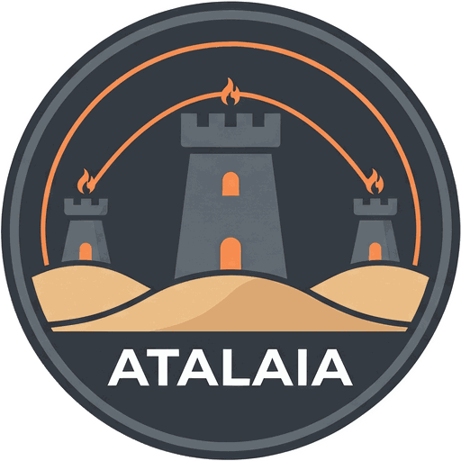
</p>

# Atalaia

[](https://github.com/vakaobr/atalaia-project/actions/workflows/ci.yml)
[](https://github.com/vakaobr/atalaia-project/actions/workflows/pages.yml)
[](LICENSING.md)
[](https://reuse.software/)
[](#roadmap)
[](https://github.com/vakaobr/atalaia-project/discussions)

**The open force-on-force platform.** Project page: [Português](https://atalaia-project.link/) · [English](https://atalaia-project.link/en/)

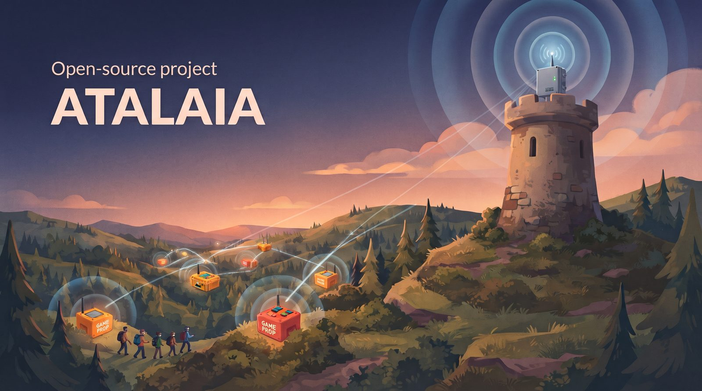

Atalaia is an open, local-first platform for airsoft, paintball and milsim game props. Build a domination box from a €20 microcontroller, turn an old Android phone into a hacking terminal, run a 20-box weekend milsim on a LoRa mesh, and write your own game modes as small scripts. No cloud required, no vendor lock-in.

*Atalaia* is Portuguese for "watchtower" ([why that name?](#name)).

> **Status: pre-alpha.** Nothing here is ready for the field yet. The software has gone ahead of the hardware:
>
> - Phase 0 (foundations) is complete.
> - Phases 1 and 2 are done in software; real Heltec V4.3 boards already play whole games with the field controller on the bench. The gates wait for built boxes and field tests.
> - Phase 3 (Android and players) is done in software, the iOS app included (it has passed its checklist on an iPhone); no real phone or I/O pod has been in a field yet.
> - Phases 4 and 5: every software step is built; they wait for hardware, a real server and the registry's repository.
>
> The [roadmap](#roadmap) below and the [roadmap page](https://atalaia-project.link/en/roadmap/) list what is done and what is next, phase by phase. Ideas, reviews and early contributors are very welcome.

---

## What it looks like

The eight captures below show the real Field Box firmware (ESP32, LVGL 9.2, 320×240 TFT) running in the Wokwi emulator. The box UI is in English. Not yet tested on physical hardware.

<table>
<tr>
<td align="center">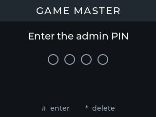<br><em>Admin PIN entry</em></td>
<td align="center">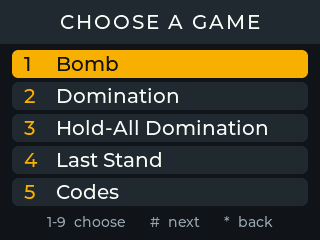<br><em>Pick a game mode</em></td>
<td align="center">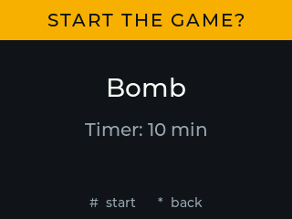<br><em>Confirm and start</em></td>
</tr>
<tr>
<td align="center">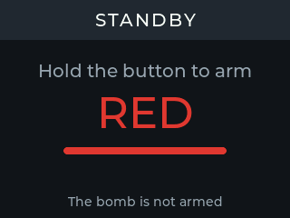<br><em>Waiting for red team to arm</em></td>
<td align="center">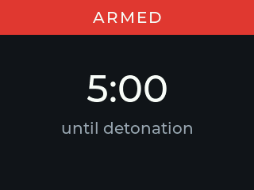<br><em>Bomb armed, 5-minute fuse</em></td>
<td align="center">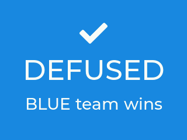<br><em>Blue defused in time</em></td>
</tr>
<tr>
<td align="center">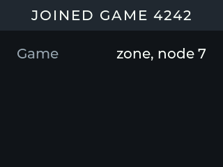<br><em>Joined a field game</em></td>
<td align="center">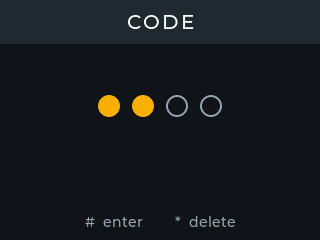<br><em>Typing a code (Codes modifier)</em></td>
<td align="center"><br><em><a href="hardware/field-box/BUILD.md">Build manual</a> wiring diagram</em></td>
</tr>
</table>

A mode's screens change as its game goes on. The animation below is drawn by the firmware's own screen code, the big screen and the small OLED: in Domination a zone nobody holds, red claiming it by holding its button, its points counting up, blue taking it over, and the final score. [The modes page](https://atalaia-project.link/en/modes/) has one for thirteen modes, in Portuguese, English, German and Traditional Chinese (`python3 tools/gen_mode_gifs.py` makes them).

<p align="center"></p>

The Android app (phase 3, in Portuguese here) draws the same mode screens from the same YAML files. These are its test images, not photos of a phone: nothing has run on a real phone yet.

<table>
<tr>
<td align="center">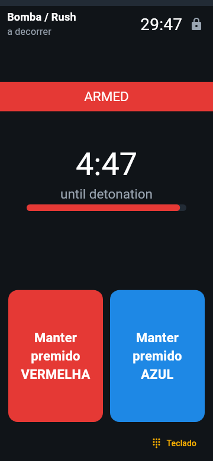<br><em>A phone as the bomb</em></td>
<td align="center"><br><em>Following the game</em></td>
<td align="center">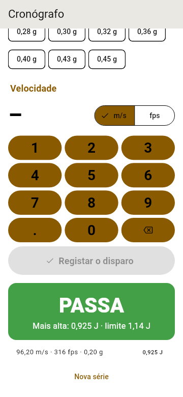<br><em>Chrono check-in</em></td>
</tr>
</table>

---

## Why Atalaia

Electronic game props add a lot to a game, but commercial systems keep the rules locked inside closed firmware. Every new game mode waits on the vendor, there is no public API, and you cannot add your own hardware.

Atalaia takes a different approach:

- **Local-first.** Every game runs fully offline, from a single house to a multi-kilometre forest. The internet is optional.
- **Any hardware.** ESP32 boards, Raspberry Pi, Arduino-class boards and new or repurposed Android phones all work in the same game.
- **Game modes are scripts.** Modes are short Lua scripts with a settings file. Change or share a mode without reflashing anything.
- **Open protocol and API.** Props talk over the documented **Skirmesh-RF** protocol, and the field controller exposes MQTT, REST and WebSocket APIs for scoreboards, overlays and your own tools.
- **Built for players and fields.** A player app with roles (player, squad leader, VIP, marshal, GM), squads, custom scenarios, and a chrono registry with spot checks to catch power changes after check-in.
- **Copyleft.** Anyone can use Atalaia, including fields that charge entry fees and makers who sell boxes. Anyone who distributes or hosts a modified version must share their changes.

## How it fits together

```
                 Site server (optional)
           accounts · history · player app · chrono
                         │ internet
 GM & player apps ── Field controller ── Scoreboards, ATAK, webhooks
     (Wi-Fi)        Raspberry Pi / Android      (MQTT, REST)
                         │
                 Skirmesh-RF (LoRa mesh)
       ┌──────────┬──────┴──────┬──────────────┐
   Field Box   Satellite   Android prop     Thin node
    (ESP32)     (ESP32)    (+ ESP32 pod)    (Arduino)
```

Every full node runs the same C11 core and the same Lua game modes; only the platform shell and hardware drivers differ. The complete design is in the [design specification](docs/design-spec.md).

## How the radio works

The props talk over LoRa, a long-range, low-power radio, in Atalaia's own protocol, Skirmesh-RF. None of it has been on a real field yet: range and timing will be measured in the phase 2 field test.

**What LoRa can do.** LoRa trades speed for reach: it gets short messages across a field on very little battery, and its signal gets through walls and trees better than Wi-Fi does, although concrete, metal and hills still block it. A box that cannot reach the controller is heard through the other boxes, and European rules limit how much of the time each device may transmit.


**Which channel, and why 869.525 MHz.** All of a game's traffic shares one channel. The default, 869.525 MHz, is the centre of 869.4–869.65 MHz, the only part of the European 868 MHz band where a device may transmit up to 10% of the time at up to 500 mW (ERP). Elsewhere in 868–870 MHz the rules allow 1% of the time (0.1% on 868.7–869.2 MHz) at 25 mW: about a tenth of the airtime, and much less range. 868.1, 868.3 and 868.5 MHz are LoRaWAN's default channels and often busy. The default is shared too: LoRaWAN gateways send some replies on 869.525 MHz, and Meshtastic's European default is the same frequency; nobody's packets are mistaken for anyone else's, but everyone nearby shares the airtime. So the GM chooses the field's channel in the GM console: keep 869.525 MHz, let the controller's USB modem listen to every legal channel for about a minute and suggest the quietest, draw one at random, or pick one by hand. The boxes and the modem then follow that channel's own power and duty-cycle limits, and a channel must fit inside one sub-band as a whole. Sources and details: [RFC 0001 Amendment 3](docs/rfcs/0001-skirmesh-rf-wire-format.md) (ERC Recommendation 70-03 Annex 1, ETSI EN 300 220-2, LoRaWAN Regional Parameters) and [controller/README.md](controller/README.md#the-fields-radio-channel).

**Radio regions: Europe and Taiwan.** A field is in one radio region, chosen once in the GM console (`[radio] region`). In Taiwan (AS923, 920–925 MHz) the NCC's rules (LP0002 5.8.1) give a single channel that does not hop full power only if it is at least 500 kHz wide, so there the boxes use LoRa SF9 at 500 kHz (about the range of SF7 at 125 kHz), at most 0.5 W at the antenna, and 921.5 MHz by default. Every box, USB radio modem and I/O pod is built for one region (`docker_fw.py build --region=as923-tw`) and refuses the other regions' channels and joins. The Taiwanese region is in software and host tests only: not tested on air, and not certified (a product sold in Taiwan needs NCC type approval and an antenna made for 920 MHz). Details: [RFC 0001 Amendment 12](docs/rfcs/0001-skirmesh-rf-wire-format.md), decisions RF-AS923-1 to -14.

**One protocol on every device.** Skirmesh-RF is built in layers, from the radio up to the controller's API. A Field Box runs everything up to the game modes; a Raspberry Pi controller leaves the radio work to a USB radio modem; in phase 3 an Android phone does the same with an I/O pod, whose firmware is the USB modem's radio code. Phones on the field's Wi-Fi need no LoRa radio at all. The wire format is [RFC 0001](docs/rfcs/0001-skirmesh-rf-wire-format.md).

![Skirmesh-RF on different devices: five layers from the bottom up (the LoRa radio on one shared channel; the encrypted Skirmesh-RF packet with anti-replay, hop limit, ACKs, TIME beacons and CLAIM failover; the eight message types in CBOR; the shared C core and Lua modes; the controller's APIs, GM console, scoreboard and join codes), and which layers each device runs. Built and tested in software: the Field Box (1 to 4), the USB radio modem (1 and 2), the field controller (2 to 5) and the GM console on phones over Wi-Fi (5). Built in software for phase 3 too: the I/O pod (1 and 2) and the Android device (2 to 4). Planned: the satellite box (1 to 4).](site/img/diagrams/skirmesh-wide-en.svg)

The diagrams are built in English and Portuguese, for wide and narrow screens, from [`site/src/diagrams/`](site/src/diagrams/) by `tools/build_site.py`; the project page's radio page shows them in your language ([Português](https://atalaia-project.link/radio/) · [English](https://atalaia-project.link/en/radio/)).

## Repository layout

| Folder | What lives there | Licence |
| --- | --- | --- |
| [`core/`](core/) | Shared C11 core: event bus, state store, Lua sandbox, protocol codec | GPL-3.0-or-later |
| [`protocol/`](protocol/) | Skirmesh-RF message and event schemas; [usb-modem.md](protocol/usb-modem.md) (modem framing); [join.md](protocol/join.md) (join payload) | GPL-3.0-or-later |
| [`modes/`](modes/) | Built-in game modes (Lua + manifest) | GPL-3.0-or-later |
| [`firmware/`](firmware/) | ESP32 firmware (ESP-IDF) and Arduino thin-node firmware | GPL-3.0-or-later |
| [`app/`](app/) | Flutter app: props and the phone controller (Android), player, marshal and GM roles (Android; iOS too: its checklist passed on an iPhone on 2026-10-26: [guide](app/docs/ios-on-a-mac.md)) | GPL-3.0-or-later + app-store permission |
| [`controller/`](controller/) | Field controller (`atalaia_controller`) and GM console ([`controller/console/`](controller/console/), served at `/console/`) | AGPL-3.0-or-later |
| [`server/`](server/) | Optional site server | AGPL-3.0-or-later |
| [`simulator/`](simulator/) | Desktop simulator with virtual nodes and a web view; the mode editor (blocks to Lua) at `/editor/` | GPL-3.0-or-later |
| [`examples/scoreboard/`](examples/scoreboard/) | MQTT subscriber scoreboard example | GPL-3.0-or-later |
| [`hardware/`](hardware/) | Reference builds: wiring, bills of materials, enclosures; the Field Box build manual ([hardware/field-box/BUILD.md](hardware/field-box/BUILD.md)) and the build guides of the Satellite, the I/O pod and the target addon | CERN-OHL-S-2.0 |
| [`docs/`](docs/) | Design spec, RFCs, phase folders, guides | CC-BY-SA-4.0 |
| [`site/`](site/) | The project page in Portuguese, English, German and Traditional Chinese, published to [GitHub Pages](https://atalaia-project.link/) | CC-BY-SA-4.0 |
| [`tools/`](tools/) | Developer scripts: `check.sh`, `docker_fw.py`, `docker_console.py`, `docker_editor.py`, `docker_server.py`, `docker_sim.py`, `build_site.py`, `docker_hw.py` | GPL-3.0-or-later |

See [LICENSING.md](LICENSING.md) for the details.

## Roadmap

| Phase | Focus | Status | Done when |
| --- | --- | --- | --- |
| [0 · Foundations](https://atalaia-project.link/en/roadmap/#phase-0) | Shared core, Lua sandbox, Skirmesh-RF codec, browser simulator | Done | The simulator runs Domination and Bomb from Lua scripts |
| [1 · Single box](https://atalaia-project.link/en/roadmap/#phase-1) · [status](docs/phase-1-single-box/STATUS.md) | Field Box firmware and build manual | Software done; a real board plays whole games on the bench | One box runs a 2-hour club game with no restarts |
| [2 · Field network](https://atalaia-project.link/en/roadmap/#phase-2) · [status](docs/phase-2-field-network/STATUS.md) | Skirmesh-RF over LoRa, field controller, GM console, mode pack | Software done; two bench boards play with the controller; boxes listen before they talk (simulator: 89 % of updates heard at 20 boxes, from 65 %) | 5 boxes on a CQB site and an outdoor field, zero lost captures |
| [3 · Android and players](https://atalaia-project.link/en/roadmap/#phase-3) · [status](docs/phase-3-android-players/STATUS.md) | Android props, I/O pod, player app, modes that need phones | Software done, iOS checked on an iPhone; no real phone or pod in the field yet | One game mixes ESP32 and Android props without issues |
| [4 · Site server and advanced play](https://atalaia-project.link/en/roadmap/#phase-4) · [status](docs/phase-4-site-server/STATUS.md) | Site server, custom scenarios, advanced modes, ATAK | Software done; no real server or hardware yet | A weekend milsim runs on Atalaia end to end |
| [5 · Community](https://atalaia-project.link/en/roadmap/#phase-5) · [status](docs/phase-5-community/STATUS.md) | Mode editor and registry, translations, build guides, carrier PCB | Software done; the registry repository and the hardware are left | Ongoing |

What each phase has done, what is next and what it waits for is on the [roadmap page](https://atalaia-project.link/en/roadmap/), as short lists, and in each phase's `STATUS.md`.

## Getting started

**Run the simulator** (no hardware needed). Build the core and run its tests and every mode's tests:

```sh
sh tools/check.sh
```

You need a C11 compiler, CMake 3.16 or newer, Python 3.10 or newer and PyYAML. No compiler? Use the [dev container](tools/README.md). To play a mode in your browser, holding team buttons and watching the props' screens and the event log, see the [simulator](simulator/README.md#play-a-mode-in-the-browser). To write a mode, start with [modes/README.md](modes/README.md).

**Build the Field Box firmware** (cross-compiles in Docker, no toolchain needed locally; works from `cmd`, PowerShell or bash):

```sh
python tools/docker_fw.py build    # the firmware, in firmware/esp32/build/
python tools/docker_fw.py test     # its host tests and screen reference images
python tools/docker_fw.py wokwi    # the variant for the Wokwi emulator
```

**Run the field controller and its GM console** on a laptop, without a radio, in the dev container (see [controller/README.md](controller/README.md#running-it)): the console is at `http://localhost:8080/console/` and the scoreboard at `/scoreboard`. The console's browser tests run with `python tools/docker_console.py`.

**Run the site server's tests** (its skeleton, accounts, personal data rights, the controller sync, the chrono registry, scheduling with the public field pages and feeds, registration with the game-day roster, and the registration import with platform adapters exist so far, the sync tested end to end against the real controller) against a throwaway PostgreSQL 16 in Docker: `python3 tools/docker_server.py test`, `python3 tools/docker_server.py migrations`, `python3 tools/docker_server.py deploy` (the deployment behind Caddy) and `python3 tools/docker_server.py browser` (the staff pages in headless Chromium); `up` and `down` start and stop a local trial. See [server/README.md](server/README.md).

To play a game on an emulated Field Box in VS Code before any hardware exists, see [firmware/esp32/docs/WOKWI.md](firmware/esp32/docs/WOKWI.md). See [firmware/esp32/README.md](firmware/esp32/README.md) for the full build guide, Kconfig options, pin table, and bring-up checklist.

## Contributing

Atalaia is built by players, field owners and makers. You can help by:

- asking questions and sharing ideas in [Discussions](https://github.com/vakaobr/atalaia-project/discussions),
- reviewing the [design specification](docs/design-spec.md) and opening issues,
- proposing game modes with the **Game mode idea** issue template,
- writing code for any phase-0 task,
- sharing how your field plays, so the defaults fit real games.

Please read [CONTRIBUTING.md](CONTRIBUTING.md) first. Every commit needs a `Signed-off-by` line (`git commit -s`), and we follow a strict clean-room policy: no code, firmware, manuals, sounds or images from any commercial product.

## Safety

Atalaia props are game equipment. Make them look like game props: bright colours, clear "GAME PROP" labels, and nothing resembling a real explosive device. Transport them in labelled cases, never leave them unattended outside the field, and treat lithium batteries with care. The [design specification](docs/design-spec.md) covers field safety and radio regulations in more detail.

## Name

An *atalaia* (say "ah-tah-LYE-ah") is a watchtower: a lookout post on a hill or a stretch of coast whose crew watched for trouble and passed the warning along. The word came into Portuguese from the Arabic *aṭ-ṭalāʾiʿ*, "the scouts" or "the vanguard", and *estar de atalaia* still means "to be on the lookout". Atalaias are scattered across Portugal's coast and countryside, and several towns carry the name.

It turned out to be an accurate name for this project:

- **A field controller is a watchtower.** It sits somewhere high, sees every prop on the field, and tells the GM the moment something changes.
- **Watchtowers were local-first.** No tower ever waited for a cloud service. They worked with what was in sight.
- **They also ran the original low-bandwidth mesh.** Smoke by day, fire by night, relayed from tower to tower: tiny messages, long range, very little airtime, a limited number of hops, and nobody streaming video. Skirmesh-RF follows the same rules with LoRa and fewer burnt eyebrows.
- **The Arabic root means "the scouts".** That's a reasonable description of anyone who has ever played milsim.
- **It's a real word, not a product name.** Portuguese speakers can say it without trying, and everyone else gets to learn one new word.

Forks are welcome under the licence, but please give your fork its own name so players can tell it apart from the original project. Every watchtower needs its own hill.

## Licence

Atalaia is free software. The core, firmware, app and modes are licensed under the [GNU GPL v3 or later](LICENSES/GPL-3.0-or-later.txt); the field controller and site server under the [GNU AGPL v3 or later](LICENSES/AGPL-3.0-or-later.txt); hardware designs under [CERN-OHL-S-2.0](LICENSES/CERN-OHL-S-2.0.txt); documentation under [CC BY-SA 4.0](LICENSES/CC-BY-SA-4.0.txt). See [LICENSING.md](LICENSING.md).
