<p align="center">
  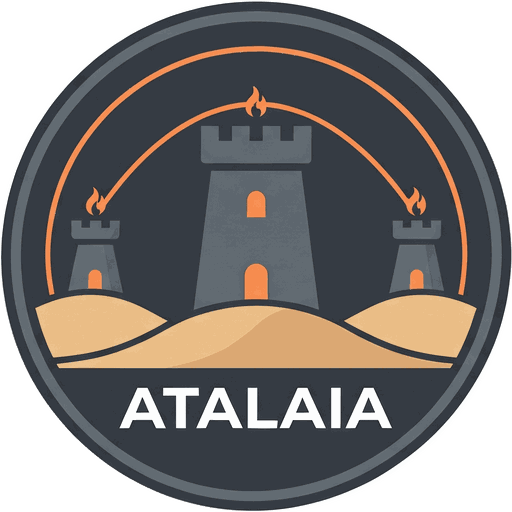
</p>

# Atalaia

[](https://github.com/vakaobr/atalaia-project/actions/workflows/ci.yml)
[](https://github.com/vakaobr/atalaia-project/actions/workflows/pages.yml)
[](LICENSING.md)
[](https://reuse.software/)
[](#roadmap)
[](https://github.com/vakaobr/atalaia-project/discussions)

**The open force-on-force platform.** Project page: [Português](https://atalaia-project.link/) · [English](https://atalaia-project.link/en/)

**Manuals** for the people who use it (players, game masters, marshals, box operators): [English](docs/manuals/en/quick-start.md) · [Português](docs/manuals/pt/quick-start.md) · [all manuals](docs/manuals/README.md)

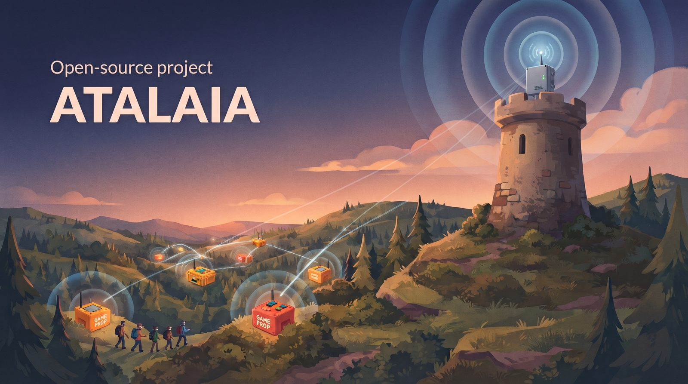

Atalaia is an open, local-first platform for airsoft, paintball and milsim game props. Build a domination box from a €20 microcontroller, turn an old Android phone into a hacking terminal, run a 20-box weekend milsim on a LoRa mesh, and write your own game modes as small scripts. No cloud required, no vendor lock-in.

*Atalaia* is Portuguese for "watchtower" ([why that name?](#name)).

> **Status: pre-alpha.** Nothing here is ready for the field yet. The software has gone ahead of the hardware.
>
> - **Phase 0, foundations:** complete.
> - **Phases 1 and 2, the Field Box and the field network:** done in software; real Heltec V4.3 boards play whole games with the field controller on the bench, not yet on a field.
> - **Phase 3, Android and players:** done in software; the iOS app has passed its checklist on an iPhone; no phone or I/O pod has been on a field yet.
> - **Phase 4, the site server:** built; it runs on the test server and as a read-only [demo](https://demo.atalaia-project.link/), not yet at a real field.
> - **Phase 5, community:** the mode editor, the [mode registry](https://vakaobr.github.io/atalaia-modes/), the manuals and the expansion port's modules are built in software; the hardware and the registry's signing key are left.
>
> The newest release is **v0.10.0** (2026-11-07). The [roadmap](#roadmap) below, the [roadmap page](https://atalaia-project.link/en/roadmap/) and each phase's `STATUS.md` say what is done and what is next. Ideas, reviews and early contributors are very welcome.

---

## What it looks like

The eight captures below show the real Field Box firmware (ESP32, LVGL 9.2, 320×240 TFT) running in the Wokwi emulator. The box's screens are in English, Portuguese, German and Traditional Chinese; these are the English ones. The same firmware runs on real boards on the bench (photos and a clip on the [build page](https://atalaia-project.link/en/build-guides/)).

<table>
<tr>
<td align="center">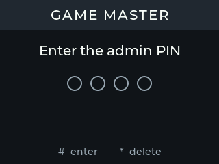<br><em>Admin PIN entry</em></td>
<td align="center">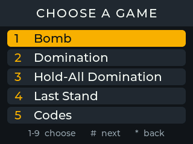<br><em>Pick a game mode</em></td>
<td align="center">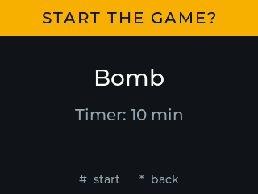<br><em>Confirm and start</em></td>
</tr>
<tr>
<td align="center">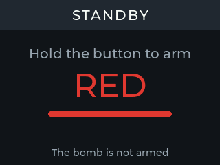<br><em>Waiting for red team to arm</em></td>
<td align="center">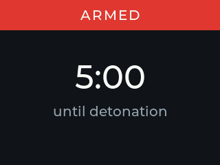<br><em>Bomb armed, 5-minute fuse</em></td>
<td align="center">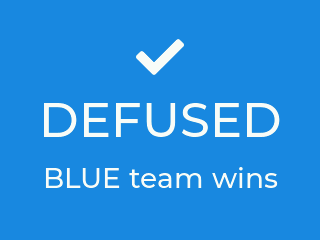<br><em>Blue defused in time</em></td>
</tr>
<tr>
<td align="center">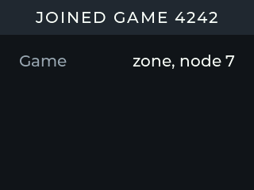<br><em>Joined a field game</em></td>
<td align="center">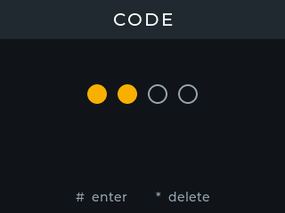<br><em>Typing a code (Codes modifier)</em></td>
<td align="center">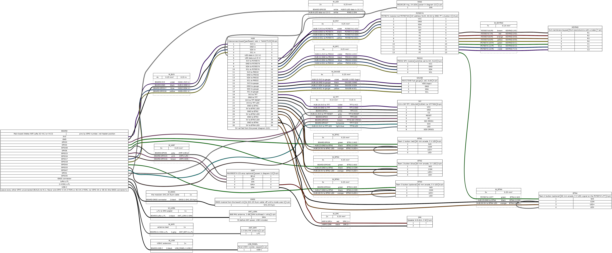<br><em><a href="hardware/field-box/BUILD.md">Build manual</a> wiring diagram</em></td>
</tr>
</table>

A mode's screens change as its game goes on. The animation below is drawn by the firmware's own screen code, the big screen and the small OLED: in Domination a zone nobody holds, red claiming it by holding its button, its points counting up, blue taking it over, and the final score. [The modes page](https://atalaia-project.link/en/modes/) has one for thirteen modes, in Portuguese, English, German and Traditional Chinese (`python3 tools/gen_mode_gifs.py` makes them).

<p align="center">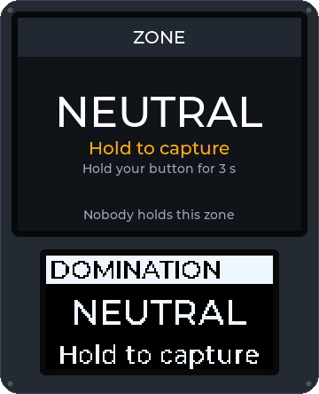</p>

The Android app (phase 3, in Portuguese here) draws the same mode screens from the same YAML files. These are its test images, not photos of a phone. The iOS app has passed its checklist on an iPhone, but no phone has been used on a field yet.

<table>
<tr>
<td align="center">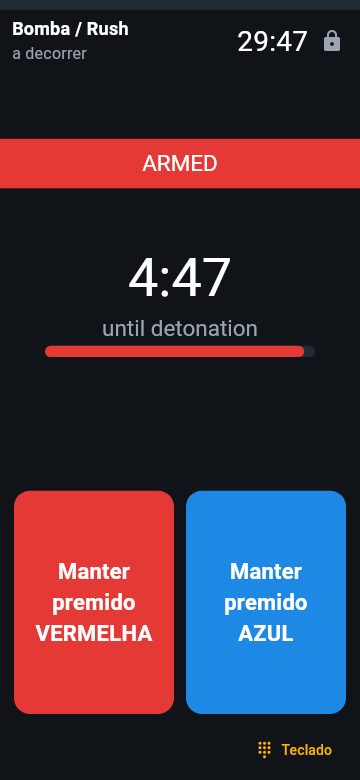<br><em>A phone as the bomb</em></td>
<td align="center">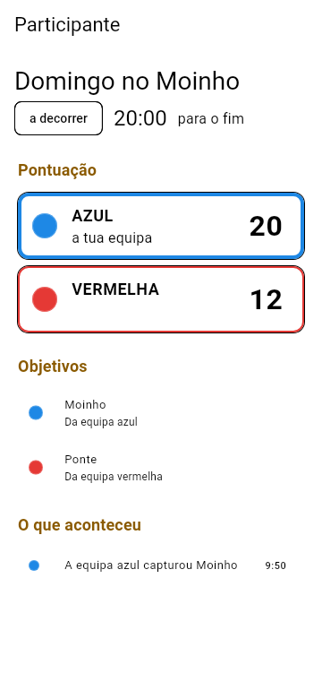<br><em>Following the game</em></td>
<td align="center">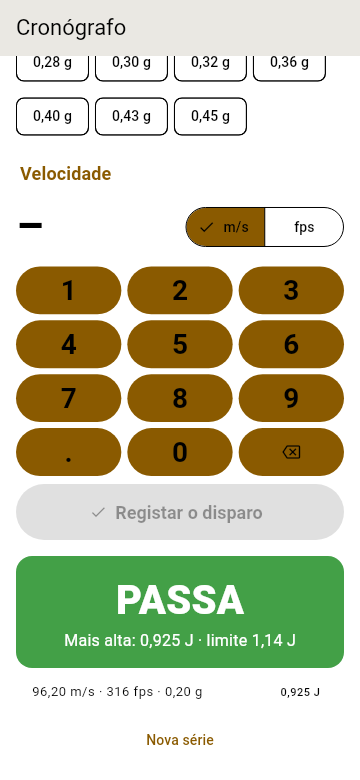<br><em>Chrono check-in</em></td>
</tr>
</table>

---

## Why Atalaia

Electronic game props add a lot to a game, but commercial systems keep the rules locked inside closed firmware. Every new game mode waits on the vendor, there is no public API, and you cannot add your own hardware.

Atalaia takes a different approach:

- **Local-first.** Every game runs fully offline, from a single house to a multi-kilometre forest. The internet is optional.
- **Any hardware.** ESP32 boards, Raspberry Pi, Arduino-class boards and new or repurposed Android phones all work in the same game.
- **Game modes are scripts.** Modes are short Lua scripts with a settings file. Change or share a mode without reflashing anything.
- **Open protocol and API.** Props talk over the documented **Skirmesh-RF** protocol, and the field controller exposes MQTT, REST and WebSocket APIs for scoreboards, overlays and your own tools.
- **Built for players and fields.** A player app with roles (player, squad leader, VIP, marshal, GM), squads, custom scenarios, and a chrono registry with spot checks to catch power changes after check-in.
- **Copyleft.** Anyone can use Atalaia, including fields that charge entry fees and makers who sell boxes. Anyone who distributes or hosts a modified version must share their changes.

## How it fits together

```
                 Site server (optional)
           accounts · history · player app · chrono
                         │ internet
 GM & player apps ── Field controller ── Scoreboards, ATAK, webhooks
     (Wi-Fi)        Raspberry Pi / Android      (MQTT, REST)
                         │
                 Skirmesh-RF (LoRa mesh)
       ┌──────────┬──────┴──────┬──────────────┐
   Field Box   Satellite   Android prop     Thin node
    (ESP32)     (ESP32)    (+ ESP32 pod)    (Arduino)
```

Every full node runs the same C11 core and the same Lua game modes; only the platform shell and hardware drivers differ. The complete design is in the [design specification](docs/design-spec.md), and [how the parts talk to each other](docs/architecture.md) is shown in diagrams.

## How the radio works

The props talk over LoRa, a long-range, low-power radio, in Atalaia's own protocol, Skirmesh-RF. None of it has been on a real field yet: range and timing will be measured in the phase 2 field test.

**What LoRa can do.** LoRa trades speed for reach: it gets short messages across a field on very little battery, and its signal gets through walls and trees better than Wi-Fi does, although concrete, metal and hills still block it. A box that cannot reach the controller is heard through the other boxes, and European rules limit how much of the time each device may transmit.


**Which channel, and why 869.525 MHz.** All of a game's traffic shares one channel. The default, 869.525 MHz, is the centre of 869.4–869.65 MHz, the only part of the European 868 MHz band where a device may transmit up to 10% of the time at up to 500 mW (ERP). Elsewhere in 868–870 MHz the rules allow 1% of the time (0.1% on 868.7–869.2 MHz) at 25 mW: about a tenth of the airtime, and much less range. 868.1, 868.3 and 868.5 MHz are LoRaWAN's default channels and often busy. The default is shared too: LoRaWAN gateways send some replies on 869.525 MHz, and Meshtastic's European default is the same frequency; nobody's packets are mistaken for anyone else's, but everyone nearby shares the airtime. So the GM chooses the field's channel in the GM console: keep 869.525 MHz, let the controller's USB modem listen to the legal channels (about 60 seconds in all) and suggest the quietest, draw one at random, or pick one by hand. When the GM changes the channel, the controller tells the free boxes three times on the old channel where it went; a box that is off or out of range then misses it, and has to be found with **Look for boxes** or adopted again. The boxes and the modem then follow that channel's own power and duty-cycle limits, and a channel must fit inside one sub-band as a whole. Sources and details: [RFC 0001 Amendment 3](docs/rfcs/0001-skirmesh-rf-wire-format.md) (ERC Recommendation 70-03 Annex 1, ETSI EN 300 220-2, LoRaWAN Regional Parameters) and [controller/README.md](controller/README.md#the-fields-radio-channel).

**Radio regions: Europe and Taiwan.** A field is in one radio region, chosen once in the GM console (`[radio] region`). In Taiwan (AS923, 920–925 MHz) the NCC's rules (LP0002 5.8.1) give a single channel that does not hop full power only if it is at least 500 kHz wide, so there the boxes use LoRa SF9 at 500 kHz (about the range of SF7 at 125 kHz), at most 0.5 W at the antenna, and 921.5 MHz by default. Every box, USB radio modem and I/O pod is built for one region (`docker_fw.py build --region=as923-tw`) and refuses the other regions' channels and joins. The Taiwanese region is in software and host tests only: not tested on air, and not certified (a product sold in Taiwan needs NCC type approval and an antenna made for 920 MHz). Details: [RFC 0001 Amendment 12](docs/rfcs/0001-skirmesh-rf-wire-format.md), decisions RF-AS923-1 to -14.

**One protocol on every device.** Skirmesh-RF is built in layers, from the radio up to the controller's API. A Field Box runs everything up to the game modes; a Raspberry Pi controller leaves the radio work to a USB radio modem; in phase 3 an Android phone does the same with an I/O pod, whose firmware is the USB modem's radio code. Phones on the field's Wi-Fi need no LoRa radio at all. The wire format is [RFC 0001](docs/rfcs/0001-skirmesh-rf-wire-format.md).

![Skirmesh-RF on different devices: five layers from the bottom up (the LoRa radio on one shared channel; the encrypted Skirmesh-RF packet with anti-replay, hop limit, ACKs, TIME beacons and CLAIM failover; the eight message types in CBOR; the shared C core and Lua modes; the controller's APIs, GM console, scoreboard and join codes), and which layers each device runs. Built and tested in software: the Field Box (1 to 4), the USB radio modem (1 and 2), the field controller (2 to 5) and the GM console on phones over Wi-Fi (5). Built in software for phase 3 too: the I/O pod (1 and 2) and the Android device (2 to 4). Planned: the satellite box (1 to 4).](site/img/diagrams/skirmesh-wide-en.svg)

The diagrams are built in English and Portuguese, for wide and narrow screens, from [`site/src/diagrams/`](site/src/diagrams/) by `tools/build_site.py`; the project page's radio page shows them in your language ([Português](https://atalaia-project.link/radio/) · [English](https://atalaia-project.link/en/radio/)).

## Repository layout

| Folder | What lives there | Licence |
| --- | --- | --- |
| [`core/`](core/) | Shared C11 core: event bus, state store, Lua sandbox, protocol codec | GPL-3.0-or-later |
| [`protocol/`](protocol/) | Skirmesh-RF message and event schemas; [usb-modem.md](protocol/usb-modem.md) (modem framing); [join.md](protocol/join.md) (join payload) | GPL-3.0-or-later |
| [`modes/`](modes/) | Built-in game modes (Lua + manifest) | GPL-3.0-or-later |
| [`firmware/`](firmware/) | ESP32 firmware (ESP-IDF), Arduino thin-node firmware, and the expansion port's RP2040 modules (pico-sdk): the [target module](firmware/target-module/README.md) and the [I2C output module](firmware/output-module/README.md) on a shared [module core](firmware/module-core/README.md) | GPL-3.0-or-later |
| [`app/`](app/) | Flutter app: props and the phone controller (Android), player, marshal and GM roles (Android; iOS too: its checklist passed on an iPhone on 2026-10-26: [guide](app/docs/ios-on-a-mac.md)) | GPL-3.0-or-later + app-store permission |
| [`controller/`](controller/) | Field controller (`atalaia_controller`) and GM console ([`controller/console/`](controller/console/), served at `/console/`) | AGPL-3.0-or-later |
| [`server/`](server/) | Optional site server | AGPL-3.0-or-later |
| [`simulator/`](simulator/) | Desktop simulator with virtual nodes and a web view; the mode editor (blocks to Lua) at `/editor/` | GPL-3.0-or-later |
| [`examples/scoreboard/`](examples/scoreboard/) | MQTT subscriber scoreboard example | GPL-3.0-or-later |
| [`hardware/`](hardware/) | Reference builds: wiring, bills of materials, enclosures; the Field Box build manual ([hardware/field-box/BUILD.md](hardware/field-box/BUILD.md)) and the build guides of the Satellite, the I/O pod, the expansion port ([hardware/expansion-port/BUILD.md](hardware/expansion-port/BUILD.md)), the target addon ([hardware/target-addon/BUILD.md](hardware/target-addon/BUILD.md)) and the I2C output module ([hardware/output-module/BUILD.md](hardware/output-module/BUILD.md)) | CERN-OHL-S-2.0 |
| [`docs/`](docs/) | Design spec, RFCs, phase folders, guides, [user manuals](docs/manuals/README.md) | CC-BY-SA-4.0 |
| [`site/`](site/) | The project page in Portuguese, English, German, Traditional Chinese and Polish, published to [GitHub Pages](https://atalaia-project.link/) | CC-BY-SA-4.0 |
| [`tools/`](tools/) | Developer scripts: `check.sh`, `docker_fw.py`, `docker_console.py`, `docker_editor.py`, `docker_server.py`, `docker_sim.py`, `build_site.py`, `docker_hw.py`, `docker_module.py` | GPL-3.0-or-later |

See [LICENSING.md](LICENSING.md) for the details.

## Roadmap

| Phase | Focus | Status | Done when |
| --- | --- | --- | --- |
| [0 · Foundations](https://atalaia-project.link/en/roadmap/#phase-0) | Shared core, Lua sandbox, Skirmesh-RF codec, browser simulator | Done | The simulator runs Domination and Bomb from Lua scripts |
| [1 · Single box](https://atalaia-project.link/en/roadmap/#phase-1) · [status](docs/phase-1-single-box/STATUS.md) | Field Box firmware and build manual | Software done; real boards play whole games on the bench; waits for a built box | One box runs a 2-hour club game with no restarts |
| [2 · Field network](https://atalaia-project.link/en/roadmap/#phase-2) · [status](docs/phase-2-field-network/STATUS.md) | Skirmesh-RF over LoRa, field controller, GM console, mode pack, the box's Wi-Fi setup | Software done; two bench boards play with the controller; stuck-box recovery released in v0.9.0, freed a box on the bench once; hardened in v0.10.0 | 5 boxes on a CQB site and an outdoor field, zero lost captures |
| [3 · Android and players](https://atalaia-project.link/en/roadmap/#phase-3) · [status](docs/phase-3-android-players/STATUS.md) | Android props, I/O pod, player app, modes that need phones | Software done; iOS checked on an iPhone; no phone or pod on a field yet | One game mixes ESP32 and Android props without issues |
| [4 · Site server and advanced play](https://atalaia-project.link/en/roadmap/#phase-4) · [status](docs/phase-4-site-server/STATUS.md) | Site server, custom scenarios, advanced modes, ATAK | Software done; on the test server and the live demo; no real server yet | A weekend milsim runs on Atalaia end to end |
| [5 · Community](https://atalaia-project.link/en/roadmap/#phase-5) · [status](docs/phase-5-community/STATUS.md) | Mode editor and registry, translations, build guides, carrier PCB | Software done; registry live (no modes yet); modules wait for hardware | Ongoing |

What each phase has done, what is next and what it waits for is on the [roadmap page](https://atalaia-project.link/en/roadmap/), as short lists, and in each phase's `STATUS.md`.

## Use it

**Manuals** for the people on the field (players, game masters, marshals, box operators) are in English and Portuguese: start with the quick start ([English](docs/manuals/en/quick-start.md) · [Português](docs/manuals/pt/quick-start.md)), or see [all manuals](docs/manuals/README.md).

**Get the firmware.** Ready-made images (Field Box and Satellite, the controller's USB modem, the I/O pod, and the expansion port's RP2040 modules as UF2 files) are on the [Releases page](https://github.com/vakaobr/atalaia-project/releases). The newest is [v0.10.0](https://github.com/vakaobr/atalaia-project/releases/tag/v0.10.0) (2026-11-07): pre-alpha and not field-tested. How to flash it: the [firmware guide](docs/manuals/en/firmware.md) and, for the controller's radio, the [modem guide](docs/manuals/en/modem.md). From v0.9.0 each release also carries the Android app, `atalaia-app-<version>.apk`, signed with the project's Android key (certificate SHA-256 in [the project's keys](docs/community/keys.md#the-android-app)); how to install it: the [player manual](docs/manuals/en/player.md#1-install-the-app).

> **v0.8.0 changed the release key.** The project's CI release key was rotated: v0.8.0 is signed by the new CI key (`a4f6002b0122b131`), and firmware from v0.8.0 on trusts only that key and the root key (`424d053af5cdbc35`); the old CI key `32b3c815ac30ad43` is retired. A box on v0.7.0 takes v0.8.0 over the air. A controller whose `[firmware] release_keys` lists keys by hand must drop the old key. A box on v0.6.1 or older trusts only the old key: flash it once over USB with the newest release (no erase needed), or take it through v0.7.0 over the air while the controller trusts the old key for that step only ([Field Box manual](docs/manuals/en/field-box.md#update-the-boxes)). Details: [RELEASE_SIGNING.md](firmware/esp32/docs/RELEASE_SIGNING.md) and the [project's keys](docs/community/keys.md).

**v0.10.0** hardens what v0.9.0 brought, after a review: a replayed field-wide RELEASE can no longer free a box that is still in a live game (the RELEASE now names its channel, a box that still hears its game's controller ignores it, and its time is bounded); the controller's automatic stuck-box resends keep to one air budget and wait while a game is started; a standby controller counts only the recognised leader's beacons for failover; a staff ticket scan asks the marshal before it confirms a check-in made in the player's app; the box's admin menu opens over a field game only while the game takes no keys from players (pause the game first); the release APK is built without its signing key and signed in a separate offline step; and the site server's dependencies are updated. The hardened Field Box image (secure boot v2, flash encryption) now builds and is signed in CI with a throw-away key; nothing has been burned into a board, and the released images do not change. **Update the controllers and the Field Boxes together**: a v0.9.0 box and a v0.10.0 controller, or the reverse, do not accept each other's RELEASE (until both are updated, *Leave the game* at the box, `@leave` and the controller's resend still free a stuck box). Reflash the USB radio modem with the v0.10.0 image over USB; the app installs over v0.9.0 and keeps its data. See the [release notes](https://github.com/vakaobr/atalaia-project/releases/tag/v0.10.0#upgrading-from-v090).

**v0.9.0** brought the stuck-box recovery: the controller (a Raspberry Pi or a phone) frees boxes left in a game that ended while they were off, the GM console lists them under *Stuck in an ended game* with a **Release** button, and a box can leave such a game from its admin menu. It passed its first bench test on 2026-11-06 (a box switched off mid-game, powered back on after the game ended, was freed within seconds). The controller's USB modem has no update over the air: flash the v0.9.0 modem image over USB ([modem guide](docs/manuals/en/modem.md)) for the recovery to work. `@wifi` now takes a Wi-Fi name and password with spaces in double quotes, and the box's setup page refuses a Wi-Fi name or password the box cannot use. Marshals take printed check-in tickets in the app. The app is now a release-signed APK: a phone that has a debug build (`atalaia-debug.apk`) must uninstall Atalaia once before installing it (that deletes the app's data: see the [player manual](docs/manuals/en/player.md#1-install-the-app)); later versions then install over it.

## Develop it

**Run the simulator** (no hardware needed). Build the core and run its tests and every mode's tests:

```sh
sh tools/check.sh
```

You need a C11 compiler, CMake 3.16 or newer, Python 3.10 or newer and PyYAML. No compiler? Use the [dev container](tools/README.md). To play a mode in your browser, holding team buttons and watching the props' screens and the event log, see the [simulator](simulator/README.md#play-a-mode-in-the-browser). To write a mode, start with [modes/README.md](modes/README.md).

**Build the Field Box firmware** (cross-compiles in Docker, no toolchain needed locally; works from `cmd`, PowerShell or bash):

```sh
python tools/docker_fw.py build    # the firmware, in firmware/esp32/build/
python tools/docker_fw.py test     # its host tests and screen reference images
python tools/docker_fw.py wokwi    # the variant for the Wokwi emulator
```

To play a game on an emulated Field Box in VS Code, see [firmware/esp32/docs/WOKWI.md](firmware/esp32/docs/WOKWI.md). The full build guide, Kconfig options, pin table and bring-up checklist are in [firmware/esp32/README.md](firmware/esp32/README.md).

**Run the field controller and its GM console** on a laptop, without a radio, in the dev container (see [controller/README.md](controller/README.md#running-it)): the console is at `http://localhost:8080/console/` and the scoreboard at `/scoreboard`. The console's browser tests run with `python tools/docker_console.py`.

**Run the site server's tests** against a throwaway PostgreSQL 16 in Docker: `python3 tools/docker_server.py test`, `migrations`, `deploy` (the deployment behind Caddy) and `browser` (the staff pages in headless Chromium); `up` and `down` start and stop a local trial. See [server/README.md](server/README.md).

**Build the app**: see the [app guide](app/README.md) and, for an iPhone, the [iOS guide](app/docs/ios-on-a-mac.md).

## Contributing

Atalaia is built by players, field owners and makers. You can help by:

- asking questions and sharing ideas in [Discussions](https://github.com/vakaobr/atalaia-project/discussions),
- reviewing the [design specification](docs/design-spec.md) and opening issues,
- proposing game modes with the **Game mode idea** issue template,
- picking up an open issue, or a task from a phase's `STATUS.md`,
- sharing how your field plays, so the defaults fit real games.

Please read [CONTRIBUTING.md](CONTRIBUTING.md) first. Every commit needs a `Signed-off-by` line (`git commit -s`), and we follow a strict clean-room policy: no code, firmware, manuals, sounds or images from any commercial product.

## Safety

Atalaia props are game equipment. Make them look like game props: bright colours, clear "GAME PROP" labels, and nothing resembling a real explosive device. Transport them in labelled cases, never leave them unattended outside the field, and treat lithium batteries with care. The [design specification](docs/design-spec.md) covers field safety and radio regulations in more detail.

## Name

An *atalaia* (say "ah-tah-LYE-ah") is a watchtower: a lookout post on a hill or a stretch of coast whose crew watched for trouble and passed the warning along. The word came into Portuguese from the Arabic *aṭ-ṭalāʾiʿ*, "the scouts" or "the vanguard", and *estar de atalaia* still means "to be on the lookout". Atalaias are scattered across Portugal's coast and countryside, and several towns carry the name.

It turned out to be an accurate name for this project:

- **A field controller is a watchtower.** It sits somewhere high, sees every prop on the field, and tells the GM the moment something changes.
- **Watchtowers were local-first.** No tower ever waited for a cloud service. They worked with what was in sight.
- **They also ran the original low-bandwidth mesh.** Smoke by day, fire by night, relayed from tower to tower: tiny messages, long range, very little airtime, a limited number of hops, and nobody streaming video. Skirmesh-RF follows the same rules with LoRa and fewer burnt eyebrows.
- **The Arabic root means "the scouts".** That's a reasonable description of anyone who has ever played milsim.
- **It's a real word, not a product name.** Portuguese speakers can say it without trying, and everyone else gets to learn one new word.

Forks are welcome under the licence, but please give your fork its own name so players can tell it apart from the original project. Every watchtower needs its own hill.

## Licence

Atalaia is free software. The core, firmware, app and modes are licensed under the [GNU GPL v3 or later](LICENSES/GPL-3.0-or-later.txt); the field controller and site server under the [GNU AGPL v3 or later](LICENSES/AGPL-3.0-or-later.txt); hardware designs under [CERN-OHL-S-2.0](LICENSES/CERN-OHL-S-2.0.txt); documentation under [CC BY-SA 4.0](LICENSES/CC-BY-SA-4.0.txt). See [LICENSING.md](LICENSING.md).
