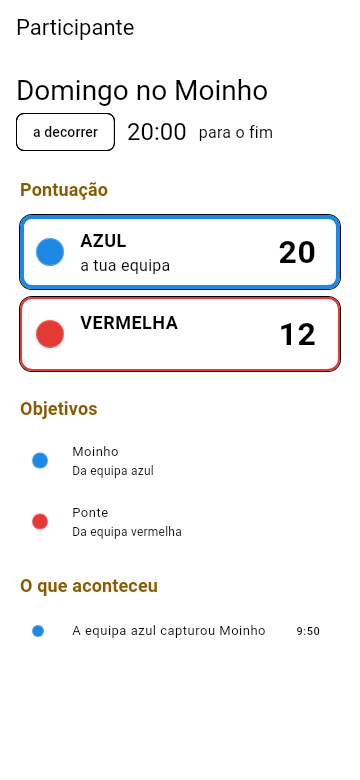
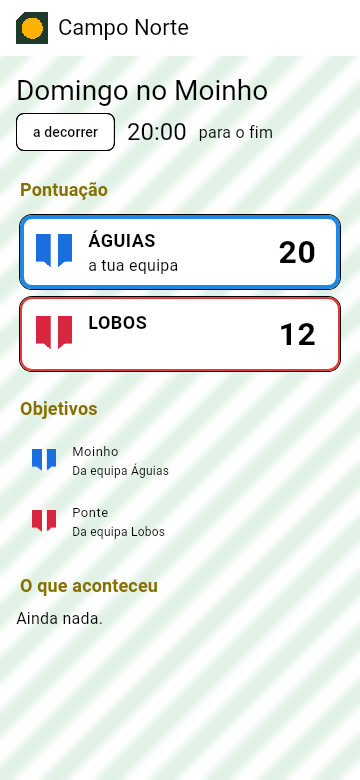
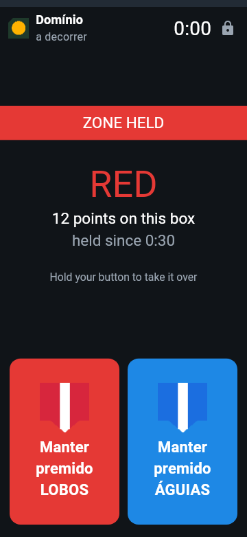

<!--
SPDX-FileCopyrightText: 2026 The Atalaia contributors
SPDX-License-Identifier: GPL-3.0-or-later
-->

# Atalaia app

One Flutter app for Android and iOS.

| Role | Platforms |
| --- | --- |
| Player, squad leader, VIP, marshal, GM, spectator | Android and iOS |
| Prop (kiosk mode, with optional ESP32 I/O pod) | Android only |
| Field controller | Android only |

The app calls the shared C core through `dart:ffi`. Android-only features (kiosk mode, the foreground service, NFC, the QR scanner, the USB and BLE pod links) are small Kotlin plugins in [`android/app/src/main/kotlin/org/atalaia/app/`](android/app/src/main/kotlin/org/atalaia/app/). Minimum Android version: 8.0 (API 26). The interface is in European Portuguese by default, and in English.

Licence: GPL-3.0-or-later with the [app-store permission](APP-STORE-PERMISSION.md).

## Status

Phase 3, plan phases B, C, D, E and F: the app has its screens, and (plan phase E) players **check in at the field** with its printed poster, declare the replicas they will use and see their chrono state; marshals work through the field's **replicas to chrono** list and send their signed readings to the controller; players can **share their position** during a game; and an Android prop **links to the field controller over Wi-Fi**, as a box does over the radio, or (plan phase F) **over the field's radio through an I/O pod**, which the pod's own firmware code on a computer stands in for in the tests. An Android phone can be a **game prop** that runs any built-in mode on the shared C core and draws the mode's own YAML screens, with team buttons, a keypad and NFC tags; a **player** can follow a game from the field controller; a **marshal** has the chrono check-in, the replica registry and the writer for players' signed tags; the **GM** gets the controller's console. Everything is tested in Docker (widget tests, golden images, the core through `dart:ffi`), and CI runs the APK on an Android emulator. **Not yet run on a real phone**; the on-device tests run on CI's emulator and on a local Android 16 emulator (below). The Android controller role is not built yet: its MQTT broker and position filter are (plan phase E, decision PE24); the I/O pod has no firmware yet (plan phase F). **iOS is not built**: there is no Mac in this project's toolchain (decision PD10).

| | |
| --- | --- |
|  |  |
| A prop running Bomb: the mode's own screen, the team buttons | A player following the game |
|  |  |
| A field's branding: its logo, wallpaper and colour, the teams' crests | A prop of that field: crests on the team buttons |

## Install it on an Android phone (from Windows)

1. Build the debug APK (Docker Desktop running): `python tools/docker_app.py apk`. It lands in `app\build\atalaia-debug.apk` (about 150 MB: a debug build for three processor types).
2. Either:
   - **With adb** ([Android platform tools](https://developer.android.com/tools/releases/platform-tools)): turn on *Developer options › USB debugging* on the phone, plug it in, accept the computer's key, then `adb install -r app\build\atalaia-debug.apk`.
   - **Without adb**: copy the file to the phone (USB file transfer, a memory card or a shared folder), open it in the phone's file manager and allow *Install unknown apps* for that file manager when Android asks.
3. A debug build is signed with Flutter's debug key: to install a build signed with another key, uninstall the old one first (`adb uninstall org.atalaia.app`).

## Try it on the Android emulator (Windows)

What runs there: the prop shell with on-screen buttons and keypad, the player view, the GM console, join by pasted text, the marshal screens. What doesn't: NFC (no reader), the I/O pod links, real battery and background behaviour; use a phone for those.

**One-time setup** (about 4 GB here on `Y:`; any fast local disk works):

1. Turn on *Windows Hypervisor Platform* (an admin `cmd`: `dism /online /enable-feature /featurename:HypervisorPlatform /all`) and reboot.
2. Install a JDK 17 (`winget install EclipseAdoptium.Temurin.17.JDK`) and unpack Google's [command-line tools](https://developer.android.com/studio#command-line-tools-only) to `<sdk>\cmdline-tools\latest`. Set `ANDROID_HOME` to `<sdk>` and `ANDROID_AVD_HOME` to a folder for the virtual phones, and add `<sdk>\platform-tools` and `<sdk>\emulator` to `PATH`.
3. Install the packages. The new `android` tool replaces `sdkmanager`: using it accepts the [Android SDK terms](https://developer.android.com/studio/terms), and it ignores `ANDROID_HOME`, so pass `--sdk`:
   `android --no-metrics --sdk=<sdk> sdk install platform-tools emulator platforms/android-36 system-images/android-36/default/x86_64`
4. Create the virtual phone (the stock image, no Google services, like the app):
   `avdmanager create avd --name atalaia-phone --package "system-images;android-36;default;x86_64" --device pixel_7`

**Each time:**

```bat
emulator -avd atalaia-phone -no-snapshot-save
python tools\docker_app.py apk
adb install -r app\build\atalaia-debug.apk
```

The emulator reaches your PC at `10.0.2.2`. Start a controller without a radio in Docker (`[modem] port = ""`, `[mqtt] enabled = false`, `[api] tls_names = ["10.0.2.2"]`, `-p 8080:8080 -p 8443:8443`; see [controller/README.md](../controller/README.md#running-it)) and connect *Participante* to `http://10.0.2.2:8080` with the read token, or open *Organização* with the GM token. For field check-in, print the poster from the console's *Check-in* tab (or copy its text there) and use *Participante › Check-in no campo*: the poster's addresses must include `https://10.0.2.2:8443`.

**Hot reload and on-device tests** need Flutter on Windows (the same 3.44.0 as `tools/docker_app.py`; `flutter config --android-sdk <sdk> --jdk-dir <jdk>`): `flutter run -d emulator-5554` in `app\`; `powershell -ExecutionPolicy Bypass -File app\tool\emulator_tests.ps1` runs the tests CI's emulator job runs (it grants the notification permission Android 13+ asks for when a prop's game starts, which Flutter cannot tap). To check a small screen like CI's emulator: `adb shell wm size 320x640` and `adb shell wm density 160` (`reset` undoes them). The first build downloads the NDK and CMake into the SDK. A real phone works the same way over Wi-Fi: *Developer options › Wireless debugging*, `adb pair`, then `flutter run`.

On the phone, *Definições* (the gear) sets the language, the **field join key** (`python3 -m atalaia_controller join-key` on the controller prints it) and the **admin PIN** that guards a prop's start, pause, end and leave. For a phone kept as a prop, kiosk mode can run without prompts once the app is the device owner: on a phone with no accounts, `adb shell dpm set-device-owner org.atalaia.app/.AtalaiaAdminReceiver`. Otherwise Android asks to confirm screen pinning.

### Field check-in, the chrono list, positions and the prop's link (plan phase E)

| Code | What it does |
| --- | --- |
| [`lib/checkin/`](lib/checkin/) | **Field check-in** ([protocol/checkin.md](../protocol/checkin.md), ADR-P3-13): the poster scanned (`checkin_screen.dart`; codec `lib/protocol/checkin_poster.dart`, against `protocol/vectors/checkin.json`); the field's CA fetched, checked against the poster's fingerprint and pinned per field, a changed one refused with both short forms (`field_trust.dart`); the field identity, made once per field (`field_identity.dart`); the privacy notice once per field and version; the form (display name, the federation number when the field asks, a team preference); the controller's endpoints over HTTPS trusting only that CA (`checkin_client.dart`); the check-in's page: status, role, team, the declared replicas with their chrono state, following the game, leaving; the player's own replicas and the per-game declaration (`my_replicas.dart`, `declare_replicas_screen.dart`) |
| [`lib/marshal/chrono_queue.dart`](lib/marshal/chrono_queue.dart) | The marshal's **replicas to chrono** list: pending first, counts, a replica's QR label scanned to find it, a declaration without a registered replica registered there and linked by the readings, a hand check-in; each judged series sent signed (`POST /api/v1/chrono/readings`), and what could not be sent kept and sent later. The marshal's key is registered by the app once the GM has given the marshal role |
| [`lib/player/`](lib/player/) | With a check-in the player's view follows the game over the field's pinned HTTPS with the player token; the snapshot's history shows what happened before the phone connected; a GM's change of team or role fetches a new token; **sharing the position** during a running game (`lib/position/position_reporter.dart`, `lib/platform/location.dart` and `LocationPlugin.kt`: Android's own location, no Google Play services; the foreground service gets the location type only while sharing) |
| [`lib/controller/`](lib/controller/) | `prop_link.dart`: an Android prop's **Wi-Fi link** to the controller ([protocol/prop-link.md](../protocol/prop-link.md)): the join payload's keys 13 and 14, the HMAC proof of the game key, events resent until acknowledged, STATE, the controller's commands and TIME beacons (start, pause, resume, end, messages; kiosk loss as `node.tamper`). For the Android controller role (not built yet): `mqtt_broker.dart`, a minimal MQTT 3.1.1 broker (ADR-P3-12), and `visibility_engine.dart`, the position visibility table |

### Field and team branding

A field or club that runs its own controller can set its name, a logo, a wallpaper and an accent colour, and give the teams of a game display names and crests ([controller/README.md](../controller/README.md#field-and-team-branding), decisions BR1-BR24). The app fetches them right after a check-in or a join from `GET /api/v1/field/branding` (no token; an ETag makes a refresh one small request) and keeps them per field id in its private files, so the field's look shows at once the next time, also out of reach.

| Code | What it does |
| --- | --- |
| [`lib/branding/field_branding.dart`](lib/branding/field_branding.dart) | The branding's model and cache (`BrandingCache`): the field's name, accent, logo and wallpaper per field id, refreshed with `If-None-Match`, images downloaded only when they change and checked again (PNG, JPEG or WebP signature, the size caps); team crests by their SHA-256 (checked on download, the last 64 kept); the game's teams for a prop (`GET /api/v1/games/{id}/teams`); the accent made readable (`brandPrimary`: lightened or darkened until it reads at 4.5:1 on the screen's background) |
| [`lib/branding/branded.dart`](lib/branding/branded.dart) | The widgets: the accent as the primary colour (`BrandedTheme`), the logo and name in the header (`BrandTitle`), the wallpaper blurred a little under a veil of the background, 80% dark or 86% light (`BrandBackdrop`), a team's crest or its colour dot (`TeamCrest`) |

Where it shows: the check-in's page and the player's view of that field (logo, wallpaper, accent; each team's crest and display name in the scores, objectives, results and events), and an Android prop in that field's game (the logo in its top bar; the wallpaper with the logo and name on its idle screens before and after the game, never behind the mode's own screen; the accent on its start button; the crests and names on the team buttons, which keep their colours). The home screen, the settings and the marshal's tools keep the default look, and so does a field that set nothing. An image that does not decode leaves the default look.

### The screens (plan phase D)

| Code | What it does |
| --- | --- |
| [`lib/ui/template/`](lib/ui/template/) | The **screen-template renderer** (ADR-P3-4): a Dart port of the core's YAML-subset parser and `{expression}` evaluator (`core/src/screen_template.c`), and a Flutter renderer with the Field Box's layout rules on its 320x240 canvas, scaled to the phone. The tests compare the parser and the evaluator with the core's through `dart:ffi` on every template the modes ship, 2,500 mutated templates and thousands of generated expressions (decision PD2) |
| [`lib/prop/`](lib/prop/) | The **Android prop shell**: `prop_session.dart` runs the mode in a game loop isolate; turns the team buttons (press, hold every 250 ms, release: `button_tracker.dart`), the keypad, NFC tags (checked with the game key) and an I/O pod's events into the mode's inputs; draws its `ui.screen`s (with the Field Box's C-only screens as templates: `shell_screens.dart`); plays its sounds as tones and vibration; keeps the game's length and sends `game.end` (`game_timer.dart`); and holds the foreground service, the screen manager (`screen_manager.dart`: dimmed after 30 s, off after 5 min, never asleep in kiosk mode) and kiosk mode, whose loss it reports (ADR-P3-5, ADR-P3-9). Screens: the prop's start (`prop_home.dart`), the game's setup with the mode's translated parameters (`prop_setup.dart`), the game (`prop_game.dart`), joining with a join payload (`join_screen.dart`), linking an I/O pod (`pod_screen.dart`), the battery guide by phone maker (`battery_guide.dart`); what the phone can do (`capability_mapper.dart`) |
| [`lib/player/`](lib/player/) | The **player's view**: the field controller's address and access code (from the scoreboard's address), the live feed of `WS /api/v1/stream` (`field_feed.dart`), and the game: time, points, objectives, lives, eliminations, the GM's messages, events in words. The **GM** role shows the controller's console in a web view (`gm_screen.dart`) |
| [`lib/marshal/`](lib/marshal/), [`lib/chrono/chrono_ui.dart`](lib/chrono/chrono_ui.dart), [`replica_registry_ui.dart`](lib/chrono/replica_registry_ui.dart) | The **marshal**: who signs (name, id, Ed25519 key), the chrono check-in and spot check on a big keypad with PASS, WARN or FAIL, the replica registry (found again by its NFC sticker or QR label), players' tags written for a game, erasing a player's readings |
| [`lib/protocol/`](lib/protocol/), [`lib/pod/`](lib/pod/) | Join payloads (`join_payload.dart`) and the CBOR they use, against `protocol/vectors/join.json`; the capability proxy codec (`pod_codec.dart`, against `protocol/vectors/capability_proxy.yaml`) and the pod client (`pod_client.dart`: IDENT, ACK and retries, pod events as inputs: a pod's button N is the game's N-th team, its opened case is `node.tamper`; a script's `team_display` and `audio` reach the pod's parts by type) |
| [`lib/radio/`](lib/radio/), [`lib/controller/dual_link.dart`](lib/controller/dual_link.dart) | The prop on the field's radio through an I/O pod (decision PF9): the packet header, HELLO, STATE, ACK, CMD and TIME codecs (`rf_codec.dart`, against `protocol/vectors/`), the radio link (`pod_radio_link.dart`: the pod's radio configured from the join payload with a new stored epoch, HELLO, events with ACKs and resends, STATE, TIME and commands), and `DualLink`: Wi-Fi first, the radio while it is down, HELLO's transports with the LoRa bit |
| [`lib/modes/`](lib/modes/) | The built-in modes, embedded from `modes/` by `tool/gen_modes.dart` (`python tools/docker_app.py gen`), and their catalogue (manifests, translated names and labels, modifiers) |
| [`lib/l10n/`](lib/l10n/), [`lib/ui/`](lib/ui/), [`lib/storage/`](lib/storage/), [`lib/platform/`](lib/platform/) | The texts in European Portuguese and English, the theme, the role selector and settings, the settings and records in the app's private folder, and the Dart side of the Kotlin plugins |
| [`android/app/src/main/kotlin/org/atalaia/app/`](android/app/src/main/kotlin/org/atalaia/app/) | The Kotlin plugins: `DevicePlugin` (files folder, maker, features, vibration, tones, screen, battery exemption, permissions), `KioskPlugin` (lock task) with `AtalaiaAdminReceiver`, `ForegroundServicePlugin` and `AtalaiaForegroundService` (wake lock `atalaia:game_loop`, Wi-Fi lock, notification), `NfcPlugin` (reader mode, writing NDEF), `QrScanPlugin` and `QrScanActivity` (CameraX and ZXing, no Google Play services: decision PD5), `UsbPodPlugin` (CDC ACM, 921600 baud) and `BlePodPlugin` (the pod's GATT service) |

### The core on Android (plan phase C)

| Code | What it does |
| --- | --- |
| [`lib/ffi/native_types.dart`](lib/ffi/native_types.dart) | The core's C structs (`atalaia_event_t`, the callbacks, the node config, field operations, scores, the template scope) as `dart:ffi` structs. A test compares every size and offset with what the C compiler makes of the real headers |
| [`lib/ffi/bindings.dart`](lib/ffi/bindings.dart) | Every function of `atalaia/node.h`, plus the version, screen templates, player-tag checks and the event codec. The library is `libatalaia_core.so` from the APK, or `$ATALAIA_CORE_LIB` on a computer |
| [`lib/ffi/callbacks.dart`](lib/ffi/callbacks.dart) | The core's callbacks (events, commands, log lines, field state, field operations) as isolate-local native callables: the core calls them during its own call, while its pointers are valid (decision PC1) |
| [`lib/ffi/core_node.dart`](lib/ffi/core_node.dart) | `CoreNode`: one node, created, loaded, given inputs and time, read and destroyed; the Dart twin of the simulator's `Node` |
| [`lib/core/game_loop_isolate.dart`](lib/core/game_loop_isolate.dart) | `GameLoopIsolate`: each node in its own isolate, which alone calls into the core (ADR-P3-1). With the real-time clock, inputs wait for the next 10 ms tick and game time follows the wall clock from `game.start`, standing still while paused; with the manual clock (tests, replays) time moves only when told |
| [`lib/core/node_runner.dart`](lib/core/node_runner.dart), [`node_runner_android.dart`](lib/core/node_runner_android.dart), [`node_runner_stub.dart`](lib/core/node_runner_stub.dart), [`node_types.dart`](lib/core/node_types.dart) | What the rest of the app uses: a node runner picked by a conditional import, the FFI one where Dart has `dart:ffi` (unsupported on iOS, which ships no core: ADR-P3-10) and one that starts nothing on the web; the node's outputs and state, with no `dart:ffi` in them |
| [`android/`](android/) | The Android project (`org.atalaia.app`, Android 8.0 / API 26 and up). [`app/build.gradle.kts`](android/app/build.gradle.kts) builds the core from `../core` with CMake for arm64-v8a, armeabi-v7a and x86_64 and packs it into the APK |
| [`lib/main.dart`](lib/main.dart), [`lib/app.dart`](lib/app.dart) | The entry point (plan phase C's placeholder screen is gone): the phone's services, the settings from the app's private folder, the role selector |

The core's FFI stub ([`core/tests/stub.c`](../core/tests/stub.c), built with `-DATALAIA_STUB=ON`) implements `node.h` with fixed, simple behaviour and reports the C struct layouts; the bridge tests run against it. The mode tests run on the real core.

Pinned build tools: Gradle 9.1.0 (with its SHA-256 in [`gradle-wrapper.properties`](android/gradle/wrapper/gradle-wrapper.properties)), Android Gradle plugin 9.0.1, Kotlin 2.3.20, NDK 28.2.13676358, CMake 3.22.1, compile and target SDK 36: Flutter 3.44.0's own choices, written out so they cannot move. The core is compiled with 64-bit Lua numbers, as on the ESP32 and in the simulator, without mbedtls (a node does not need the radio's AES-CCM), and with 16 KB pages on the 64-bit ABIs.

### Chrono check-in, player tags and tokens (plan phase B)

| Code | What it does |
| --- | --- |
| [`lib/chrono/energy.dart`](lib/chrono/energy.dart) | Muzzle energy `E = 0.5 * m * v²` (0.20 g at 100 m/s is 1.0 J), fps and m/s (1 ft = 0.3048 m), the velocity for an energy, rounding |
| [`lib/chrono/reading.dart`](lib/chrono/reading.dart) | `ChronoReading`: one shot, with every field of ADR-P3-7, strict JSON in and out, the canonical bytes that are signed |
| [`lib/chrono/record_signer.dart`](lib/chrono/record_signer.dart) | The marshal's Ed25519 key, signing and verifying readings ([protocol/chrono-record.md](../protocol/chrono-record.md)) |
| [`lib/chrono/replica.dart`](lib/chrono/replica.dart) | `Replica`: the field's registry entry for a replica and its NFC sticker or QR label |
| [`lib/chrono/limit_template.dart`](lib/chrono/limit_template.dart) | Limit templates (YAML) and their loader; a field's own limits on top of one |
| [`lib/chrono/limit_templates/`](lib/chrono/limit_templates/) | Portugal, United Kingdom, Germany and generic CQB. **Unverified**: the figures come from the project's research, not from an official source; check them against current national and association rules before use (decision P3-5). They are not the law |
| [`lib/chrono/spot_check.dart`](lib/chrono/spot_check.dart) | Check-in (PASS or FAIL) and spot check (PASS, WARN or FAIL against the limit and the check-in plus 5%) |
| [`lib/chrono/retention.dart`](lib/chrono/retention.dart) | How long readings are kept (365 days by default) and erasing a player's readings |
| [`lib/security/nfc_tag_signer.dart`](lib/security/nfc_tag_signer.dart) | Player tags ([protocol/nfc-tag.md](../protocol/nfc-tag.md)): write, check, the NFC record, the `nfc.tag` data a prop gives its mode |
| [`lib/security/player_token.dart`](lib/security/player_token.dart) | Player tokens ([protocol/player-token.md](../protocol/player-token.md)): issue, check, read |
| [`lib/security/canonical_json.dart`](lib/security/canonical_json.dart), [`ndef.dart`](lib/security/ndef.dart), [`bytes.dart`](lib/security/bytes.dart) | The canonical JSON both signatures use, NFC Type 2 tag memory, hex and base64 |

Everything signed is checked against shared vectors that other implementations check too: [`tag.json`](../protocol/vectors/tag.json) (the C core and the simulator), [`chrono_record.json`](../protocol/vectors/chrono_record.json) and [`player_token.json`](../protocol/vectors/player_token.json) (the field controller's Python, `controller/atalaia_controller/chrono.py` and `player_token.py`, which the site server can reuse).

## Tests

Everything runs in Docker, from the repository root, in any shell (cmd, PowerShell, bash):

```sh
python tools/docker_app.py                    # check, ndk and apk below, one after the other
python tools/docker_app.py check              # the core for the tests, flutter analyze, dart format check, flutter test
python tools/docker_app.py test test/ffi      # only some tests (any flutter test arguments)
python tools/docker_app.py ndk                # the core cross-compiled for the three Android ABIs, and checked
python tools/docker_app.py apk                # flutter build apk --debug (Gradle builds the core), the APK checked
                                              # and copied to app/build/atalaia-debug.apk
python tools/docker_app.py format             # format lib/, test/, integration_test/ and tool/ in place
python tools/docker_app.py lock               # after changing a version in pubspec.yaml
python tools/docker_app.py gen                # after changing a mode in modes/: lib/modes/builtin_modes.g.dart
python tools/docker_app.py goldens            # draw test/goldens/images/ again (then look at every changed image)
```

The Dart side runs in the image CI uses (`ghcr.io/cirruslabs/flutter:3.44.0`, pinned by digest, about 2.3 GB on the first run). That image has a C compiler but no CMake, so `docker_app.py` first builds the core and the FFI stub as shared libraries in the `atalaia-dev` image (`tools/dev/Dockerfile`; both are Ubuntu 24.04) and hands them to the tests through `ATALAIA_CORE_LIB` and `ATALAIA_CORE_STUB_LIB`. `ndk` and `apk` install the pinned NDK and CMake with the Android SDK manager on first use (about 1 GB) and keep them, with Gradle's downloads, in Docker volumes. `apk` also checks that the APK carries no Google Play services or ML Kit classes.

What the tests cover:

- `test/ui/`: the screen-template parser and expressions against the core's, through `dart:ffi` (`template_engine_test.dart`: every shipped template, 2,500 mutated ones with the same error messages, 4,000 generated expressions and texts, 3,000 visibilities and progress values, the colour names); the settings, the player's view on a live feed, the GM console's address, the marshal's chrono check-in and the tag writer (`screens_test.dart`).
- `test/goldens/`: golden images, drawn with Roboto and the Material icons from the Flutter SDK. `template_goldens_test.dart` draws every mode's templates (and the shell's) with the data of the Field Box's reference images (`firmware/esp32/test/screens/yaml_*.png`); they match those in layout and colour, not pixel for pixel (Roboto here, Montserrat on the box; Material icons here, LVGL symbols there). `screens_goldens_test.dart` draws the main screens in European Portuguese and in English: the role selector, the settings, a prop's setup and its game, the player's view, the chrono check-in.
- `test/prop/`: the prop shell on the real core with a manual clock (`prop_session_test.dart`: Bomb armed by holding the button and exploding, the game's length ending the game, pause and resume, Respawn with a signed and a forged tag, a stand-alone prop refusing tags, kiosk mode and its loss); the team-button tracker, the game timer, the screen manager and the capabilities (`prop_logic_test.dart`); the prop's screens with a scripted node (`prop_screens_test.dart`: the start behind the PIN, team buttons, the keypad, tags, the admin controls, the back button, the setup, the battery guide); joining (`join_test.dart`).
- `test/protocol/`, `test/pod/`: join payloads and CBOR against `join.json`; the capability proxy codec against `capability_proxy.yaml`; the pod client against a simulated pod, and (`pod_host_test.dart`) against the pod firmware's own code, the host pod, over its USB link and its Bluetooth link at a 23-byte MTU: IDENT, a held button, commands on its hardware, a signed tag on its reader, its enclosure switch, a silent phone.
- `test/radio/`: the Skirmesh-RF codecs against the shared vectors; the radio link and `DualLink` end to end with the host pod and the host modem (the controller's radio, played by the test) on a UDP air with real AES-CCM: HELLO and its ACK, events encoded by the core and sent again until acknowledged, TIME and commands, STATE's interval, a new epoch on every link, a channel the pod refuses, Wi-Fi first and the radio while it is down. `test/prop/prop_pod_session_test.dart`: a joined prop session on the pod's radio (the start over the radio, the pod's button, the mode's event, `node.tamper` when the pod is opened).
- The host programs come from `firmware/esp32/test/pod_host` and `modem_host`, named by `ATALAIA_POD_HOST` and `ATALAIA_MODEM_HOST` (`docker_app.py` and CI build them with mbedtls linked in statically, so they run in the Flutter image); a missing one fails the tests.
- `test/player/`, `test/marshal/`, `test/l10n/`, `test/modes/builtin_modes_test.dart`: the feed's model, the marshal's records (signed and verified, retention, erasure) and storage, both languages' keys and placeholders, the embedded modes against `modes/`.
- `test/ffi/`: the struct layouts against the C compiler's (`layout_test.dart`); every binding against the stub (`bindings_test.dart`: strings both ways, every callback, field operations, errors in handlers); the real core (`core_test.dart`: the shared event vectors through the C codec, the player-tag vectors, screen templates, a Domination node).
- `test/core/`: the game loop isolate on the stub and on the real core, with the manual and the real-time clock (order of outputs and replies, pause, status changes, load failures, shutdown), and the node runners.
- `test/modes/mode_tests_test.dart`: every mode's tests in `modes/*/tests/*.yaml` (Domination, Bomb, the Codes modifier, Hold-All, Last Stand, Kill Confirmed, Respawn and Lives, Player Check-in, the Medic Kit, a role package composed with Domination too) on the real core through the Dart bridge, each once with the nodes called directly and once with each node in its own game loop isolate. They are the same files the simulator runs (`python -m atalaia_sim test`), with the same steps and expectations; [`test/support/mode_runner.dart`](test/support/mode_runner.dart) is the Dart port of the simulator's runner. As in the simulator, every event must match `protocol/schema/events.yaml` and fit a LoRa payload (through the core's codec), and each mode's screen templates must pass the core's parser.
- `test/chrono/`, `test/security/`: plan phase B, against the shared vectors.
- Plan phase E: `test/protocol/checkin_poster_test.dart` (the poster codec, declarations and field identities against `checkin.json`; `join_payload_test.dart` also checks the join's keys 13 and 14); `test/checkin/` (the CA pinned on first use and a changed one refused, the identity made once per field, the client against a fake controller, the screens in both languages: scan, notice, form, the federation number a field requires, declaring, chrono states, leaving); `test/marshal/chrono_queue_test.dart` (the list, a series signed and sent, kept while out of reach and sent later, a hand check-in, a refused token); `test/controller/` (the prop link's proof, resends and commands; the MQTT broker over real sockets: wildcards, QoS 0 and 1, retained topics, ping, 20 connections, QoS 2 refused); `test/prop/prop_link_session_test.dart` (a prop session on the link; a snapshot that arrives after the screen closed notifies no one); `test/position/` (the visibility table and grants, the reporter); `test/player/field_feed_test.dart` (the snapshot's history, the player's own row, the 4409 token refresh). The fake controller is `test/support/fake_field.dart`.
- Branding: `test/branding/branding_cache_test.dart` (the first download, a refresh that is one 304, a changed or removed image, kept per field id across restarts, another field at the same address, out of reach, SVG and oversized images refused, forgetting a field, crests fetched once and checked against their id, the accent at 4.5:1 on both themes); `test/branding/branded_screens_test.dart` (the player's view with the logo, the wallpaper's veil, the accent, crests and display names and a live change from the stream; the default look without branding; an image that does not decode; a prop's idle screen with the wallpaper and its running screen without it, the crests on its buttons); `test/goldens/branding_goldens_test.dart` (the player's view and a prop, idle and running, in both languages, with bright stripes as the wallpaper). The other golden images are unchanged: the default look stays exactly as it was.
- `integration_test/` (CI's `flutter-integration` job, and locally with `app\tool\emulator_tests.ps1`): the app on an Android emulator (CI: Android 11 x86_64, the AOSP image without Google APIs), with the APK's own core and the real Kotlin plugins: the roles and the language, a Bomb prop armed by holding its red button and exploding, a Medic Kit prop in a joined game healing a player whose signed tag is given to it as the phone's reader would (`medic_kit_test.dart`: the emulator has no NFC; the button is held on the screen) and refusing a forged one, a game joined with a join text, the player's view following a stand-in controller over a WebSocket, and checking in at the field over real HTTPS (`check_in_test.dart`: the phone serves a stand-in controller on 127.0.0.1 with a test-only CA from `integration_test/test_certs.dart`, whose private key is public on purpose; the app pins it from the poster, checks in, declares a replica, follows the game over WSS with the player token and shows the events from before it connected; a poster whose fingerprint is not the controller's is refused; the field's logo, wallpaper and a team's crest come over the same pinned HTTPS and show on the check-in's page and the player's view). An emulator needs KVM or the Windows Hypervisor Platform, which Docker on Windows and macOS lacks.

With Flutter 3.44 installed locally and the core built (`cmake -S core -B build -DATALAIA_SHARED=ON -DATALAIA_STUB=ON -DATALAIA_MBEDTLS=OFF && cmake --build build`), `flutter test` in `app/` does the same; the tests find the libraries in `../build/` when the variables are not set. A missing library fails the tests that need it: nothing is skipped. `tools/check.sh` does not run the Dart tests (its image has no Dart); it does run the controller's side of the shared chrono and token vectors, and checks the simulator's ctypes structs against the stub's layout report.

Not run yet: the app on a real phone, NFC with real tags, the QR scanner with a real camera, a real I/O pod (the USB and Bluetooth plugins, pairing, the pod's radio on air: firmware/esp32/docs/BRING_UP.md, "The I/O pod"), and iOS (not built: decision PD10).

### Dependencies

Pinned to exact versions in [`pubspec.yaml`](pubspec.yaml), with [`pubspec.lock`](pubspec.lock) committed: `crypto` 3.0.7 (HMAC-SHA256, from the Dart team), `cryptography` 2.9.0 (its pure-Dart Ed25519, checked against RFC 8032's known answers), `ffi` 2.2.0 (native memory and strings for the bridge, from the Dart team), `qr` 4.0.0 (QR code matrices, kevmoo.com; the app draws the modules itself), `webview_flutter` 4.14.1 (the GM console, flutter.dev), `yaml` 3.1.4, and from the Flutter SDK `flutter_localizations` (Material's own texts in European Portuguese) and `integration_test`; `flutter_lints` 6.0.0 for the analyzer. The Kotlin side pins, in [`android/app/build.gradle.kts`](android/app/build.gradle.kts), CameraX 1.6.2 (`camera-camera2`, `camera-lifecycle`, `camera-view`), `androidx.activity` 1.13.0 and ZXing `core` 3.5.4 for the QR scanner: open-source libraries that need no Google Play services.

### iOS

Not built: Flutter builds for iOS only on a Mac, which this project's toolchain (Docker on Windows, Ubuntu CI runners) does not have, so the repository has no `ios/` folder (decision PD10). The Dart code is ready for it: the role selector leaves out the prop on iOS (tested), the node runner reports no core there, and every platform channel answers "not available" instead of failing. To build it on a Mac: `flutter create --platforms=ios .` in `app/`, then add to `ios/Runner/Info.plist` `NSCameraUsageDescription` (QR codes) and `NFCReaderUsageDescription` with the *Near Field Communication Tag Reading* capability (players' tags, join cards), and write the iOS side of the files-folder, QR and NFC channels (AVFoundation, CoreNFC). The GM console's web view (WKWebView) needs nothing more.

## Next

- The rest of plan phase E: the Android controller role (`field.lua` with `CoreNode`'s field operations, the controller's REST and WebSocket API and check-in on the phone, the broker and visibility engine already here), BLE beacon positions indoors, a map of the positions a player may see.
- A real I/O pod (plan phase G): the USB and Bluetooth links here meet the board; an automatic reconnect to a pod that was lost (now the prop reports it).
- Plan phase G: real phones, real tags, the field test.
