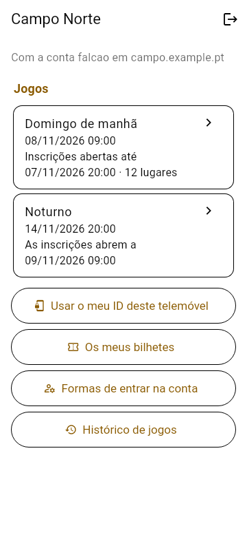
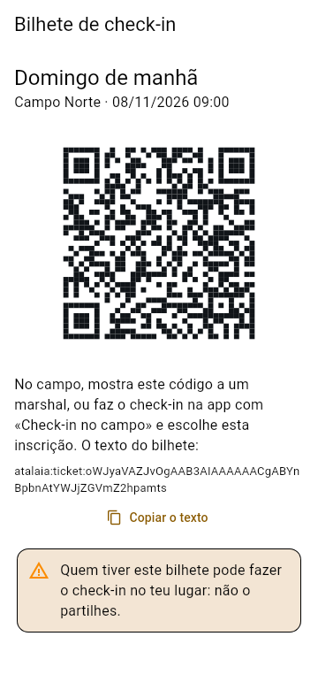

<!--
SPDX-FileCopyrightText: 2026 The Atalaia contributors
SPDX-License-Identifier: GPL-3.0-or-later
-->

# Atalaia app

One Flutter app for Android and iOS.

| Role | Platforms |
| --- | --- |
| Player, squad leader, VIP, marshal, GM, spectator | Android and iOS (iOS: the project is built by CI and its checklist has passed on an iPhone (2026-10-26, QR scanning included); `atalaia://` links, position sharing and the indoor beacons (both while the app is on the screen) are written for it; no NFC) |
| Prop (kiosk mode, with optional ESP32 I/O pod) | Android only |
| Field controller | Android only |

The app calls the shared C core through `dart:ffi`. Android-only features (kiosk mode, the foreground service, NFC, the QR scanner, the USB and BLE pod links) are small Kotlin plugins in [`android/app/src/main/kotlin/org/atalaia/app/`](android/app/src/main/kotlin/org/atalaia/app/). Minimum Android version: 8.0 (API 26). The interface is in European Portuguese by default, and in English.

Licence: GPL-3.0-or-later with the [app-store permission](APP-STORE-PERMISSION.md).

## Status

Phase 3, plan phases B, C, D, E and F: the app has its screens, and (plan phase E) players **check in at the field** with its printed poster, declare the replicas they will use and see their chrono state; marshals work through the field's **replicas to chrono** list and send their signed readings to the controller (a marshal is only someone on the GM's marshal list: the app does not take an id from its user, it asks the field controller, which gives the id and name, and it records nothing without the controller's yes, decisions MR-1 to MR-14); players can **share their position** during a game; and an Android prop **links to the field controller over Wi-Fi**, as a box does over the radio, or (plan phase F) **over the field's radio through an I/O pod**, which the pod's own firmware code on a computer stands in for in the tests. An Android phone can be a **game prop** that runs any built-in mode on the shared C core and draws the mode's own YAML screens, with team buttons, a keypad and NFC tags; a **player** can follow a game from the field controller; a **marshal** has the chrono check-in, the replica registry and the writer for players' signed tags; the **GM** gets the controller's console. Everything is tested in Docker (widget tests, golden images, the core through `dart:ffi`), and CI runs the APK on an Android emulator. **Not yet run on a real phone**; the on-device tests run on CI's emulator and on a local Android 16 emulator (below). The Android controller role is built in part (decision PE24, in slices): its MQTT broker and position filter (plan phase E), (slice S1, 2026-10-22) its game engine with `field.lua` on the core and its REST API for games, scores, the event log and nodes, (slice S2) its live stream and MQTT topics, (slice S3) its games kept in files across a restart, (slice S4) an I/O pod as its radio, join payloads for boxes and Android props, and those props on its Wi-Fi, and (slice S5) field check-in, player tokens, the replicas-to-chrono list fed by signed readings and player positions, which pass the same contract cases as the Pi controller and play games with the pod's and the Field Box's own code on a computer, and (slice S6) the role itself: **Field controller** on the home screen (Android only) runs all of it on its own isolate under the foreground service, serves the GM console (the Pi's own files, carried in the APK) to the app's web view and to the field, opens HTTPS with a field CA made on the phone and the MQTT broker to the field's Wi-Fi, prints its CA's fingerprint on the check-in poster, and takes an I/O pod as its radio; tested on a computer and written for CI's emulator, not yet run on a phone (below); the I/O pod's firmware is written (plan phase F, `python tools/docker_fw.py pod`) and tested against the app on a computer through the host pod, not yet on a real pod or phone. **iOS is not built**: there is no Mac in this project's toolchain (decision PD10). Phase 4 (plan phase 16's app part, decision S16-13): a player **registers online** for a field's game on the field's site server: logs in to the account (password, then the TOTP code when the account has one), sees the field's published games, registers with the replicas they will use, keeps the **check-in ticket** on the phone (a QR code and its text for a marshal, or sent with the app's check-in), changes or cancels the registration, and claims the player id the phone already has at that field; the site server's register page opens the app with an `atalaia://register` link. Tested against a stand-in site server, not yet against a real deployment or on a real phone.

| | |
| --- | --- |
|  |  |
| A prop running Bomb: the mode's own screen, the team buttons | A player following the game |
|  |  |
| A field's branding: its logo, wallpaper and colour, the teams' crests | A prop of that field: crests on the team buttons |

## Install it on an Android phone (from Windows)

1. Build the debug APK (Docker Desktop running): `python tools/docker_app.py apk`. It lands in `app\build\atalaia-debug.apk` (about 150 MB: a debug build for three processor types).
2. Either:
   - **With adb** ([Android platform tools](https://developer.android.com/tools/releases/platform-tools)): turn on *Developer options › USB debugging* on the phone, plug it in, accept the computer's key, then `adb install -r app\build\atalaia-debug.apk`.
   - **Without adb**: copy the file to the phone (USB file transfer, a memory card or a shared folder), open it in the phone's file manager and allow *Install unknown apps* for that file manager when Android asks.
3. A debug build is signed with Flutter's debug key: to install a build signed with another key, uninstall the old one first (`adb uninstall org.atalaia.app`).

## Try it on the Android emulator (Windows)

What runs there: the prop shell with on-screen buttons and keypad, the player view, the GM console, join by pasted text, the marshal screens. What doesn't: NFC (no reader), the I/O pod links, real battery and background behaviour; use a phone for those.

**One-time setup** (about 4 GB here on `Y:`; any fast local disk works):

1. Turn on *Windows Hypervisor Platform* (an admin `cmd`: `dism /online /enable-feature /featurename:HypervisorPlatform /all`) and reboot.
2. Install a JDK 17 (`winget install EclipseAdoptium.Temurin.17.JDK`) and unpack Google's [command-line tools](https://developer.android.com/studio#command-line-tools-only) to `<sdk>\cmdline-tools\latest`. Set `ANDROID_HOME` to `<sdk>` and `ANDROID_AVD_HOME` to a folder for the virtual phones, and add `<sdk>\platform-tools` and `<sdk>\emulator` to `PATH`.
3. Install the packages. The new `android` tool replaces `sdkmanager`: using it accepts the [Android SDK terms](https://developer.android.com/studio/terms), and it ignores `ANDROID_HOME`, so pass `--sdk`:
   `android --no-metrics --sdk=<sdk> sdk install platform-tools emulator platforms/android-36 system-images/android-36/default/x86_64`
4. Create the virtual phone (the stock image, no Google services, like the app):
   `avdmanager create avd --name atalaia-phone --package "system-images;android-36;default;x86_64" --device pixel_7`

**Each time:**

```bat
emulator -avd atalaia-phone -no-snapshot-save
python tools\docker_app.py apk
adb install -r app\build\atalaia-debug.apk
```

The emulator reaches your PC at `10.0.2.2`. Start a controller without a radio in Docker (`[modem] port = ""`, `[mqtt] enabled = false`, `[api] tls_names = ["10.0.2.2"]`, `-p 8080:8080 -p 8443:8443`; see [controller/README.md](../controller/README.md#running-it)) and connect *Participante* to `http://10.0.2.2:8080` with the read token, or open *Organização* with the GM token. For field check-in, print the poster from the console's *Check-in* tab (or copy its text there) and use *Participante › Check-in no campo*: the poster's addresses must include `https://10.0.2.2:8443`.

**Hot reload and on-device tests** need Flutter on Windows (the same 3.44.0 as `tools/docker_app.py`; `flutter config --android-sdk <sdk> --jdk-dir <jdk>`): `flutter run -d emulator-5554` in `app\`; `powershell -ExecutionPolicy Bypass -File app\tool\emulator_tests.ps1` runs the tests CI's emulator job runs (it grants the notification permission Android 13+ asks for when a prop's game starts, which Flutter cannot tap). From Linux or WSL, `sh app/tool/emulator_tests.sh [device]` does the same with Flutter installed there. In WSL, with the emulator on Windows, turn on mirrored networking (`networkingMode=mirrored` under `[wsl2]` in `%UserProfile%\.wslconfig`, then `wsl --shutdown`) so both sides share `localhost`, start the Windows adb server with `adb -a nodaemon server start`, and set `ADB_SERVER_SOCKET=tcp:127.0.0.1:5037` in WSL; without mirrored networking the tests cannot attach to the app, because Flutter's port forward opens on the Windows side. To check a small screen like CI's emulator: `adb shell wm size 320x640` and `adb shell wm density 160` (`reset` undoes them). The first build downloads the NDK and CMake into the SDK. A real phone works the same way over Wi-Fi: *Developer options › Wireless debugging*, `adb pair`, then `flutter run`.

On the phone, *Definições* (the gear) sets the language, the **field join key** (`python3 -m atalaia_controller join-key` on the controller prints it; only a prop, to read its join card, and the phone controller need it: a marshal's phone and a player's keep none, decision APX-1, and an upgrade clears one an older version had kept on a phone that is a marshal and never ran the controller) and the **admin PIN** that guards a prop's start, pause, end and leave. For a phone kept as a prop, kiosk mode can run without prompts once the app is the device owner: on a phone with no accounts, `adb shell dpm set-device-owner org.atalaia.app/.AtalaiaAdminReceiver`. Otherwise Android asks to confirm screen pinning.

### The phone as the field controller (slice S6 of PE24)

*Controlador de campo* (Android only) makes the phone the field controller of a small game with no Raspberry Pi. **Start** keeps the phone running with the screen off (the foreground service's notification, a partial wake lock and a Wi-Fi lock; the battery exemption is asked once) and starts the controller on its own isolate: games in the app's private storage (a live game goes on after a stop and a start, as after a Pi's restart), the GM console on the phone's own address for *Abrir a consola*, and, with *Aberto na rede Wi-Fi do campo* on, HTTPS on port 8443 with the **field CA** the phone makes on its first start and MQTT over TLS on port 8883 (the same CA) at every address, plain MQTT on its own loopback only. The screen shows the console's addresses for a computer on the field's network, the CA's fingerprint the check-in poster carries (print the poster from the console's *Check-in* tab on that computer), the **GM and read codes** (hidden until asked), and the radio: an **I/O pod** found over USB or Bluetooth before the start (the field's boxes need it; without one, only Android props on Wi-Fi). The field's network is the phone's hotspot (Android's settings, opened from the screen; keep its name and password, which go on the poster), a router the phone joins, or a **network for the game** the app makes itself (Android chooses a new name and password each time: players join it from the QR code on the screen). The field join key is the one in *Definições*, made there on the first start if none was set: give the same key to the boxes. Not run on a real phone yet: plan phase G checks the screen off for a whole game, the hotspot's address, the pod's link and the console in the web view.

**Boxes over the radio** (slice S7c, 2026-10-23, decisions PE24-90 to PE24-99): the phone controller lists the boxes that announce themselves between games, invites them into the next game with sealed radio invites (the console's box picker), tells a game's boxes it is over (GAME_OVER, also after a restart without the game's key), adopts new boxes by **pairing code** over the radio (the console's *Adotar*) or with the **field card**, which the screen writes with the phone's own NFC after a warning (*Cartão de campo*), and sends **firmware updates** between games (the release keys under *Atualizações de firmware* on the screen; the boxes fetch the signed release over the phone's HTTPS with the field CA, so only with the controller open to the field's Wi-Fi). Re-invites, GAME_OVER and pairing need a radio that carries field frames: the Pi's **USB radio modem** plugged into the phone (the screen's radio search finds it like a pod, and the controller tells the two apart by their answer) does, and so does an **I/O pod** whose firmware relays them (PE24-100 to PE24-105); an older pod does not, and the console then says the radio carries none. **Firmware updates go through either radio** (decision PE24-130): the offer is an ordinary game packet that a pod relays like any other, so a pod needs no flag for it. When the radio cannot carry the offer (no radio linked, a pod with no radio chip, a radio that is down) the console says why (`radio_problem`, and the radio's state in `GET /firmware`), and an offer the radio takes and then refuses (its duty-cycle budget spent, a full queue) fails the update at once with `radio_duty_cycle` or `radio_queue_full`, not after the 10-minute timeout. No USB adoption on a phone (PE24-95).

**Failover, the site sync, the remote GM and ATAK** (the rest of slice S7, 2026-10-23, decisions PE24-118 to PE24-129): the phone runs the Pi's CLAIM election, so a phone and a Pi can each be the other's standby: the GM gives one controller the leader's join of kind *controller* (the console's Join tab), it follows the leader's TIME, and it takes over when promoted or, with automatic failover, after three missed beacons. With a site server set in *Definições* (*Servidor do site, substituição e ATAK*: its address and the field's API key, kept in the app's private settings and shown afterwards only by its fingerprint), the controller pushes its games, logs and scores when the internet is there and pulls the schedule, rosters, the field's branding and its scenario library (a scenario the site archives and a preset it deletes are removed again, S20-9), as a Pi's `[sync]`; the remote GM lets the field's GMs on the site server act on the live game (off by default); the ATAK feed puts the boxes and map features on ATAK maps by multicast on the field's Wi-Fi (sending needs no multicast lock), on staff devices over TCP and through the site server. Code in `controller_failover.dart`, `controller_sync.dart` with `controller_sync_format.dart` and `controller_schedule.dart`, `controller_remote_gm.dart`, `controller_atak.dart` and `controller_site_screen.dart`. **Since the 2026-10-30 security and privacy review (FU30-9 to FU30-12):** the staff ATAK feed can use TLS (`staff_tls`, with the CA, an optional client certificate and key as PEM text on the site screen; port 8089; only that CA is trusted; names are checked, `staff_tls_name` says which when the endpoints are addresses), signed-mode revocation fails closed as on the Pi (fetched before every install and upload, the last good list kept across restarts, `revocation_max_age_days`, `min_versions`, on the *Mode packages* screen), and the purge keeps each dropped game's team results for 365 days without a player id (`GET /api/v1/game-results`). **Since PKD (2026-10-28):** the phone controller does what the Pi's does for the new stream notes and pushes: `field.changed` may carry `what` (`library`, `schedule`: pulled at once; `ControllerSync.fieldChanged`), the chrono push carries `limit_j`, and with `remote_gm` on `RemoteGm` sends the live game's players' positions in a `positions` message for the site server's remote GM page (never stored or logged there); the player's position-sharing switch says that a remote GM may see them (`player.share_remote_gm`).

**Retention and erasure on the phone controller** (decisions RET-1 to RET-8, as the Pi's `Checkin.purge`): `chrono_retention_days` (365 by default) and `game_retention_days` (90 by default, the maintainer's decision of 2026-10-30), both 30-3653, are check-in settings (`PUT /api/v1/checkin/settings`, the console's check-in tab, or the site server's with `[sync] branding = "site"`: `settings.chrono_retention_days` and `settings.game_retention_days`, which lock the console's PUT with a 409), kept with the others and not told to a player's app. `ControllerCheckin.purge` uses the first for the readings, other fields' readings and a marshal's earlier keys, and the second to delete an ended game whole (`ControllerStore.deleteGame`: its record, key, events, scores, nodes and per-game settings, its check-in rows, token key, schedule link and sync state). With the site sync on (`engine.syncStatus`, set by `ControllerSync`) a game is deleted only once its sync state says `final` (the site server has all of it), whatever its age. A GM erasure and a player's chrono erasure are kept as erasure records (`erasures` in the check-in document, only with a sync) and sent by `ControllerSync` as `POST /api/v1/sync/erasures` until acknowledged (`checkErasures`, [protocol/sync.md](../protocol/sync.md); `status()['erasures']`). Tests: `test/controller/controller_checkin_test.dart`, `controller_sync_test.dart` (the erasures and game retention group, the site settings) and `controller_sync_format_test.dart` (the shared vectors).

The console in the APK is controller/console/src itself: `dart tool/sync_console.dart` copies it (and the check-in notices) into `assets/` before a build, which `tool/check.sh`, CI and the emulator scripts do; the copy is not committed. Run it in `app/` before a plain `flutter test` or `flutter build`.

### Field check-in, the chrono list, positions and the prop's link (plan phase E)

| Code | What it does |
| --- | --- |
| [`lib/checkin/`](lib/checkin/) | **Field check-in** ([protocol/checkin.md](../protocol/checkin.md), ADR-P3-13): the poster scanned (`checkin_screen.dart`; codec `lib/protocol/checkin_poster.dart`, against `protocol/vectors/checkin.json`); the field's CA fetched, checked against the poster's fingerprint and pinned per field, a changed one refused with both short forms (`field_trust.dart`); the field identity, made once per field (`field_identity.dart`); the privacy notice once per field and version; the form (display name, the federation number when the field asks, a team preference); the controller's endpoints over HTTPS trusting only that CA (`checkin_client.dart`); the check-in's page: status, role, team, the declared replicas with their chrono state, following the game, leaving; the player's own replicas and the per-game declaration (`my_replicas.dart`, `declare_replicas_screen.dart`) |
| [`lib/protocol/apd.dart`](lib/protocol/apd.dart), [`lib/checkin/apd_fields.dart`](lib/checkin/apd_fields.dart), [`assets/apds.json`](assets/apds.json) | **APD membership** ([protocol/apd.md](../protocol/apd.md), decisions APD-40 to APD-49): the rule, the membership and the verdict (`valid`, `expired`, `not_accepted`, `missing`) in pure Dart, checked against `protocol/vectors/apd.json`; the **card check** (a marshal's "Card seen, matches" on the queue, the hand check-in's tick, the phone controller's pending state, stored verdict and erased number: decisions LEG-1 to LEG-11) and the **position-sharing choice** taken at check-in (`share_position`, decisions LEG-12 to LEG-16); the list of membership bodies the project ships, each with its `country` (a byte-for-byte copy of `registry/apds/apds.json`); the field's **country** (`SiteField.country`, `FieldInfo.country`, the controller's `country` setting; decisions MEM-1 to MEM-6) picks which entries are offered and whether the texts say "APD" (PT) or "association membership" (any other country or none; an older peer that sends no `country` is taken as PT), through the `<key>_m` twins of the `apd.*` strings (`apdKey` in `apd_fields.dart`); the form part (APD picker, number, expiry) shared by the site registration (`lib/site/`) and the field check-in (`lib/checkin/`), shown only when the field's rule asks, replacing the old federation number field; the verdict badge on the player's status and on the marshal's queue (`lib/marshal/chrono_queue.dart`, with *Let in* for a pending player: never blocked by the verdict, logged by the controller). The phone controller keeps the rule as the check-in setting `apd` and the country as `country` (default PT where `CheckinConfig.zoneName` is Portugal's: the phone gives its abbreviation, and WET, WEST, AZOT and AZOST count; `controller_checkin.dart`) or takes the site server's with `[sync] branding = "site"` (`settings.apd`, `controller_sync.dart`; the *Site server* settings), and the number, APD and expiry are erased with the federation number |
| [`lib/position/beacon_scanner.dart`](lib/position/beacon_scanner.dart), [`lib/platform/beacon_scan.dart`](lib/platform/beacon_scan.dart), `BeaconScanPlugin.kt` | **Indoor positions from iBeacons** (ADR-P3-6, decisions BLE-1 to BLE-9): while a player shares their position on a field whose controller has beacons (`GET /api/v1/beacons`), the phone listens for those beacons' UUIDs only (low-power scan, a window of the game's beacon interval, nothing kept), reports the strongest registered one above -95 dBm as a `ble` position, and sends it instead of its GPS fixes while one was heard in the last two intervals; the app explains and asks before Android's Bluetooth and location prompts, and a refusal leaves GPS as it was. **During the game** the stream's bare `beacons` message (BLE-20) makes the phone read the registry again after two seconds and restart the scan only if the UUIDs changed, so a box placed or a tag added after the player began to share is used too. The controller turns the beacon into the room, which the player's screen shows. **iOS** has its own Swift plugin on the same channels and message shapes (`ios/Runner/BeaconScanPlugin.swift`, decisions IOSB-1 to IOSB-8): CoreLocation ranging (`startRangingBeacons(satisfying:)`, one constraint per registered UUID, a field box's and the tags'), the same -95 dBm floor, the same Dart code; it needs only the location *when in use* (the app asks for no Bluetooth permission and no *Always*), and ranges only while the app is on the screen, so a locked phone falls back to GPS and the last floor, which the player screen says. Written without a Mac and not run on an iPhone yet ([checklist](../docs/runbooks/ios-beacons-iphone.md)). |
| [`lib/marshal/marshal_access.dart`](lib/marshal/marshal_access.dart) | Whether this phone may act as a marshal (decisions MR-1 to MR-14): the field controller says, on opening the marshal screens and on every check-in refresh (`GET /api/v1/checkin/me`: the id and name from the GM's list, `null` for someone not on it); the app registers its key for that id, remembers the yes for the time the controller gives (`valid_for_s`, 2 hours) and records nothing without it; a marshal the GM removed loses it, and their unsent readings are kept |
| [`lib/marshal/chrono_queue.dart`](lib/marshal/chrono_queue.dart) | The marshal's **replicas to chrono** list: pending first, counts, a replica's QR label scanned to find it, a declaration without a registered replica registered there (the marshal holds the replica's **NFC sticker** to the phone to bind its UID as the tag, decision PKA-3, or chooses the printed QR label; a sticker already on another replica is refused; a phone without NFC goes straight to the label) and linked by the readings, a hand check-in; each judged series sent signed (`POST /api/v1/chrono/readings`), and what could not be sent kept and sent later. The marshal's key is registered by the app once the GM has given the marshal role |
| [`lib/modes/prop_mode_fetch.dart`](lib/modes/prop_mode_fetch.dart), [`lib/prop/prop_setup.dart`](lib/prop/prop_setup.dart) | **A prop fetches the modes a game needs** (decisions PKF-1 to PKF-8; [protocol/mode-packages.md](../protocol/mode-packages.md#7-an-android-prop-pkf-1-onwards)): a join whose mode the app does not carry, with keys 13, 14 and 16, has each missing part downloaded from the controller over HTTPS pinned to the field CA, checked as a Field Box checks it (the Dart ports of `box_check_release` and `box_check_archive`, the shared `box_checks` vectors: exact release form, Ed25519 signature against the prop's mode keys, kind, tier, never a built-in id, size, SHA-256, the canonical archive, its mode.yaml agreeing with the signed manifest, the script loading in the core's sandbox), kept (8 packages and 512 KiB at most, the least recently used dropped, every one checked again with the current keys each time it is read) and reported with the game key's HMAC. An unsigned or badly signed package is refused with a message and never runs. Trust roots: the build's `--dart-define=ATALAIA_MODE_KEYS` and **Settings › Mode keys for fetched modes** (at most 4); no key, nothing is fetched. Tests: `test/modes/prop_mode_fetch_test.dart`. |
| [`lib/ui/replica_label.dart`](lib/ui/replica_label.dart), `ShareFilePlugin.kt` | A replica's **QR label** (found by the marshal's scanner: `ATL-` and the first eight characters of the replica's id, upper case, `Replica.labelFor`; nothing personal, [protocol/checkin.md](../protocol/checkin.md#replica-labels)): **Show label** (a big QR with the code under it, the screen kept on and at full brightness) and **Share / print label** (a PNG of 30 x 30 mm at 300 dpi for one sticker, or A4 sheets of 54 labels with cutting guides, drawn with `dart:ui` and the `qr` package: no new dependency) on the player's replica list (once declared; the id is the field's `replica_id` or, before any marshal registered it, the declaration's) and on the marshal's replica registry and queue. The PNG goes to Android's share sheet, which lists printing, through `ShareFilePlugin.kt` (channel `org.atalaia.app/share`, a `FileProvider` on `cache/labels/` only); iOS has no twin yet and says so |
| [`lib/player/`](lib/player/) | The **field plan's grid** (decision PKA-2, the controller's MF-81 to MF-93): the level's grid (`GET /field/levels/{n}/grid`) is drawn over the plan in the player's map, thin white lines with the row letters and column numbers, and the player's own cell is said ("A tua quadrícula: C4"; the cell as `field_grid.py`'s `cell`); asked again when the map opens and when the level changes. With a check-in the player's view follows the game over the field's pinned HTTPS with the player token; the snapshot's history shows what happened before the phone connected; the player's list leaves out housekeeping events (`playerHiddenEventTypes` in `player_screens.dart`: node online/offline/rebooted/setup applied, pod links, script errors, reader scans, battery, chrono readings; decision PF-1), the player's game history leaves out the same types; the feed keeps every event and staff views are not filtered; the phone **vibrates on key game events** (`field_buzz.dart`, decisions VB-1 to VB-9; the Settings switch is on by default): a GM message (the longest pulse), a box of the player's team captured (one short pulse) or lost (two), the game starting (three ticks) and ending (two medium pulses), live events only (nothing for the snapshot a connection or a reconnect starts with), one buzz for a burst, no sound; **with the app closed (Android, decision APX-3, amending VB-9):** while the player view is open on a live game (ready, running or paused) with the Settings switch on and the role not a spectator, `AtalaiaForegroundService` runs with an ongoing notification (`player.buzz_title`, in the four languages), which keeps the process and the Flutter engine, so the feed and the same buzzes go on with the app closed or the screen off; it stops when the game ends, the switch goes off or the player leaves, and sharing the position shares it (the service widens to the location type, and a stopped sharing goes back to the buzz notification); no Google Play services; **iOS is out of scope** (it has no such service: the buzz plays while the player view is alive); **CA-pinned scoreboard links** (`&ca=`, decision APX-2, amending SQR-4) are remembered per field by the CA's fingerprint (`saved_links.dart`, the list `scoreboard_links` with the read code sealed like the other secrets) and offered on the start screen as *Campos guardados*, one tap reconnecting with the CA fetched and checked again; a link whose CA no longer matches, or a new link for the same address with another fingerprint, forgets the old one (at most 8 fields); a GM's change of team or role fetches a new token; **sharing the position** during a running game (`lib/position/position_reporter.dart`, `lib/platform/location.dart` and `LocationPlugin.kt`: Android's own location, no Google Play services; the foreground service gets the location type only while sharing); while sharing, the **out-of-bounds warning** (`lib/position/field_bounds.dart`, decisions MF-31 to MF-40): the phone tests its own fixes against the field boundary (a `boundary` map feature placed on the ground by its level's map position), and once they have stayed outside by more than their accuracy and 10 m it shows a banner, vibrates and says so in the sharing notification (no sound); players, squad leaders and VIPs only, while the game runs; nothing about it is sent to anyone, and no extra GPS fix is taken; on a field with levels the player chooses their **floor** (`PositionReporter.setLevel`: the GPS reports carry `level`, a beacon's own level wins, decisions ML-5, PM-1, PM-2) and a **field map** card (`field_map.dart`, `lib/position/field_plan.dart`, decisions PM-1 to PM-9) draws the level's plan image, the map features this token may see and the positions the stream gives it, by level; the vector plan only, no tile layer |
| [`lib/controller/`](lib/controller/) | `prop_link.dart`: an Android prop's **Wi-Fi link** to the controller ([protocol/prop-link.md](../protocol/prop-link.md)): the join payload's keys 13 and 14, the HMAC proof of the game key, events resent until acknowledged, STATE, the controller's commands and TIME beacons (start, pause, resume, end, messages; kiosk loss as `node.tamper`). For the Android controller role (in slices, decision PE24; no screen yet): `mqtt_broker.dart`, a minimal MQTT 3.1.1 broker (ADR-P3-12), and `visibility_engine.dart`, the position visibility table; slice S1: `field_controller.dart` (the radio side of a game, the simulator's FieldController in Dart: game clock, TIME beacons, commands, HELLO, STATE and events with replays dropped, ACKs, scores merged by maximum, node health; no election yet), `controller_engine.dart` (games created, started, paused, resumed and ended by the GM; the mode's `field.lua` on the core with the field operations and its points kept per run; the start check; GM score adjustments; node commands; the read token's view without gm_only data), `controller_store.dart` (games, events, scores and nodes in memory; since slice S3 also `FileControllerStore`, the same in files that outlive a restart, the game key only with `persist_game_key`) and `controller_api.dart` (the Pi controller's REST endpoints for all of this, with its tokens and status codes, on the loopback address by default); slice S2: `controller_stream.dart` (`WS /api/v1/stream`: the hello snapshot, then the engine's messages in order, gm_only data for the GM token only, 4401 and 4408 as on the Pi) and `controller_mqtt.dart` (the Pi bridge's `field/v1/{game}/...` topics on the embedded broker, commands from `cmd/`; the broker takes the `gm` and `reader` logins with the Pi's ACL, `MqttAcl.field`); slice S4: `controller_radio.dart` (the radio as the Pi's modem, the controller's packets with a TX epoch per game key), `pod_modem.dart` (an I/O pod as that radio, through its RADIO_* frames), joins in `controller_engine.dart` and the API (`POST /api/v1/join`, `/nodes/{id}/join`, the boxes' language) and `controller_props.dart` (`WS /api/v1/prop`, the server side of the prop link); slice S5: `controller_checkin.dart` (field check-in as the Pi's: the poster's settings, identities, player tokens with a key per game checked against the check-in, declarations, the staff's list and changes, signed chrono readings and the replicas-to-chrono list, retention), `controller_positions.dart` (player positions with the visibility table, the level kept, a team's temporary view, a VIP's GPS to `field.lua`), player tokens on the API and the stream |
| [`lib/controller/`](lib/controller/) (slice S7c) | **Boxes over the radio**, as the Pi's modules: `controller_boxes.dart` (`reinvite.py` and lobby.py's `Inviter`: free boxes, DISCOVER, sealed invites paced by their time on air with retries, answers, HELLO, the previous game, GAME_OVER), `controller_pairing.dart` (`pairing.py`: CPace by the box's code), `controller_adoption.dart` (`adoption.py`: the field card and the records; no USB), `controller_firmware.dart` (`firmware_updates.py`: signed releases, CMD update through a pod or a USB modem with the radio's refusals said in words, reports, HELLO, the start guard), their routes in `controller_boxes_api.dart`; `serial_modem.dart` (the Pi's USB radio modem as the radio, and the probe that tells it from a pod); `controller_boxes_screen.dart` (the field card written by the phone's NFC, the release keys). The codecs: [`lib/protocol/field_frame.dart`](lib/protocol/field_frame.dart), `pair_frame.dart`, `field_card.dart`, `firmware_release.dart`, [`lib/security/aes_ccm.dart`](lib/security/aes_ccm.dart), `cpace.dart` |
| [`lib/controller/`](lib/controller/) (slice S7) | **Failover, the site sync, the remote GM, ATAK**, as the Pi's modules: `controller_failover.dart` (`election.py`: the CLAIM election, the priority, manual or automatic failover; the FieldController follows another controller's TIME and sends CLAIM), `controller_sync_format.dart` (`sync_format.py`: every sync body, answer and stream message, checked against `sync.json`), `controller_sync.dart` (`sync_client.py`: HTTPS to the site server, offline first; with each roster it pulls other fields' chrono records of its players that their person shared, S14-5, kept apart in `controller_checkin.dart` and shown marked "from another field"), `controller_schedule.dart` (`schedule.py`), `controller_remote_gm.dart` (`remote_gm.py`), `controller_atak.dart` (`atak.py`: CoT XML byte for byte, UDP multicast, TCP to staff devices, the relay), `controller_site_screen.dart` (the settings) |
| [`lib/controller/controller_import_screen.dart`](lib/controller/controller_import_screen.dart), `FilePickerPlugin.kt` | **A registration list imported from the phone controller's own screen** (decision PIM-1, PKE-1's caveat): on the controller's screen, under **Registration list**, **Import a registration list** (while a game is live) opens a screen on the same endpoint and rules as the GM console's import panel (`POST /api/v1/games/{id}/checkins/import`, asked of the running controller on the loopback address with the GM token, `requestRegistrationImport`; the format is [`registration_import.dart`](lib/controller/registration_import.dart)): **Choose a file** (Android's own chooser, `ACTION_OPEN_DOCUMENT` in `FilePickerPlugin.kt`, so no storage permission; `FilePicker` in `lib/platform/services.dart`; at most 1 MiB + 1 byte is read, a file over it is refused as too large and one that is not UTF-8 never leaves the phone), the **Source**, the tick that the field has its own legal basis for the list, **Check the file** (a dry run: nothing changes; every row is listed as new, changed, skipped or refused with the reason, the columns not read are only named, how many imported players are not in the file is said) and then **Import** (enabled only once the basis is ticked and the file and source were checked). A file, a row or a request refused is told in words in the four languages (`ctl_import.codes.*`, the console's wording). On a phone with no chooser the screen says to use the GM console in a browser instead. |
| [`lib/controller/scenarios/`](lib/controller/scenarios/) (slice S7b) | **Scenarios** on a phone controller (`controller_scenarios.dart` serves them): `scenario_manifest.dart` reads a manifest's YAML or JSON as the Pi's PyYAML does (YAML 1.1, a key given twice, surrogate pairs, impossible dates; checked against `scenario_compile.json`'s `loads`); `scenario_package.dart` hands what it read to the core's scenario compiler through `dart:ffi` as the manifest's data tree, and returns its problems and package. The rules, `field.lua` and `mode.yaml` are the core's ([core/scenario/](../core/scenario/README.md), decision PE24-109), the same code the Pi calls |
| [`lib/controller/`](lib/controller/) (slice S6) | The **field controller role**: `controller_screen.dart` (the role's screen: start and stop, the Wi-Fi opening, the addresses and the field CA's fingerprint, the I/O pod, the GM and read codes, the GM console in the web view, the field's Wi-Fi and a local hotspot with a QR code to join it), `controller_shell.dart` (on the UI isolate: the foreground service with its wake and Wi-Fi locks, the notification following the live game, a restart for another Wi-Fi opening), `controller_isolate.dart` (the controller's own isolate and its messages; the pod's bytes relayed from the UI isolate), `controller_host.dart` (on that isolate: the store, the engine on the core, check-in, positions, the API on HTTP at the loopback address and on HTTPS for the field, the broker, the tick, the phone's addresses watched), `field_tls.dart` (the field CA and the server certificate as the Pi's `tls.py` makes them: ECDSA P-256, renewed for new addresses or near their end), `console_files.dart` and `console_assets.dart` (the GM console's files served as the Pi serves them: the strict headers on every page, and, on `field-map.html` alone, the Pi's `FIELD_MAP_HEADERS`, its own Content-Security-Policy naming OpenStreetMap, Overpass, Nominatim and the open orthophotos, and `geolocation=(self)`, decision MF-64); [`lib/security/der.dart`](lib/security/der.dart) (the DER the certificates need) |

### Online registration on the field's site server (phase 4, decision S16-13)

A field that runs a site server ([server/README.md](../server/README.md)) publishes its games there; players register with an account on that site (decision F14). *Participante › Inscrições online* opens a field: the site server's register page (`/f/<slug>/games/<id>/register`) has a button to `atalaia://register?site=<origin>&field=<slug>&game=<id>`, which Android opens in the app, or the address of the field's or the game's page (`https://<site>/f/<slug>[/games/<id>]`) is pasted. Only `https://` sites are accepted, and `http://` only for this phone and the emulator's host (`localhost`, `127.0.0.1`, `10.0.2.2`, for a trial with `python3 tools/docker_server.py up`). The first time, the app shows the site's host and asks whether it is the field's site before any login, since a link on a web page can name any site.

| | |
| --- | --- |
|  |  |
| A field's games | The check-in ticket kept on the phone |

| Code | What it does |
| --- | --- |
| [`lib/site/site_link.dart`](lib/site/site_link.dart) | The links: `atalaia://register?...` and pasted page addresses, the site reduced to its origin, the https rule |
| [`lib/site/site_client.dart`](lib/site/site_client.dart) | The account: login with the password, then the TOTP step; the access token in memory only; the refresh token (the `__Secure-atalaia_refresh` cookie the site server sets) kept in the app's private files with the other secrets (decision PD6), rotated by every refresh, one refresh at a time, and saved before the new access token is used; a refused refresh (spent, replayed, expired, revoked) forgets it and asks for the login again; an access token the server no longer takes is refreshed once; logging out |
| [`lib/site/site_auth.dart`](lib/site/site_auth.dart), [`lib/site/account_screen.dart`](lib/site/account_screen.dart), `BrowserPlugin.kt`, `PasskeyPlugin.kt` | **Login without a password and the account's login methods** (decision PKA-1; the site server's LG-* and ACC-* decisions). A **social login** (Google, Microsoft, Apple) runs in the system browser, a Custom Tab: the app asks `POST /api/v1/auth/oidc/{provider}/start` with `return_to` the site's own `https://<host>/app/oidc?s=<nonce>` (an Android **App Link**) and opens the `browser_url` it gets, which sets the site's binding cookie in that browser and goes on to the provider; the redirect back opens the app with `#oidc=<ticket>`, which `POST /auth/oidc/complete` turns into a session. The nonce `s` is the app's own: a return that is not for the attempt it waits for is ignored. **Passkeys** go through Android's Credential Manager (from Android 14, no Google Play services) against `/auth/passkey/*`. The login screen offers them beside the password (each only when the site and the phone can), with the consent box a first sign-in of a new account needs; creating an account in the app is still not offered (S17-16). The **account screen** (*Formas de entrar*, from the field screen) shows what the server says and puts every refusal in words: the confirmation (the password, or for an account without one a TOTP code, a passkey or the provider again), providers (link, unlink), passkeys (add, rename, remove), the password (set, change, remove) and TOTP (turn on with its secret shown as text, turn off). The site must serve `/.well-known/assetlinks.json` (`ATALAIA_APP_ANDROID_PACKAGE` and `_SHA256`, server/docs/DEPLOY.md) and the build names the host Android may open (`-Patalaia.appLinkHost=<host>`) |
| [`lib/site/privacy_notice.dart`](lib/site/privacy_notice.dart), [`lib/site/privacy_screens.dart`](lib/site/privacy_screens.dart) | **The privacy notice, shown again, and making an account** (the site server's CONS-1 to CONS-6 and LEG-*; the staff pages' twin). An account rests on the contract (Art. 6(1)(b)), not on consent: the notice is information and the server records which version was shown. `GET /api/v1/privacy-notice?lang=` (public) gives the operator's Markdown in the app's language, else in the one the server fell back to, and the screen says so; a small built-in renderer (headings, lists, tables, quotes, code; every mark dropped, a link's address written out, nothing opened) draws it. `GET /api/v1/me`'s `notice.status` (`current`, `outdated`, `missing`) puts a *Read and confirm* banner on the signed-in field screen; the screen shows the text, a tick (*I have read the privacy notice*) and *Confirm*, which posts `POST /api/v1/me/notice` with the version on the screen, so a notice that changed meanwhile (409 `notice_version_changed`) is read again and never recorded unseen. Nothing is blocked (CONS-4: a lock would block the account's own export and erasure). **Sign-up** (S17-16, unblocked by LEG-*): the login step has *Create an account* (when the server takes passwords; `SiteSession.register`: `POST /auth/register`, then the login), and its own two boxes, which a **social sign-up** uses too: *I have read the privacy notice* (it stays closed until the notice was opened from *Read the privacy notice*, so it is shown first) and *I am 16 or older* (no date of birth; younger players check in at the field without an account, under the field's parental rules, and the refusal text says so). Both go to the server (`notice_seen`, `age_confirmed`, only when ticked, so a login to an existing account sends neither and still works against an older server) and are recorded with the sign-up's notice record. With no notice published the sign-up is closed (`site-signup-no-notice`). A **social sign-up** sends `notice_version` (the one shown) with the ticked boxes in the OIDC start: a server before CONS-7 (an older self-hosted one; the site has no version or capabilities endpoint, only `/auth/methods`) refuses the field with a 422 that names it (`extra_forbidden` at `body.notice_version`), and only that answer makes the app ask again without it (APF-10): any other 422 is shown as the refusal it is |
| [`lib/site/hub_share.dart`](lib/site/hub_share.dart) | **The chrono link between a hosted hub's fields** (the site server's SVX-2): `GET /me/hub-share` (state; 404 `not_hosted` hides the button and the screen), `POST /me/hub-share/code` (a one-time code, shown once, 15 minutes), `POST /me/hub-share/link {code}`, `DELETE /me/hub-share`. What is shared still needs the person's consent at each field and the field's own switch: the screen says whether it is on and holds no rule |
| [`lib/site/site_api.dart`](lib/site/site_api.dart) | The site server's player API: the field's published games (`GET /api/v1/fields-by-slug/{slug}`), registering, the account's registrations, changing and cancelling them, a new ticket, the account's player ids and a claim; the tickets kept (`TicketStore`: kept as soon as an answer carries one, before it is shown) |
| [`lib/site/history_screens.dart`](lib/site/history_screens.dart) | The player's own **game history** (decision S20-8): the games the account played, newest first, each with its scores, the winner and the player's own events in words, from the site server's existing player history API (`SiteApi.history`); nothing kept on the phone |
| [`lib/pod/pod_reconnect.dart`](lib/pod/pod_reconnect.dart) | The pod's **automatic reconnect** (PF15): a broken link is opened again with backoff (1, 2, 4, 8, 16 then 30 s) while the screen or game is open, the new link must identify the same pod (another one is refused), the state is shown (linked, reconnecting, refused, unlinked), and the person's unlink stops it; the game's radio through the pod is configured again with a new epoch |
| [`lib/site/site_screens.dart`](lib/site/site_screens.dart) | The screens: the field (address, the site confirmed, login, the TOTP code), its games with their registration state, a game with the form (the name for that game, the team preference, the federation number as the game asks with the field's label, the replicas from *my replicas* whose class the field has, up to the field's `max_replicas`), the ticket (QR code and text), the tickets kept (they need no connection), the claim of this phone's player id (the field's controller confirms it, decision S16-4) |
| [`lib/platform/links.dart`](lib/platform/links.dart), `LinkPlugin.kt` | The link that started the app, and links while it runs (`onNewIntent`); Flutter's own deep linking is off (`flutter_deeplinking_enabled`) |

At the field, *Check-in no campo* offers the tickets kept: the registration's id and ticket go with the check-in (decision S16-8), with the registration's player id, which the phone takes at that field if it has none there; a phone that already has another id there is told to claim it first (or to check in without the registration). Without the app, the ticket's QR code is shown to a marshal. Times are shown on the phone's clock (the field's time zone is not applied: the app has no time-zone database). Not in the app: making an account (the site server has no page for its privacy notice yet).

### Field and team branding

A field or club that runs its own controller can set its name, a logo, a wallpaper and an accent colour, and give the teams of a game display names and crests ([controller/README.md](../controller/README.md#field-and-team-branding), decisions BR1-BR24). The app fetches them right after a check-in or a join from `GET /api/v1/field/branding` (no token; an ETag makes a refresh one small request) and keeps them per field id in its private files, so the field's look shows at once the next time, also out of reach.

| Code | What it does |
| --- | --- |
| [`lib/branding/field_branding.dart`](lib/branding/field_branding.dart) | The branding's model and cache (`BrandingCache`): the field's name, accent, logo and wallpaper per field id, refreshed with `If-None-Match`, images downloaded only when they change and checked again (PNG, JPEG or WebP signature, the size caps); team crests by their SHA-256 (checked on download, the last 64 kept); the game's teams for a prop (`GET /api/v1/games/{id}/teams`); the accent made readable (`brandPrimary`: lightened or darkened until it reads at 4.5:1 on the screen's background) |
| [`lib/branding/branded.dart`](lib/branding/branded.dart) | The widgets: the accent as the primary colour (`BrandedTheme`), the logo and name in the header (`BrandTitle`), the wallpaper blurred a little under a veil of the background, 80% dark or 86% light (`BrandBackdrop`), a team's crest or its colour dot (`TeamCrest`) |

Where it shows: the check-in's page and the player's view of that field (logo, wallpaper, accent; each team's crest and display name in the scores, objectives, results and events), and an Android prop in that field's game (the logo in its top bar; the wallpaper with the logo and name on its idle screens before and after the game, never behind the mode's own screen; the accent on its start button; the crests and names on the team buttons, which keep their colours). The home screen, the settings and the marshal's tools keep the default look, and so does a field that set nothing. An image that does not decode leaves the default look.

### The screens (plan phase D)

| Code | What it does |
| --- | --- |
| [`lib/ui/template/`](lib/ui/template/) | The **screen-template renderer** (ADR-P3-4): a Dart port of the core's YAML-subset parser and `{expression}` evaluator (`core/src/screen_template.c`), and a Flutter renderer with the Field Box's layout rules on its 320x240 canvas, scaled to the phone. The tests compare the parser and the evaluator with the core's through `dart:ffi` on every template the modes ship, 2,500 mutated templates and thousands of generated expressions (decision PD2) |
| [`lib/prop/`](lib/prop/) | The **Android prop shell**: `prop_session.dart` runs the mode in a game loop isolate; turns the team buttons (press, hold every 250 ms, release: `button_tracker.dart`), the keypad, NFC tags (checked with the game key), the phone's GPS for a role that uses `gps` (`gps.fix`, which stays on the phone: VIP / Payload's payload, P4R6) and an I/O pod's events into the mode's inputs; draws its `ui.screen`s (with the Field Box's C-only screens as templates: `shell_screens.dart`); plays its sounds as tones and vibration; keeps the game's length and sends `game.end` (`game_timer.dart`); and holds the foreground service, the screen manager (`screen_manager.dart`: dimmed after 30 s, off after 5 min, never asleep in kiosk mode) and kiosk mode, whose loss it reports (ADR-P3-5, ADR-P3-9). Screens: the prop's start (`prop_home.dart`), the game's setup with the mode's translated parameters (`prop_setup.dart`), the game (`prop_game.dart`; the keypad is shown from the start when the role requires one, as the Hacking Terminal's does), joining with a join payload (`join_screen.dart`), linking an I/O pod (`pod_screen.dart`), the battery guide by phone maker (`battery_guide.dart`); what the phone can do (`capability_mapper.dart`) |
| [`lib/player/`](lib/player/) | The **player's view**: the field controller's address and access code (from the scoreboard's address), the live feed of `WS /api/v1/stream` (`field_feed.dart`), and the game: time, points (a box's points arrive with its STATE, every 15 s, so they can trail the box's screen by up to about 15 s; decision SL-3), objectives, lives, eliminations, the GM's messages, events in words; in a scenario's game, the scenario's objectives this player may know (phase 4 plan phase 8, P4R24: the controller sends a team's or squad's objectives to it only, a hidden one once revealed; with `disclosure: leader` only a squad leader gets a squad's, the members' app says their leader has new orders and buzzes briefly, SQ-3, SQ-5), with their names in the app's language, where each stands and its points, named in the events too. The **GM** role shows the controller's console in a web view (`gm_screen.dart`) |
| [`lib/marshal/`](lib/marshal/), [`lib/chrono/chrono_ui.dart`](lib/chrono/chrono_ui.dart), [`replica_registry_ui.dart`](lib/chrono/replica_registry_ui.dart) | The **marshal**: who signs (name, id, Ed25519 key), the chrono check-in and spot check on a big keypad with PASS, WARN or FAIL, the replica registry (found again by its NFC sticker or QR label), players' tags (the field controller signs each one with the game's key, `POST /api/v1/games/{id}/tags`, and this phone writes it: the marshal needs neither the field join key nor the game key for it, only the field's network; a marshal's phone keeps no join key, APX-1: `AppSettings.joinKeyUse` says whether a stored key is for the phone controller or a prop, settings version 2 clears an old marshal's, and confirming a marshal clears it unless the controller's), erasing a player's readings |
| [`lib/protocol/`](lib/protocol/), [`lib/pod/`](lib/pod/) | Join payloads (`join_payload.dart`) and the CBOR they use, against `protocol/vectors/join.json`; the capability proxy codec (`pod_codec.dart`, against `protocol/vectors/capability_proxy.yaml`) and the pod client (`pod_client.dart`: IDENT, ACK and retries, pod events as inputs: a pod's button N is the game's N-th team, its opened case is `node.tamper`; a script's `team_display` and `audio` reach the pod's parts by type) |
| [`lib/radio/`](lib/radio/), [`lib/controller/dual_link.dart`](lib/controller/dual_link.dart) | The prop on the field's radio through an I/O pod (decision PF9): the packet header, HELLO, STATE, ACK, CMD and TIME codecs (`rf_codec.dart`, against `protocol/vectors/`), the radio link (`pod_radio_link.dart`: the pod's radio configured from the join payload with a new stored epoch, HELLO, events with ACKs and resends, STATE, TIME and commands), and `DualLink`: Wi-Fi first, the radio while it is down, HELLO's transports with the LoRa bit |
| [`lib/modes/`](lib/modes/) | The built-in modes, embedded from `modes/` by `tool/gen_modes.dart` (`python tools/docker_app.py gen`), and their catalogue (manifests, translated names and labels, modifiers) |
| [`lib/l10n/`](lib/l10n/), [`lib/ui/`](lib/ui/), [`lib/storage/`](lib/storage/), [`lib/platform/`](lib/platform/) | The texts in European Portuguese, English, German and Traditional Chinese as written in Taiwan (`zh-tw`; German and Chinese may lack newer keys, shown in English; Han characters are drawn by Android's own CJK font, in its Taiwan forms from the locale `zh-Hant-TW`, and the golden tests use a subset of Noto Sans TC, [`test/fonts/`](test/fonts/)), the theme, the role selector and settings, the settings and records in the app's private folder, and the Dart side of the Kotlin plugins. **Secrets at rest (decisions PD6, PKA-4):** on Android the field join key, the marshal's Ed25519 seed and the player's read code are not in `settings.json`, and since PKA-4 the phone controller's site API key (inside `controller_sync`), the player's secret at each field (`field_identities.json`) and the site account's refresh token (`site_accounts.json`) are not in their files either; they are sealed in `secrets.enc` with an AES-256-GCM key made in the **AndroidKeyStore** ([`KeystorePlugin.kt`](android/app/src/main/kotlin/org/atalaia/app/KeystorePlugin.kt), channel `org.atalaia.app/keystore`, [`secret_vault.dart`](lib/storage/secret_vault.dart)): the key cannot be exported and asks for no user authentication and no unlocked screen, so the foreground service and a start after a reboot still read the secrets. An older plaintext `settings.json` is migrated on the first start (sealed, read back, then rewritten without the secrets). If the Keystore fails or the key is lost (data restored on another phone, a damaged file), the secrets read as **missing** and the app asks to join again: nothing crashes, nothing is written in the clear, a lost-key file is removed, and a Keystore that merely did not answer keeps the file for a later start. **Not yet sealed:** the player's `player_secret`, the site account's refresh token and the controller's site API key (records and lists in the same folder, still protected by the sandbox and `allowBackup="false"` only). **iOS is unchanged**: there is no Keystore plugin there, so the three secrets stay in `settings.json` in Application Support (kept out of backups); a Keychain twin is a follow-up that needs a Mac to test |
| [`android/app/src/main/kotlin/org/atalaia/app/`](android/app/src/main/kotlin/org/atalaia/app/) | The Kotlin plugins: `DevicePlugin` (files folder, maker, features, vibration, tones, screen, battery exemption, permissions), `KioskPlugin` (lock task) with `AtalaiaAdminReceiver`, `ForegroundServicePlugin` and `AtalaiaForegroundService` (wake lock `atalaia:game_loop`, Wi-Fi lock, notification), `NfcPlugin` (reader mode, writing NDEF), `QrScanPlugin` and `QrScanActivity` (CameraX and ZXing, no Google Play services: decision PD5), `BrowserPlugin` (a Custom Tab for a social login) and `PasskeyPlugin` (the Credential Manager: decision PKA-1), `UsbPodPlugin` (CDC ACM, 921600 baud), `BlePodPlugin` (the pod's GATT service) and `LinkPlugin` (the `atalaia://register` links that open the app); the iOS twins of the QR scanner, the links, the location, the social-login browser and the passkeys are Swift files in [`ios/Runner/`](ios/Runner/) |

### The core on Android (plan phase C)

| Code | What it does |
| --- | --- |
| [`lib/ffi/native_types.dart`](lib/ffi/native_types.dart) | The core's C structs (`atalaia_event_t`, the callbacks, the node config, field operations, scores, the template scope) as `dart:ffi` structs. A test compares every size and offset with what the C compiler makes of the real headers |
| [`lib/ffi/bindings.dart`](lib/ffi/bindings.dart) | Every function of `atalaia/node.h`, plus the version, screen templates, player-tag checks and the event codec. The library is `libatalaia_core.so` from the APK, or `$ATALAIA_CORE_LIB` on a computer |
| [`lib/ffi/callbacks.dart`](lib/ffi/callbacks.dart) | The core's callbacks (events, commands, log lines, field state, field operations) as isolate-local native callables: the core calls them during its own call, while its pointers are valid (decision PC1) |
| [`lib/ffi/core_node.dart`](lib/ffi/core_node.dart) | `CoreNode`: one node, created, loaded, given inputs and time, read and destroyed; the Dart twin of the simulator's `Node` |
| [`lib/core/game_loop_isolate.dart`](lib/core/game_loop_isolate.dart) | `GameLoopIsolate`: each node in its own isolate, which alone calls into the core (ADR-P3-1). With the real-time clock, inputs wait for the next 10 ms tick and game time follows the wall clock from `game.start`, standing still while paused; with the manual clock (tests, replays) time moves only when told |
| [`lib/core/node_runner.dart`](lib/core/node_runner.dart), [`node_runner_android.dart`](lib/core/node_runner_android.dart), [`node_runner_stub.dart`](lib/core/node_runner_stub.dart), [`node_types.dart`](lib/core/node_types.dart) | What the rest of the app uses: a node runner picked by a conditional import, the FFI one where Dart has `dart:ffi` (unsupported on iOS, which ships no core: ADR-P3-10) and one that starts nothing on the web; the node's outputs and state, with no `dart:ffi` in them |
| [`android/`](android/) | The Android project (`org.atalaia.app`, Android 8.0 / API 26 and up). [`app/build.gradle.kts`](android/app/build.gradle.kts) builds the core from `../core` with CMake for arm64-v8a, armeabi-v7a and x86_64 and packs it into the APK |
| [`lib/main.dart`](lib/main.dart), [`lib/app.dart`](lib/app.dart) | The entry point (plan phase C's placeholder screen is gone): the phone's services, the settings from the app's private folder, the role selector |

The core's FFI stub ([`core/tests/stub.c`](../core/tests/stub.c), built with `-DATALAIA_STUB=ON`) implements `node.h` with fixed, simple behaviour and reports the C struct layouts; the bridge tests run against it. The mode tests run on the real core.

Pinned build tools: Gradle 9.1.0 (with its SHA-256 in [`gradle-wrapper.properties`](android/gradle/wrapper/gradle-wrapper.properties)), Android Gradle plugin 9.0.1, Kotlin 2.3.20, NDK 28.2.13676358, CMake 3.22.1, compile and target SDK 36: Flutter 3.44.0's own choices, written out so they cannot move. The core is compiled with 64-bit Lua numbers, as on the ESP32 and in the simulator, without mbedtls (a node does not need the radio's AES-CCM), and with 16 KB pages on the 64-bit ABIs.

### Chrono check-in, player tags and tokens (plan phase B)

| Code | What it does |
| --- | --- |
| [`lib/chrono/energy.dart`](lib/chrono/energy.dart) | Muzzle energy `E = 0.5 * m * v²` (0.20 g at 100 m/s is 1.0 J), fps and m/s (1 ft = 0.3048 m), the velocity for an energy, rounding |
| [`lib/chrono/reading.dart`](lib/chrono/reading.dart) | `ChronoReading`: one shot, with every field of ADR-P3-7, strict JSON in and out, the canonical bytes that are signed |
| [`lib/chrono/record_signer.dart`](lib/chrono/record_signer.dart) | The marshal's Ed25519 key, signing and verifying readings ([protocol/chrono-record.md](../protocol/chrono-record.md)) |
| [`lib/chrono/replica.dart`](lib/chrono/replica.dart) | `Replica`: the field's registry entry for a replica and its NFC sticker or QR label |
| [`lib/chrono/limit_template.dart`](lib/chrono/limit_template.dart) | Limit templates (YAML) and their loader; a field's own limits on top of one |
| [`lib/chrono/limit_templates/`](lib/chrono/limit_templates/) | Portugal, United Kingdom, Germany and generic CQB. **Unverified**: the figures come from the project's research, not from an official source; check them against current national and association rules before use (decision P3-5). They are not the law |
| [`lib/chrono/spot_check.dart`](lib/chrono/spot_check.dart) | Check-in (PASS or FAIL) and spot check (PASS, WARN or FAIL against the limit and the check-in plus 5%) |
| [`lib/chrono/retention.dart`](lib/chrono/retention.dart) | How long readings are kept (365 days by default) and erasing a player's readings |
| [`lib/security/nfc_tag_signer.dart`](lib/security/nfc_tag_signer.dart) | Player tags ([protocol/nfc-tag.md](../protocol/nfc-tag.md)): sign and check (a phone controller signs them for its own `controller/controller_tags.dart`; props check them), the NFC record, the `nfc.tag` data a prop gives its mode |
| [`lib/security/player_token.dart`](lib/security/player_token.dart) | Player tokens ([protocol/player-token.md](../protocol/player-token.md)): issue, check, read |
| [`lib/security/canonical_json.dart`](lib/security/canonical_json.dart), [`ndef.dart`](lib/security/ndef.dart), [`bytes.dart`](lib/security/bytes.dart) | The canonical JSON both signatures use, NFC Type 2 tag memory, hex and base64 |

Everything signed is checked against shared vectors that other implementations check too: [`tag.json`](../protocol/vectors/tag.json) (the C core and the simulator), [`chrono_record.json`](../protocol/vectors/chrono_record.json) and [`player_token.json`](../protocol/vectors/player_token.json) (the field controller's Python, `controller/atalaia_controller/chrono.py` and `player_token.py`, which the site server can reuse).

## Tests

Everything runs in Docker, from the repository root, in any shell (cmd, PowerShell, bash):

```sh
python tools/docker_app.py                    # check, ndk and apk below, one after the other
python tools/docker_app.py check              # the core for the tests, flutter analyze, dart format check, flutter test
python tools/docker_app.py test test/ffi      # only some tests (any flutter test arguments)
python tools/docker_app.py ndk                # the core cross-compiled for the three Android ABIs, and checked
python tools/docker_app.py apk                # flutter build apk --debug (Gradle builds the core), the APK checked
                                              # and copied to app/build/atalaia-debug.apk
python tools/docker_app.py format             # format lib/, test/, integration_test/ and tool/ in place
python tools/docker_app.py lock               # after changing a version in pubspec.yaml
python tools/docker_app.py gen                # after changing a mode in modes/: lib/modes/builtin_modes.g.dart
python tools/docker_app.py goldens            # draw test/goldens/images/ again (then look at every changed image)
```

The Dart side runs in the image CI uses (`ghcr.io/cirruslabs/flutter:3.44.0`, pinned by digest, about 2.3 GB on the first run). That image has a C compiler but no CMake, so `docker_app.py` first builds the core and the FFI stub as shared libraries in the `atalaia-dev` image (`tools/dev/Dockerfile`; both are Ubuntu 24.04) and hands them to the tests through `ATALAIA_CORE_LIB` and `ATALAIA_CORE_STUB_LIB`. `ndk` and `apk` install the pinned NDK and CMake with the Android SDK manager on first use (about 1 GB) and keep them, with Gradle's downloads, in Docker volumes. `apk` also checks that the APK carries no Google Play services or ML Kit classes.

What the tests cover:

- `test/ui/`: the screen-template parser and expressions against the core's, through `dart:ffi` (`template_engine_test.dart`: every shipped template, 2,500 mutated ones with the same error messages, 4,000 generated expressions and texts, 3,000 visibilities and progress values, the colour names); the settings, the player's view on a live feed, the GM console's address, the marshal's chrono check-in and the tag writer (`screens_test.dart`).
- `test/goldens/`: golden images, drawn with Roboto and the Material icons from the Flutter SDK. `template_goldens_test.dart` draws every mode's templates (and the shell's) with the data of the Field Box's reference images (`firmware/esp32/test/screens/yaml_*.png`); they match those in layout and colour, not pixel for pixel (Roboto here, Montserrat on the box; Material icons here, LVGL symbols there). `screens_goldens_test.dart` draws the main screens in European Portuguese and in English: the role selector, the settings, a prop's setup and its game, the player's view (and of a scenario's game: its objectives completed, in progress and failed), the chrono check-in.
- `test/prop/`: the prop shell on the real core with a manual clock (`prop_session_test.dart`: Bomb armed by holding the button and exploding, the game's length ending the game, pause and resume, Respawn with a signed and a forged tag, a stand-alone prop refusing tags, kiosk mode and its loss); the team-button tracker, the game timer, the screen manager and the capabilities (`prop_logic_test.dart`); the prop's screens with a scripted node (`prop_screens_test.dart`: the start behind the PIN, team buttons, the keypad, tags, the admin controls, the back button, the setup, the battery guide); joining (`join_test.dart`); VIP / Payload's payload with fake GPS fixes: the metres left, a weak fix, the extraction once, nothing with a position leaving the phone (`prop_gps_session_test.dart`).
- `test/site/history_screens_test.dart` (the history list, a game's scores and events, no games, errors, a login that lapsed); `test/pod/pod_reconnect_test.dart` and `test/prop/prop_pod_reconnect_test.dart` (backoff, the same pod and another one, an unlink that stops it, the game's radio replaced; fake link in `test/support/fake_pod_link.dart`).
- `test/protocol/`, `test/pod/`: join payloads and CBOR against `join.json`; the capability proxy codec against `capability_proxy.yaml`; the pod client against a simulated pod, and (`pod_host_test.dart`) against the pod firmware's own code, the host pod, over its USB link and its Bluetooth link at a 23-byte MTU: IDENT, a held button, commands on its hardware, a signed tag on its reader, its enclosure switch, a silent phone.
- `test/radio/`: the Skirmesh-RF codecs against the shared vectors; the radio link and `DualLink` end to end with the host pod and the host modem (the controller's radio, played by the test) on a UDP air with real AES-CCM: HELLO and its ACK, events encoded by the core and sent again until acknowledged, TIME and commands, STATE's interval, a new epoch on every link, a channel the pod refuses, Wi-Fi first and the radio while it is down. `test/prop/prop_pod_session_test.dart`: a joined prop session on the pod's radio (the start over the radio, the pod's button, the mode's event, `node.tamper` when the pod is opened).
- The host programs come from `firmware/esp32/test/pod_host` and `modem_host`, named by `ATALAIA_POD_HOST` and `ATALAIA_MODEM_HOST` (`docker_app.py` and CI build them with mbedtls linked in statically, so they run in the Flutter image); a missing one fails the tests.
- `test/player/`, `test/marshal/`, `test/l10n/`, `test/modes/builtin_modes_test.dart`: the feed's model (with a scenario's objectives and their states, phase 4 plan phase 8; `squad_orders_test.dart`: a squad's chain in the leader's and a member's view, the notice and the short vibration in the four languages; `buzz_service_test.dart`: the foreground service for a live game and its end; `saved_links_test.dart`: the remembered CA links; `storage/join_key_migration_test.dart`: the marshal's join key cleared on upgrade; `field_buzz_test.dart`: which events buzz and with which pattern, the setting off, one buzz for a burst, none for the snapshot or a reconnect's; `controller/squad_objectives_test.dart`: who gets which objective and event; `player_objectives_test.dart`: the objectives in the player's view in both languages, their names, states, failure reasons, assignees and points, and the events that name them), the marshal's records (signed and verified, retention, erasure) and storage, both languages' keys and placeholders, the embedded modes against `modes/` (a scenario package reads but is never a prop's game: a join names what a node runs). `test/modes/composition_vectors_test.dart`: the test runner's composition of main modes, modifiers, role packages and scenarios against `protocol/vectors/composition.yaml`, the simulator's vectors.
- `test/position/box_beacon_scan_test.dart`: a Field Box's real advertisement bytes (the shared vectors, `protocol/vectors/box_beacon.json`) through the Android plugin's hardware filter and parse (written out in the test: `BeaconScanPlugin.kt` has no unit test harness) and then through the scanner: the box's UUID is one more UUID to listen for, a box is a registered beacon that wins or loses against a tag by signal, one the controller does not list (disabled, not placed, another field's UUID) is dropped; the app needs nothing else for boxes that advertise as beacons (decisions BBC-1 to BBC-12). `test/controller/controller_box_beacons_test.dart` is the phone controller's side of the same.
- `test/position/beacon_scanner_test.dart`: the beacon scanner (only registered beacons, the strongest, the signal floor, ties, the window and its range), the reporter's beacon-or-GPS rule, the plugin's channel contract on a mocked channel and the player screen (nothing asked without beacons, the explanation first, refusals leave GPS, the room shown, the registry read again when the stream says it changed, BLE-20), all on a fake scan channel: no beacon hardware.
- `test/storage/secret_vault_test.dart`: the secrets at rest on a fake vault and a mocked channel (sealed file, no secret in `settings.json`, migration of a plaintext file, a failing Keystore leaves the plaintext, a lost key or damaged file reads as missing and never throws, a busy Keystore keeps the file, no vault means the earlier plaintext behaviour); `integration_test/keystore_test.dart` runs the same against the real AndroidKeyStore on the CI emulator (not run locally: no emulator).
- `test/ffi/`: the struct layouts against the C compiler's (`layout_test.dart`); every binding against the stub (`bindings_test.dart`: strings both ways, every callback, field operations, errors in handlers); the real core (`core_test.dart`: the shared event vectors through the C codec, the player-tag vectors, screen templates, a Domination node).
- `test/core/`: the game loop isolate on the stub and on the real core, with the manual and the real-time clock (order of outputs and replies, pause, status changes, load failures, shutdown), and the node runners.
- `test/modes/mode_tests_test.dart`: every mode's tests in `modes/*/tests/*.yaml` (Domination, Bomb, the Codes modifier, Hold-All, Last Stand, Kill Confirmed, Respawn and Lives, Player Check-in, the Medic Kit, a role package composed with Domination too, Master and Satellites, Target Windows, the Hacking Terminal, VIP / Payload with `geo`, Money Factory (factories and banks, and next to the Medic Kit), the objectives package under the hand-written example scenario, with the `scenario:` key and the `reboot` step) on the real core through the Dart bridge, each once with the nodes called directly and once with each node in its own game loop isolate. They are the same files the simulator runs (`python -m atalaia_sim test`), with the same steps and expectations; [`test/support/mode_runner.dart`](test/support/mode_runner.dart) is the Dart port of the simulator's runner. As in the simulator, every event must match `protocol/schema/events.yaml`, carry no position and fit a LoRa payload (through the core's codec), and each mode's screen templates must pass the core's parser.
- `test/chrono/`, `test/security/`: plan phase B, against the shared vectors.
- Replica labels: `test/ui/replica_label_test.dart` (the sticker PNG and the A4 sheet are read back pixel by pixel and their QR matrix is the label text's; the text passes the queue scanner's own steps, `classifyCode` and `MarshalRecords.byTag`; the label screen keeps the screen on and bright and shares a PNG; the player's list and the marshal's registry offer it, NFC-tagged replicas do not; a phone that cannot share says so) and `test/marshal/chrono_queue_test.dart` (a printed label found in the queue before the phone registered the replica, and the registration under it).
- The phone controller's registration import (decision PIM-1): `test/controller/controller_import_screen_test.dart` (against the real controller API: pick, check with the per-row result, the basis and the check-first rule, import, in the four languages at 320 px with the accessibility guidelines; a file that is not UTF-8 or too large never leaves the phone; refusals in words; a JSON file; no chooser; the console's file, row and result texts equal the app's in all four languages) and `controller_import_request_test.dart` (the request to a real controller on a loopback port: dry run, refusal with its code, no controller).
- Plan phase E: `test/protocol/checkin_poster_test.dart` (the poster codec, declarations and field identities against `checkin.json`; `join_payload_test.dart` also checks the join's keys 13 and 14); `test/checkin/` (the CA pinned on first use and a changed one refused, the identity made once per field, the client against a fake controller, the screens in both languages: scan, notice, form, the federation number a field requires, declaring, chrono states, leaving); `test/marshal/chrono_queue_test.dart` (the list, a series signed and sent, kept while out of reach and sent later, a hand check-in, a refused token); `test/controller/` (the prop link's proof, resends and commands; the MQTT broker over real sockets: wildcards, QoS 0 and 1, retained topics, ping, 20 connections, QoS 2 refused); the Android controller (decision PE24, slice S1): `test/controller/api_contract_test.dart` runs the shared contract cases of `protocol/vectors/controller_api.json` over HTTP against the engine on the real core, as `controller/tests/test_api_contract.py` runs them against the Pi controller (tokens, a Domination game from creation to its end with a box's HELLO, STATE and events, Hold-All's and Last Stand's `field.lua`, the time limit, gm_only parameters and event data, refused requests; since slice S2 also the stream's tokens, hello and message order by token, a client that falls behind, the MQTT topics and payloads, and the ACL against `MqttAcl.field`; since slice S3, on a `FileControllerStore`, restarts: a live game, the GM's adjustments, `field.lua` and a game without its key); `controller_store_test.dart` (the store's files: reopened, a last line cut short, the key on disk only with `persist_game_key`, replaced files, a newer layout refused; the node health, the key and the game time across restarts; the TX epochs per key against `epoch_tag.json`); since slice S4 the contract cases also check the radio's traffic, joins and an Android prop on Wi-Fi, and the prop link's proof against `prop_link.json`; since slice S5 check-in, player tokens, signed readings, the player's stream, positions, a VIP's extraction and all of it across restarts; `controller_checkin_test.dart` (the poster with a field CA, the rate limit, the CSV, spot checks, erasing a player, retention); `pod_controller_test.dart` (end to end on one machine: the engine with the host pod as its radio and host boxes, the Field Box's own code, on a UDP air: a game joined, played and ended, a restart mid-game, Hold-All on two boxes); `pod_modem_test.dart` (pings, a pod that says who it is again or has no radio, the RADIO_* frames); `controller_props_test.dart` (the app's own prop link against the phone controller); `controller_stream_test.dart` (staff-only messages, routing marks, the hello); `mqtt_broker_test.dart` also checks logins, the field ACL and the controller's topics on a real broker; `field_controller_test.dart` (commands and TIME beacons, scores by maximum, flood copies and replays, ACK bitmaps, node health); `controller_engine_test.dart` (the field operations on the core, `game.win` waiting for the tick, the listeners' messages, the gm_only table against the schema, no core, no radio, loopback by default, the core's event decoder); `test/prop/prop_link_session_test.dart` (a prop session on the link; a snapshot that arrives after the screen closed notifies no one); `test/position/` (the visibility table and grants, the reporter; `field_bounds_test.dart`: the out-of-bounds warning, MF-31 to MF-40: inside and outside against geo.json's polygon cases, the boundary placed by its level's map position, distances in metres, the margin, accuracy and dwell, the level rules, the fetch with the player's token, and the player screen's banner, vibration and notification, with nothing sent but position reports and no warning for a marshal); `test/player/field_feed_test.dart` (the snapshot's history, the player's own row, the 4409 token refresh). The fake controller is `test/support/fake_field.dart`.
- The field controller role (slice S6): `test/controller/field_tls_test.dart` (the field CA and the phone's certificate through Dart's own TLS: trusted by address and by name with only the CA, by the app's pinned check-in client; another CA and an uncovered name refused; the Pi's renewal rules; the certificates' fields; keys and RFC 6979 signatures; the phone's addresses, best first); `console_bundle_test.dart` (the APK's console is controller/console/src byte for byte, every folder of it in `pubspec.yaml`, the notices; served as the Pi serves it, the field CA's endpoint; the field-map page's own headers, every other page strict, and the origins equal to those in the Pi's `api.py`); `controller_host_test.dart` (on the real core and sockets: a game run over HTTPS trusting only the field CA, the poster and join payloads naming the CA and the addresses, closed to the Wi-Fi, a new address, a restart, an I/O pod through the relay with the host pod); `controller_isolate_test.dart` (the controller on its own isolate, its pod relayed from this one, a stop that frees its ports, a start that fails); `controller_screen_test.dart` (the role on Android only, start and stop with the foreground service, the join key made once, the codes hidden, the notification, the console, a restart for the Wi-Fi opening, failures, the field's Wi-Fi and a local hotspot's QR code, both languages, 320 px wide with the accessibility guidelines); `integration_test/controller_test.dart` (a game run from the phone on the emulator, over its HTTPS).
- APD membership (decisions APD-40 to APD-49): `test/protocol/apd_test.dart` (`apd.json`'s rules, memberships, verdicts, countries, default countries, wording and offered lists; the shipped list equals the registry's), `test/controller/controller_apd_test.dart` (the rule as a setting, the pending rule, a marshal's override logged without the number, the old federation number as the membership number, erasure and purge, the site rule, the roster) and the APD cases of `controller_sync_test.dart`, `checkin_screen_test.dart`, `site_screens_test.dart` and `chrono_queue_test.dart`.
- The privacy notice shown again, the sign-up's notice version and the chrono link (decisions APF-1 to APF-4, LEG-*): `test/site/privacy_hub_test.dart` (the notice in each language and the fallback, the notice states, the tick and the version recorded, a notice that changes while it is read, no notice published, an older server, the `notice_version` sent with the social sign-up's boxes and dropped for a server that refuses it, the Markdown renderer, the hub screen hidden for a single-field server and its code/link/unlink flow), the goldens `images/site/notice_banner_*.png`, `privacy_*.png` and `hub_share_*.png`; a prop's penalty reaching the controller in `test/prop/prop_link_session_test.dart` (counters are the gains, STATE key 9 `lost` carries the loss), `test/controller/controller_props_test.dart` and `test/radio/pod_radio_link_test.dart`.
- Login without a password and the account's login methods (decision PKA-1): `test/site/site_auth_test.dart` (the return link read and matched to its attempt, a social login and a passkey login against the fake site with a fake browser and Credential Manager, the login screen's buttons and their refusals, every part of the account screen: link, unlink, passkeys, password, TOTP, the confirmation of an account with no password), `test/site/account_texts_test.dart` (a text in every language for every code the server raises), the goldens `images/site/account_*.png`; the secrets sealed in `test/storage/secret_vault_test.dart`; the field grid in `test/position/floor_and_map_test.dart`; the NFC sticker in `test/marshal/chrono_queue_test.dart`.
- Online registration (decision S16-13): `test/site/site_link_test.dart` (the app link and page addresses, the https rule, everything else refused); `test/site/site_session_test.dart` (the login and its TOTP step, the refresh token stored and never the password, rotation on a new start and on expiry, three refreshes at once sharing one, a refused access token refreshed once, a replayed token ending the session, offline is not a logout, logging out, the cookie over real HTTP with `dart:io`, the tickets kept); `test/site/site_screens_test.dart` (the register page's link opening the app, the site confirmed, a wrong TOTP code, registering with a replica and the federation number, the ticket kept before it is shown, changing, a new ticket, cancelling, the session kept across restarts, logging out; in English a wrong address, a wrong password and claiming the phone's id; a kept ticket sent with a check-in with its player id, and refused on a phone with another id there; a link while the app runs, and an http one ignored); `test/goldens/site_goldens_test.dart` (the login, the games, the form, the ticket, in both languages). The fake site server is `test/support/fake_site.dart`.
- Branding: `test/branding/branding_cache_test.dart` (the first download, a refresh that is one 304, a changed or removed image, kept per field id across restarts, another field at the same address, out of reach, SVG and oversized images refused, forgetting a field, crests fetched once and checked against their id, the accent at 4.5:1 on both themes); `test/branding/branded_screens_test.dart` (the player's view with the logo, the wallpaper's veil, the accent, crests and display names and a live change from the stream; the default look without branding; an image that does not decode; a prop's idle screen with the wallpaper and its running screen without it, the crests on its buttons); `test/goldens/branding_goldens_test.dart` (the player's view and a prop, idle and running, in both languages, with bright stripes as the wallpaper). The other golden images are unchanged: the default look stays exactly as it was.
- `integration_test/` (CI's `flutter-integration` job, and locally with `app\tool\emulator_tests.ps1`): the app on an Android emulator (CI: Android 11 x86_64, the AOSP image without Google APIs), with the APK's own core and the real Kotlin plugins: the roles and the language, a Bomb prop armed by holding its red button and exploding, a Medic Kit prop in a joined game healing a player whose signed tag is given to it as the phone's reader would (`medic_kit_test.dart`: the emulator has no NFC; the button is held on the screen) and refusing a forged one, a game joined with a join text, the player's view following a stand-in controller over a WebSocket (and a scenario objective appearing once revealed), and checking in at the field over real HTTPS (`check_in_test.dart`: the phone serves a stand-in controller on 127.0.0.1 with a CA and a 365-day server certificate made at run time by `lib/controller/field_tls.dart`; the app pins it from the poster, checks in, declares a replica, follows the game over WSS with the player token and shows the events from before it connected; a poster whose fingerprint is not the controller's is refused; the field's logo, wallpaper and a team's crest come over the same pinned HTTPS and show on the check-in's page and the player's view; `site_registration_test.dart`: online registration with the real `dart:io` client against a stand-in site server on `http://127.0.0.1`, its refresh cookie included). `ios_checklist_test.dart` is the iPhone's checklist (`docs/ios-on-a-mac.md`, "Integration tests on the iPhone"): the start language and the four languages without overflow, the iOS roles, the settings across a restart, the version, the QR scanner and position sharing offered as unavailable, the GM console in the web view, the marshal list against a real controller, the event buzzes with a recording device and a stand-in stream, and a player's feed from a real controller; `flutter test integration_test/ios_checklist_test.dart -d <udid>` with optional `--dart-define=ATALAIA_TEST_CONTROLLER=...`, `ATALAIA_TEST_READ_TOKEN=...` and `ATALAIA_TEST_GM_TOKEN=...` (a check that needs one is skipped, with its reason, when it is missing; the iOS-only checks are skipped on an Android emulator, so CI runs the rest). An emulator needs KVM or the Windows Hypervisor Platform, which Docker on Windows and macOS lacks.

With Flutter 3.44 installed locally and the core built (`cmake -S core -B build -DATALAIA_SHARED=ON -DATALAIA_STUB=ON -DATALAIA_MBEDTLS=OFF && cmake --build build`), `flutter test` in `app/` does the same; the tests find the libraries in `../build/` when the variables are not set. A missing library fails the tests that need it: nothing is skipped. `tools/check.sh` does not run the Dart tests (its image has no Dart); it does run the controller's side of the shared chrono and token vectors, and checks the simulator's ctypes structs against the stub's layout report.

#### Tests on a Mac

The same commands work on a Mac with Xcode's command line tools, CMake (`brew install cmake`) and Flutter 3.44.0 (the iOS guide, [`docs/ios-on-a-mac.md`](docs/ios-on-a-mac.md), installs them), run from the repository root and then in `app/`:

```sh
cmake -S core -B build -DATALAIA_SHARED=ON
cmake --build build
cd app && flutter test
```

CMake names the libraries as the platform does, `build/libatalaia_core.dylib` and `build/libatalaia_core_stub.dylib` here (`.so` on Linux, `.dll` on Windows), and `test/support/core_libs.dart` looks for that name in `../build/` (`$ATALAIA_CORE_LIB` and `$ATALAIA_CORE_STUB_LIB` still win; `test/ffi/core_libs_test.dart` checks the names). On macOS the core's CMake changes four defaults, so that the one `-DATALAIA_SHARED=ON` is enough (Linux's are as they were): the FFI stub is built too (`ATALAIA_STUB`), the core's own unit tests are not (`BUILD_TESTING`; `-DBUILD_TESTING=ON` builds them, for `ctest`), `ATALAIA_MBEDTLS` is off (Homebrew's mbedtls is not the 2.28 that `src/crypto_mbedtls.c` is written for; the app's tests never need the real AES-CCM) and `ATALAIA_WERROR` is off (compiler warnings are shown, not errors, since Apple's Clang is not a compiler CI builds with); `-DATALAIA_MBEDTLS=ON` or `-DATALAIA_WERROR=ON` turn those back on. No linker flag is Linux-only: the shared library has no version script, exports every symbol, and the vendored Lua is a position-independent static library linked into it. **The golden tests do not pass on a Mac**: their images (`test/goldens/`) are drawn on Linux in the Flutter Docker image and macOS renders fonts differently (1 to 10 % of the pixels differ), so every golden file is tagged `golden` (`dart_test.yaml`) and a Mac runs `flutter test --exclude-tags golden`. Linux, `python tools/docker_app.py` and CI run them: nothing excludes the tag unless asked. **The tests that drive the firmware's host programs** (`ATALAIA_POD_HOST`, `ATALAIA_MODEM_HOST` and `ATALAIA_BOX_HOST`, built from `firmware/esp32/test/*_host`) are skipped, each with the reason, when the program is not built and the machine is not Linux (or `ATALAIA_ALLOW_MISSING_HOSTS=1` is set); on Linux a missing program fails, and `tool/check.sh` (so `docker_app.py` and CI's `flutter-test`) sets `ATALAIA_ALLOW_MISSING_HOSTS=0`, which never skips. To run them on a Mac, build the three (they need mbedtls for the real AES-CCM: `brew install mbedtls`; the host programs compile `core/src/crypto_mbedtls.c`, written for mbedtls 2.28, against Homebrew's 3.x, which has not been tried, so the first build may need a fix, to report) and name them:

```sh
P="$(brew --prefix mbedtls)"
for h in pod_host modem_host box_host; do
  cmake -S firmware/esp32/test/$h -B build/$h -DCMAKE_BUILD_TYPE=Debug -DCMAKE_PREFIX_PATH="$P"
  cmake --build build/$h
done
export ATALAIA_POD_HOST="$PWD/build/pod_host/pod_host"
export ATALAIA_MODEM_HOST="$PWD/build/modem_host/modem_host"
export ATALAIA_BOX_HOST="$PWD/build/box_host/box_host"
cd app && flutter test --exclude-tags golden
```

(The host programs were made to build on macOS without a Mac to try them: `MSG_NOSIGNAL`, which macOS lacks, falls back to 0 since SIGPIPE is ignored anyway; `-Werror` is off for Apple's Clang; the host box asks the core for mbedtls, which the core's own macOS default leaves off. They use only POSIX sockets, `poll` and `clock_gettime`: no pty, epoll or `-lrt`.) Without them, `flutter test --exclude-tags golden` skips those tests and runs the rest. Written without a Mac: the first run on one may need a fix, which is a bug to report.

Not run yet: the app on a real phone (for the field controller: a whole game with the screen off, the hotspot's address, the local hotspot, the pod's link, the console in the web view), NFC with real tags, the QR scanner with a real camera, a real I/O pod (the USB and Bluetooth plugins, pairing, the pod's radio on air: firmware/esp32/docs/BRING_UP.md, "The I/O pod"), and iOS (not built: decision PD10).

### Dependencies

Pinned to exact versions in [`pubspec.yaml`](pubspec.yaml), with [`pubspec.lock`](pubspec.lock) committed: `crypto` 3.0.7 (HMAC-SHA256, from the Dart team), `cryptography` 2.9.0 (its pure-Dart Ed25519, checked against RFC 8032's known answers), `ffi` 2.2.0 (native memory and strings for the bridge, from the Dart team), `qr` 4.0.0 (QR code matrices, kevmoo.com; the app draws the modules itself), `pointycastle` 4.0.0 (ECDSA P-256 for the field CA a phone controller makes, the Legion of the Bouncy Castle, MIT), `webview_flutter` 4.14.1 (the GM console, flutter.dev), `yaml` 3.1.4, and from the Flutter SDK `flutter_localizations` (Material's own texts in European Portuguese) and `integration_test`; `flutter_lints` 6.0.0 for the analyzer. The Kotlin side pins, in [`android/app/build.gradle.kts`](android/app/build.gradle.kts), CameraX 1.6.2 (`camera-camera2`, `camera-lifecycle`, `camera-view`), `androidx.activity` 1.13.0 and ZXing `core` 3.5.4 for the QR scanner, and `androidx.browser` 1.9.0 (the social login's Custom Tab) and `androidx.credentials` 1.5.0 (passkeys through the Credential Manager, from Android 14): open-source libraries that need no Google Play services.

### Network policy and signing a release (security review APP-1 to APP-4)

**Network policy (APP-3, decision PD11 as the maintainer changed it).** The manifest no longer says `usesCleartextTraffic`. [`res/xml/network_security_config.xml`](android/app/src/main/res/xml/network_security_config.xml) refuses cleartext HTTP except to `localhost`, `127.0.0.1` (this phone's own console in its web view), `10.0.2.2` (the emulator's host), `192.168.4.1` and `atalaia.local` (the Pi controller's default address and name, for the GM console in a web view, which does not know the field CA). Android cannot name an address range, so a field whose console is on another address over plain HTTP builds with `-Patalaia.cleartextLan=true`, which uses `network_security_config_lan.xml` (cleartext anywhere, as before). The policy only reaches the web view and Java networking: the app's own clients (check-in, player token, prop link, the feed, the site server) are `dart:io`, pin the field CA over HTTPS in code and refuse plain HTTP to the site server except on the loopback.

**One certificate per pinned CA (APP-1).** A field's CA is fetched from `/api/v1/controller/ca`, its SHA-256 compared with the poster's, and **exactly one certificate** is accepted and kept, re-encoded from the hashed DER (`lib/security/pem.dart`): a bundle with a second certificate, or anything else in the text, is refused as "not a certificate". Before this, only the first was hashed but the whole text was trusted. A pin stored before the fix with several certificates is narrowed to its first (the one whose hash was checked) when it is read, and dropped (the field is fetched again from its next poster) when that first certificate is not the pinned hash. The site sync's `ca_pem` must be one certificate too (`SyncConfig.problem()`; a bundle trusts nothing).

**Signing a release (APP-2).** The release build type no longer falls back to the debug key. It reads a keystore from the environment (`ATALAIA_RELEASE_STORE_FILE`, `ATALAIA_RELEASE_STORE_PASSWORD`, `ATALAIA_RELEASE_KEY_ALIAS`, `ATALAIA_RELEASE_KEY_PASSWORD`) or from Gradle properties (`atalaia.release.storeFile`, `.storePassword`, `.keyAlias`, `.keyPassword`, in `~/.gradle/gradle.properties`, never in the repository), and **stops with a message that says so** when there is none (`checkReleaseSigning`). `-Patalaia.release.debugSigned=true` signs a non-distribution release with the debug key on purpose. Debug builds, `docker_app.py apk` and `verify.sh` build debug and are untouched; CI builds no release. The key ceremony is the maintainer's: (1) on an offline machine, `keytool -genkeypair -v -keystore atalaia-release.jks -alias atalaia -keyalg RSA -keysize 4096 -validity 10000` with a strong password; (2) keep the file and the passwords offline, backed up twice (losing it means no update can ever be installed over the app); (3) `keytool -list -v -keystore atalaia-release.jks` and take the SHA-256 certificate fingerprint; (4) set `ATALAIA_APP_ANDROID_PACKAGE=org.atalaia.app` and `ATALAIA_APP_ANDROID_SHA256=<that fingerprint>` on each site server (assetlinks.json and the passkeys' origin binding name it), and build with `-Patalaia.appLinkHost=<host>`; (5) `flutter build apk --release` with the four variables set. Play App Signing (if the app ever goes to the Play Store) re-signs with Google's key: then give the servers that app-signing certificate's fingerprint too. A debug-signed APK cannot be an App Link or passkey origin for a production site.

**The social login's ticket (APP-4).** The app makes a random verifier for each login, sends its SHA-256 (`app_challenge`) at the start and presents the verifier with the ticket, so a ticket lifted from the return link is useless to another app. Servers before this refuse the unknown field (422) and the app asks again without it. See `server/atalaia_server/api/login_methods.py`.

### iOS

The project is in [`ios/`](ios/) (decisions PD10, amended, and iOS-1 to iOS-16): generated with the pinned Flutter 3.44.0 (`flutter create --platforms=ios --org org.atalaia`), bundle id `org.atalaia.app` (as Android's), display name Atalaia, minimum iOS 15.0 (Xcode 27.1 accepts 15.0 to 27.1; `webview_flutter_wkwebview` 3.26.2 and Flutter ask 13.0 or later; every other dependency is pure Dart, so there is no Android-only plugin to guard). Plugins build with Swift Package Manager, so there is no `Podfile`. **It has not run on an iPhone yet**; it was first built on the maintainer's Mac (Xcode 27.1) on 2026-10-26, and since this project's toolchain (Docker on Windows or Linux, Ubuntu CI runners) has no Mac, CI's `ios-build` job (macOS runner, `flutter build ios --release --no-codesign`, on pushes to `main`) is what compiles it. [`docs/ios-on-a-mac.md`](docs/ios-on-a-mac.md) walks through installing it on an iPhone from a Mac with a free Apple ID, and lists what to test.

What the iOS app does today: the **player, marshal and GM roles** (the role selector leaves out the prop, and the phone as field controller is Android only: it needs the core, background servers, USB and the hotspot); the settings in the app's private folder (Application Support, kept out of backups, like Android's `allowBackup="false"`); vibration (the game events' buzzes too: the system vibration for a long pulse, the haptic engine's taps for short ones, VB-6) and keeping the screen on; the GM console in `WKWebView`. **Site login** (decisions IOSL-1 to IOSL-9) has two more Swift sides on the Android plugins' channels, compiled by CI and not run: **`org.atalaia.app/browser`** ([`BrowserPlugin.swift`](ios/Runner/BrowserPlugin.swift): an `ASWebAuthenticationSession` for the social login, iOS 17.4 or later) and **`org.atalaia.app/passkeys`** ([`PasskeyPlugin.swift`](ios/Runner/PasskeyPlugin.swift): `ASAuthorizationPlatformPublicKeyCredentialProvider`, iOS 16 or later); they need the paid Apple program, the site's domain in [`Runner.entitlements`](ios/Runner/Runner.entitlements) and `ATALAIA_APP_IOS_APP_IDS` on the site server ([`docs/ios-on-a-mac.md`](docs/ios-on-a-mac.md), "Site login on iOS"). Of the app's other platform channels five have a Swift side (the fifth, **`org.atalaia.app/beacons`**, is [`BeaconScanPlugin.swift`](ios/Runner/BeaconScanPlugin.swift): indoor beacons over CoreLocation, see the table above), each in its own file registered from [`ios/Runner/AppDelegate.swift`](ios/Runner/AppDelegate.swift): `org.atalaia.app/device` (there: `filesDir`, `manufacturer`, `keepScreenOn`, `vibrate`, and `requestPermission` for the location), **`org.atalaia.app/qr`** ([`QrScanPlugin.swift`](ios/Runner/QrScanPlugin.swift): AVFoundation, a full-screen scanner with the hint and a cancel button; no camera, a refused camera or a cancel read as nothing scanned, so the simulator offers the typed join), **`org.atalaia.app/links`** ([`LinkPlugin.swift`](ios/Runner/LinkPlugin.swift): the `atalaia://register?...` links, at a cold start and while running, `CFBundleURLTypes` in `Info.plist`; testable with `xcrun simctl openurl`) and **`org.atalaia.app/location`** ([`LocationPlugin.swift`](ios/Runner/LocationPlugin.swift): CoreLocation, **when in use only**, so a player's position is sent only while the app is on the screen, which the player screen says; the permission, and a one-time request for the precise location when the phone gave only the approximate one; testable with the simulator's location). Every other method and channel (NFC, kiosk, foreground service, the field's Wi-Fi, the I/O pod) is left unanswered, which Dart reads as "not available" (`MissingPluginException`), so **NFC is not written for iOS** (it needs the paid program, iOS-10; the join is typed or scanned). Decisions iOS-13 to iOS-16; none of the three has run on a device yet (the Swift is written without a Mac and compiled by CI's `ios-build` job and the maintainer's Mac). `Info.plist` has the texts for the camera, NFC reader, location when in use (and the one-time precise location, English only) and local network, in English and (`InfoPlist.strings`) Portuguese, German and Traditional Chinese, and the `atalaia` URL scheme; no background modes, no Bluetooth permission (iBeacons are ranged through CoreLocation, which needs only the location), no Bonjour (the app uses none). App Transport Security: `NSAllowsLocalNetworking`, the least that lets the web view load the controller's plain-HTTP console from an IP address (the app's own HTTP client, `dart:io`, is not under ATS and pins the field CA itself); an HTTPS console with the field's own CA does not load in the web view. There is no entitlements file: the NFC tag reading entitlement needs a paid Apple Developer account, a free one signs and installs the app without it. The icon and the launch image are drawn from the Android icon's polygons and colours by [`tool/gen_ios_icons.py`](tool/gen_ios_icons.py) (Pillow); the launch screen is the dark green with the mark.

## Next

- Boxes over the radio (slice S7c): `test/protocol/field_frame_test.dart` (field frames, pair frames and CPace, field cards and firmware releases against `field_frame.json`, `pairing.json`, `field_card.json` and `firmware.json`); 10 more contract cases (re-invites, GAME_OVER, adoption, pairing, firmware updates) with the field and pair frame steps; `boxes_e2e_test.dart` (end to end with the host modem and host boxes: a box invited into the next game, GAME_OVER after a restart without the key, a box paired by its code, a firmware update's offer and its failure over the radio, the offer also through the host pod; the host pod's field and pair frames); `firmware_radio_test.dart` (a firmware update's offer through a scripted I/O pod as a RADIO_TX with CMD update, a pod with no radio chip, a pod link that is down and no radio at all refused in words, the radio's TX_ACK refusal failing the update, a USB modem as before); `pod_modem_test.dart` (the pod's field frames once its IDENT says so); `controller_host_test.dart` (a USB radio modem through the relay); `boxes_screen_test.dart` (the field card written by NFC in every language, the release keys).
- The rest of slice S7: `test/controller/controller_failover_test.dart` (`test_election.py`'s cases and two FieldControllers failing over on a shared air), `controller_sync_format_test.dart` (all of `sync.json`), `controller_sync_test.dart` (the sync end to end against a site server in the test over HTTP: the cursor, batches, restarts, lost answers, refusals, the backoff, redirects, the chrono registry, game day, branding, the library, nothing private sent), `controller_remote_gm_test.dart` (commands, the log, the live view, the stream against a WebSocket in the test, the ATAK relay), `controller_atak_test.dart` (`atak_xml.json` and `cot.json`, `test_atak.py`'s cases, UDP and multicast and TCP listeners), `controller_site_screen_test.dart`; the shared contract cases' `s7` block in `api_contract_test.dart`, CLAIM in `test/radio/rf_codec_test.dart`.
- The rest of plan phase E: a map of the positions a player may see. (BLE beacon positions indoors are built since 2026-10-27, decisions BLE-1 to BLE-9, tested with fakes only; iOS has a Swift plugin, not run on an iPhone yet, IOSB-1 to IOSB-8.) The Android controller role is done in software (slices S1 to S7, [PLAN.md, "PE24 slices"](../docs/phase-3-android-players/PLAN.md#pe24-slices-the-android-controller-role-added-2026-10-22)); it has not run on a phone yet.
- A real I/O pod (plan phase G): the USB and Bluetooth links here meet the board; an automatic reconnect to a pod that was lost (now the prop reports it).
- Plan phase G: real phones, real tags, the field test.
