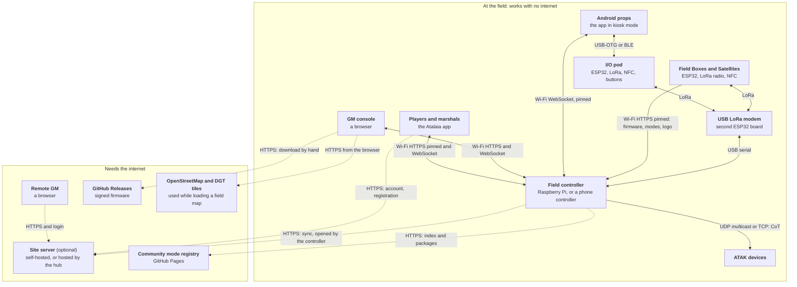
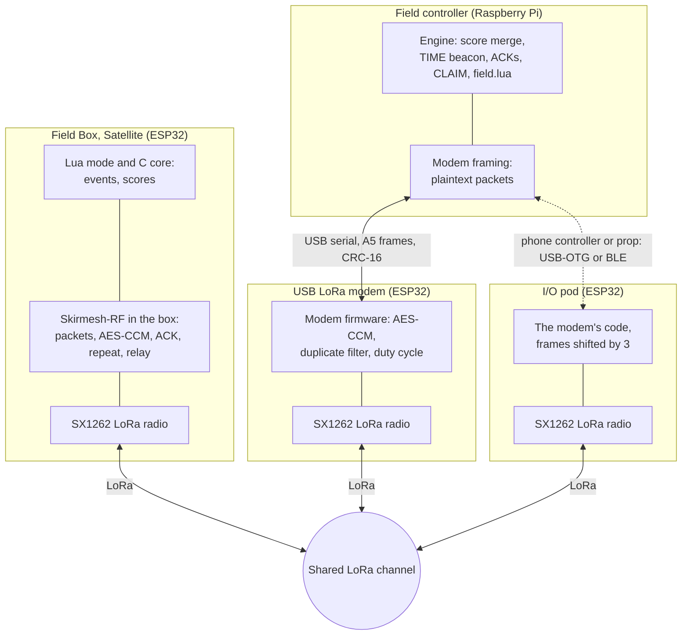
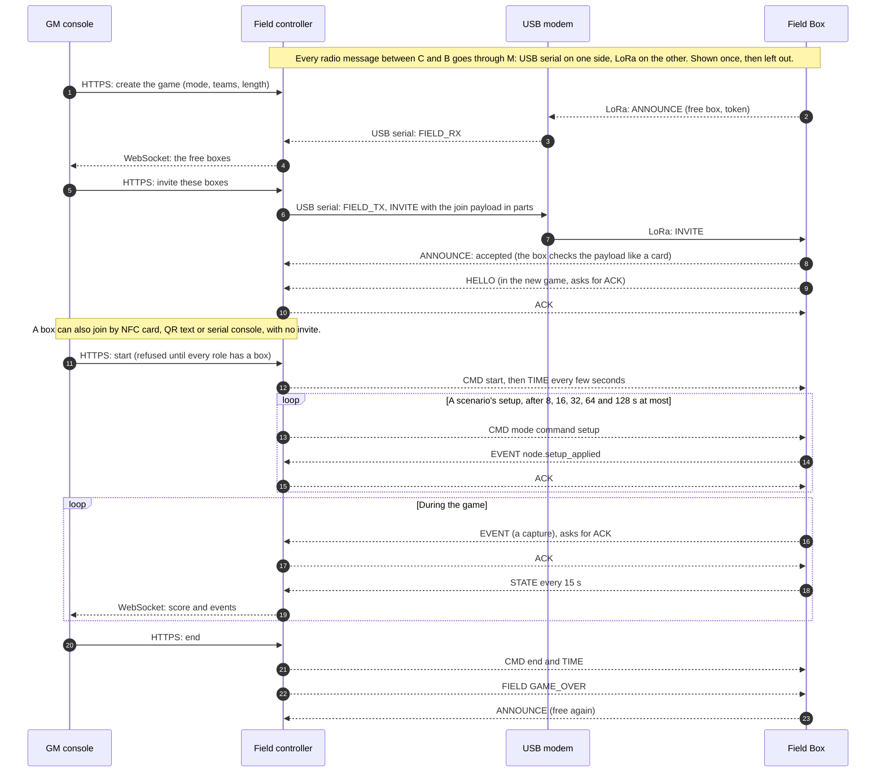
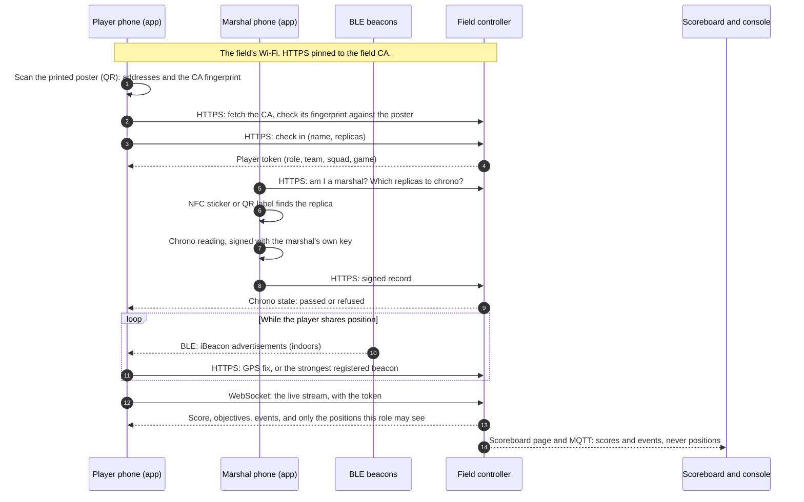
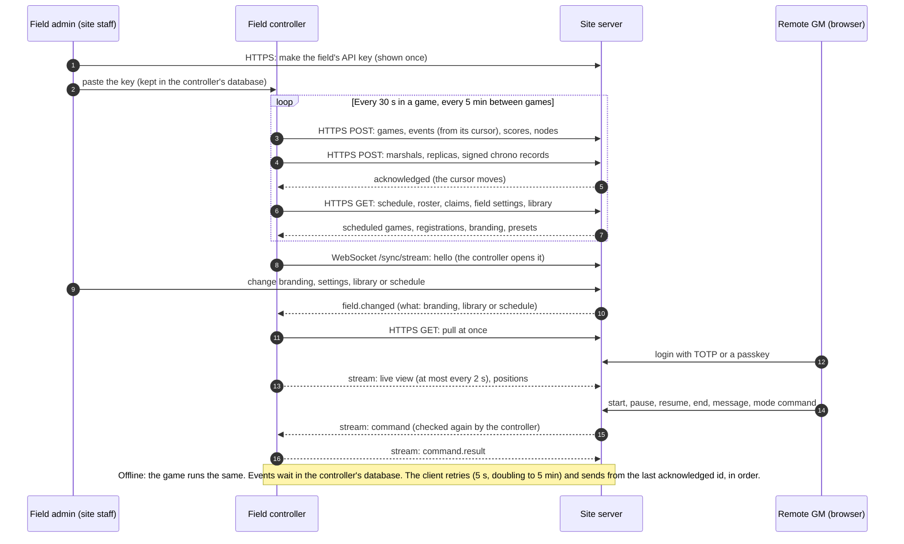
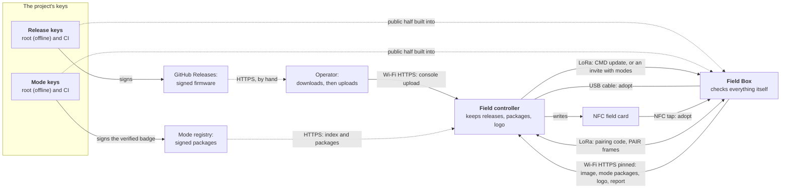
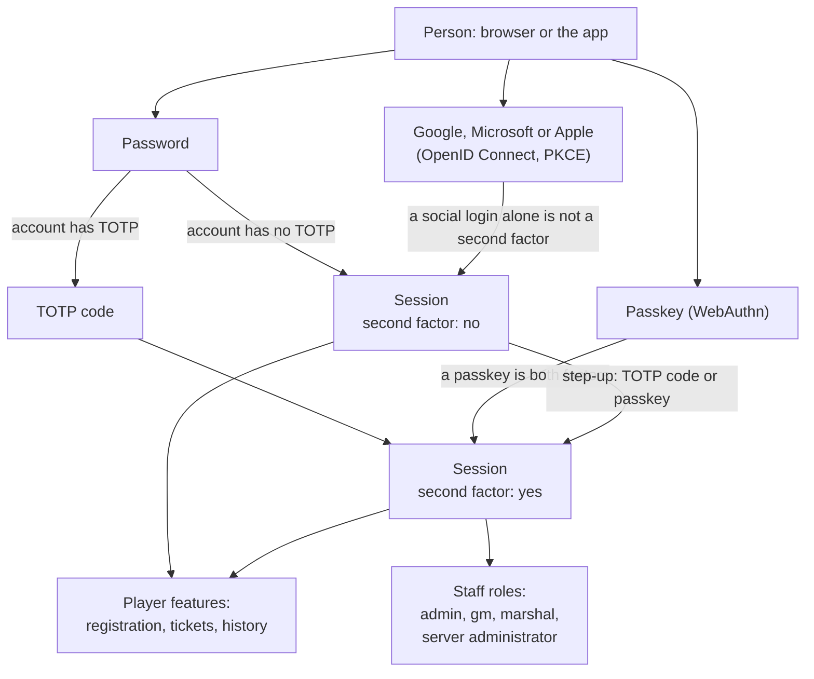

<!--
SPDX-FileCopyrightText: 2026 The Atalaia contributors
SPDX-License-Identifier: CC-BY-SA-4.0
-->

# How the parts of Atalaia talk to each other

Em português: [Como as partes do Atalaia falam entre si](architecture.pt.md).

This page shows, with diagrams, which part of Atalaia talks to which, over what
link, and what travels on it. It is for club members, makers and new
contributors. The [design specification](design-spec.md) explains why the
system is built this way. This page explains how it is wired today, and it
follows the code and the protocol documents where they differ from the design
(see [Where the documents and the code differ](#where-the-documents-and-the-code-differ)).

The diagrams are [Mermaid](https://mermaid.js.org/), which GitHub draws in the
browser. The project page shows the same diagrams as SVG in four languages
(its templates are `site/src/diagrams/arch-*.mmd`: change a diagram here and there
together, then run `python3 tools/render_diagrams.py`). Each one has a short text under it that says what flows on the links
and what does **not**.

**Reading the diagrams.** A solid line works with no internet at the field. A
dashed line needs the internet. The names of the links are always the same:

| Link | What it is |
| --- | --- |
| LoRa (Skirmesh-RF) | The field's radio, one shared channel, 869.525 MHz by default in Europe. Small encrypted packets. |
| Wi-Fi HTTPS, pinned | The field's own Wi-Fi. The controller serves HTTPS with its own certificate authority (the *field CA*). Apps and boxes trust only that authority, for the controller's addresses and nothing else. |
| USB serial | A cable between a computer or a phone and a board (the radio modem, or a box during adoption). |
| BLE | Bluetooth Low Energy: between a phone and an I/O pod, and from indoor beacons to a phone. |
| NFC | A tap: join cards, the field card, players' tags, replica stickers. |
| WebSocket stream | A long-lived connection for live data: the player's view, the GM console, the remote GM. |
| HTTPS to the internet | Ordinary HTTPS with the normal certificate authorities. Always opened from the field outwards. |

**Status.** Atalaia is pre-alpha. On real Heltec V4.3 boards, on a bench with the
field controller, these have run: boot, the radio, buttons, adoption by USB cable
and by pairing code, and an update over the air. Everything else on this page is
built and tested in software only (the simulator, host tests and Docker). Each
section says what has not been seen on real hardware.

## 1. The whole system on one page

**What flows.** All game traffic stays at the field. Boxes and the controller
talk over LoRa through the modem: events, scores, the clock and commands. The
controller serves everything else on the field's Wi-Fi: the GM console, the
live view for players, the Android props, and the files a box fetches (firmware,
game modes, the field's logo). A phone that is the field controller replaces the
Raspberry Pi and the modem: it uses a modem or an I/O pod plugged into it, or
has no LoRa at all and serves only Android props on Wi-Fi.

**What does not flow.**

- Game traffic never waits for the internet. The site server is optional.
- Players' **positions never go over LoRa**, and never over MQTT. They stay on
  the controller and are deleted when the game ends. Two opt-in exceptions are
  covered in section 5.
- The site server never connects to the controller. The controller always opens
  the connection (it usually sits behind a phone's 4G link).
- Boxes never talk to the internet, to GitHub or to the registry. The controller
  fetches a mode from the registry (or reads a folder, for a field with no
  internet); the box only trusts what it checks itself.
- The controller does not download firmware from GitHub. A person downloads the
  signed files and uploads them in the console (section 6).
- The map tiles are fetched by the GM's *browser*, only on the page *Load the
  field from a map* while setting the game up. Players' phones and the controller
  fetch no map tiles. That page uses OpenStreetMap (map, search and data) and,
  where the country has one, the open orthophoto service (the DGT's in mainland
  Portugal).

The "hub" is the project's public community page plus, optionally, hosted site
servers run by the project. A hosted site server is a mode of the same server
program, off by default and not live before the legal review of the templates.

Not yet run on real hardware: the phone controller, the Android props, the I/O
pod with a phone, ATAK, and everything on the internet side.

## 2. The radio layers

**What flows.** Every game packet has a 9-byte header and a body, and is
encrypted and authenticated with AES-128-CCM under the game's key. On LoRa the
body is compact CBOR. These message types are used:

| Message | What it carries |
| --- | --- |
| EVENT | One game event (a capture, a code used, a bomb armed). Normal and critical events ask for an ACK and are sent again until one comes. |
| ACK | "Received this sequence number" (a base and a bitmap). |
| STATE | A box's snapshot: its owner team, phase, points gained per team, battery. Every 15 s and after a capture. |
| HELLO | A node says who it is, its firmware and what it can do, after it joins or reboots. |
| CMD | A controller or GM instruction: start, pause, end, a message, a mode command (opcode 8, which carries a scenario's `setup`), a firmware update offer (opcode 9), an I/O pod's settings (opcode 10, sent to the pod of one phone). |
| TIME | The game clock. Also the controller's heartbeat. |
| CLAIM | The election of the controller in charge, for failover between two controllers. |
| CONFIG | Defined in the schema, for pushing a preset. The game's setup, its channel and its teams actually reach a box in its **join payload**, not in CONFIG. |
| FIELD, PAIR | Between games, outside any game (game id 0). FIELD (sealed with a key derived from the field join key): a free box's announcement, the controller's discovery, an invitation, GAME_OVER. PAIR (in the clear, CPace): adopting a box by its code. |

Boxes repeat each other's packets (a flood with a hop limit, 1 to 3, set in the
join). The modem and the controller never relay. The controller spaces its own frames
(RFC 0001 Amendment 15), the radios listen before they talk (Amendment 14), and
the duty-cycle budget of the channel's sub-band is enforced in the modem, the
pod and the boxes.

**Over the cable.** The controller and the modem speak plaintext packets in
`0xA5` frames with a CRC-16 ([`protocol/usb-modem.md`](../protocol/usb-modem.md)).
The modem seals and opens them, so the game key lives in the modem for game
packets. Field frames are different: the controller seals them, and the modem
never holds the field key. An I/O pod runs the same code and uses the same frames
(types shifted by 3) over USB-OTG or BLE to a phone
([`protocol/capability-proxy.md`](../protocol/capability-proxy.md)).

**What does not flow.** No player positions, no names, no tokens, no Wi-Fi
passwords, no firmware images and no mode packages go over LoRa. A mode package
or an image is too large and is fetched over HTTPS; only a short offer (CMD
update) or a failure report (`node.modes_failed`, `node.update_failed`) uses LoRa.

Not yet run on real hardware: the pod, the relay between many boxes (the field
test with 5 and 10 boxes), and field frames with more than one box. Whole games
with a modem and boxes on a bench have run.

## 3. A game, from the invite to the end

**What flows.** The join payload carries the game's id and key, the box's node
id and role, the teams, the channel and the hop limit, signed with the field join
key. After the invite, the box sends HELLO. The controller starts the game only
when every role the mode needs has a joined node, unless the GM forces it. Setup
commands are sent again until the box says `node.setup_applied`, at most five
times; each repeat carries what the controller knows then, so repeats do no harm.
A box's points reach the controller with its STATE, so the scoreboard can trail a
box's own screen by up to about 15 s.

**What does not flow.** The GM console never speaks LoRa: it talks only to the
controller. The game key travels only inside the sealed invite (or on a card), never in an announcement. The controller
keeps the game key in its database until the game ends, so that a restarted
controller can go on (GAME_OVER also works without the key, so boxes can leave).

Not yet run on real hardware: invites and GAME_OVER with several boxes, the
setup re-send and `node.setup_applied`, the start guard (software and the
simulator's radio model only).

## 4. Players on game day

**What flows.** The poster carries only the field's addresses and the CA's
SHA-256, no secret. The app pins that CA for those addresses. The player token is
signed by the controller and says who the phone is; the controller checks it on
every request. A marshal is only someone on the GM's marshal list. A chrono
reading is signed on the marshal's phone, so the controller (and later the site
server or another field) can check it is not changed. Players' own NFC tags are
signed by the controller, which holds the game key; the key never leaves it.

**Positions.** A player may share their position during a running game, either
as a GPS fix or, indoors, as the id of the strongest iBeacon the phone hears (it
listens for the registered beacons only). The controller keeps the latest fix per
player, for that game only. A player sees their own (and their squad's if the game
allows it), a squad leader their squad, a VIP their team, marshals and the GM
everyone, and the read code nobody.

**What does not flow.** Positions never go over LoRa or MQTT, and never to
players of other roles. The scoreboard and MQTT get scores and events, not
positions. There is no internet in this diagram: the whole of it works with the site
server off.

Not yet run on real hardware: all of it with a real phone (the iPhone checklist
passed for the iOS app, but nothing has been in a field), NFC on a phone, and
the BLE beacons.

## 5. Controller and site server sync

**What flows.** The controller pushes each game's metadata, its event log in id
order, the score counters per source, its nodes, and the chrono registry (the
marshals' public keys, the replicas, the signed readings). It pulls the field's
published games of the next 14 days, the roster of a scheduled game, claims of
player ids, branding and team crests (when it is set to take them from the site),
the field's check-in settings, and the scenario library and game presets. The
`field.changed` note is only a hint to pull at once: a missed one costs only the
wait for the next cycle. The remote GM works only when the field turns it on
(`remote_gm`, off by default): the site server sends a command only for a user
with the `gm` role on that field in a TOTP session, and the controller checks it
again, refuses one older than 60 s, and logs it.

**What does not flow.** The site server never connects to the controller and never
holds its GM or read tokens. Never sent: the game key, the join key, tokens, check-in
names and federation numbers, and any position inside an event (an event whose
data has a `lat`, `lon` or similar key is refused). Two opt-in exceptions send
positions, in memory and never stored: the remote GM's `positions` message
(`remote_gm` on) and the player events of the remote ATAK relay
(`[atak] remote_players`). Without them, positions stay on the controller.

Offline is the normal case, not an error: nothing in a game waits for the
network. The sync bodies go as ordinary HTTPS requests; the stream carries the
notes, the live view, the positions, the commands and ATAK's remote relay.

Not yet run on real hardware or over a real 4G link: all of it was tested against
the real site server and PostgreSQL in Docker only.

## 6. Getting things onto a box

**Adoption.** A new box is adopted once by the field and gets the *field join key*,
which is also the field's master secret. There are three ways: the USB cable
(the controller finds the box's USB port and sends the key), the NFC field card
(one card, tapped once on each new box; keep it locked away, since it is the
field's master secret), and the pairing code (the box shows 6 digits and the
controller proves it knows them over the radio with CPace, so the key never goes
over the air in the clear). Every adoption is logged, never with the key or a PIN.

**Firmware and modes.** The controller offers the update in a short LoRa packet.
The box then fetches the signed release and the image over the field Wi-Fi, from
the controller's HTTPS, trusting only the field CA whose hash its join payload
carries (so it needs no clock and no other trust store), and it reports the result
over HTTPS (or by a LoRa event if HTTPS fails). A mode a box lacks is fetched the
same way after an invite that asks for it. The field's logo comes over the same
Wi-Fi and HTTPS. Updates happen only between games, never while a game runs.

**The trust chain.** The signature, not the channel, is what makes a file safe:

- Firmware: a release key signs the manifest (platform, version, size and SHA-256).
  The private half of the root key is offline with the maintainer. The CI key is a
  secret of this repository and signs the GitHub releases. Their public halves are
  built into the firmware (`CONFIG_ATALAIA_OTA_RELEASE_KEYS`) and set on the
  controller (`[firmware] release_keys`). The controller and the site server check
  the signature only to keep a bad file out of their lists. The **box decides**,
  with the keys in its own firmware, before it writes a byte to flash.
- Modes: an author key signs a package. The project's registry key (root offline
  and CI, in the registry's secrets) signs the *verified badge*. The controller
  installs only what a key in its own `[modes] keys` signed and that is not
  revoked. The registry's index is never trusted for who signed. A box accepts a
  mode only from its controller, checked against the mode keys in its firmware.
- The release keys and the mode keys are separate keys, so that reviewing modes
  never needs the key that can replace a box's firmware. See
  [`community/keys.md`](community/keys.md).

Not yet run on real hardware: modes fetched by a box, the logo on a box's screen,
and the NFC field card. Adoption by USB cable and by pairing code, and an update
over the air, have run on a bench.

## 7. Login and accounts on the site server

**What flows.** The site server's login is a short-lived access token (15
minutes) plus a refresh token in a cookie that is rotated at every use. The app
keeps the refresh token in the phone's Android Keystore-sealed storage and the
access token in memory only. A social login runs in the system browser and returns
to the app by a link. Password login can be turned off, then accounts log in with
a passkey or a provider. The roles that manage a field (`admin`, `gm`, `marshal`,
and server administrators) count only in a session with a second factor, and an
account cannot remove its last second factor while a role needs one.

**What does not flow.** The controller does not use these accounts: it
authenticates to the site server with the field's API key and the app
authenticates to the controller with a player token or a GM or read code. A
social provider is contacted only by the person's browser and the site server,
never by a controller, a box or a modem.

Not yet run: the real login providers (Google, Microsoft, Apple) and passkeys on
a real phone. The server is tested on a computer only.

## Where the documents and the code differ

Where the design specification and the code disagree, this page follows the code.

| Topic | The design says | The code does |
| --- | --- | --- |
| Link to the site server | Section 4 of the design draws a "bridge" (usually an Android device with 4G) and a link labelled "internet" between the site server and the controller. | There is no bridge program. The controller itself opens HTTPS (and one WebSocket) to the site server over whatever internet the field has, including a phone's hotspot. |
| Android props | The design draws a prop reaching the controller over the LoRa mesh through an I/O pod. | An Android prop links to the controller over Wi-Fi (`WS /api/v1/prop`) by default. The pod adds the radio when one is plugged in, and a prop with a pod uses both. |
| Radio setup of a game | RFC 0001 Amendment 1 first said a game's channel is set by the CONFIG message. | CONFIG has no channel field (Amendment 3). The channel, the teams and the hop limit reach a box in the join payload. |
| Hub | The design speaks of a community hub with hosted site servers. | The hub is a project page and the registry. A hosted site server is a mode of the site server program (`hosted`), off by default. |
| Firmware on the controller | The catalogue of the site server could look like a firmware source. | The catalogue lists signed releases but holds no image. The controller does not fetch from GitHub: a person uploads the image and its `.release.json`. |
| Sync over the stream | Older text says the controller's bodies can travel on the stream. | The sync bodies go as HTTPS requests. The stream is for the `field.changed` note, the live view, positions, commands and the ATAK relay. |
| Positions | "Never leave the controller." | Two opt-in exceptions send them in memory to the site server: the remote GM's positions and the remote ATAK relay's player events. |

Found something else that does not match? Open an issue, or tell us in
[Discussions](https://github.com/vakaobr/atalaia-project/discussions).

## Where to read more

- [`protocol/README.md`](../protocol/README.md) and the documents beside it: the
  messages, the join payload, field frames, adoption, firmware updates, mode
  packages, the controller sync and the chrono records.
- [`controller/README.md`](../controller/README.md), [`server/README.md`](../server/README.md),
  [`app/README.md`](../app/README.md) and [`firmware/esp32/README.md`](../firmware/esp32/README.md):
  each part's own guide.
- [RFC 0001](rfcs/0001-skirmesh-rf-wire-format.md): the radio's wire format and its amendments.
- [The design specification](design-spec.md): section 4 is the first picture of
  this system, and sections 11 and 12 cover the integrations and the apps.
