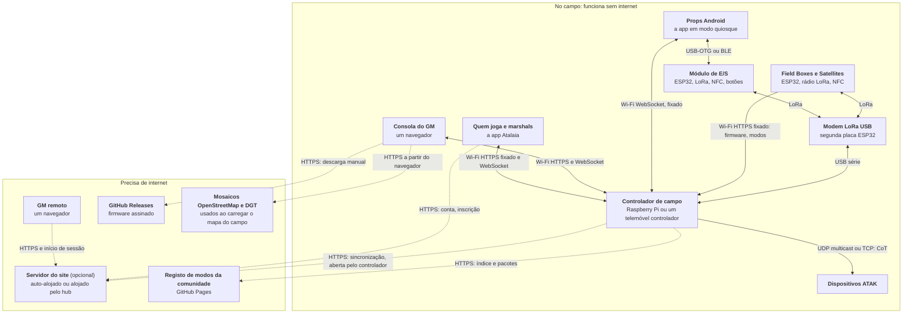
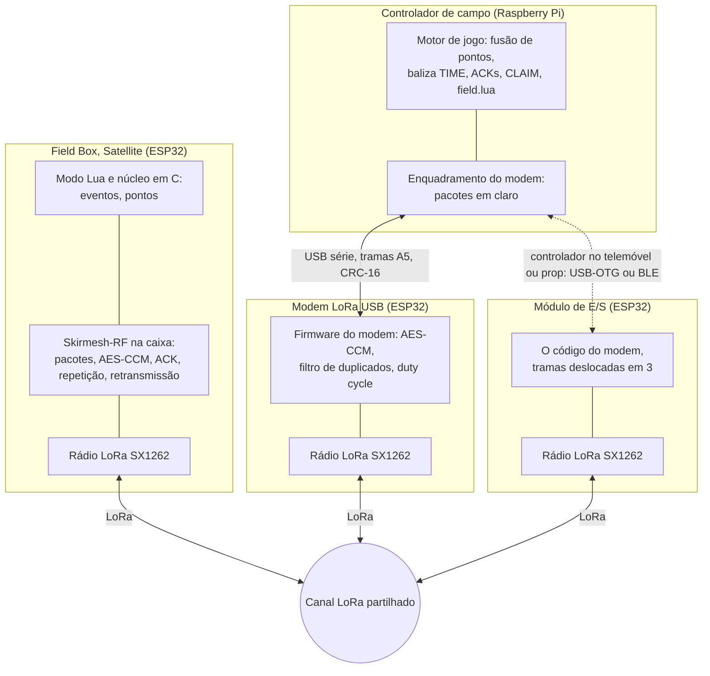
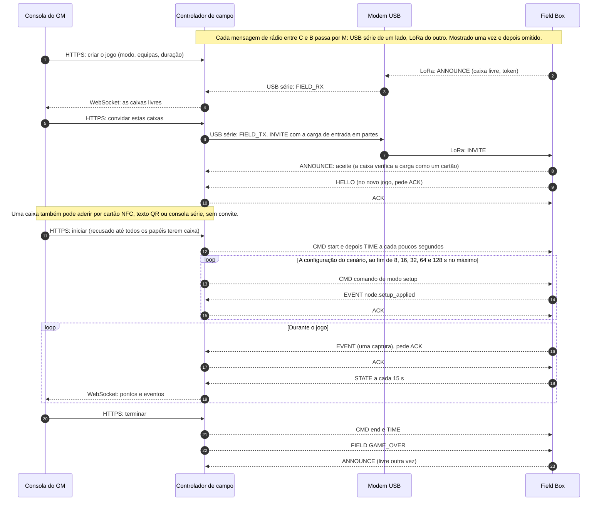
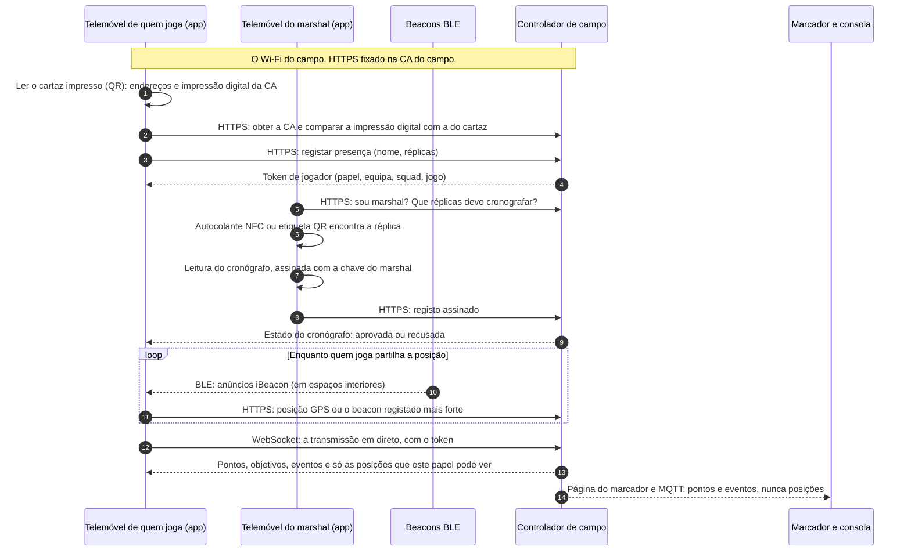
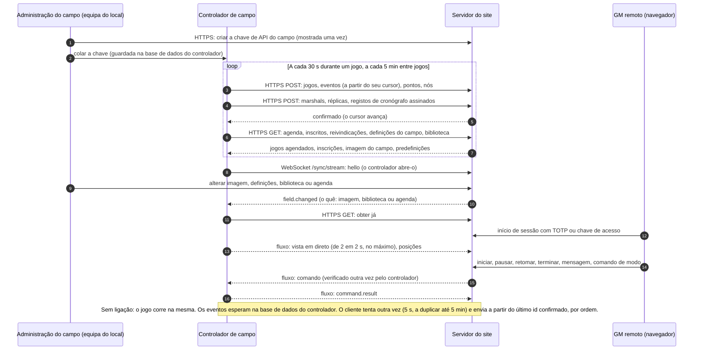
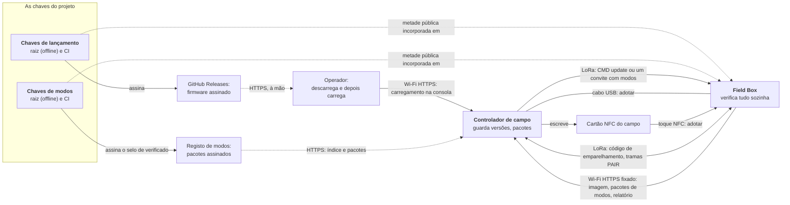
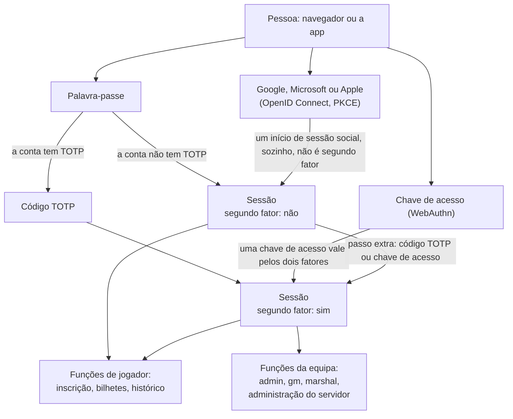

<!--
SPDX-FileCopyrightText: 2026 The Atalaia contributors
SPDX-License-Identifier: CC-BY-SA-4.0
-->

# Como as partes do Atalaia falam entre si

Em inglês: [How the parts of Atalaia talk to each other](architecture.md).

Esta página mostra, com diagramas, que parte do Atalaia fala com que parte, por
que ligação e o que passa por ela. É para quem é do clube, para quem constrói
caixas e para quem chega para contribuir. A [especificação de design](design-spec.md)
explica porque o sistema é assim. Esta página explica como está ligado hoje, e
segue o código e os documentos do protocolo onde estes diferem do design (vê
[Onde os documentos e o código diferem](#onde-os-documentos-e-o-código-diferem)).

Os diagramas são em [Mermaid](https://mermaid.js.org/), que o GitHub desenha no
navegador. A página do projeto mostra os mesmos diagramas em SVG, em quatro
línguas (os modelos estão em `site/src/diagrams/arch-*.mmd`: muda um diagrama aqui
e lá ao mesmo tempo e depois corre `python3 tools/render_diagrams.py`). Debaixo de
cada um há um texto curto que diz o que circula nas ligações e o que **não** circula.

**Como ler os diagramas.** Uma linha contínua funciona sem internet no campo. Uma
linha tracejada precisa de internet. Os nomes das ligações são sempre os mesmos:

| Ligação | O que é |
| --- | --- |
| LoRa (Skirmesh-RF) | O rádio do campo, um canal partilhado, 869,525 MHz por omissão na Europa. Pacotes pequenos e cifrados. |
| Wi-Fi HTTPS, fixado | O Wi-Fi do próprio campo. O controlador serve HTTPS com a sua própria autoridade de certificação (a *CA do campo*). As apps e as caixas só confiam nessa autoridade, para os endereços do controlador e para mais nada. |
| USB série | Um cabo entre um computador ou um telemóvel e uma placa (o modem de rádio, ou uma caixa durante a adoção). |
| BLE | Bluetooth Low Energy: entre um telemóvel e um módulo de E/S, e dos beacons de interior para um telemóvel. |
| NFC | Um toque: cartões de entrada, o cartão do campo, as etiquetas de quem joga, os autocolantes das réplicas. |
| WebSocket stream | Uma ligação duradoura para dados em direto: a vista de quem joga, a consola do GM, o GM remoto. |
| HTTPS para a internet | HTTPS normal, com as autoridades de certificação habituais. Abre-se sempre do campo para fora. |

**Estado.** O Atalaia está em pré-alfa. Em placas Heltec V4.3 reais, numa bancada
com o controlador de campo, já correram: arranque, rádio, botões, adoção por cabo
USB e por código de emparelhamento, e uma atualização por rádio. Tudo o resto
nesta página está feito e testado só em software (o simulador, os testes no
computador e o Docker). Cada secção diz o que ainda não foi visto em hardware real.

## 1. O sistema completo numa página

**O que circula.** Todo o tráfego do jogo fica no campo. As caixas e o controlador
falam por LoRa através do modem: eventos, pontos, o relógio e comandos. O controlador
serve tudo o resto no Wi-Fi do campo: a consola do GM, a vista em direto para quem
joga, os props Android e os ficheiros que uma caixa vai buscar (firmware, modos de
jogo). Um telemóvel que é o controlador de campo substitui o
Raspberry Pi e o modem: usa um modem ou um módulo de E/S ligado a ele, ou não tem
LoRa nenhum e serve só props Android no Wi-Fi.

**O que não circula.**

- O tráfego do jogo nunca espera pela internet. O servidor do site é opcional.
- As **posições** de quem joga **nunca vão por LoRa**, nem por MQTT. Ficam no
  controlador e são apagadas quando o jogo acaba. Duas exceções opcionais são
  tratadas na secção 5.
- O servidor do site nunca se liga ao controlador. É sempre o controlador que abre
  a ligação (costuma estar atrás da ligação 4G de um telemóvel).
- As caixas nunca falam com a internet, com o GitHub nem com o registo. O
  controlador vai buscar um modo ao registo (ou lê uma pasta, num campo sem
  internet); a caixa só confia no que ela própria verifica.
- O controlador não descarrega firmware do GitHub. Uma pessoa descarrega os
  ficheiros assinados e carrega-os na consola (secção 6).
- Os mosaicos do mapa são obtidos pelo *navegador* do GM, só na página *Carregar o
  campo de um mapa*, enquanto prepara o jogo. Os telemóveis de quem joga e o
  controlador não vão buscar mosaicos. Essa página usa o OpenStreetMap (mapa,
  pesquisa e dados) e, onde o país tem um, o serviço aberto de ortofotomapas (o da
  DGT em Portugal continental).

O "hub" é a página pública da comunidade do projeto e, opcionalmente, servidores
de site alojados pelo projeto. Um servidor de site alojado é um modo do mesmo
programa de servidor, desligado por omissão e que só entra no ar depois da revisão
jurídica dos modelos.

Ainda não testado em hardware real: o telemóvel controlador, os props Android, o
módulo de E/S com um telemóvel, o ATAK e tudo o que está do lado da internet.

## 2. As camadas de rádio

**O que circula.** Cada pacote do jogo tem um cabeçalho de 9 bytes e um corpo, e é
cifrado e autenticado com AES-128-CCM, com a chave do jogo. No LoRa o corpo é CBOR
compacto. Usam-se estes tipos de mensagem:

| Mensagem | O que leva |
| --- | --- |
| EVENT | Um evento do jogo (uma captura, um código usado, uma bomba armada). Os eventos normais e críticos pedem um ACK e são enviados outra vez até chegar um. |
| ACK | "Recebi este número de sequência" (uma base e um mapa de bits). |
| STATE | O retrato de uma caixa: a equipa dona, a fase, os pontos ganhos por equipa, a bateria. De 15 em 15 s e depois de uma captura. |
| HELLO | Um nó diz quem é, o seu firmware e o que sabe fazer, depois de aderir ou de reiniciar. |
| CMD | Uma instrução do controlador ou do GM: iniciar, pausar, terminar, uma mensagem, um comando de modo (opcode 8, que leva o `setup` de um cenário), uma oferta de atualização de firmware (opcode 9), as definições de um módulo de E/S (opcode 10, enviadas ao módulo de um telemóvel). |
| TIME | O relógio do jogo. É também o batimento do controlador. |
| CLAIM | A eleição do controlador responsável, para a passagem de testemunho entre dois controladores. |
| CONFIG | Definida no esquema, para enviar uma predefinição. A configuração do jogo, o seu canal e as suas equipas chegam de facto a uma caixa na sua **carga de entrada**, e não em CONFIG. |
| FIELD, PAIR | Entre jogos, fora de qualquer jogo (id de jogo 0). FIELD (selada com uma chave derivada da chave de entrada do campo): o anúncio de uma caixa livre, a descoberta pelo controlador, um convite, GAME_OVER. PAIR (em claro, CPace): adotar uma caixa pelo seu código. |

As caixas repetem os pacotes umas das outras (uma inundação com um limite de
saltos, de 1 a 3, definido na entrada no jogo). O modem e o controlador nunca retransmitem.
O controlador espaça as suas próprias tramas (RFC 0001, Emenda 15), os rádios
escutam antes de falar (Emenda 14), e o orçamento de duty cycle da subbanda do
canal é aplicado no modem, no pod e nas caixas.

**Mudanças de estado e de canal.** Um início, uma pausa ou um retomar sai como um CMD
e um TIME, e o controlador repete o estado num TIME 1, 2,5, 5 e 10 s depois, para que
uma caixa que perdeu as duas tramas não espere pelo sinal de 30 s (Emenda 19). Quando
o canal do campo muda, o controlador di-lo no canal antigo numa trama de campo, MOVE
(três vezes, com 2,5 s de intervalo), para que as caixas livres o sigam; o *Procurar
caixas* varre os últimos quatro canais à procura de caixas que a perderam, no máximo
uma vez por minuto e, numa subbanda com menos de 10 % de ciclo de trabalho, dentro de
5 % do orçamento dessa subbanda numa hora deslizante.

**Pelo cabo.** O controlador e o modem falam em pacotes em claro, em tramas `0xA5`
com um CRC-16 ([`protocol/usb-modem.md`](../protocol/usb-modem.md)). O modem sela-os
e abre-os, por isso a chave do jogo vive no modem para os pacotes de jogo. As
tramas de campo são diferentes: é o controlador que as sela, e o modem nunca tem a
chave do campo. Um módulo de E/S corre o mesmo código e usa as mesmas tramas (tipos
deslocados em 3) por USB-OTG ou BLE até um telemóvel
([`protocol/capability-proxy.md`](../protocol/capability-proxy.md)).

**O que não circula.** Nenhuma posição, nome, token, palavra-passe de Wi-Fi,
imagem de firmware nem pacote de modo vai por LoRa. Um pacote de modo ou uma imagem
é demasiado grande e vai buscar-se por HTTPS; só uma oferta curta (CMD update) ou um
relatório de falha (`node.modes_failed`, `node.update_failed`) usa o LoRa.

**Repetições.** Cada recetor (a caixa, o modem e os dois controladores) guarda, por
emissor, o `epoch << 16 | seq` mais alto e um mapa de 64 bits, aplicados só a um pacote
que autenticou: um contador já visto, ou 64 ou mais abaixo do mais alto, é largado por
muito tempo que tenha passado desde a gravação. Uma caixa também recusa um início, uma
pausa, um retomar, um fim ou um TIME mais antigo do que o último do seu tipo que
aplicou, e uma caixa que perdeu o registo da época sorteia uma nova em vez de repetir
números únicos. Nada muda no ar, por isso uma caixa que não foi atualizada continua
exposta. A janela vive na RAM: uma caixa que acabou de reiniciar aceita o primeiro
pacote de cada emissor. Testado com vetores comuns em C, Python e Dart e em testes no
computador; nenhum pacote gravado foi repetido em placas reais.

Ainda não testado em hardware real: o pod, a retransmissão entre muitas caixas (o
teste de campo com 5 e 10 caixas) e as tramas de campo com mais de uma caixa. Já
correram jogos inteiros com um modem e caixas numa bancada. O MOVE e as repetições do
TIME respondem a dois achados da bancada de 29 de outubro (uma pesquisa de rádio mudou
o canal e uma caixa parada deixou de ouvir; um início chegou a uma caixa 21 s tarde);
ambos estão corrigidos em software, e falta a verificação em duas placas.

## 3. Um jogo, do convite ao fim

**O que circula.** A carga de entrada leva o id e a chave do jogo, o id e o papel do
nó da caixa, as equipas, o canal e o limite de saltos, assinados com a chave de
entrada do campo. Depois do convite, a caixa envia HELLO. O controlador só inicia o
jogo quando cada papel de que o modo precisa tem um nó que entrou, a não ser que o GM
force. Os comandos de configuração são enviados outra vez até a caixa dizer
`node.setup_applied`, no máximo cinco vezes; cada repetição leva o que o controlador
sabe nesse momento, por isso repetir não faz mal. Os pontos de uma caixa chegam ao
controlador com o seu STATE, por isso o marcador pode ficar atrás do ecrã da própria
caixa até cerca de 15 s.

**Como acaba um jogo.** A organização termina-o, o tempo de jogo acaba, ou o modo di-lo:
num modo com `field.lua` decide o script; num modo sem ele, o primeiro `game.end` de
uma caixa do jogo em curso termina-o no controlador, com o vencedor do evento (uma das
equipas do jogo) ou em empate. Uma explosão da Bomba / Rush é um desses eventos: ganha
a equipa que armou a bomba. Um jogo em pausa ignora o `game.end` de uma caixa.

**O que não circula.** A consola do GM nunca fala LoRa: só fala com o controlador.
A chave do jogo só viaja dentro do convite selado (ou num cartão), nunca num
anúncio. O controlador guarda a chave do jogo na sua base de dados até o jogo
acabar, para que um controlador reiniciado possa continuar (GAME_OVER também
funciona sem a chave, para as caixas poderem sair).

Ainda não testado em hardware real: convites e GAME_OVER com várias caixas, o
reenvio da configuração e `node.setup_applied`, a guarda do início (só em software
e no modelo de rádio do simulador).

## 4. Quem joga, no dia do jogo

**O que circula.** O cartaz leva só os endereços do campo e o SHA-256 da CA, nenhum
segredo. A app fixa essa CA para esses endereços. O token de jogador é assinado
pelo controlador e diz quem é o telemóvel; o controlador verifica-o em cada pedido.
Um marshal é apenas quem está na lista de marshals do GM. Uma leitura do cronógrafo
é assinada no telemóvel do marshal, para que o controlador (e mais tarde o servidor
do site ou outro campo) possa verificar que não foi alterada. As etiquetas NFC de
quem joga são assinadas pelo controlador, que tem a chave do jogo; a chave nunca
sai dele.

**Check-in.** Quando o campo confere a filiação numa associação (a APD, em Portugal), o
check-in fica pendente até quem é árbitro ou o GM ter o cartão físico à frente e marcar
"cartão visto, corresponde"; o controlador guarda então o veredicto e apaga o número de
filiado (o servidor do site apaga a sua cópia quando chega o resultado do jogo ou o jogo
termina). É possível passar alguém sem o cartão, com o motivo registado. O código do GM
e os códigos de quem joga são recusados em HTTP simples quando o HTTPS está ligado, por
isso a consola do GM abre-se em `https://<controlador>:8443/console/`. A obtenção de
mapas da consola (*Carregar o campo a partir de um mapa*, que chega ao OpenStreetMap e
a serviços de imagens aéreas a partir do navegador) pode ser desligada nas Definições.

**Posições.** Quem joga pode partilhar a sua posição durante um jogo em curso, só se
marcou uma caixa própria, desmarcada de origem, no check-in (recusar não impede o
check-in nem o jogo; pode ligar-se ou desligar-se a qualquer momento, e sem ela o
controlador recusa as posições), como um ponto GPS ou, em espaços interiores, como o id do iBeacon mais forte que o
telemóvel ouve (só escuta os beacons registados). O registo tem as etiquetas da
organização e, a seu lado, as Field Box do jogo em curso que foram colocadas: uma caixa
que entrou num jogo emite como iBeacon (um UUID derivado da chave de entrada do campo,
um major fixo, o id do nó como minor), por isso uma caixa na parede também diz a um
telemóvel o seu piso e a sua sala. Um telemóvel que já está a partilhar volta a ler o
registo quando ele muda. Um controlador de reserva recebe as escolhas das balizas das
caixas e os lugares das caixas na sua carga de entrada, por isso, depois de uma passagem
de testemunho, o registo é o mesmo, e uma consola já aberta nele move logo os
marcadores das caixas. O controlador guarda o último
ponto de cada pessoa, só para esse jogo. Quem joga vê a sua própria posição (e a do
seu squad, se o jogo o permitir), a chefia de um squad vê o seu squad, um VIP vê a
sua equipa, os marshals e o GM veem todas, e o código de leitura nenhuma.

**O que não circula.** As posições nunca vão por LoRa nem por MQTT, e nunca chegam a
quem tem outro papel. O marcador e o MQTT recebem pontos e eventos, não posições. Neste
diagrama não há internet: tudo funciona com o servidor do site desligado.

Ainda não testado em hardware real: a verificação do cartão, a escolha da posição e os
códigos só em HTTPS com um telemóvel a sério; tudo isto com um telemóvel a sério (a lista de
verificação do iPhone passou para a app iOS, mas nada foi ainda a um campo), o NFC
num telemóvel e os beacons BLE: o plugin CoreLocation do iPhone compila no CI e não foi
corrido num iPhone, e nenhum telemóvel ouviu ainda o beacon de uma Field Box a sério.

## 5. Sincronização entre o controlador e o servidor do site

**O que circula.** O controlador envia os metadados de cada jogo, o seu registo de
eventos por ordem de id, os contadores de pontos por fonte, os seus nós e o registo
do cronógrafo (as chaves públicas dos marshals, as réplicas, as leituras
assinadas). Vai buscar os jogos publicados do campo para os 14 dias seguintes, os
inscritos de um jogo agendado, as reivindicações de ids de jogador, a imagem do
campo e os emblemas das equipas (quando está definido para os ir buscar ao site),
as definições de presença do campo e a biblioteca de cenários e as predefinições de
jogo. A nota `field.changed` é só uma dica para ir buscar já: se se perder, só custa
esperar pelo ciclo seguinte. O GM remoto só funciona quando o campo o liga
(`remote_gm`, desligado por omissão): o servidor do site só envia um comando para
quem tem a função `gm` nesse campo numa sessão com TOTP, e o controlador volta a
verificá-lo, recusa um com mais de 60 s e regista-o.

**O que não circula.** O servidor do site nunca se liga ao controlador e nunca tem
os seus tokens de GM ou de leitura. Nunca se envia: a chave do jogo, a chave de
entrada, tokens, nomes de presença e números de federação, nem qualquer posição
dentro de um evento (um evento cujos dados tenham uma chave `lat`, `lon` ou
parecida é recusado). Duas exceções opcionais enviam posições, em memória e sem
nunca as guardar: a mensagem `positions` do GM remoto (`remote_gm` ligado) e os
eventos de jogador da retransmissão ATAK remota (`[atak] remote_players`). Sem elas,
as posições ficam no controlador.

Estar sem ligação é o caso normal, não um erro: nada num jogo espera pela rede. Os
corpos da sincronização vão como pedidos HTTPS normais; o fluxo leva as notas, a
vista em direto, as posições, os comandos e a retransmissão ATAK remota.

Ainda não testado em hardware real nem numa ligação 4G real: tudo foi testado
apenas contra o servidor do site e o PostgreSQL reais, no Docker.

## 6. Pôr coisas numa caixa

**Adoção.** Uma caixa nova é adotada uma vez pelo campo e recebe a *chave de entrada
do campo*, que é também o segredo mestre do campo. Há três maneiras: o cabo USB (o
controlador encontra a porta USB da caixa e envia a chave), o cartão NFC do campo
(um cartão, tocado uma vez em cada caixa nova; guarda-o trancado, pois é o segredo
mestre do campo) e o código de emparelhamento (a caixa mostra 6 dígitos e o
controlador prova que os conhece pelo rádio com CPace, por isso a chave nunca vai
pelo ar em claro). Toda a adoção fica registada, nunca com a chave nem com um PIN.

**Firmware e modos.** O controlador oferece a atualização num pacote LoRa curto. A
caixa vai então buscar a versão assinada e a imagem pelo Wi-Fi do campo, ao HTTPS
do controlador, confiando só na CA do campo cujo hash a sua carga de entrada leva
(por isso não precisa de relógio nem de outro repositório de confiança), e
comunica o resultado por HTTPS (ou por um evento LoRa, se o HTTPS falhar). Um modo
que falta a uma caixa vai buscar-se da mesma maneira, depois de um convite que o
peça. As atualizações só se fazem
entre jogos, nunca com um jogo a correr.

**A cadeia de confiança.** É a assinatura, e não o canal, que torna um ficheiro
seguro:

- Firmware: uma chave de lançamento assina o manifesto (plataforma, versão, tamanho
  e SHA-256). A metade privada da chave raiz está offline, com quem mantém o
  projeto. A chave de CI é um segredo deste repositório e assina as versões no
  GitHub. As suas metades públicas estão incorporadas no firmware
  (`CONFIG_ATALAIA_OTA_RELEASE_KEYS`) e definidas no controlador
  (`[firmware] release_keys`). O controlador e o servidor do site só verificam a
  assinatura para manter um ficheiro mau fora das suas listas. **Quem decide é a
  caixa**, com as chaves do seu próprio firmware, antes de escrever um byte na
  flash.
- Modos: uma chave de autor assina um pacote. A chave de registo do projeto (raiz
  offline e CI, nos segredos do registo) assina o *selo de verificado*. O
  controlador só instala o que foi assinado por uma chave do seu próprio
  `[modes] keys` e que não foi revogado. Nunca se confia no índice do registo para
  saber quem assinou. Uma caixa só aceita um modo do seu controlador, verificado
  contra as chaves de modos do seu firmware.
- As chaves de lançamento e as chaves de modos são chaves separadas, para que
  rever modos nunca precise da chave que pode substituir o firmware de uma caixa.
  Vê [`community/keys.md`](community/keys.md).

Ainda não testado em hardware real: modos obtidos por uma caixa e o cartão NFC do
campo. A adoção por cabo USB e por código de
emparelhamento, e uma atualização por rádio, já correram numa bancada.

## 7. Início de sessão e contas no servidor do site

**O que circula.** O início de sessão do servidor do site é um token de acesso de
curta duração (15 minutos) mais um token de renovação num cookie, que é substituído
a cada uso. A app guarda o token de renovação no armazenamento do telemóvel selado
pelo Android Keystore e o token de acesso só em memória. Um início de sessão social
corre no navegador do sistema e volta à app por uma ligação. O início de sessão
com palavra-passe pode ser desligado, e então as contas entram com uma chave de
acesso ou com um fornecedor. As funções que gerem um campo (`admin`, `gm`,
`marshal` e a administração do servidor) só contam numa sessão com segundo fator, e
uma conta não pode remover o seu último segundo fator enquanto uma função precisar
dele.

**Contas.** Uma conta social nova pode escolher o seu nome de utilizador na página da
conta, qualquer conta pode mudar o seu nome com o seu próprio método de início de
sessão, e duas contas da mesma pessoa podem ser fundidas depois de a pessoa provar as
duas (nunca para dentro ou a partir de uma conta com função de equipa). As contas assentam no contrato, não no consentimento: um registo guarda que versão do
aviso de privacidade foi mostrada e que a pessoa tem 16 anos ou mais, e não há registo
enquanto não houver aviso publicado. Mudar a forma como uma conta inicia sessão (uma
passkey, o TOTP, a palavra-passe, uma conta social ligada, uma fusão) exige uma sessão
que passou por um TOTP ou uma passkey: um início de sessão social sozinho é recusado.
Num centro alojado, um só endereço de retorno serve todos os campos (o centro assina um
estado que nomeia o campo e passa para o retorno do próprio campo). O registo de
auditoria esquece os endereços de rede ao fim de 180 dias, uma conta sem uso há 24
meses é anonimizada e o histórico de jogos guarda-se 90 dias (os resultados das equipas,
sem identificadores, 365). Um registo por
conta social guarda a versão do aviso de privacidade que a pessoa viu. A limpeza diária
da retenção apaga os restos anonimizados de uma conta eliminada ou fundida quando nada
os referencia. O início de sessão com a Google e a Microsoft foi experimentado com os
fornecedores a sério no servidor de testes do projeto; o da Apple não.

**O que não circula.** O controlador não usa estas contas: autentica-se no servidor
do site com a chave de API do campo, e a app autentica-se no controlador com um
token de jogador ou com um código de GM ou de leitura. Um fornecedor social só é
contactado pelo navegador da pessoa e pelo servidor do site, nunca por um
controlador, uma caixa ou um modem.

Ainda não testado: os fornecedores de início de sessão reais (Google, Microsoft,
Apple) e as chaves de acesso num telemóvel real. O servidor só foi testado num
computador.

## Onde os documentos e o código diferem

Onde a especificação de design e o código discordam, esta página segue o código.

| Tema | O que o design diz | O que o código faz |
| --- | --- | --- |
| Ligação ao servidor do site | A secção 4 do design desenha uma "ponte" (normalmente um dispositivo Android com 4G) e uma ligação chamada "internet" entre o servidor do site e o controlador. | Não há programa de ponte. É o próprio controlador que abre HTTPS (e um WebSocket) para o servidor do site, pela internet que o campo tiver, incluindo o hotspot de um telemóvel. |
| Props Android | O design desenha um prop a chegar ao controlador pela malha LoRa, através de um módulo de E/S. | Por omissão, um prop Android liga-se ao controlador por Wi-Fi (`WS /api/v1/prop`). O pod acrescenta o rádio quando está ligado um, e um prop com um pod usa os dois. |
| Configuração de rádio de um jogo | A Emenda 1 da RFC 0001 dizia primeiro que o canal de um jogo é definido pela mensagem CONFIG. | CONFIG não tem campo de canal (Emenda 3). O canal, as equipas e o limite de saltos chegam a uma caixa na carga de entrada. |
| Hub | O design fala de um hub da comunidade com servidores de site alojados. | O hub é uma página do projeto e o registo. Um servidor de site alojado é um modo do programa do servidor do site (`hosted`), desligado por omissão. |
| Firmware no controlador | O catálogo do servidor do site podia parecer uma fonte de firmware. | O catálogo lista versões assinadas mas não guarda nenhuma imagem. O controlador não vai buscar ao GitHub: uma pessoa carrega a imagem e o seu `.release.json`. |
| Sincronização pelo fluxo | Um texto mais antigo diz que os corpos do controlador podem viajar no fluxo. | Os corpos da sincronização vão como pedidos HTTPS. O fluxo serve a nota `field.changed`, a vista em direto, as posições, os comandos e a retransmissão ATAK. |
| Posições | "Nunca saem do controlador." | Duas exceções opcionais enviam-nas, em memória, para o servidor do site: as posições do GM remoto e os eventos de jogador da retransmissão ATAK remota. |

Encontraste outra coisa que não bate certo? Abre uma issue, ou diz-nos nas
[Discussions](https://github.com/vakaobr/atalaia-project/discussions).

## Onde ler mais

- [`protocol/README.md`](../protocol/README.md) e os documentos ao lado: as
  mensagens, a carga de entrada, as tramas de campo, a adoção, as atualizações de
  firmware, os pacotes de modos, a sincronização do controlador e os registos do
  cronógrafo.
- [`controller/README.md`](../controller/README.md), [`server/README.md`](../server/README.md),
  [`app/README.md`](../app/README.md) e [`firmware/esp32/README.md`](../firmware/esp32/README.md):
  o guia de cada parte.
- [RFC 0001](rfcs/0001-skirmesh-rf-wire-format.md): o formato de transmissão do
  rádio e as suas emendas.
- [A especificação de design](design-spec.md): a secção 4 é a primeira imagem deste
  sistema, e as secções 11 e 12 tratam das integrações e das apps.
