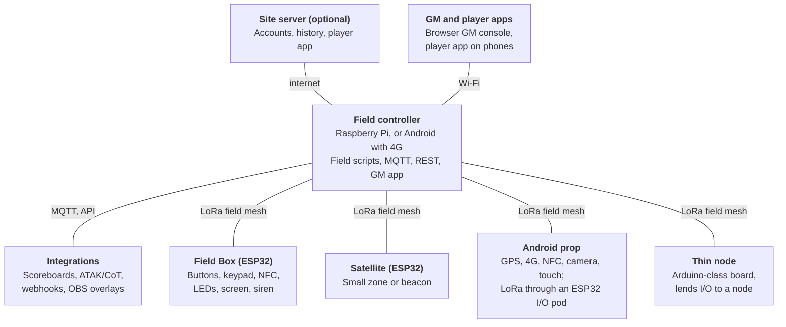
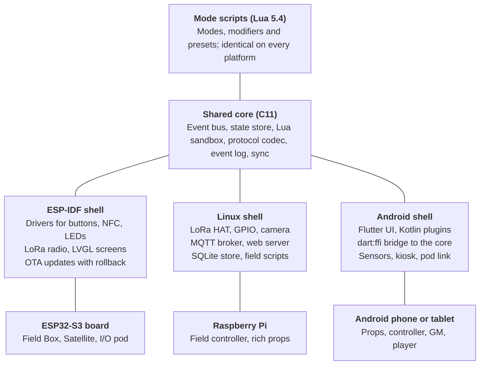

# Atalaia — Design Spec

The open force-on-force platform · Draft v0.2 · 17 October 2026

> Exported from the living design document. Diagrams are rendered as Mermaid charts.

## 1. Overview

Atalaia is an open, local-first platform for airsoft and paintball game props. Any device can be a prop: an ESP32 board, a Raspberry Pi, or a new or repurposed Android phone or tablet. Game modes are scripts that anyone can write, share and run on every platform unchanged.

### Goals

- Run every built-in mode fully offline on any site, from a single house or palacete to a multi-kilometre field.
- Mix device types freely in one game: a €20 microcontroller box and an old Android tablet are equal citizens.
- Make game modes data, not firmware. Adding or changing a mode never requires reflashing a device.
- Publish a documented protocol and public API so others can add devices, apps and scoreboards.
- Keep setup fast: a game master (GM) picks a saved preset on the device or from a phone in under a minute.
- Let a field optionally self-host a site server for accounts, history, remote setup and the player app.
- Give players a role-based app (player, squad leader, VIP, marshal, GM, spectator) on Android and iOS.
- Keep a chrono history per player and replica, so marshals can catch power changes with spot checks.

### Non-goals for v1

- Compatibility with any commercial prop system's hardware, firmware or protocol.
- A cloud service as a requirement. The site server is optional and self-hosted; no game ever waits on it.
- A required central service. Fields self-host by default; hosted site servers on the community hub are an opt-in service for clubs without IT support.
- Hit detection worn by players (laser-tag style).

### Terms used in this spec

| Term | Meaning |
| --- | --- |
| Node | Any device running the platform runtime, on any hardware |
| Prop | A node players interact with on the field (box, target, beacon) |
| Field controller | The on-site node that runs cross-device game logic and hosts the local API |
| Site server | An optional, self-hosted server for accounts, history, remote setup and the player app |
| GM console | The UI a game master uses to configure, start, watch and override a game |
| Player app | The Android and iOS app players use; its view depends on their role |
| Player role | A set of views and permissions: player, squad leader, VIP, marshal, GM, spectator |
| Marshal | Safety official who runs chrono checks at check-in and spot checks during play |
| Chrono record | One measured velocity, BB weight and energy for a replica, signed by a marshal |
| Field profile | Radio and timing defaults for a site type: CQB/indoor, small outdoor, large outdoor |
| Capability | A typed hardware feature a node announces, such as `button`, `nfc` or `gps` |
| Mode | A game-logic script, such as Domination or Bomb |
| Preset | A mode plus saved parameters, ready to start from the device or console |
| Game | One running session: teams, nodes, presets, scores and an event log |

## 2. Background

The main commercial reference is the Ares Alpha prop line. Its hardware is capable, but every game rule lives in closed firmware, so each community idea waits on the vendor. This project matches the feature surface with our own clean-room design and opens the rules layer.

### What the reference system offers

Per the [ATB Pro product listing](https://www.iwa.info/en/ausstellerprodukte/iwa24/product-10334365/atb-pro) and the vendor's [2025 recap](https://forum.ares-alpha.com/forum/topic/ares-alpha-electronic-props-2025-recap-2026-development-roadmap/):

- Modes: Domination, Bomb, Money Factory, Tags Collect, VIP Transport, player check-in.
- Connectivity: 4G and Wi-Fi to a vendor cloud, plus a local LoRa mesh that syncs points offline.
- Sensors and I/O: keypad, display, RFID/NFC tags and wristbands, GPS, motion sensor, addon port (e.g. a hit target).
- Management: phone app with remote control, web config page, online firmware updates.
- Gaps: no public API, no user-written modes, no third-party hardware. User-made modes are only at [concept stage](https://forum.ares-alpha.com/forum/topic/ares-alpha-electronic-props-2025-recap-2026-development-roadmap/), held back by complexity and support load.

### Community requests this design must make easy

Collected from the vendor's [Electronic Props forum](https://forum.ares-alpha.com/forum/forum/electronic-props/). Section 15 maps each one to a mode or feature.

| Request | Thread | Why it is blocked today |
| --- | --- | --- |
| Game timer that freezes scores at the end | [Prop suggestions](https://forum.ares-alpha.com/forum/topic/ares-alpha-prop-suggestions/) | Needs a firmware release |
| GM notified when a hint code is used, and by which team | [Prop suggestions](https://forum.ares-alpha.com/forum/topic/ares-alpha-prop-suggestions/) | No event stream to the GM |
| RFID tags usable as hint or point codes in any mode | [Prop suggestions](https://forum.ares-alpha.com/forum/topic/ares-alpha-prop-suggestions/) | Tag behaviour hard-coded per mode |
| Pick saved presets on the box without the app | [Prop suggestions](https://forum.ares-alpha.com/forum/topic/ares-alpha-prop-suggestions/) | Config only through the app |
| Target lights a random team colour for a short scoring window | [Prop suggestions](https://forum.ares-alpha.com/forum/topic/ares-alpha-prop-suggestions/) | Vendor roadmap item |
| Kill-confirmed: scanning a team's tag removes their point | [Prop suggestions](https://forum.ares-alpha.com/forum/topic/ares-alpha-prop-suggestions/) | Hard-coded modes |
| Bomb returns to standby after defuse; button arm/disarm; auto-arm timer | [Prop suggestions](https://forum.ares-alpha.com/forum/topic/ares-alpha-prop-suggestions/) | Hard-coded modes |
| Read live scores from a Raspberry Pi or Arduino scoreboard | [Prop suggestions](https://forum.ares-alpha.com/forum/topic/ares-alpha-prop-suggestions/) | No public API |
| Score only while holding all boxes at once | [New ATB modes](https://forum.ares-alpha.com/forum/topic/new-game-modes-for-the-atb/) | Logic spans several devices |
| A separate arming code per team on one bomb | [New ATB modes](https://forum.ares-alpha.com/forum/topic/new-game-modes-for-the-atb/) | Vendor roadmap item |
| Countdown to defeat while holding only 1 of 3 flags | [New ATB modes](https://forum.ares-alpha.com/forum/topic/new-game-modes-for-the-atb/) | Vendor says not supported |
| Lives-per-team respawn counter | [New ATB modes](https://forum.ares-alpha.com/forum/topic/new-game-modes-for-the-atb/) | Limited to specific hardware |
| Master boxes boosted by captured satellite boxes ("power plant" ×1.5) | [Master and slave devices](https://forum.ares-alpha.com/forum/topic/master-and-slave-devices/) | Vendor says it needs constant cloud connection |

The pattern is clear: most requests are a few lines of logic, and the hard ones span devices. Scriptable modes solve the first group; a local field controller solves the second.

## 3. Design principles

Eight rules settle most design arguments. When a proposal breaks one, it needs a written exception in the decision log (section 18).

1. **Local-first.** A game never depends on the internet. Every feature works on an isolated field. An optional site server adds accounts, history, remote setup and the player app, but a game never waits on it.
2. **Platform-agnostic.** ESP32, Arduino-class boards, Raspberry Pi/Linux and Android are all first-class nodes. No feature is designed around one platform's strengths.
3. **Capability-based.** Modes ask for capabilities ("needs `buttons.team` or `keypad`"), never for device models. A node that has the capability can run the role.
4. **One protocol, many transports.** The same messages travel over LoRa, Wi-Fi, BLE, USB serial or the internet. Transports are plugins.
5. **Modes are data.** Game logic is a script plus a parameter schema. It can be pushed to a node at the start of a game without reflashing.
6. **Degrade gracefully.** A prop that loses its link keeps running its local logic, keeps its own score and reconciles when the link returns.
7. **Simple by default, deep on demand.** Presets and a visual editor for GMs; scripts and the raw API for tinkerers.
8. **Open and clean-room.** Open hardware, open firmware, open protocol, documented in this repo. Nothing copied from a commercial product.

## 4. System architecture

A game is one field controller plus any number of props, all speaking one protocol. Inside every full node, only the platform shell and the hardware differ; scripts and the core are shared.



All links are two-way. LoRa carries game traffic across the field; Wi-Fi, BLE and USB carry bulky transfers and pod links; the optional site server connects the field to the internet for the player app, history and remote GMs.

### Logical roles

A role is software, not a device. One Android tablet can be both field controller and GM console in a small game.

- **Prop**: a node players interact with. Runs node scripts and keeps its own score.
- **Field controller**: runs field scripts, merges event logs, hosts the local API and the GM console.
- **Site server** (optional): self-hosted accounts, field setup, game history, chrono registry and the player app backend. On a small site it can run on the same machine as the field controller.
- **GM console**: configures presets, starts and stops games, watches events, overrides.
- **Player app**: role-based views for players, squad leaders, VIPs, marshals, GMs and spectators (section 12).
- **Bridge**: optional link from the field to the site server, usually an Android device with 4G or the venue's internet.

### Inside a node



Only the shell and hardware layers change between platforms. Thin nodes (Arduino-class) run no scripts; they lend their I/O to a full node through the capability proxy. A mode is tested once against the shared core, then runs on any platform shell that offers the capabilities it needs.

### Typical deployments

| Scenario | Devices |
| --- | --- |
| Quick single-box game | 1 Field Box, no controller; preset picked on the keypad |
| Small CQB site (house, palacete, warehouse) | 2–6 Field Boxes, one mini PC running both controller and site server, player app over the venue Wi-Fi |
| Club Sunday game | 3–5 Field Boxes, Raspberry Pi controller, GM on a phone |
| Weekend milsim | 10–20 boxes and satellites, Pi controller with repeaters, Android 4G bridge to the site server, player app, ATAK integration |
| Budget field | Repurposed Android phones with I/O pods as props, an Android tablet as controller |

## 5. Supported platforms

Four platform families are supported from the start: ESP32, Arduino-class microcontrollers, Raspberry Pi/Linux and Android. Android is a first-class option because one cheap or repurposed device already covers GPS, 4G, Wi-Fi, BLE, NFC, motion sensing, a touchscreen, audio, a camera and a large battery.

### How we keep four platforms manageable

All platforms share one portable core written in C11: the event bus, state store, protocol codec and Lua 5.4 script runtime. Each platform only adds a thin shell with its hardware drivers, transports and UI. A mode script therefore behaves identically on an ESP32 box and on an Android tablet, and is tested once against the core.

| Layer | ESP32 | Arduino-class | Raspberry Pi / Linux | Android |
| --- | --- | --- | --- | --- |
| Core (C11 + Lua 5.4) | ESP-IDF component | Not run (thin node) | Native library + daemon | Native library via `dart:ffi` |
| Shell language | C / C++ | C++ (Arduino) | C, Python bindings | Dart (Flutter), small Kotlin plugins |
| UI | Small display, LEDs | LEDs, 7-segment | Touchscreen or headless web | Flutter touch UI |

### Capability matrix

"Built-in" means no extra parts. "Add-on" means a cheap module or pod (section 6).

| Capability | ESP32-S3 | Arduino-class (AVR, RP2040) | Raspberry Pi | Android |
| --- | --- | --- | --- | --- |
| LoRa field mesh | Add-on (SX1262, often on-board) | Add-on | Add-on (HAT) | Add-on via BLE/USB radio pod |
| Wi-Fi | Built-in | RP2040W only | Built-in | Built-in |
| BLE | Built-in | No | Built-in | Built-in |
| 4G / internet | Add-on modem | No | USB modem | Built-in on SIM devices |
| GPS | Add-on | Add-on | Add-on | Built-in |
| NFC / RFID | Add-on (PN532) | Add-on | Add-on | Built-in on many devices, short range |
| Motion (IMU) | Add-on | Add-on | Add-on | Built-in |
| QR / camera | No | No | Add-on | Built-in |
| Large physical buttons, siren, LED strip | Built-in GPIO | Built-in GPIO | Built-in GPIO | Add-on via I/O pod |
| Battery life (typical prop duty) | 24–72 h | Days | 6–12 h | 8–20 h, screen-dependent |
| Runs mode scripts | Yes; full with PSRAM, reduced without (section 6) | No (AVR) / stretch goal (RP2040) | Yes | Yes |
| Ruggedness | Your enclosure | Your enclosure | Your enclosure | Needs a rugged case |

### Role fit

| Role | Best fit | Also works | Notes |
| --- | --- | --- | --- |
| Prop (box, target, beacon) | ESP32 | Android + I/O pod, Arduino thin node | ESP32 wins on battery life and cost per box |
| Prop with rich UI (terminal, hacking puzzle, map) | Android | Raspberry Pi | Touchscreen, sound and QR for free |
| Field controller | Raspberry Pi or mini PC | Android with 4G, ESP32 (small games) | Needs storage, MQTT broker and web server |
| Site server (optional) | Mini PC on site, or a VPS | Raspberry Pi 5 | Container image; shares a machine with the controller on small sites |
| GM console | Any browser, Android tablet | — | Served by the controller or the site server |
| Player app | Players' own phones | — | Android and iOS; prop and controller roles stay Android-only |
| Internet bridge | Android with 4G | Pi + USB modem, venue internet | Links the field to the site server |

### Android-specific constraints

Android gives a lot for free but needs careful handling on the field.

- **No LoRa radio.** An Android prop joins the mesh through a small ESP32 radio pod over BLE or USB-OTG. Without a pod it can still join over Wi-Fi.
- **Touch is weak outdoors.** Gloves, rain and sunlight hurt touch input. Props that need fast capture use an I/O pod with big physical buttons.
- **Background killing.** The app runs as a foreground service with a wake lock and asks to be exempted from battery optimisation. Some vendors need extra per-brand settings, documented in a wiki page.
- **Tamper resistance.** Props run in lock-task (kiosk) mode so players cannot leave the app. Dedicated props are set up as device owner.
- **Battery.** Screen brightness dominates. The prop UI dims after inactivity and wakes on button, NFC or motion.
- **Old devices.** Minimum target is Android 8.0 (API 26), so most phones from 2017 onward can be repurposed.
- **Heat and water.** A sealed case with a clear window, plus external pod buttons through cable glands.

### Thin nodes and pods

Devices too small to run scripts still take part as **thin nodes**. A thin node only exposes capabilities and raw events through the capability proxy protocol (section 7); a nearby full node or the field controller runs its logic. The same mechanism lets an Android device borrow buttons, LEDs, a siren and a LoRa radio from an ESP32 **I/O pod**, so the pod's hardware looks local to the script.

## 6. Reference hardware builds

Five reference builds cover v1, all from off-the-shelf parts with no custom PCB required. A carrier PCB comes later to make assembly easier. Costs are approximate 2026 hobby-market prices, not quotes.

| Build | Purpose | Core parts | Approx. cost |
| --- | --- | --- | --- |
| **Field Box** | Main prop: domination, bomb, codes, tags | ESP32-S3 LoRa board (e.g. Heltec LoRa 32 V3), 2–4 × 60 mm arcade buttons, 3×4 keypad, 2.8" TFT, WS2812 ring, PN532 NFC, MAX98357A amp + speaker + microSD, MAX17048 fuel gauge, 2S 18650 pack with BMS, IP65 box | €70–110 |
| **Satellite** | Small secondary point, beacon, "power plant" | ESP32-S3 LoRa board, 2 buttons, LED ring, piezo buzzer, 1S 18650 | €30–40 |
| **Android hybrid prop** | Rich-UI terminal, map, QR, 4G | Repurposed phone or tablet, rugged case, ESP32 I/O pod (LoRa + buttons + LEDs + siren) over USB-OTG or BLE | €0–120 device + €35 pod |
| **Field controller** | Runs cross-device logic, API, GM web app | Raspberry Pi 4/5 (Zero 2 W for small fields), SX1262 LoRa HAT, optional GPS, optional 4G USB modem, 10–20 Ah power bank | €80–150 |
| **Target addon** | Hit-scoring target for any box | Steel or polycarbonate plate, piezo sensor, small MCU (RP2040 or ATtiny) for hit detection, WS2812 ring | €20–30 |

Optional modules for any ESP32 build: GPS (u-blox M10 class), IMU (LSM6DS3 class) for VIP transport, 4G modem (SIM7600 / A7670 class) for stand-alone internet.

For CQB and indoor sites, GPS can be dropped from every build: props are placed on a floor plan instead (section 10), which also lowers cost and power use.

### Device tiers and PSRAM

PSRAM is optional. Every ESP32 build works with or without it, so boards people already own can join without buying new parts. The firmware detects PSRAM at boot and runs in the matching tier.

| Tier | Example boards | What runs | Limits |
| --- | --- | --- | --- |
| Full | ESP32-S3 with 2–8 MB PSRAM, classic ESP32 WROVER | Node scripts, a mode plus several modifiers, colour screens, cached audio clips | Script memory 256 KB by default |
| Reduced | Classic ESP32 or ESP32-S3 without PSRAM (WROOM modules, most older dev boards) | Node scripts loaded as precompiled bytecode; one mode plus one modifier; small or monochrome screens | Script memory about 64 KB; audio streamed from microSD |
| Proxy | Boards that cannot run scripts (ESP8266, AVR, other low-RAM boards) | Thin node: hardware only, its script runs on the controller | Needs a link to the controller during the game |

PSRAM sits inside the module, so it cannot practically be added to a board that lacks it. What helps a Reduced-tier board instead:

- **microSD module** (about €2): holds sound clips, screen images and logs so they need no RAM.
- **Monochrome OLED** instead of a colour TFT: a much smaller frame buffer.
- **Proxy mode**: any board can hand its logic to the controller when a mode needs more than it has.
- **For new builds**: pick an ESP32-S3 module with PSRAM; it usually costs only slightly more than one without.

Mode manifests declare `min_tier` (`reduced` or `full`). The GM console shows each node's tier and warns before a game when a mode needs more than a node offers.

### Radio band

Use the legal LoRa band for the region: EU868 in Portugal and the rest of Europe, US915 in the Americas, AS923 in much of Asia. The firmware ships a region table and refuses to transmit until a region is chosen.

### Addon bus

Addons plug into a waterproof 5-pin M12 connector: GND, 5 V, SDA, SCL and an interrupt line. Each addon carries its own small MCU that answers an "identify" request with a capability descriptor, so the host needs no driver changes. I2C is reliable to about 1–2 m; longer runs or remote targets use a Satellite or thin node over LoRa or BLE instead.

### Enclosure and power guidance

- Field boxes: IP65 or better, cable glands for external buttons, a lanyard point, and a recessed power switch players cannot reach easily.
- Batteries: protected 18650 cells with a BMS; charge over USB-C PD so field operators use one charger type.
- Visual design: bright colours and a printed "GAME PROP" label. Avoid anything resembling a real explosive device (see section 17).

## 7. Capability model and hardware abstraction

Every node describes itself as a list of typed capabilities, and scripts talk only to capabilities. This is what lets the same mode run on a Field Box, an Android tablet or a Pi.

### Node descriptor

On boot and on request, each node announces a descriptor:

```json
{
  "node": "box-a3f1", "name": "Alpha", "platform": "esp32s3",
  "fw": "0.4.0", "core": "0.4.0", "proto": 1,
  "transports": ["lora", "wifi", "ble"],
  "caps": [
    {"id": "btn.red",  "type": "button",  "team": "red"},
    {"id": "btn.blue", "type": "button",  "team": "blue"},
    {"id": "keypad",   "type": "keypad",  "keys": "0-9*#"},
    {"id": "ring",     "type": "led",     "count": 24, "rgb": true},
    {"id": "screen",   "type": "display", "w": 320, "h": 240, "color": true},
    {"id": "nfc",      "type": "nfc"},
    {"id": "spk",      "type": "audio",   "clips": true}
  ]
}
```

### Standard capability types

| Type | Emits events | Accepts commands | Typical hardware |
| --- | --- | --- | --- |
| `button` | `press`, `release`, `hold(ms)` | `led(on/off/blink)` | Arcade button, touch button on Android |
| `keypad` | `key`, `code(string)` | `clear` | 3×4 matrix keypad, on-screen keypad |
| `display` | `touch(x,y)` on touch screens | `text`, `screen(template, data)`, `brightness` | TFT, OLED, Android view |
| `led` | — | `color`, `fill(team)`, `progress(0–1)`, `pattern` | WS2812 ring or strip |
| `audio` | — | `tone(freq, ms)`, `play(clip)`, `say(text)` (TTS where available) | I2S amp, buzzer, Android speaker |
| `nfc` | `tag(uid, data)` | `write(data)` | PN532, Android NFC |
| `qr` | `scan(text)` | — | Android camera, Pi camera |
| `gps` | `fix(lat, lon, acc)` | `rate(s)` | GNSS module, Android location |
| `imu` | `moved`, `tilt(deg)`, `shock(g)` | `sensitivity` | IMU module, Android sensors |
| `hit` | `hit(strength)` | `arm`, `disarm` | Target addon |
| `output` | — | `on`, `off`, `pulse(ms)` | Siren, smoke relay, strobe |
| `battery` | `level(%)`, `low` | — | Fuel gauge, Android battery API |

New types are added by RFC (section 13), never ad hoc, so scripts stay portable.

### Semantic capabilities

Most modes care about intent, not hardware. The core provides a few **semantic capabilities** built on top of the physical ones, and each node maps them from what it has:

- `team_input`: "a team is claiming this node". Mapped from team buttons, a team code on the keypad, a team NFC tag, or a touch button. NFC tags, codes and the player app can also identify the squad; plain team buttons identify only the team.
- `code_input`: "someone entered a code". Mapped from the keypad, an NFC tag's payload or a QR scan.
- `team_display`: show owner colour and score. Mapped to LEDs, screen or both.

A Domination script written against `team_input` works unchanged on a two-button box, a keypad-only box and a tablet.

### Mode requirements

Each mode's manifest lists required and optional capabilities. The GM console checks every node against the preset before the game starts and flags gaps such as "Box C has no `nfc`: tag scoring disabled on C".

### Capability proxy protocol

Thin nodes and I/O pods expose capabilities to a host node instead of running scripts. The protocol has four frames: `IDENT` (descriptor), `EVT` (event up), `CMD` (command down) and `ACK`. It runs over UART, USB CDC, BLE GATT or LoRa. To a script, a proxied capability is indistinguishable from a local one, apart from added latency.

## 8. Event model

Everything that happens in a game is an event, and the event log is the single source of truth for scores, replays and GM notifications. Scripts consume events, emit new ones, and never write scores directly over the network.

### Event shape

```json
{
  "id": "box-a3f1:1842",
  "t": 734210,
  "node": "box-a3f1",
  "type": "code.used",
  "team": "blue",
  "squad": "blue-2",
  "data": { "code": "HINT-07", "kind": "hint" },
  "prio": "normal"
}
```

`id` is node id plus a per-node sequence number, so duplicates are dropped safely. `t` is game time in milliseconds from game start (section 10 covers clock sync).

### Three event layers

- **Hardware events** come from capabilities (`button.press`, `nfc.tag`). They stay on the node unless a script forwards them.
- **Game events** come from scripts (`zone.captured`, `bomb.armed`). They are broadcast to the field.
- **System events** come from the runtime (`node.online`, `battery.low`, `sync.lost`). They are broadcast at low priority.

Keeping hardware events local is the main lever for staying inside LoRa duty-cycle limits.

### Standard game event vocabulary

| Event | Meaning | Typical data |
| --- | --- | --- |
| `game.start` / `game.pause` / `game.resume` / `game.end` | Game lifecycle | preset id, reason |
| `zone.captured` / `zone.neutralized` | Ownership change | zone, team, previous team |
| `bomb.armed` / `bomb.defused` / `bomb.exploded` / `bomb.reset` | Bomb lifecycle | team, fuse remaining |
| `score.delta` | Points added or removed | team, amount, reason |
| `code.used` | A code was entered or scanned | code id, kind (hint, points, unlock) |
| `tag.scanned` | An NFC tag was read | tag id, owner team or player |
| `player.respawn` / `player.checkin` | Player tracking | player id, team, lives left |
| `target.hit` | Target addon scored | team, window open or closed |
| `gm.message` | Message to show on props or player devices | text, audience |
| `node.online` / `node.offline` / `battery.low` | Health | battery %, link quality |

Custom events use a namespace (`x.myclub.power_plant.upgraded`). A popular custom event can be promoted to the standard list by RFC.

### Priority and delivery

- **Critical** (`bomb.exploded`, `game.end`): retried until acknowledged by the field controller.
- **Normal** (captures, codes, score deltas): sent once with ACK; repaired by state sync if lost.
- **Telemetry** (battery, GPS position): best-effort, coalesced, sent at a configurable interval.

### Event log

Each node keeps an append-only log: a flash ring buffer on ESP32, SQLite on Pi and Android. The field controller merges node logs into the game log, ordered by (`t`, `node`, `id`). After a game, the merged log exports as JSON for replays, disputes and statistics.

## 9. Game runtime and scripting

Modes are Lua 5.4 scripts packaged with a manifest, and they run inside a sandbox in the shared C core on every platform. GMs never touch Lua: they fill in forms generated from the manifest, and later use a visual editor.

### Why Lua 5.4

| Option | For | Against | Verdict |
| --- | --- | --- | --- |
| **Lua 5.4** | Tiny C core, embeds on ESP32 (with PSRAM), Android NDK and Linux; widely known; easy to sandbox | 1-based arrays surprise newcomers | **Chosen** |
| Berry | Even smaller, proven in Tasmota | Small community, few learning resources | Fallback for very small MCUs |
| MicroPython | Popular, friendly syntax | Larger footprint, hard to sandbox, awkward on Android | Rejected |
| WebAssembly (wasm3) | Any source language | Heavier toolchain; too technical for GMs | Revisit later |

### Two places a script runs

- **Node scripts** (`node.lua`) run on each prop and handle local logic: input, timers, display, sound. They keep working if the link drops.
- **Field scripts** (`field.lua`) run on the field controller and handle logic spanning nodes: hold-all, master/satellite multipliers, countdown-to-defeat. They react to game events from every node.

A mode can ship either or both. Single-box modes need only `node.lua`.

### Mode package

```
bomb/
  mode.yaml     manifest: id, version, licence, roles, capabilities, parameters
  node.lua      runs on each prop with the "bomb" role
  field.lua     optional, runs on the field controller
  assets/       sound clips, screen templates
  i18n/         translated strings (en, pt, de, ...)
  tests/        scripted event sequences with expected results
```

Manifest excerpt:

```yaml
id: org.atalaia.bomb
version: 1.2.0
license: GPL-3.0-or-later
min_tier: reduced
roles:
  bomb: { requires: [team_input], optional: [keypad, audio, led, display] }
params:
  attackers:          { type: team, default: red }
  defenders:          { type: team, default: blue }
  fuse_s:             { type: int, min: 10, max: 3600, default: 300 }
  arm_hold_ms:        { type: int, default: 5000 }
  defuse_hold_ms:     { type: int, default: 10000 }
  reset_after_defuse: { type: bool, default: false, label: "Return to standby after defuse" }
  auto_arm_after_s:   { type: int, optional: true, label: "Arm automatically after" }
```

The GM console builds its settings form straight from `params`, including validation and defaults.

### Example node script

```lua
-- bomb/node.lua (simplified)
local s = state.node { phase = "standby", explode_at = 0 }
local fuse_timer

on("team_input.hold", function(e)
  if s.phase == "standby" and e.team == params.attackers and e.ms >= params.arm_hold_ms then
    s.phase, s.explode_at = "armed", game.time() + params.fuse_s
    fuse_timer = after(params.fuse_s, function()
      s.phase = "exploded"
      audio.play("explosion")
      emit("bomb.exploded", { team = params.attackers }, { prio = "critical" })
    end)
    emit("bomb.armed", { team = e.team, fuse_s = params.fuse_s }, { prio = "critical" })
  elseif s.phase == "armed" and e.team == params.defenders and e.ms >= params.defuse_hold_ms then
    cancel(fuse_timer)
    s.phase = params.reset_after_defuse and "standby" or "defused"
    emit("bomb.defused", { team = e.team }, { prio = "critical" })
  end
end)

every(1, function()
  if s.phase ~= "armed" then return end
  ui.screen("countdown", { left = math.ceil(s.explode_at - game.time()) })
end)
```

The explosion is its own timer rather than a countdown in the display tick, so it lands exactly `fuse_s` after arming. While a team holds a node's input, the platform shell emits `team_input.hold` every 250 ms with the time held so far in `ms`, then `team_input.release`.

### Script API surface (v1)

| Area | Functions |
| --- | --- |
| Events | `on(type, fn)`, `emit(type, data, opts)`; `opts.prio` defaults to the event's priority in the protocol schema |
| Time | `every(s, fn)` and `after(s, fn)` return a timer id for `cancel(id)`; `game.time()` is seconds since the start |
| State | `state.node{}` (this node only), `state.field{}` (replicated via controller) |
| Game | `game.start()`, `game.finish(reason)`, `game.win(team)`, `score.add(team, n, reason, squad)`, `score.get(team or squad)` |
| Hardware | `cap("ring"):fill(team)`, `ui.screen(template, data)`, `audio.play(clip)`, `audio.say(text)` |
| Field (controller only) | `field.nodes(role)`, `field.owner(node)`, `field.common_owner(list)`, `field.send(node, cmd)` |
| Utilities | `params`, `rand(a, b)` (seeded per game for replays), `log(msg)` |

### Sandbox rules

- No `io`, `os`, `require` of arbitrary files, or network access.
- Per-script memory cap (256 KB on Full-tier ESP32 nodes, about 64 KB on Reduced tier) and an instruction-count watchdog; a runaway script is stopped and the node falls back to a safe "paused" screen.
- Randomness only through `rand`, seeded per game, so a game log can be replayed exactly.

### Simulator and tests

The core builds for desktop, so a simulator runs any number of virtual nodes with a web view of their screens and LEDs. Each mode's `tests/` folder holds event sequences ("red holds 5 s, wait 300 s, expect `bomb.exploded`") that CI runs on every change.

### Visual editor (phase 5)

A Blockly-based editor generates `node.lua` and `field.lua` from blocks such as "when team claims this box" and "every N seconds". Generated code stays readable, so a GM can graduate to editing it by hand.

## 10. Networking and protocol

One message protocol, Skirmesh-RF, runs over five pluggable transports, with LoRa as the field backbone and Wi-Fi for anything bulky. Scores are built from events so that nodes cut off from the network keep scoring and merge cleanly when they return.

### Transports

| Transport | Used for | Range | Bandwidth | Notes |
| --- | --- | --- | --- | --- |
| LoRa | Field mesh: events, state, commands | 0.5–2 km on a typical field | Very low; duty-cycle limited | Backbone; always on |
| Wi-Fi | GM console, player app on site, API, script and asset push, OTA, Android nodes without a pod | 50–150 m | High | Controller runs an access point or joins the venue network |
| BLE | I/O pods, phone-based setup, close-range player check-in | 10–30 m | Medium | Also the pod link for Android |
| USB / UART | Wired pods, debugging, flashing | Cable | High | Capability proxy protocol |
| Internet (site server) | Site server sync, player app over 4G, remote GMs | Global | High | Optional; MQTT and HTTPS to the field's site server |

### LoRa budget

In EU868 most channels allow 1% duty cycle: 36 s of airtime per device per hour. At SF7/125 kHz a 30-byte packet takes roughly 60–70 ms, so a node can send about 500 packets an hour; at SF9 it is closer to 180. These are approximate planning figures to be measured in phase 2.

Rules that keep us inside the budget:

- Send state **changes**, never clock ticks. A domination box counts hold time itself.
- Hardware events stay local; only game events and periodic snapshots go on air.
- Snapshots every 30–60 s by default, configurable per game.
- The controller's time beacons and commands use the 869.4–869.65 MHz sub-band, which allows 10% duty cycle.
- Scripts, assets and firmware never travel over LoRa.

### Topology

The field is a star centred on the field controller, extended by a TTL-limited flood. Each packet carries a hop limit (default 2) and every node rebroadcasts a packet once if it has not seen its id before. GMs can also mark specific nodes as dedicated repeaters for difficult terrain. Meshtastic support is an optional alternate transport, not the default, because its routing is not tuned for game latency.

### Field sizes and indoor sites

There is no minimum or maximum field size: the same platform serves a single house, a palacete with gardens, or a multi-kilometre forest. A **field profile** sets radio and timing defaults for the site, and the GM can override any value.

| Profile | Typical site | Defaults |
| --- | --- | --- |
| CQB / indoor | Houses, palacetes, warehouses; under about 150 m across | LoRa at SF7 with snapshots every 10 s, or Wi-Fi only; no GPS, props placed on a floor plan; shorter capture and fuse times in presets |
| Small outdoor | Up to about 500 m | LoRa SF7–SF9, snapshots every 30 s, GPS optional |
| Large outdoor | 500 m to several km | LoRa SF9–SF10, dedicated repeaters, snapshots every 60 s, GPS on props and players |

Indoor sites need a few specific choices:

- **Walls**: thick stone or brick walls in old buildings weaken 2.4 GHz Wi-Fi and BLE far more than sub-GHz LoRa, so LoRa stays the default backbone even indoors.
- **Positions**: GPS is unreliable inside buildings. The GM places props on an uploaded floor plan, one image per floor.
- **Player location** (optional): small BLE beacons per room let the player app report room-level presence instead of GPS.
- **Timing**: short distances mean faster games, so CQB presets ship with shorter capture, arm and fuse times.

### Packet format (LoRa)

| Field | Size | Purpose |
| --- | --- | --- |
| Version + flags | 1 B | Protocol version, priority, ACK requested |
| Game id | 2 B | Ignore traffic from other games on the same band |
| Source short id | 2 B | Node within this game |
| Sequence | 2 B | Dedupe and ACK matching |
| Hop limit | 1 B | Flood control |
| Type | 1 B | HELLO, EVENT, ACK, STATE, CMD, TIME, CONFIG |
| Payload | ≤ 200 B | CBOR with integer keys |
| MIC | 8 B | Message authentication with the per-game key |

On Wi-Fi, BLE and the API the same messages are carried as JSON with readable keys. A shared schema file generates both encodings. In an EVENT payload, standard events travel as a numeric id and custom events by name, and standard data fields use integer keys from one table; [`protocol/README.md`](../protocol/README.md) has the details.

### Message types

- `HELLO`: node announces itself and its capability summary.
- `EVENT`: one game or system event (section 8).
- `ACK`: confirms receipt of a sequence number.
- `STATE`: periodic snapshot of a node's local state and per-team counters.
- `CMD`: controller or GM instruction (start, pause, reset, set owner, show message).
- `TIME`: game-clock beacon from the controller.
- `CONFIG`: assigns a preset and role to a node; parameters only, the script must already be on the node.

### Time sync

The controller broadcasts a `TIME` beacon every 30 s and nodes slew their clocks towards it. Nodes with GPS may use GPS time instead. The target is ±250 ms, which is fine for human-scale game timing.

### State, scores and partitions

- Each node is authoritative for its own local state: owner, bomb phase, timers.
- The controller is authoritative for field state and the official totals.
- Scores are per-node, per-team counters that only grow, plus explicit negative `score.delta` events for penalties. Merging two copies is a simple maximum per counter, so there is never a conflict to resolve.
- A node that loses its link keeps playing and scoring. When it reconnects, it sends every event after its last acknowledged sequence.

### Joining a game

The controller creates a game with a game id and key. A node joins by tapping an NFC join card, scanning a QR code on the GM console, or BLE pairing from the GM's phone. Joining also pushes any scripts and assets the node is missing over Wi-Fi or BLE.

## 11. Field controller, site server and public API

The field controller runs field scripts, bridges LoRa to the network, and exposes the public API over MQTT, REST and WebSocket. The reference build is a Raspberry Pi; an Android device with 4G is the supported alternative. An optional site server adds the internet-facing services described at the end of this section.

### Controller components

- **Core runtime** running every active mode's `field.lua`.
- **Radio gateway** for the LoRa transport, plus BLE and Wi-Fi transports.
- **MQTT broker** (Mosquitto on Pi; an embedded broker on Android).
- **Web server** serving the REST and WebSocket API and the GM console web app.
- **Store** in SQLite: games, presets, event logs, mode packages, node registry.
- **Site server link** (optional) that pulls accounts, presets and chrono records before a game and pushes the event log up.

If the controller fails, every prop keeps running its node script and local score while a new controller is elected automatically.

### Controller failover

- **Candidates**: every node able to take the controller role (Raspberry Pi, Android, Full-tier ESP32 for small games) announces itself with a priority based on power source, battery, storage and link quality.
- **Detection**: the controller's `TIME` beacon doubles as a heartbeat. With failover on, it is sent every 10 s instead of 30 s, on the 10% duty-cycle sub-band. Three missed beacons start an election.
- **Election**: the highest-priority reachable candidate claims the role with a new term number; the lowest node id breaks ties. Every node follows the highest term it has seen, so two controllers can never both stay in charge.
- **Recovery**: the new controller asks every node for events after its last acknowledged sequence and replays them. Scores are conflict-free counters, so nothing is lost or counted twice.
- **Return**: a former controller that comes back sees the higher term, steps down and merges its log.
- **Only one capable node**: failover falls back to manual standby, and the GM promotes a replacement device from the console or app.

This requires field scripts to be replayable: their state must come only from events, parameters and the seeded `rand` (section 9).

### MQTT topics

```
field/v1/{game}/events/{type}          every game event, JSON
field/v1/{game}/score                   current totals per team (retained)
field/v1/{game}/nodes/{node}/state      latest node snapshot (retained)
field/v1/{game}/nodes/{node}/health     battery, link quality, last seen (retained)
field/v1/{game}/cmd/{node}              commands to one node (GM token required)
field/v1/{game}/cmd/all                 broadcast commands (GM token required)
```

Reading needs a read token, which can be printed as a QR code for spectators and scoreboards. Publishing commands needs a GM token.

### REST endpoints (v1)

| Method | Path | Purpose |
| --- | --- | --- |
| GET | `/api/v1/nodes` | Nodes, capabilities, health |
| GET | `/api/v1/modes` | Installed mode packages and their parameter schemas |
| POST | `/api/v1/modes` | Upload a mode package |
| GET / POST | `/api/v1/presets` | List or save presets |
| POST | `/api/v1/games` | Create a game from presets and node assignments |
| POST | `/api/v1/games/{id}/start` · `/pause` · `/resume` · `/end` | Game lifecycle |
| GET | `/api/v1/games/{id}/score` | Current totals |
| POST | `/api/v1/games/{id}/score` | GM manual adjustment, logged as `score.delta` |
| POST | `/api/v1/nodes/{id}/cmd` | Send a command to one node |
| GET | `/api/v1/games/{id}/log` | Export the merged event log |
| WS | `/api/v1/stream` | Live event stream |

The REST API is described in an OpenAPI file and MQTT in an AsyncAPI file, both versioned in the repo.

### Integrations enabled by the API

- **Scoreboards**: a Pi or ESP32 with a big LED display subscribes to `score`. This is the forum's "read points from a Pi or Arduino" request.
- **ATAK / CoT**: the controller emits Cursor-on-Target messages so props and zone owners appear on ATAK maps used by milsim teams.
- **Webhooks**: Discord or Telegram notifications for remote organisers.
- **Streaming overlays**: an OBS browser source showing live scores and events.
- **Smoke, sirens, lights**: a relay node driven by events such as `bomb.exploded`.

### Site server (optional)

A field with internet can self-host a site server. It never runs game logic: it holds everything that outlives a single game, and everything people reach from off the field.

| Function | What it gives the field |
| --- | --- |
| Accounts and profiles | Players, clubs and squads. Optional: playing never requires an account |
| Field setup | Maps and floor plans, prop inventory, presets, field profiles, house rules such as joule limits per replica class |
| Remote management | Prop health, battery and firmware status when props are online; game scheduling |
| Player app backend | Login, role assignment, positions, messages, pre-game briefings |
| History | Archived event logs, scores and statistics per player, squad and team |
| Chrono registry | Replicas, check-in readings and spot checks (section 12) |
| Public scoreboard | Live and past results for spectators and social media |

Sync with the field controller:

- **Before a game** the controller pulls rosters, roles, presets and chrono records, so check-in and spot checks work even if the internet drops.
- **During a game** the controller stays authoritative. It streams events to the site server when a link exists, and uploads the full log afterwards when it does not.
- **Conflicts** do not arise: events and chrono records are append-only, and presets are versioned.

The site server ships as one container setup (application plus PostgreSQL). It runs on a mini PC at the field, on a VPS, or on the same machine as the controller at small sites. It exposes the same REST API plus account endpoints such as `/api/v1/players`, `/api/v1/replicas` and `/api/v1/chrono`.

## 12. Applications, player roles and chrono checks

Two user-facing apps cover v1: a GM console web app, and one Flutter app for Android and iOS. On Android that app can also act as a prop or field controller; on both platforms it is the player app, whose view depends on the player's role. Playing never requires an account; the site server adds optional ones.

### GM console (web app)

Served by the field controller, or remotely by the site server, and installable as a PWA on any phone, tablet or laptop.

- **Field view**: nodes on a map, placed by GPS or by dragging onto an uploaded field image; owner colour, battery and link quality at a glance.
- **Preset builder**: settings forms generated from each mode's parameter schema; save, copy and share presets.
- **Game control**: start, pause, end; broadcast a message to props or players; override a zone owner; adjust a score with a reason.
- **Live feed and alerts**: every event, filterable, with rules such as "alert me when code HINT-07 is used and tell me which team".
- **After-action report**: score timeline, captures per zone, event log export.

### One Flutter app, every role

The role is chosen at setup and can be locked by the GM.

| Role | What it does |
| --- | --- |
| Prop | Kiosk-mode prop; maps phone sensors (GPS, NFC, IMU, camera, speaker) to capabilities; pairs with an I/O pod |
| Field controller | Runs the controller stack; uses 4G as the internet bridge when a site server is configured |
| GM | Wraps the GM console with native notifications and vibration that work with the screen off |
| Player | Player roles (below), on Android and iOS |

The app is one Flutter code base in Dart, built for Android and iOS. It calls the shared C core directly through `dart:ffi`. Android-only pieces that need native access (kiosk mode, the foreground service, USB and BLE pod links) are small Kotlin plugins. Prop and controller roles exist only in the Android build.

### Shared screen templates

Scripts call `ui.screen(template, data)` and never draw pixels. Templates are a small declarative layout format (big number, label, progress bar, team colour, QR code, icon) shipped in each mode's `assets/`. ESP32 renders them with LVGL and the app with Flutter, so a mode looks consistent on every prop.

### Player app and roles

Players install the app once and join a game by scanning a QR code at the safe zone or through a site-server invite. Without an account they play as guests; with one, their history and chrono records follow them. The GM assigns roles, and each role unlocks a different view.

| Role | Sees | Can do |
| --- | --- | --- |
| Player | Team score, objectives, own squad on the map if the mode allows, GM messages, own lives and respawn timer | Respawn check-in by NFC or QR, scan codes, view own chrono records |
| Squad leader | Everything a player sees, plus squad positions and status | Place markers and waypoints, receive hint intel for the squad, request a respawn wave |
| VIP | Own escort team's positions | Acts as a moving objective: the phone's GPS feeds VIP and escort modes; reaching an extraction zone triggers an event |
| Marshal | All players' positions, safety alerts | Chrono check-in and spot checks, mark a player out, log incidents, record penalties |
| GM | Everything | All GM console functions from the phone |
| Spectator | Scores and public events only, with a delay | Nothing that affects play |

Modes can declare extra roles in their manifest, such as an "engineer" who may activate satellite boxes or a medic who can revive players. A role is a view plus a set of permissions, so like modes it is data.

### Positions and visibility

- Positions travel to the site server over 4G, or to the controller over field Wi-Fi. Indoors, BLE room beacons replace GPS.
- The server decides who sees what. A device only ever receives positions its role may see, so a modified app cannot reveal the enemy.
- Modes can grant temporary visibility as a game event, for example a 30-second "UAV sweep" when a hint code is used.
- Fields without mobile coverage can lend optional LoRa player tags that pair with the phone over BLE.

### Chrono checks and replica registry

Every replica gets a chrono record at check-in, and marshals can compare any later reading against it. The classic trick of passing chrono low and then playing hot becomes something a spot check catches with data.

**Replica registry.** Each replica carries an id on an NFC sticker or QR label, linked to its owner, its type (AEG, GBB, HPA, bolt-action, DMR) and the field's class for it.

**Check-in flow:**

1. The marshal scans the replica's tag, or registers it on first visit.
2. The marshal fires the agreed number of shots (for example 3–5) through the chronograph, using the field's own BBs of a known weight.
3. The app stores each velocity, the BB weight, the computed energy, the chronograph id, the marshal and the time.
4. The app checks the highest reading against the limit for that class and site profile (CQB sites usually have lower limits) and shows pass or fail.
5. A pass shows on the player's app and on any marshal's scan for the rest of the day.

**Limit templates.** The project ships templates for common national rule sets, with energy limits per replica class (for example rifle, DMR, bolt-action sniper) and minimum engagement distances. Each template names its source and the date it was last checked. Fields start from a template and adjust any value, such as higher limits for DMRs and snipers, or lower ones for CQB.

Energy is computed from velocity and BB weight:

```
E = ½ · m · v²
```

Here m is in kilograms and v in metres per second: a 0.20 g BB at 100 m/s (about 328 fps) carries 1.0 J. Storing velocity and BB weight, not only joules, keeps readings with different BBs comparable.

**Spot checks during play:**

- A marshal scans the replica tag, takes a reading with field BBs, and the app compares it with the check-in reading and the class limit.
- A reading over the limit, or above the check-in value by more than a set tolerance (default 5%), raises a `chrono.violation` event to the GM and marshals.
- Penalties follow the field's own policy. The app records the outcome; a person always decides.

**History.** Records are append-only and signed by the marshal's account, so nobody can edit them later. The site server shows each replica's readings across games and highlights repeated jumps between check-in and spot checks. Temperature, gas and battery state cause honest variation, which is why tolerance is configurable and the app never accuses automatically.

**Chronograph input:**

- v1: manual entry on a large, outdoor-readable keypad screen.
- Chronographs with a Bluetooth or USB data output, where their protocol is documented.
- An open DIY chronograph addon (ESP32 plus two infrared light gates) that sends readings to the marshal's app over BLE. It must be verified against a commercial chronograph before use.

### Platforms not covered in v1

iOS runs the player app and the GM console, but cannot be a prop or controller: kiosk mode and background NFC are too restricted. Desktop browsers work for the GM console.

### Languages

All UI text and mode strings go through i18n files from day one. English and Portuguese ship first.

## 13. Configuration, updates and the mode registry

Configuration is layered so a GM can run a quick single-box game from the keypad, or a 20-node event from the console, with the same presets. Firmware, apps and modes all update offline through the field controller.

### Configuration layers

| Layer | Stored on | Contents | Who changes it |
| --- | --- | --- | --- |
| Node config | Each node | Name, radio region, team colours, admin PIN, brightness, volume | Owner, once |
| Presets | Site server or controller; cached on nodes | Mode + parameter values + a label | GM, before events |
| Game | Controller | Teams, node roles, preset per node, start time | GM, per game |

### Teams and squads

The GM sets the number of teams per game; there is no fixed maximum, so small CQB sites and large milsims alike can choose what suits them. The protocol encodes a team in one byte (up to 250 teams). Presets default to 2 teams. Beyond about 8 teams LED colours become hard to tell apart, so props with screens also show team names.

Each team can be split into squads, as is common in big games. Squads are optional: a game without them behaves exactly as described elsewhere in this spec.

- **Hierarchy**: team → squad → player. A player belongs to one squad, and a squad to one team.
- **Scores roll up**: squad points add to the team total, and both are shown in the console and player app.
- **Identification at props**: NFC tags or wristbands, squad codes and the player app identify the squad; plain team buttons identify only the team.
- **Per-squad rules**: props and objectives can be limited to one squad (only squad Alpha can arm box C) or award it different points.
- **Visibility**: positions, hints and objectives can be shared with a single squad only (section 12).
- **Separate objectives**: each squad can get its own objectives through custom scenarios (section 15).

### Stand-alone and on-device setup

A node with no controller still runs any cached preset that needs only `node.lua`. The GM enters the admin PIN on the keypad (or long-presses on Android), picks a preset, adjusts the timer and starts. Each node caches at least 10 presets. For first-time setup an ESP32 node can also open its own Wi-Fi access point with a small configuration page.

### Firmware and app updates

- **ESP32**: A/B partitions with automatic rollback if the new image fails to boot; images signed with Ed25519.
- **Android**: GitHub Releases and F-Droid, signed APKs.
- **Raspberry Pi**: a Debian package repository and a container image.
- **Offline fields**: the controller caches images and pushes them to nodes over Wi-Fi or BLE.
- **Channels**: stable, beta and nightly; nodes only ever install builds signed by a project release key.

### Mode registry

Shared modes live in a Git-based registry: an index repository listing each mode's id, versions, hashes, licence, required capabilities and the author's signature.

- The controller syncs the index when it has internet and caches packages for offline use.
- Packages are signed by their author; the controller shows who signed a mode before installing it.
- A **verified** badge means the mode passed its own tests in CI and a maintainer review.
- Manifests declare the minimum core API version, so old nodes never receive modes they cannot run.

### Community hub

The project runs one public community hub where fields, teams and builders meet. Registering is optional. The public hub holds only what people choose to publish; game data lives on site servers, including the hosted ones.

| Part | What it offers |
| --- | --- |
| Field and team directory | Opt-in listing with name, region, site type (CQB, outdoor), contact link and map pin, so players can find fields that use the platform |
| Build gallery | Photos, bills of materials, enclosure files (STL) and wiring notes for each build, tagged with its device tier |
| Mode and scenario browser | The registry index from above, with descriptions, downloads and community ratings |
| Discussion | Questions, ideas and event reports; GitHub Discussions at first, a dedicated forum later if needed |
| Usage statistics | Opt-in, anonymous counts sent by controllers and site servers: versions, platforms, modes played, node counts. Off by default; published only as totals |
| Hosted site servers | A ready-to-use site server for clubs and small fields without IT support, free or for a small fee that only covers server costs. Each club's data stays separate and can be exported to a self-hosted server at any time |

A field with a site server can register with one click from its admin page; others use a web form. The hub starts on free GitHub tools (repository, Discussions, Pages) and gains a small server only when registrations or statistics need one. Hosted site servers run on separate infrastructure from the public hub.

### Governance of the protocol

New capability types, standard events, packet fields and API endpoints go through a lightweight RFC: a markdown proposal in the repo, a review period of two weeks, and a maintainer decision recorded in the decision log. Everything is versioned so older nodes keep working.

## 14. Security and game integrity

The target is "hard to cheat casually, obvious when someone tries", not bank-grade security. Every message is authenticated with a per-game key, and every anomaly becomes an event the GM can see.

| Threat | Mitigation |
| --- | --- |
| A player sends fake radio packets (e.g. with an SDR) | Per-game 128-bit key; every packet carries an AES-CCM message code. Payloads are encrypted by default so bomb codes are not visible on air |
| Replayed old packets | Game id plus per-node sequence numbers; nodes reject anything already seen or from another game |
| A player's phone calls the API on the field Wi-Fi | Separate read and GM tokens; GM commands need the GM token; the API listens on the local network only unless a site server is configured |
| A modified player app reveals enemy positions | The server filters positions per role before sending; a device never receives data its role may not see |
| Forged or edited chrono records | Only the marshal role can create records; records are append-only and signed by the marshal's account and chronograph id |
| Stolen GM, marshal or admin account | HTTPS only; two-factor login required for these roles; every role change and override is logged |
| Pulling the battery to stop a bomb | Node state is persisted every second; after a reboot the node resumes the countdown and emits `node.rebooted` to the GM |
| Opening or moving a prop | Optional enclosure switch and IMU events (`imu.shock`, `node.moved`) that modes can treat as penalties |
| Cloned or forged NFC tags | Tags carry a payload signed with the game key; the UID alone is not trusted |
| A malicious shared mode | Sandbox with no file, OS or network access; author signatures; verified badge in the registry |
| Interference from another game on the same band | Game id filtering; GM can change channel and spreading factor per game |

### Keys and joining

The controller generates the game key when a game is created. Nodes receive it during join by NFC card, QR code or BLE pairing, never over LoRa. A new game always gets a new key.

### Player data and privacy

Accounts, positions and chrono records are personal data, and fields in the EU fall under GDPR. Each field is the data controller for its own data. On hosted site servers the project acts only as a data processor, under a written agreement with each field. Defaults favour minimal data:

- Positions are deleted when a game is archived, unless the GM exports them.
- Chrono records are kept for a period the field sets (default 12 months).
- Players can export or delete their own account and records.
- Sharing chrono history with other fields is off by default. Each field opts in, and players are told at registration which fields can see their records.

The docs include a template privacy notice organisers can show players at registration.

## 15. Built-in game modes

The project ships 12 modes and 3 modifiers, all written against the public script API so they double as examples. Every community request in section 2 is covered by one of them or by a core feature.

### Core features (every mode gets these)

- **Game timer with score freeze**: `game.end` freezes all displays on final scores.
- **GM notifications**: every game event reaches the console feed and alert rules.
- **On-device preset selection**: section 13.
- **Battery on display**: a standard status screen on every node.

### Modifiers

Modifiers are small packages (`kind: modifier`) that run alongside any main mode on the same node.

| Modifier | What it does | Covers request |
| --- | --- | --- |
| Codes | Keypad or QR codes grant points, hints or unlocks; GM sees who used them and which team held the node | Hint-code notifications |
| Tags as codes | NFC tags act like codes in any mode (e.g. yellow = hint, red/blue = team points) | RFID tags in any mode |
| Penalties | Moving, shaking or opening the prop costs points | — (anti-tamper) |

### Main modes

| Mode | Runs on | Needs | Covers request | Phase |
| --- | --- | --- | --- | --- |
| Domination | Node | `team_input` | Classic; timer freeze | 1 |
| Bomb / Rush | Node | `team_input` or `keypad` | Button arm/disarm, return to standby, auto-arm timer, per-team codes | 1 (per-team codes in 2) |
| Hold-All Domination | Field + node | `team_input` | Score only while holding every box | 3 |
| Last Stand | Field + node | `team_input` | Countdown to defeat while holding 1 of 3 | 3 |
| Kill Confirmed | Node | `nfc` | Scanning a team's tag removes their point | 3 |
| Respawn and Lives | Node + player app | `nfc` or `qr` | Lives per team or player, respawn tracking | 3 |
| Player Check-in | Node | `nfc` or `qr` | Count individual players | 3 |
| Money Factory | Node | `nfc` | Resource-collection games | 3 |
| Master and Satellites | Field + node | `team_input` | Satellites boost the master zone (×1.5, faster ticks), upgradable, engineer-only tags | 4 |
| Target Windows | Node + target addon | `hit`, `led` | Random team-colour scoring window | 4 |
| VIP / Payload | Node | `gps` or `imu` | Escort a moving prop, or a VIP player tracked by the player app | 4 |
| Hacking Terminal | Node (Android) | `display` with touch | Solve a puzzle to unlock a code or capture | 4 |

### Example: Master and Satellites without the cloud

The master box runs Domination. Each satellite runs a small node script that emits `zone.captured` for its own small zone. The controller's `field.lua` multiplies the master's score while the same team holds its satellites, and resets satellites to neutral when the master changes hands. Everything runs over the local LoRa mesh, so no internet connection is needed.

### Custom scenarios

Beyond the ready-made modes, a GM can build a custom scenario in the GM console without writing code. A scenario is a set of objectives, each assigned to a team or a squad, played on whatever props the GM places.

| Objective block | Example |
| --- | --- |
| Capture and hold | Squad Alpha holds box B for 10 minutes |
| Enter a code | Enter the code found in the farmhouse on box A |
| Scan tags | Recover 3 intel tags and scan them at the HQ box |
| Escort | Bring the VIP player or a payload prop to the extraction zone |
| Destroy | Arm the bomb on box D and defend it until it explodes |
| Defend | Keep box E out of enemy hands until minute 45 |
| Survive | Keep at least 5 team lives until the end of the game |

Each objective has:

- a **target**: a prop, a zone, a player or a tag set;
- **conditions**: time windows, hold durations, codes;
- an **effect**: points, a win or loss, or revealing information;
- **visibility**: who sees it in the player app (one squad, one team, everyone);
- optional **dependencies**: objective 2 unlocks only after objective 1 is done.

The console compiles a scenario into a field script, so it runs, syncs and survives controller failover like any mode. Scenarios save as presets and can be shared in the registry. The scenario builder arrives in phase 4; the visual editor in phase 5 covers what the blocks cannot express.

## 16. Roadmap

Work runs in six phases, and each one closes with a real field test before the next begins. Phases are sequenced, not dated; dates get set once contributors are known.

```mermaid
flowchart TB
    p0["<b>Phase 0 · Foundations</b><br/>Repo, licences, CONTRIBUTING, RFC process<br/>Shared C core skeleton, Lua sandbox, desktop simulator"]
    g0{{"Simulator runs Domination and<br/>Bomb from Lua scripts"}}
    p1["<b>Phase 1 · Single box</b><br/>Field Box build, ESP-IDF shell, on-device presets, Wi-Fi setup<br/>Domination and Bomb as Lua modes, game timer with freeze"]
    g1{{"One box runs a 2-hour club<br/>game with no restarts"}}
    p2["<b>Phase 2 · Field network</b><br/>LoRa protocol, time sync, log merge, Raspberry Pi controller<br/>MQTT and REST API, GM console web app, scoreboard example"]
    g2{{"5 boxes on a CQB site and an<br/>outdoor field, zero lost captures"}}
    p3["<b>Phase 3 · Android and players</b><br/>Android props, I/O pod, player app with roles (Android, iOS)<br/>Respawn, Kill Confirmed, Hold-All, Last Stand, chrono check-in"]
    g3{{"One game mixes ESP32 and<br/>Android props without issues"}}
    p4["<b>Phase 4 · Site server and advanced play</b><br/>Site server: accounts, history, chrono registry, remote setup<br/>Master and Satellites, Target, VIP, Hacking Terminal, ATAK"]
    g4{{"A weekend milsim runs on<br/>the platform end to end"}}
    p5["<b>Phase 5 · Community</b><br/>Visual editor, mode registry with verified badge<br/>Carrier PCB, translations, build guides<br/><i>Ongoing after the first release</i>"]
    p0 --> g0 --> p1 --> g1 --> p2 --> g2 --> p3 --> g3 --> p4 --> g4 --> p5
```



The hexagons are gates: a phase is done only when its field test passes. Android props and the player app arrive in phase 3, once the protocol and controller they plug into are stable. The site server follows in phase 4, building on the same API.

### First tasks (phase 0)

- [ ] Create the atalaia-project repository on GitHub (private at first, under the founder's account), with Discussions and a project page for the community hub.
- [ ] Add the LICENSE files, CONTRIBUTING.md and the DCO check.
- [ ] Write the protocol schema file (events, message types) and generate CBOR and JSON codecs.
- [ ] Build the core skeleton: event bus, state store, Lua 5.4 sandbox with memory and instruction limits.
- [ ] Build the desktop simulator with virtual nodes and a web view.
- [ ] Port Domination and Bomb to Lua with event-sequence tests in CI.
- [ ] Order parts for three Field Box prototypes.

## 17. Legal, licensing and field safety

The project is clean-room, openly licensed, and ships with radio and safety limits enforced in firmware. These rules are written into CONTRIBUTING.md from day one.

### Clean-room policy

- No commercial vendor's name in the project name, branding, logos or marketing. Factual comparisons in docs are allowed.
- No firmware dumps, decompiled code, copied manuals, UI layouts, sounds or images from any commercial product.
- No work towards compatibility with any commercial prop's radio protocol or hardware.
- Every commit carries a Developer Certificate of Origin sign-off (`Signed-off-by`).

### Licences

| Part | Licence | Why |
| --- | --- | --- |
| Core, firmware and apps | GPL-3.0-or-later with an app-store exception | Anyone may use, modify and even sell it, but every distributed fork must publish its source under the same licence |
| Field controller and site server | AGPL-3.0-or-later | Also covers running a modified version as a hosted service without sharing the changes |
| Hardware designs | CERN-OHL-S-2.0 | Keeps improved hardware designs open |
| Documentation | CC BY-SA 4.0 | Shareable, improvements stay open |
| Built-in modes | GPL-3.0-or-later | Same rules as the core |
| Community modes | Author's choice from an approved list | Registry shows the licence on each package |

**Why copyleft rather than a noncommercial licence.** Licences that forbid commercial use, such as PolyForm Noncommercial or CC BY-NC, are not open source. They would also block the people this project serves: most fields are businesses charging entry fees, and small makers could not sell pre-built boxes. Copyleft allows that use but forbids closed forks: a company shipping a modified version must publish its source, so improvements flow back to players.

**App stores.** Apple's App Store terms conflict with plain GPL. An added permission, allowed by section 7 of GPL-3.0, lets the project and others publish the iOS app.

**The name.** Trademark registration is deferred until the first prototypes have been tested and feedback gathered. Until then the README asks forks not to present themselves as the original Atalaia. A legal review is still planned before the first public release.

### Radio regulations

In Europe, LoRa use falls under ETSI EN 300 220: most EU868 channels allow 25 mW ERP at 1% duty cycle, and 869.4–869.65 MHz allows 500 mW at 10%. Firmware enforces the chosen region's power and duty-cycle limits and will not transmit before a region is set. Operators remain responsible for local rules.

### Field safety

- **Prop appearance**: bright colours, "GAME PROP" labels, no pipe-and-wire look. Props resembling explosive devices can trigger police responses in transport or in public.
- **Transport and storage**: labelled cases; never leave props unattended outside the field.
- **Batteries**: protected Li-ion cells with a BMS, supervised charging, fire-safe bags for storage.
- **Outputs**: the relay output is for commercial game smoke, strobes and sirens only, used within local law.
- **Sound levels**: siren and speaker volume capped by default; louder settings require the admin PIN.

### Liability

All software and designs are provided as-is, without warranty, as stated in each licence.

## 18. Open questions and decision log

Twenty-eight decisions are settled and two questions remain open. Settled decisions change only through the RFC process in section 13.

### Decision log

| Date | Decision | Rationale |
| --- | --- | --- |
| 2026-10-17 | EVENT payloads: a CBOR map with integer keys; standard events by id, custom events by name; one table of data-field keys; defaults left out | Keeps a typical event under 40 bytes of the 200-byte LoRa payload while staying self-describing for custom events |
| 2026-10-17 | Protocol tables, test vectors and the JSON Schema are generated from `protocol/schema`; the codecs are written by hand and share test vectors | One source of truth; hand-written codecs stay small and reviewable on every platform |
| 2026-10-17 | `emit()` defaults to the schema's priority for standard events | Scripts cannot forget to mark `bomb.exploded` or `game.end` critical |
| 2026-10-17 | Licences: GPL-3.0-or-later (with app-store exception) for core, firmware, apps and built-in modes; AGPL-3.0-or-later for field controller and site server | Field owners and makers may use it commercially; companies that ship or host changes must give them back to the community |
| 2026-10-17 | Project name Atalaia; field radio protocol Skirmesh-RF; tagline "the open force-on-force platform" | A memorable name rooted in Portugal, a descriptive protocol name, and a tagline that explains the project |
| 2026-10-17 | Code lives in the atalaia-project repository on GitHub, private at first under the founder's account; moved to an organisation once the project gains traction | Fast start with no setup overhead; GitHub keeps redirects when a repository moves |
| 2026-10-17 | Trademark registration deferred until after the first prototypes and feedback | Focus effort on building; revisit once there is something to protect |
| 2026-10-17 | The community hub offers hosted site servers for clubs without IT support, free or for a small cost-covering fee | Lets small clubs and fields use every feature without running their own server |
| 2026-10-17 | Optional squads inside teams, with their own objectives, scores and visibility | Common in big games; lets GMs run richer scenarios |
| 2026-10-17 | Custom scenarios built from objective blocks in the GM console, compiled to field scripts | GMs can design games beyond the built-in modes without writing code |
| 2026-10-17 | Public community hub: opt-in field directory, build gallery, mode browser, discussion, opt-in usage statistics | Shows how the project is used and helps fields and builders collaborate |
| 2026-10-17 | One Flutter app for Android and iOS, calling the C core through `dart:ffi`; small Kotlin plugins for Android-only features | One code base and one language for every role; large ecosystem and gentle learning curve |
| 2026-10-17 | Minimum Android version is 8.0 (API 26) | Covers most phones from 2017 onward |
| 2026-10-17 | PSRAM optional: Full, Reduced and Proxy device tiers, declared per mode with `min_tier` | Lets people reuse ESP32 boards they already own at no extra cost |
| 2026-10-17 | LoRa defaults per field profile as in section 10, tuned after phase-2 tests | Defaults are good enough to start; real measurements refine them |
| 2026-10-17 | No fixed team count; set per game by the GM | Sites and GMs differ; the protocol supports up to 250 teams |
| 2026-10-17 | Automatic controller election among capable nodes; manual standby when only one exists | Keeps long games running without a person on hand to fix the controller |
| 2026-10-17 | Chrono history sharing between fields is opt-in per field | Fields keep control of their data; players are informed at registration |
| 2026-10-17 | Ship joule-limit templates for common national rules, editable per field | Fast setup; fields can still raise DMR and sniper limits or lower CQB ones |
| 2026-10-17 | No fixed field size; field profiles from CQB/indoor to large outdoor | Many sites are single buildings (houses, palacetes, warehouses) as well as large outdoor fields |
| 2026-10-17 | Optional self-hosted site server for accounts, history, remote setup and the player app | Fields with internet gain persistence and remote access, without games depending on it |
| 2026-10-17 | Player app with role-based views (player, squad leader, VIP, marshal, GM, spectator) on Android and iOS | Players carry their own phones; each role needs different views and permissions |
| 2026-10-17 | Chrono registry with check-in and spot checks; people decide penalties | History catches power changes after chrono; honest variation rules out automatic accusations |
| 2026-10-17 | Clean-room project; no commercial vendor name, firmware or protocol compatibility | Legal safety and a clear identity |
| 2026-10-17 | Android is a first-class platform beside ESP32, Arduino-class and Raspberry Pi | One cheap or repurposed device covers GPS, 4G, Wi-Fi, BLE, NFC, IMU, camera and touch |
| 2026-10-17 | One shared C11 core on all platforms; thin per-platform shells | Keeps every platform maintainable; scripts behave identically everywhere |
| 2026-10-17 | Game modes are Lua 5.4 scripts with a YAML manifest | Small, embeddable everywhere, sandboxable, widely known |
| 2026-10-17 | Capabilities, not device models; semantic capabilities such as `team_input` | One mode runs on any suitable hardware |
| 2026-10-17 | Local-first: LoRa backbone plus Wi-Fi; site server optional | Fields often lack coverage; cross-device modes must not need the internet |
| 2026-10-17 | Scores as grow-only per-node counters plus explicit penalty events | Conflict-free merging after radio dropouts and controller handovers |
| 2026-10-17 | No separate rules language; the visual editor generates Lua | Avoids maintaining a third language |

### Open questions

- [ ] Legal entity (needed once hosted servers launch or a trademark is filed): who owns the trademark, signs data processing agreements and collects hosting fees? A Portuguese non-profit association is one option.
- [ ] Carrier PCB timing: deferred, to be decided later.
