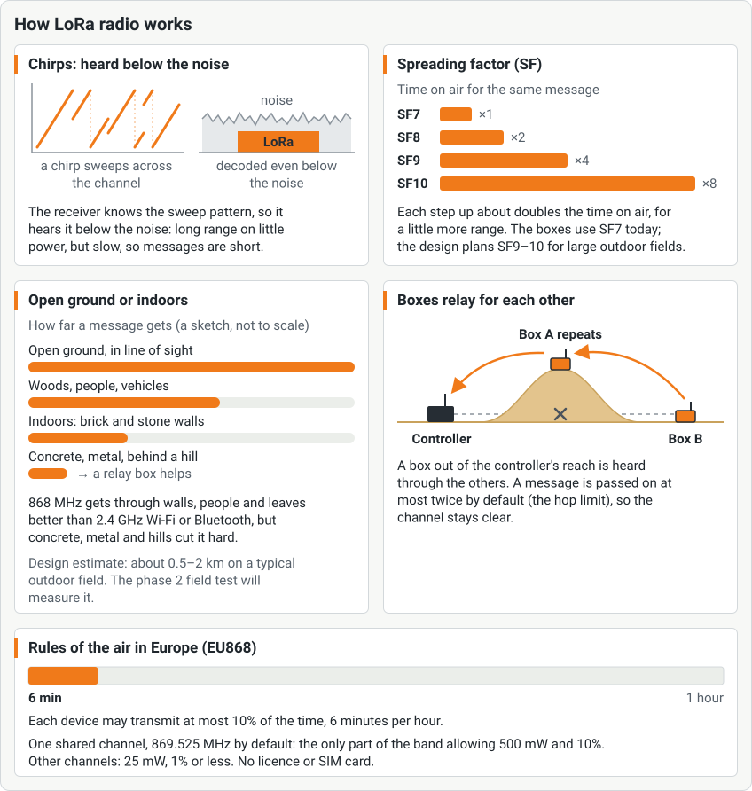

<!--
SPDX-FileCopyrightText: 2026 The Atalaia contributors
SPDX-License-Identifier: CC-BY-SA-4.0
-->

# Field Box operator manual

For the person who looks after the boxes on a field: switching them on, getting them into a game, and keeping them alive. In Portuguese: [Manual de operação da Field Box](../pt/field-box.md).

**Building a box is not covered here.** Follow the [build guide](https://atalaia-project.link/en/build-guides/) on the project page, or the step-by-step [Field Box build manual](../../../hardware/field-box/BUILD.md).

> **Not field-ready yet.** Atalaia is pre-alpha. Real Heltec V4.3 boards have played whole games on a bench with the field controller. No built box has been used on a field. Every step below matches what the firmware shows today. Steps that depend on hardware say **Not yet tested on a field**. Words in *italics* are in the [glossary](https://atalaia-project.link/en/glossary/).

## 1. What a Field Box is

The *Field Box* is Atalaia's main game prop. It has:

- two to four big **team buttons**, each with its own colour and light;
- a **screen** (2.8 inch, colour) and a **keypad**;
- a ring of **lights** that shows the team's colour;
- an **NFC reader** for tags and cards;
- a small **OLED screen** on the board, a status line for staff;
- an optional **speaker**;
- a *LoRa* radio and a **battery** (one Li-ion cell, recharged by USB-C).

It runs the game's rules by itself, and it talks to the field controller by radio. If it loses the controller, it keeps playing and keeps score.

### Safety first

- **Never switch a box on without its LoRa antenna fitted.** The radio can be damaged.
- Keep it looking like a game prop: bright colours and a **GAME PROP** label. Nothing that looks like a real explosive. Carry boxes in labelled cases and never leave one alone outside the field.
- Treat the lithium battery with care. Charge it where you can watch it. Never use a swollen, dented or hot cell.
- Do not use a box in a game before the transmit-power check in the [bring-up checklist](../../../firmware/esp32/docs/BRING_UP.md) has been done for it. Not yet tested on a field.

## 2. Power on, power off and charging

1. Check that the antennas are fitted.
2. Switch the **main switch** on. The small OLED shows the Atalaia tower and the firmware version for 2 seconds. Then the big screen shows the box's first screen ([section 3](#3-first-time-setup-new-box) or [section 5](#5-get-the-box-into-a-game)).
3. To switch off, use the main switch.

**Charging.** Plug a 5 V USB-C charger into the panel socket with the **main switch on**. With the switch off, the battery is cut off and does not charge. Charge in a place you can supervise, not inside a closed transport case. Charge only between about 0 °C and 45 °C. Do not charge a cold box straight from a winter field.

**Storing and travelling.** For more than a few weeks, store the box half charged, switched off, in a cool, dry place. For flights and shipping, follow the carrier's rules for lithium batteries.

**If the power fails during a game**, the box comes back in the same game. It keeps its score and its game time. If it was armed as a bomb, it comes back armed with the fuse it had left.

## 3. First-time setup (new box)

A new box shows **FIRST-TIME SETUP** with a Wi-Fi name like `atalaia-1A2B`.

1. On your phone, join that Wi-Fi network.
2. If the setup page does not open by itself, open a browser and go to `192.168.4.1`.
3. Fill in the page **Atalaia Node Setup**:
   - **Node Name**: a name for this box, for example `field-box-01`.
   - **Radio Region**: choose the region this box was built for (**EU868** or **AS923-TW**). The box accepts only its own.
   - **Number of Teams**: 2, 3 or 4.
   - **Admin PIN**: 4 to 8 digits. **There is no default PIN.** Easy ones such as 1234, 0000, 9876 or 1212 are refused. Write it down and keep it safe.
   - **Display Brightness** and **Audio Volume**.
   - **Field join key** (optional): the 64-digit key the organisers give you. You can also add it later ([section 4](#4-adopt-the-box-into-the-field)).
   - **Field Wi-Fi name** and **password** (optional): needed for firmware updates ([section 9](#9-updates-over-the-air)).
4. Tap **Save & Reboot**.

The box restarts. A box with no field yet shows **PAIR THIS BOX** and a 6-digit code ([section 4](#4-adopt-the-box-into-the-field)).

The setup page opens by itself only on a box that has not been set up. To open it again on a box that is already set up: press any key, type the admin PIN and `#`, pick **Wi-Fi setup** (after the games) and confirm with `#`. The box restarts into the setup page; it keeps its field, its join key and its games, and asks again for the rest (name, admin PIN, Wi-Fi). A box with no keypad does it from a computer over USB (the [firmware guide](firmware.md)). Not yet tested on a field.

## 4. Adopt the box into the field

A box must be **adopted** once by a field before it can play there. Adopting gives it the *field join key*. The organisers do it from the console's **Adopt** tab. They have three ways:

| Way | What you do |
| --- | --- |
| **USB cable** | Plug the box into the controller with a **data** cable (not a charge-only cable). The organisers look for it and press **Adopt**. |
| **Field card (NFC)** | Tap the **field card** on the box's NFC reader once. The screen shows **ADOPTED**. The field card is the field's master secret: keep it locked away. |
| **Pairing code (radio)** | An unadopted box shows **PAIR THIS BOX** and **Code: 042 137** (six digits). Read the code to the organisers. They pick your box by name on the console and type the code. No cable, no card. |

When it works, the box shows **ADOPTED**, the field's name and a short fingerprint such as `A1B2-C3D4`. The organisers compare it with their console.

- A wrong code changes the box's code. Read the new one. Three wrong codes make the box wait one minute. Ten wrong codes stop pairing until the box restarts. Press `#` on the keypad for a new code.
- A box that belongs to **another field** asks for its **admin PIN** (**PIN to change field**) on the keypad. After five wrong PINs it makes you wait 1, 2, 4 … up to 60 minutes. The wait survives a restart. The screen shows **PIN locked** and the minutes to wait.
- A box with no admin PIN set cannot move to another field. It shows **USB console: @admin-pin**. Whoever built it can set a PIN.
- **Moving an adopted box to another field by code.** On the box that belongs to a field, press any key, type the admin PIN and `#`, pick **Change field** (the entry after the games and **Wi-Fi setup**; it shows only on an adopted box with a radio and an admin PIN) and press `#`. The screen asks **CHANGE FIELD?**: `#` continues, `*` goes back. The box then shows **PAIR THIS BOX** and a code, as a new box does, and the other field's organisers pair it from their console as in the table above. The box keeps its old field until the new one has paired it: `*`, five minutes without a pairing, or a game joined leave it as it was.

Not yet tested on a field: the NFC field card and pairing over the radio.

## 5. Get the box into a game

After adoption, an unused box shows **READY** and **Next game**. It announces itself over the radio. Two ways to join a game:

### A. The organisers invite it (the normal way)

1. The organisers create the game and open **Invite boxes** in the console.
2. Your box is listed by name. It appears within about 20 seconds after it is ready or a game ends. Then it repeats about once a minute.
3. The organisers tick it and give it a role.
4. The box shows **Invited:** *role*, then **WAITING** with **Game** *N* and **The game hasn't started**.
5. When the organisers press **Start**, the box shows **GAME ON** and then the mode's own screen.

### B. A join card

With no game being played, hold the **join card** to the NFC reader. The box shows **JOINED GAME** *N*. A card made for another field is refused.

The same words show in Portuguese, German or Traditional Chinese when the organisers set the **Box language** for the game.

### C. A game with no controller (stand-alone)

You can play one box alone, with no controller:

1. On **READY**, press any key. It says **Any key: choose a game here**.
2. **Enter the admin PIN.** `#` confirms and `*` deletes.
3. **CHOOSE A GAME**: press `1` to `9` to pick the game. `0` shows more. `#` goes on. `*` goes back.
4. **GAME TIMER**: `2` adds 5 minutes, `8` takes 5 minutes off. **No limit** means the game goes on until the organisers end it. `#` goes on.
5. **START THE GAME?**: `#` starts, `*` goes back.

In a stand-alone game the box has no game key. It **refuses player tags**. Modes that need tags need a controller.

## 6. The box's screens and buttons

You hold your team's button on the box. The box shows what is happening.

| On the screen | Meaning |
| --- | --- |
| **READY** · your field's logo · **Next game** | Adopted, in no game. It can be invited. The logo is the field's, or the Atalaia tower if the box has none. |
| **WAITING** · **Game** *N* · **The game hasn't started** | Joined. Waits for the organisers' **Start**. |
| **GAME ON** | The game started. The mode's own screen follows. |
| **ZONE · NEUTRAL** · **Hold to capture** | A zone nobody holds (Domination, Hold-All, Last Stand, Master and Satellites). Hold your team's button. A bar fills. |
| **ZONE HELD** · team | A team holds the zone. The ring takes its colour. The small OLED shows how long it has held it. |
| **Hold to take it over** | Another team can take the zone the same way. |
| **READY** · **Hold to arm** | *Bomb / Rush*: the bomb is not armed yet. Attackers hold their button. |
| **ARMED** · time **until detonation** | The bomb is armed. Defenders hold their button to defuse. |
| **DEFUSED** / **EXPLODED** | The bomb ended. The winning team is named. |
| **PAUSED** · **Wait for the game master** | The organisers paused the game. Do not touch the box. |
| **GAME OVER** · **Scores are final** | The game ended. After 30 seconds the box shows **READY** again. |
| **CODE** with dots | A keypad code is asked (*Codes*, team codes in *Bomb*). Type it. `#` confirms and `*` deletes. |

Other modes have their own screens: *Kill Confirmed* (**press your button, then scan the tags**), *Respawn and Lives* (**Scan your tag to come back in**), *Medic Kit* (**Scan your tag**, **then hold the button**) and *Hacking Terminal* (a puzzle on the keypad). The [modes page](https://atalaia-project.link/en/modes/) shows them.

**The field's logo.** If the organisers set a logo for the field (in the console's *Settings*), the box shows it on the **READY** screen, and on the *Bomb / Rush* screen while the bomb is not armed. The box fetches it by itself over the field Wi-Fi when it joins a game, so it needs the **Field Wi-Fi name** and **password** (as for [updates](#9-updates-over-the-air)); it keeps it, and fetches it again only when the logo changes. Only a **PNG** logo reaches the box; with a JPEG or WebP logo, or no logo, the box shows the Atalaia tower. A box that never joined a game on this field's Wi-Fi shows the tower too. The small OLED always shows the Atalaia tower.

On the small OLED you see the mode on top, one big value (the phase, the timer or the team) and a hint under it. While a team holds its button, the OLED shows a bar that fills.

In a game with a time limit that you started on the box, the big screen has a thin bar along its bottom edge that shows how much of the game is left (it turns red in the last minute), and the OLED shows the time left, as minutes and seconds, at the right of its top line. A game with **No limit** has neither. A game that the field controller runs ends when the game master ends it, so it has no bar.

*Medic Kit*, *Hacking Terminal* and *VIP / Payload* do not follow the box language. Each takes its screen language from its own **Language** setting in the game, and that is Portuguese by default. Ask the organisers to set it.

## 7. What the lights and screens tell you

| You see | It means |
| --- | --- |
| The ring shows a team's colour | That team holds the zone. Not yet tested on a field. |
| The buttons are lit | The box is on. |
| The big screen is dark and the small OLED is lit | The box is on. Check the big screen's wires, or ask the builder. |
| **ADOPTED** with a field name | The box now belongs to that field. |
| **Not adopted** / **Already adopted** | The adoption state, when you tap a field card or use the cable. |
| **Bad field card** | The card is damaged. |
| **Wrong PIN** / **Adoption locked** | See [section 4](#4-adopt-the-box-into-the-field). |
| **Admin PIN needed** | The box has no PIN yet. Ask the builder. |
| **Game joined** | You tried to adopt a box that is in a game. End the game first. |

## 8. Battery

- The box reports its battery level to the controller. The organisers see it in the console's **Boxes** tab. Below 20% it shows **low**.
- When a box's level drops below its limit, it sends a low-battery alert once.
- A box with no battery gauge shows no level.
- One Li-ion cell (two 18650 cells in parallel) should last well beyond a two-hour game. **This has not been measured.** The LED ring and the speaker use the most power.
- Charge the boxes the night before. Swap or charge a box that shows **low** between games, not during one.

## 9. Updates over the air

The organisers can update a box's firmware over the field's Wi-Fi, between games. Nothing runs while a game is on.

1. The box needs the **Field Wi-Fi name** and **password** (set in the setup page, [section 3](#3-first-time-setup-new-box)) and a joined game.
2. The organisers upload a signed release in the console's **Boxes** tab (**Firmware updates**), then press **Update every box** or **Update to** *version* for one box. The box downloads it, checks the signature again, installs it and restarts.
3. If the new version fails its self-test, the box goes back to the old one by itself.
4. The console shows **sent, waiting for the box**, **installed, restarting**, **done**, **failed**, **rolled back** or **no news from the box**.

Do not switch the box off during an update. Keep the battery charged: a box with a low battery refuses. Not yet tested on a field.

## 10. Radio basics for a field

- **One channel for the whole field.** All boxes, the controller's USB modem and the apps' pods use the same channel. The default is **869.525 MHz** in Europe. The organisers choose it in the console, before the first game, and the box learns it when it joins a game. A box refuses a game from another region.
- **Range.** *LoRa* reaches far on very little power. The design estimate is **0.5 to 2 km outdoors**, and much less indoors or behind concrete, metal or a hill. This is an estimate, not a measurement. Not yet tested on a field.
- **Relays.** A box that cannot reach the controller is heard **through the other boxes**. Each box repeats other boxes' messages, at most **twice** by default. On difficult ground, the organisers can put extra boxes in between as repeaters. See *mesh* in the glossary.
- **Antennas.** Keep the LoRa antenna fitted for good, upright if you can, and as far as you can from the battery and the wires.
- **Listen before talk.** A box listens to the channel before it sends. If it hears another transmission, it waits a fraction of a second (20 to 200 ms) and tries again. After 8 busy answers in a row it sends anyway.
- **Limited airtime.** European rules allow each device to transmit only 10% of the time on the default channel, and 1% or less on other channels. A box that has used its time does not send until it recovers. A channel with 25 mW and 1% gives about a tenth of the airtime and much less range. The console warns about it.
- **Messages.** Boxes send what changes, such as "red captured B". Points reach the console within about 15 seconds.

More: the [radio page](https://atalaia-project.link/en/radio/), the [radio field-test runbook](../../runbooks/radio-field-test.md) and the *[mesh](https://atalaia-project.link/en/glossary/#glossary-mesh)* and *[LoRa](https://atalaia-project.link/en/glossary/#glossary-lora)* entries.

## 11. A phone as a game prop

An Android phone can be a box too. In the app choose **Game prop**, then **Join a game** and scan the **join QR code** the organisers show, or hold a join card. The phone shows the mode's screen with team buttons on the screen. An optional **I/O pod** adds a radio and big buttons. Set the **Field join key** and the **Admin PIN** in **Settings**. In **Settings**, **Kiosk mode** pins the phone to the app and **Battery and background** tells you how to stop Android from sleeping the app. If the game uses a mode the app does not carry, and the organisers allow it, the phone gets the mode from the field controller over the field's Wi-Fi before you start: it takes only a package **signed** by a mode key you trust. Add the project's (or your club's) key in **Settings › Mode keys for fetched modes**, and ask the organisers for it. A package that is unsigned, signed by another key or damaged is refused with a message and never runs. Not yet tested on a field. See the [app guide](../../../app/README.md).

## Troubleshooting

| Problem | What to do |
| --- | --- |
| Nothing happens when I switch on | Check the main switch, the fuse and the battery. Charge it through USB-C with the switch **on**. If it smells or is hot, switch off and take the cells out. |
| The box is not in the organisers' **Invite boxes** list | It must show **READY** and be adopted. Wait up to a minute, or ask the organisers to press **Look for boxes**. Check the region and move closer to the controller. |
| The invite says **refused: in another game** | The box is still in an old game. Power-cycle it or end that game. |
| The invite says **refused**, "another field's join key?" | The box belongs to another field. Adopt it again ([section 4](#4-adopt-the-box-into-the-field)). |
| The console says **Box N has not been heard for more than 90 s** | Move the box closer, add a box in between as a relay, or check the antenna. The box may be fine: it keeps playing and catches up. |
| The console says **Two boxes share node N** | One join was used on two boxes. Take one out of the game and join it again with a new join. |
| A button only works sometimes | Hold it all the way. Any release restarts the hold. If it is flaky, ask the builder. A loose wire is the usual cause. |
| The NFC reader does not read | Hold the tag flat on the reader for a second. Check it is an NTAG tag. Each game needs new player tags. |
| The screen is in the wrong language | The organisers set the **Box language** before creating the game. |
| The box shows English only | An older firmware. The organisers can update it. |
| **PIN locked · try again in N min** | Wait. The count survives a restart. Do not keep guessing. |
| The box rebooted in a game | It comes back in the same game. The organisers see **node.rebooted** in their log. |
| The small screen is dark | Ask the builder. The big screen can still work. |

For building and bench faults see [the build manual's troubleshooting table](../../../hardware/field-box/BUILD.md#13-troubleshooting).
