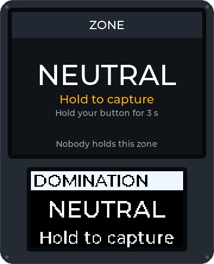
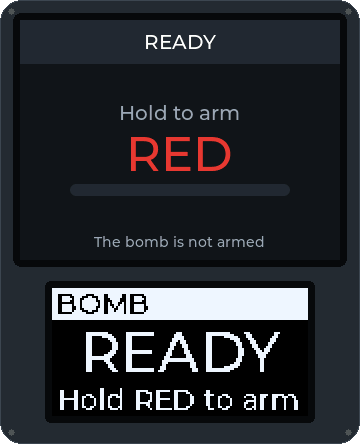
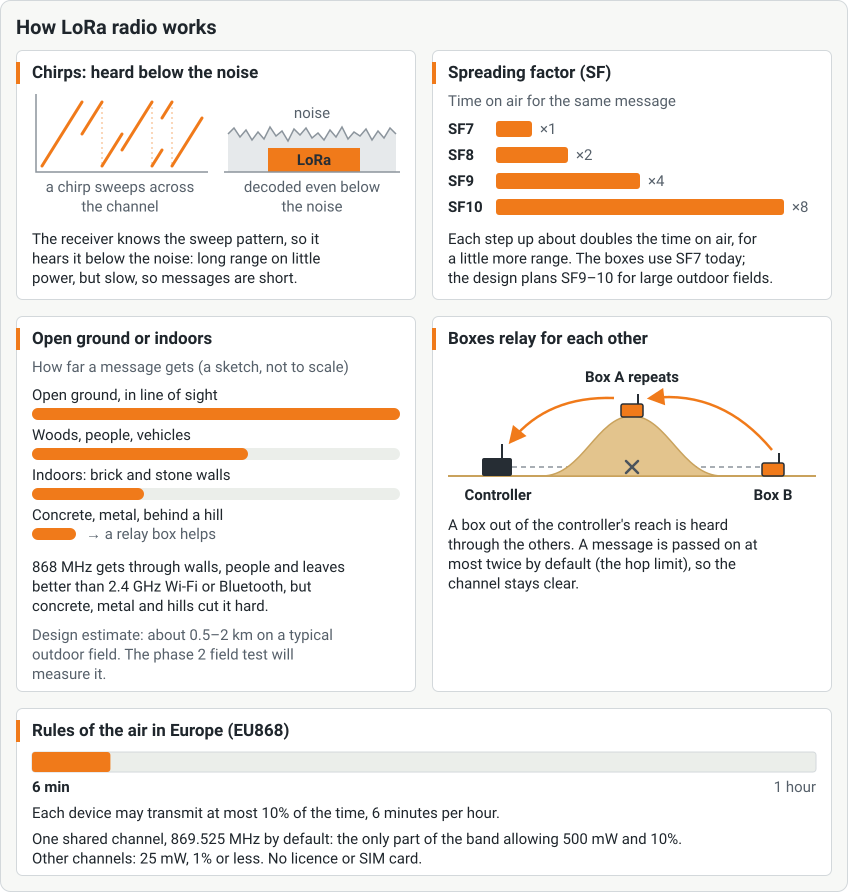

<!--
SPDX-FileCopyrightText: 2026 The Atalaia contributors
SPDX-License-Identifier: CC-BY-SA-4.0
-->

# Field Box operator manual

For the person who looks after the boxes on a field: switching them on, getting them into a game, and keeping them alive. In Portuguese: [Manual de operação da Field Box](../pt/field-box.md).

**Building a box is not covered here.** Follow the [build guide](https://atalaia-project.link/en/build-guides/) on the project page, or the step-by-step [Field Box build manual](../../../hardware/field-box/BUILD.md). Putting the firmware on a board is in the [firmware guide](firmware.md). An Android phone used as a box, and the I/O pod, have their own manual: [Phone prop and I/O pod](phone-prop.md).

> **Not field-ready yet.** Atalaia is pre-alpha. Real Heltec V4.3 boards have played whole games on a bench with the field controller. No built box has been used on a field. Every step below matches what the firmware shows today. Steps that depend on hardware say **Not yet tested on a field**. Words in *italics* are in the [glossary](https://atalaia-project.link/en/glossary/).

> **Which firmware.** The newest release is **v0.9.0** (2026-11-06). A few things below need **v0.9.0** or later, and say so where they appear: taking a box out of its game at the box, the controller freeing such a box by itself, Wi-Fi names with spaces on the USB console, and the setup page's Wi-Fi rules.

## Contents

1. [What a Field Box is](#1-what-a-field-box-is)
2. [Safety](#2-safety)
3. [Power on, power off and charging](#3-power-on-power-off-and-charging)
4. [First-time setup](#4-first-time-setup)
5. [Adopt the box into the field](#5-adopt-the-box-into-the-field)
6. [Get the box into a game](#6-get-the-box-into-a-game)
7. [The box's screens and lights](#7-the-boxs-screens-and-lights)
8. [Outputs and modules](#8-outputs-and-modules)
9. [The Medic Kit at the box](#9-the-medic-kit-at-the-box)
10. [Take a box out of its game](#take-a-box-out-of-its-game)
11. [Battery](#11-battery)
12. [Update the boxes](#update-the-boxes)
13. [Radio basics for a field](#13-radio-basics-for-a-field)
14. [Troubleshooting](#14-troubleshooting)

## 1. What a Field Box is

The *Field Box* is Atalaia's main game prop. It has:

- two to four big **team buttons**, each with its own colour and light;
- a **screen** (2.8 inch, colour) and a **keypad**;
- a ring of **lights** that shows the team's colour;
- an **NFC reader** for tags and cards;
- a small **OLED screen** on the board, a status line for staff;
- an optional **speaker**, an optional **piezo buzzer**, or both (the buzzer beeps the game's sounds as short patterns);
- one or two optional **simple outputs** that switch a siren, a strobe, a light or a smoke machine's remote, and an optional **expansion port** for an output module or a target ([section 8](#8-outputs-and-modules));
- a *LoRa* radio and a **battery** (one Li-ion cell, recharged by USB-C).

It runs the game's rules by itself, and it talks to the field controller by radio. If it loses the controller, it keeps playing and keeps score.

**It is also a Bluetooth beacon.** While a box is in a game (from the moment it joins until the game ends) it sends a small Bluetooth iBeacon signal, once every half second. A player's phone that hears it is placed in the room, on the floor, where the organisers put the box on the field plan, so on a building with several floors the field needs separate beacons only where there is no box. It needs nothing from you: it is on by default, the organisers can switch it off for the field at the console, and the box uses the same 2.4 GHz antenna as for Wi-Fi (nothing extra to fit). It does not affect the LoRa radio, and it is off between games. The details are in the [Game Master guide](game-master.md) and the [firmware guide](firmware.md#4-the-options-a-builder-sets).

A **Satellite** is a Field Box with fewer parts (no keypad, no big screen). It runs the same firmware; where this manual uses the keypad, a Satellite uses the USB console instead.

## 2. Safety

- **Never switch a box on without its LoRa antenna fitted.** The radio can be damaged.
- Keep it looking like a game prop: bright colours and a **GAME PROP** label. Nothing that looks like a real explosive. Carry boxes in labelled cases and never leave one alone outside the field.
- Treat the lithium battery with care. Charge it where you can watch it. Never use a swollen, dented or hot cell.
- Do not use a box in a game before the transmit-power check in the [bring-up checklist](../../../firmware/esp32/docs/BRING_UP.md) has been done for it. Not yet tested on a field.
- Outputs and targets have their own safety rules: [section 8](#8-outputs-and-modules).

## 3. Power on, power off and charging

1. Check that the antennas are fitted.
2. Switch the **main switch** on. The small OLED and the big screen both show the Atalaia tower and the firmware version: the OLED for 2 seconds, the big screen for about 2.5 seconds (longer only if the box's first screen is not ready by then). Then the big screen shows the box's first screen ([section 4](#4-first-time-setup) or [section 6](#6-get-the-box-into-a-game)).
3. To switch off, use the main switch.

**Charging.** Plug a 5 V USB-C charger into the panel socket with the **main switch on**. With the switch off, the battery is cut off and does not charge. Charge in a place you can supervise, not inside a closed transport case. Charge only between about 0 °C and 45 °C. Do not charge a cold box straight from a winter field.

**Storing and travelling.** For more than a few weeks, store the box half charged, switched off, in a cool, dry place. For flights and shipping, follow the carrier's rules for lithium batteries.

**If the power fails during a game**, the box comes back in the same game. It keeps its score and its game time. If it was armed as a bomb, it comes back armed with the fuse it had left.

## 4. First-time setup

A new box shows **FIRST-TIME SETUP** with a Wi-Fi name like `atalaia-1A2B`.

1. On your phone, join that Wi-Fi network. It has no password, so do this away from the players.
2. If the setup page does not open by itself, open a browser and go to `192.168.4.1`.
3. Fill in the page **Atalaia Node Setup**. It opens in the box's language; the links at the bottom (**English**, **Português**, **Deutsch**, **繁體中文**) change it:
   - **Node Name**: a name for this box, for example `field-box-01`.
   - **Radio Region**: choose the region this box was built for (**EU868** or **AS923-TW**). The box accepts only its own.
   - **Number of Teams**: 2, 3 or 4.
   - **Admin PIN**: 4 to 8 digits. **There is no default PIN.** Easy ones such as 1234, 0000, 9876 or 1212 are refused. Write it down and keep it safe.
   - **Display Brightness** and **Audio Volume**.
   - **Field join key** (optional): the 64-digit key the organisers give you. You can also add it later ([section 5](#5-adopt-the-box-into-the-field)).
   - **Field Wi-Fi name** and **password** (optional): needed for firmware updates ([section 12](#update-the-boxes)). The field Wi-Fi must be 2.4 GHz. See the rules below.
4. Tap **Save & Reboot**.

The box restarts. A box with no field yet shows **PAIR THIS BOX** and a 6-digit code ([section 5](#5-adopt-the-box-into-the-field)).

**The field Wi-Fi rules.** From v0.9.0, the setup page refuses what the box could not use, and says why:

- the **name** is 1 to 32 bytes. An accented letter takes 2 bytes and a Chinese character 3, so a name with them can be refused under 32 characters;
- the **password** is empty (an open network), 8 to 63 characters, or exactly 64 hex digits.

On v0.8.0 and older, the page cuts a name longer than 32 bytes, or a password longer than 64 characters, without saying so. Keep to the rules above and both work.

**The same on the USB console.** The box also takes the field Wi-Fi from a computer over USB: `@wifi <name> <password>` (an open network: `@wifi <name>`). From v0.9.0, a name or password with spaces goes in double quotes: `@wifi "My Field" "pass word"`; inside the quotes, `\"` is a quote and `\\` a backslash. The box answers `field Wi-Fi: stored (network "My Field")`, or `field Wi-Fi: refused:` and the reason, and then stores nothing. On v0.8.0, `@wifi` takes no spaces in the name. How to open the USB console: [firmware guide, section 3.4](firmware.md#34-restart-and-watch).

**Open the setup page again.** The setup page opens by itself only on a box that has not been set up. On a box that is already set up:

1. Press any key, type the admin PIN and `#`.
2. Pick **Wi-Fi setup** (after the games) and press `#`.
3. Confirm with `#`.

The box restarts into the setup page. It keeps its field, its join key and its games, and asks again for the rest (name, admin PIN, Wi-Fi). It does not work during a game. A box with no keypad does it over USB with `@setup` and the admin PIN ([firmware guide, section 5](firmware.md#5-first-boot-and-setup)). Not yet tested on a field.

## 5. Adopt the box into the field

A box must be **adopted** once by a field before it can play there. Adopting gives it the *field join key*. The organisers do it from the console's **Adopt** tab. They have three ways:

| Way | What you do |
| --- | --- |
| **USB cable** | Plug the box into the controller with a **data** cable (not a charge-only cable). The organisers look for it and press **Adopt**. |
| **Field card (NFC)** | Tap the **field card** on the box's NFC reader once. The screen shows **ADOPTED**. The field card is the field's master secret: keep it locked away. |
| **Pairing code (radio)** | An unadopted box shows **PAIR THIS BOX** and **Code: 042 137** (six digits). Read the code to the organisers. They pick your box by name on the console and type the code. No cable, no card. |

When it works, the box shows **ADOPTED**, the field's name and a short fingerprint such as `A1B2-C3D4`. The organisers compare it with their console.

- A wrong code changes the box's code. Read the new one. Three wrong codes make the box wait one minute. Ten wrong codes stop pairing until the box restarts. Press `#` on the keypad for a new code.
- A box that belongs to **another field** asks for its **admin PIN** (**PIN to change field**) on the keypad. After five wrong PINs it makes you wait 1, 2, 4 … up to 60 minutes. The wait survives a restart. The screen shows **PIN locked** and the minutes to wait.
- A box with no admin PIN set cannot move to another field. It shows **USB console: @admin-pin**. Whoever built it can set a PIN.

**Move an adopted box to another field by code.**

1. On the box, press any key, type the admin PIN and `#`.
2. Pick **Change field** (the entry after the games and **Wi-Fi setup**; it shows only on an adopted box with a radio and an admin PIN) and press `#`.
3. The screen asks **CHANGE FIELD?**: `#` continues, `*` goes back.
4. The box shows **PAIR THIS BOX** and a code, as a new box does. The other field's organisers pair it from their console as in the table above.

The box keeps its old field until the new one has paired it: `*`, five minutes without a pairing, or a game joined leave it as it was.

Not yet tested on a field: the NFC field card and pairing over the radio.

## 6. Get the box into a game

After adoption, an unused box shows **READY** and **Next game**. It announces itself over the radio. There are three ways into a game.

### 6.1 The organisers invite it (the normal way)

1. The organisers create the game and open **Invite boxes** in the console.
2. Your box is listed by name. It appears within about 20 seconds after it is ready or a game ends. Then it repeats about once a minute.
3. The organisers tick it and give it a role.
4. The box shows **Invited:** *role*, then **WAITING** with **Game** *N* and **The game hasn't started**.
5. When the organisers press **Start**, the box shows **GAME ON** and then the mode's own screen.

When it joins, the box tells the console what it has (buttons, NFC, outputs, modules). If the game needs something the box lacks, the organisers see it before the start and may ask you to swap the box or plug a module in.

### 6.2 A join card

With no game being played, hold the **join card** to the NFC reader. The box shows **JOINED GAME** *N*. A card made for another field is refused.

The same words show in Portuguese, German or Traditional Chinese when the organisers set the **Box language** for the game.

### 6.3 A game with no controller (stand-alone)

You can play one box alone, with no controller:

1. On **READY**, press any key. It says **Any key: choose a game here**.
2. **Enter the admin PIN.** `#` confirms and `*` deletes.
3. **CHOOSE A GAME**: press `1` to `9` to pick the game. `0` shows more. `#` goes on. `*` goes back.
4. **GAME TIMER**: `2` adds 5 minutes, `8` takes 5 minutes off. **No limit** means the game goes on until the organisers end it. `#` goes on.
5. **START THE GAME?**: `#` starts, `*` goes back.

In a stand-alone game the box has no game key. It **refuses player tags**. Modes that need tags need a controller.

## 7. The box's screens and lights

You hold your team's button on the box. The box shows what is happening.

| On the screen | Meaning |
| --- | --- |
| **READY** · the Atalaia tower · **Next game** | Adopted, in no game. It can be invited. |
| **WAITING** · **Game** *N* · **The game hasn't started** | Joined. Waits for the organisers' **Start**. |
| **GAME ON** | The game started. The mode's own screen follows. |
| **ZONE · NEUTRAL** · **Hold to capture** | A zone nobody holds (Domination, Hold-All, Last Stand, Master and Satellites; in Master and Satellites the header says **MASTER** or **SATELLITE** once the controller has told the box which it is). Hold your team's button. A bar fills. |
| **ZONE HELD** · team | A team holds the zone. The ring takes its colour. Both screens show how long it has held it, counting up (**held 1:23**). In Domination the big screen also shows each team's points at this box, in team colours, in its top right corner. In Master and Satellites the header names the box (**MASTER HELD**, **SATELLITE HELD**), and the master's big screen counts up the held time and shows each team's score the same way. Progressive Domination and VIP Payload's checkpoints count up the held time on the big screen too. |
| **Hold to take it over** | Another team can take the zone the same way. While a team holds its button, a bar with that team's name fills along the bottom of the big screen, as it does on the OLED. |
| **READY** · **Hold to arm** | *Bomb / Rush*: the bomb is not armed yet. Attackers hold their button. |
| **ARMED** · time **until detonation** | The bomb is armed. Defenders hold their button to defuse. |
| **DEFUSED** / **EXPLODED** | The bomb ended. The winning team is named. After an explosion the game ends. |
| **PAUSED** · **Wait for the game master** | The organisers paused the game. Do not touch the box. |
| **GAME OVER** · **Scores are final** | The game ended. After 30 seconds the box shows **READY** again. |
| **CODE** with dots | A keypad code is asked (*Codes*, team codes in *Bomb*). Type it. `#` confirms and `*` deletes. |

Other modes have their own screens: *Kill Confirmed* (**press your button, then scan the tags**), *Respawn and Lives* (**Scan your tag to come back in**), *Medic Kit* ([section 9](#9-the-medic-kit-at-the-box)) and *Hacking Terminal* (a puzzle on the keypad). The [modes page](https://atalaia-project.link/en/modes/) shows them.

**Languages of the modes.** The box's screens follow the **Box language** of the game. *Medic Kit* and *Hacking Terminal* are the exceptions: each takes its screen language from its own **Language** setting in the game; left empty, it is the game's language. *VIP / Payload* follows the box language, like the other modes (its old **Language** setting is no longer used).

**The logo.** The box shows the Atalaia tower, on its boot screen (the small screen and the big one, with the firmware version beside it), on the **READY** screen, and on the *Bomb / Rush* screen while the bomb is not armed. The field's own logo (the console's *Settings*) shows in the app, on the scoreboard and on the poster, not on the box: boxes no longer fetch it. A builder can build a box with another splash: [firmware guide, section 4](firmware.md#4-the-options-a-builder-sets).

**The small OLED** shows the mode on top, one big value (the phase, the timer or the team) and a hint under it. On a held zone (Domination, Progressive Domination, Master and Satellites, VIP Payload's checkpoints) the hint is how long the team has held it (**held for 1:23**). While a team holds its button, the OLED shows a bar that fills.

**The time bar.** In a game with a time limit that you started on the box, the big screen has a thin bar along its bottom edge that shows how much of the game is left (it turns red in the last minute), and the OLED shows the time left, as minutes and seconds, at the right of its top line. A game with **No limit** has neither. A game that the field controller runs ends when the game master ends it, so it has no bar.

**Lights and messages.**

| You see | It means |
| --- | --- |
| The ring shows a team's colour | That team holds the zone. Not yet tested on a field. |
| The buttons are lit | The box is on. |
| The big screen is dark and the small OLED is lit | The box is on. Check the big screen's wires, or ask the builder. |
| **ADOPTED** with a field name | The box now belongs to that field. |
| **Not adopted** / **Already adopted** | The adoption state, when you tap a field card or use the cable. |
| **Bad field card** | The card is damaged. |
| **Wrong PIN** / **Adoption locked** | See [section 5](#5-adopt-the-box-into-the-field). |
| **Admin PIN needed** | The box has no PIN yet. Ask the builder. |
| **Game joined** | You tried to adopt a box that is in a game. End the game first, or [take the box out of it](#take-a-box-out-of-its-game). |

## 8. Outputs and modules

A box can switch things and take add-ons in three ways. All three are optional and are fitted by the builder.

| What | Where it plugs in | What it does | Since |
| --- | --- | --- | --- |
| **Simple output** | An M8 socket labelled **OUTPUT 1** (sometimes also **OUTPUT 2**) | One RC relay switch per output, for a siren, a strobe, a light or a smoke machine's remote on its own battery. The preferred way for one or two devices | v0.7.0 |
| **Output module** | The **expansion port** (an M12 socket) | A small board of its own that switches up to 4 relays from its own supply, behind an isolator. For more channels than the simple output has | v0.8.0 |
| **Target** | The expansion port | A plate players shoot at, with its own sensor and board. Used by *Target Windows* | v0.8.0 |

None of them has been tried on hardware yet: the firmware is written and tested on a computer. Build guides: [simple output](../../../hardware/field-box/BUILD.md#910-simple-output-optional), [expansion port](../../../hardware/expansion-port/BUILD.md), [output module](../../../hardware/output-module/BUILD.md), [target](../../../hardware/target-addon/BUILD.md). The module boards are flashed as in the [firmware guide, section 11](firmware.md#11-the-expansion-modules-target-and-output-module).

### 8.1 What the game does with an output

Each output has a **use**, the name a game asks for: **siren**, **strobe**, **smoke**, **light**, **horn**, or its number (**out.1**). The game switches it: smoke or a siren when the bomb explodes (*Bomb / Rush*'s **Smoke when it explodes** and **Siren when it explodes**), the master's siren when a team holds every satellite (*Master and Satellites*), or the GM from the console. Give the output the use the mode asks for.

What the box does, for every output (simple or on a module):

- It switches outputs **only during a game** (and your 1-second test between games). Settings change only between games.
- It turns every output **off** when it starts, when the game is **paused** (they stay off when the game goes on), and when the game **ends**. An end-of-game horn may still sound for up to 10 seconds.
- An output never stays on longer than its longest time. It changes at most every half second.
- If the box stops working, loses power or restarts, the switch loses its signal and turns off within about a second. An output module turns its outputs off 1.5 seconds after the box stops talking to it.
- The GM sees the box's outputs in the console (a chip under the box, marked **not checked**, and the **Outputs** list on the **Game** tab) and can turn one on for a few seconds during the game, turn it off, or turn every output off at once ([GM manual](game-master.md)).
- When it joins a game, the box also tells the console which outputs are fitted but **not enabled**. The GM then sees, for example, **horn · fitted, not enabled by the box's admin** under the box, and a note before the start if the game would use that output, so they can ask you to enable it. A disabled output still never fires.

### 8.2 Enable an output at the box

**Outputs are off until you enable them, at the box.** This is on purpose: a box borrowed from another field, or plugged in at the safe zone, can never fire until a person at that box says so. The **Outputs** entry shows only on a box that has at least one output (a simple output, or an output module plugged in).

1. On **READY**, press any key. **Enter the admin PIN.**
2. Go to the last entry of the list, **Outputs**, and press `#`.
3. The screen shows one output, its use and whether it is enabled: **OUTPUT 1 GPIO 46** for a simple output, or **OUTPUT 2 I2C 5c/1** for channel 1 of an output module. Press:
   - `1` to enable or disable it;
   - `2` to change its use: **out.1**, **siren**, **strobe**, **smoke**, **light**, **horn**;
   - `3` to change the longest time it may stay on: 5, 10, 30, 60, 120, 300 or 600 seconds (on a module, never more than the module's own limit);
   - `5` to test it: on for 1 second;
   - `0` for the next output; `#` or `*` to go back to the list.
4. A simple output keeps each change at once, also after a restart.

You can do the same on the USB console: `@outputs` lists them, `@output 1 enable <PIN>`, `@output 1 function siren <PIN>`, `@output 1 max 30 <PIN>`, `@output 1 test <PIN>`.

### 8.3 An output module on the expansion port

1. **Plug the module in before the game**, with its own supply on. The box finds it within 2 seconds, with the box on or off; its USB log says `expansion: 0x5C added: ...` (the module's address).
2. The box adds the module's channels to its outputs, after its simple outputs: at most **8 module channels** in all. Each one starts **disabled**, with the use the builder gave that channel, and a longest time no higher than the module's own.
3. Enable each channel you need, between games, as in [8.2](#82-enable-an-output-at-the-box).

What is different from a simple output:

- **A module's settings are not kept.** Each time the box finds the module (after the box restarts, or the cable is plugged in again) its channels start disabled again. Enable them again before each game day, and after any restart.
- **The module has its own limits.** The builder sets each channel's longest time on (and a rest time after it) in the module's firmware. The box can only lower them.
- **Plugged in during a game,** the module's channels arrive disabled, and settings cannot change during a game, so it switches nothing in that game.
- If the cable comes out during a game, the GM's log says the box lost a module. The outputs on it are off.

### 8.4 A target on the expansion port

A **target** is a plate that players shoot at, with a sensor and a small board of its own behind it, on a cable of up to 2 m. The game *Target Windows* uses it: the box lights up in a team's colour for a few seconds, and a hit on the plate then scores for that team.

1. **Plug the target in before the box joins the game** (with the box on or off). The box finds it within 2 seconds; plugged in later, the box still finds it, and the game uses it at once.
2. The GM's console shows it as a chip under the box: **target 1.0.0: hit**.
3. During *Target Windows* the target counts hits only while the game runs: not before it starts, not while it is paused, not after it ends.
4. If the cable comes out during the game, the GM's log says **box-4 lost a module: 58:target/1.0.0:hit (it stopped answering)**. Plug it back in: it carries on at once.

### 8.5 Safety

- **Only low-voltage devices on their own battery or supply** (at most 24 V; an output module at most 2 A per channel). **Never** mains.
- A smoke machine only through its documented low-voltage remote input; never pyrotechnics. Smoke never in a closed room without the venue's approval.
- Hearing protection near sirens and horns.
- Before its first game, the builder checks each switch: it must turn off when its cable is pulled ([build manual, section 9.10](../../../hardware/field-box/BUILD.md#910-simple-output-optional)).
- **Targets:** eye and face protection for everyone within range of the target, the plate angled down so BBs go to the ground, and never shoot at the box, the cable or the target's enclosure: only at the plate. The field's power limits apply to targets as to players.

## 9. The Medic Kit at the box

The *Medic Kit* is a role a game can add to any main mode: a box given the **medic** role runs only the kit. A hit player heals at it with their player tag. It needs the box's NFC reader and buttons, and a game run by the field controller (a stand-alone box refuses player tags). Not yet tested on a field.

The organisers set it when they create the game: the seconds a player holds the button (10 by default), the heals in the kit (5), the heals per player in the whole game, at every kit (2; 0 for no limit), the wait between two heals of the same player (none by default), the team it serves (every team by default) and the kit's **Language**.

What the player does, and what the box shows:

1. The box shows **MEDIC KIT** with the number of heals left (**4 heals left**). In the colour of the team it serves, if it serves one.
2. The player holds their tag to the NFC reader.
3. Within 15 seconds, the player holds a team button. The box shows **Keep holding to heal**, a filling bar and the seconds left. Letting go early cancels: scan again.
4. The box shows **BACK IN THE GAME**, and the GM and the players see the heal.

If the box refuses, it shows **REFUSED** and why: a forged tag, a tag from another game, a team the kit does not serve, a player who has had all their heals, or the seconds still to wait.

When the kit is empty it shows **The kit is empty** and **The organisers can refill it**. The organisers refill it from the console's **Boxes** tab (**Refill the kit**). There is nothing to do at the box. After a restart in a field game, the kit starts again with its full number of heals; each player's count across kits is kept by the controller.

## 10. Take a box out of its game

A box that was switched off when its game ended never hears the end. Switched on again, it is still in that game: it shows the game's screen and refuses every invite and join card (the console says **refused: in another game**). A box never leaves a game on its own when the controller goes silent. **Do not erase it.** There are three ways out. All three need firmware from **v0.9.0**, on the piece named.

| Way | Who does it | Needs v0.9.0 on |
| --- | --- | --- |
| **The controller frees it by itself.** It hears the box, says again that its game is over, and within about a minute the box shows the game's last screen, then **READY**. The organisers also see the box in the console's **Boxes** tab, under **Stuck in an ended game**, and **Release** tells it at once | Nobody, or the GM | The **controller** and its **USB radio modem** (the modem has no update over the air: it is reflashed over USB, [modem guide](modem.md#update-the-modem)). Any box firmware. The box must be on the field's channel. An I/O pod used as the controller's radio cannot do it |
| **Release every box not in this game** (console, **Settings**). For a controller that was reinstalled or lost its data, and no longer knows the old game. It frees every box of the field on that channel that is in another game, if the box joined that game before and has not heard that game's controller for a minute and a half | The GM | The **controller** and the **box** on the same version (from v0.10.0 the release names its channel: a v0.9.0 box ignores a v0.10.0 controller's, and the reverse) |
| **Leave the game, at the box** (below). Works always, also with an older controller or modem | You, with the admin PIN | The **box** |

The GM's side of all this is in the [GM manual, Recover from problems](game-master.md#recover-from-problems).

**Leave the game at the box** (the box's admin menu; not the player app's **Leave the game**, which only erases a player's name):

1. Hold `*` for 3 seconds. The press itself still goes to the game, as one `*`.
2. **Enter the admin PIN.** `#` confirms. `*` deletes; with nothing typed, `*` goes back to the game.
3. **ADMIN** lists one entry, **Leave the game**. Press `#`.
4. **LEAVE THE GAME?**: `#` leaves, `*` goes back.

The box ends the game as if the organisers had ended it: the game's last screen, then **READY** after 30 seconds. It never joins that game again. It keeps its field, its join key, its Wi-Fi, its admin PIN and its games. It can be invited, or take a join card, at once.

- It works in a game that is still running too, so the organisers can pull a box out: their console then sees that box as ended, and the game goes on for the other boxes.
- The menu shows only while the box is in a game from the controller or a join card. It closes by itself after 30 seconds without a key, or when the game ends.
- Five wrong PINs make you wait, as everywhere else.
- A box with no keypad (a Satellite) does the same on the USB console: `@leave <admin PIN>`. The box answers `leave: game N is over on this box; it is free for the next game` ([firmware guide, section 5](firmware.md#5-first-boot-and-setup)).

Tested on a computer only; not yet tried on hardware.

## 11. Battery

- The box reports its battery level to the controller. The organisers see it in the console's **Boxes** tab. Below 20% it shows **low**.
- When a box's level drops below its limit, it sends a low-battery alert once.
- A box with no battery gauge shows no level.
- One Li-ion cell (two 18650 cells in parallel) should last well beyond a two-hour game. **This has not been measured.** The LED ring and the speaker use the most power.
- Charge the boxes the night before. Swap or charge a box that shows **low** between games, not during one.

## 12. Update the boxes

The organisers update a box's firmware over the field's Wi-Fi, between games. Nothing installs while a game is on. Done once on a real board on a bench; not yet tested on a field.

### 12.1 Before the first update

- The box needs the **Field Wi-Fi name** and **password** ([section 4](#4-first-time-setup)).
- The controller must serve HTTPS (the console says so if it does not).
- The box must be in a game that has been created but **not started**: invite it, update it, then start the game.
- The battery must be at 30% or more, if the box has a gauge.
- The box must already run firmware that updates over the air, on the current partition table. A box flashed with **v0.4.0 or earlier** needs one USB flash first ([12.4](#124-boxes-on-v040-or-earlier)).

### 12.2 Update

1. Download the newest release from the [Releases page](https://github.com/vakaobr/atalaia-project/releases): the plain `atalaia-field-box-<version>.bin` and its `atalaia-field-box-<version>.bin.release.json`.
2. In the console's **Boxes** tab, **Firmware updates**, choose both files and press **Upload**. The controller checks the signature against its release keys. A release it does not trust is refused (see [12.3](#123-the-release-keys-after-v080)).
3. Press **Update every box**, or **Update to** *version* for one box.
4. Watch the state: **sent, waiting for the box**, **installed, restarting**, **done**, **failed**, **rolled back** or **no news from the box**. A failure gives its reason (no field Wi-Fi on the box, battery too low, not newer than the box's, and so on).
5. The box downloads the image, checks the signature again with the keys built into its own firmware, installs it and restarts. If the new version fails its self-test, the box goes back to the old one by itself.

Do not switch the box off during an update. A box that is not in the game, or a game that has started, gets no update.

### 12.3 The release keys after v0.8.0

From v0.8.0 the project signs its releases with a new CI key. The old CI key, id `32b3c815ac30ad43`, is retired. Firmware **v0.7.0** trusts both the old and the new key; **v0.8.0 and later** trust only the new one (and the project's root key); **v0.6.1 and older** trust only the old one. So, once per field:

1. **Find each box's version.** It is on the box's boot screen, and in the console's **Boxes** tab (**Installed version**).
2. **Check the controller's release keys.**
   - A Raspberry Pi whose `controller.toml` has no `release_keys` line already uses the project's two current keys.
   - A `controller.toml` that lists them by hand (the old example file did) must list exactly the root key and the new CI key, and **not** the old one. The key strings are in the [firmware guide, section 7.1](firmware.md#71-with-the-projects-releases). Restart the controller after the edit ([controller setup guide](controller-setup.md)).
   - A phone controller that kept the app's default takes the new list by itself. A list you edited is kept as it is: check it in the app's controller settings.
3. **Boxes on v0.7.0 or later:** update them to the newest release as in [12.2](#122-update).
4. **Boxes on v0.6.1 or older** cannot take v0.8.0 or later over the air. Either:
   - **flash the newest release over USB**, without erasing it ([firmware guide, section 3.3](firmware.md#33-write-the-image)): it keeps its field, its keys and its settings. This is the simplest way; or
   - **go through v0.7.0 over the air**: v0.7.0 is signed with the old key, so the controller must trust that key for this step. Add the old key to the controller's `release_keys` for the time being, upload v0.7.0 and update those boxes to it, then **remove the old key again** and update them to the newest release as in step 3.
5. **Check:** every box shows the new version, and the console's release list shows no release marked **key no longer trusted**. Delete any that is.

The project's keys, and what happens if one leaks, are in [RELEASE_SIGNING.md](../../../firmware/esp32/docs/RELEASE_SIGNING.md#rotating-the-ci-key-2026-11).

### 12.4 Boxes on v0.4.0 or earlier

From v0.5 the firmware slots are bigger (a new partition table), and an update over the air cannot change the table. A box flashed with v0.4.0 or earlier needs to be flashed over USB once, **without erasing it**: it keeps its field, its keys and its settings, and fetches the game modes it lacks again at the next game. A box that shows **Flash over USB** is one on the old table with the new firmware. After that one flash, updates over the air work as before. How: [firmware guide, section 3.3](firmware.md#33-write-the-image).

The USB radio modem and the I/O pod are never updated over the air: they are reflashed over USB ([modem guide](modem.md#update-the-modem), [firmware guide](firmware.md)).

## 13. Radio basics for a field

- **One channel for the whole field.** All boxes, the controller's USB modem and the phones' I/O pods use the same channel. The default is **869.525 MHz** in Europe. The organisers choose it in the console, before the first game, and the box learns it when it joins a game. A box refuses a game from another region.
- **Range.** *LoRa* reaches far on very little power. The design estimate is **0.5 to 2 km outdoors**, and much less indoors or behind concrete, metal or a hill. This is an estimate, not a measurement. Not yet tested on a field.
- **Relays.** A box that cannot reach the controller is heard **through the other boxes**. Each box repeats other boxes' messages, at most **twice** by default. On difficult ground, the organisers can put extra boxes in between as repeaters. See *mesh* in the glossary.
- **Antennas.** Keep the LoRa antenna fitted for good, upright if you can, and as far as you can from the battery and the wires.
- **Listen before talk.** A box listens to the channel before it sends. If it hears another transmission, it waits a fraction of a second (20 to 200 ms) and tries again. After 8 busy answers in a row it sends anyway.
- **Limited airtime.** European rules allow each device to transmit only 10% of the time on the default channel, and 1% or less on other channels. A box that has used its time does not send until it recovers. A channel with 25 mW and 1% gives about a tenth of the airtime and much less range. The console warns about it.
- **Messages.** Boxes send what changes, such as "red captured B". Points reach the console within about 15 seconds.

More: the [radio page](https://atalaia-project.link/en/radio/), the [radio field-test runbook](../../runbooks/radio-field-test.md) and the *[mesh](https://atalaia-project.link/en/glossary/#glossary-mesh)* and *[LoRa](https://atalaia-project.link/en/glossary/#glossary-lora)* entries.

## 14. Troubleshooting

| Problem | What to do |
| --- | --- |
| Nothing happens when I switch on | Check the main switch, the fuse and the battery. Charge it through USB-C with the switch **on**. If it smells or is hot, switch off and take the cells out. |
| The box is not in the organisers' **Invite boxes** list | It must show **READY** and be adopted. Wait up to a minute, or ask the organisers to press **Look for boxes**. Check the region and move closer to the controller. |
| The invite says **refused: in another game** | The box is still in an old game. If that game is still running, end it or [take the box out of it](#take-a-box-out-of-its-game). If it was already over (the box was off when it ended), see the same section. Do not erase it. |
| The box ignores **Release** or **Release every box not in this game** | Its firmware or the controller's modem is older than v0.9.0, the box and the controller are on different versions (v0.9.0 and v0.10.0), the box is on another channel, or the box still hears its game's controller. Take it out at the box: [Leave the game](#take-a-box-out-of-its-game). |
| The invite says **refused**, "another field's join key?" | The box belongs to another field. Adopt it again ([section 5](#5-adopt-the-box-into-the-field)). |
| The console says **Box N has not been heard for more than 90 s** | Move the box closer, add a box in between as a relay, or check the antenna. The box may be fine: it keeps playing and catches up. |
| The console says **Two boxes share node N** | One join was used on two boxes. Take one out of the game and join it again with a new join. |
| A button only works sometimes | Hold it all the way. Any release restarts the hold. If it is flaky, ask the builder. A loose wire is the usual cause. |
| The NFC reader does not read | Hold the tag flat on the reader for a second. Check it is an NTAG tag. Each game needs new player tags. |
| The screen is in the wrong language | The organisers set the **Box language** before creating the game. The Medic Kit and the Hacking Terminal have their own **Language** setting. |
| The box shows English only | An older firmware. The organisers can update it ([section 12](#update-the-boxes)). |
| **PIN locked · try again in N min** | Wait. The count survives a restart. Do not keep guessing. |
| The box rebooted in a game | It comes back in the same game. The organisers see **node.rebooted** in their log, with the reason the box gives (power, brownout, software, panic, watchdog); the console's feed says **A box crashed and restarted** for a program crash or a watchdog reset. A flaky keypad or screen wire no longer reboots a box: the failing part is set aside for a while and the game goes on (a keypad then reads as no key). |
| The small screen is dark | Ask the builder. The big screen can still work. |
| The setup page refuses the Wi-Fi name or password | Keep to the rules in [section 4](#4-first-time-setup): a name of 1 to 32 bytes, a password of 8 to 63 characters or 64 hex digits, or none. |
| The update is refused because of its signature (on upload, or **the signature did not verify on the box**) | The controller or the box does not trust the key that signed it. See [12.3](#123-the-release-keys-after-v080). |
| The siren (or strobe, smoke) never comes on | If the console says **fitted, not enabled by the box's admin**, enable the output at the box (admin PIN, **Outputs**). Give it the use the game asks for. It works only during a game, or with the 1-second test between games. Check the switch's own battery. |
| An output module's relays never come on | Enable its channels at the box: they start disabled each time the box finds the module, also after a restart. Check the module's own supply. If no **Outputs** entry shows, the box did not find the module: check its cable and its address ([port guide](../../../hardware/expansion-port/BUILD.md#9-troubleshooting)). |
| A switch stays on when the box is off | Stop using that switch: it must turn off when it loses its signal. Ask the builder. |

For a phone used as a box, or an I/O pod, see [Phone prop and I/O pod](phone-prop.md#10-troubleshooting). For building and bench faults see [the build manual's troubleshooting table](../../../hardware/field-box/BUILD.md#13-troubleshooting).
