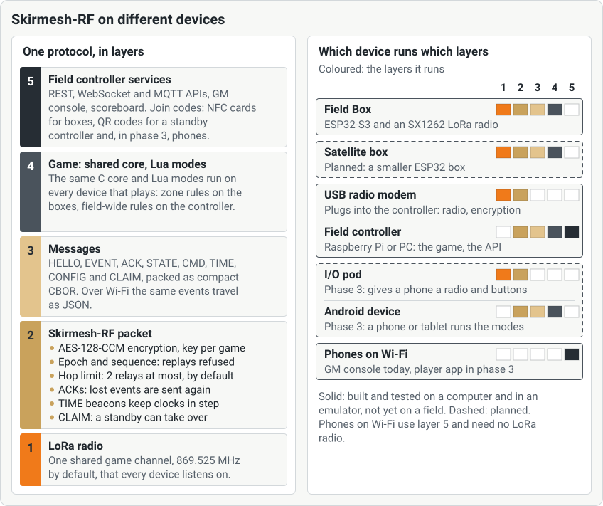

<!--
SPDX-FileCopyrightText: 2026 The Atalaia contributors
SPDX-License-Identifier: CC-BY-SA-4.0
-->

# Game master and field organiser manual

For the people who run a field: setting up the *field controller*, preparing a game, running it from the **GM console** and closing it. In Portuguese: [Manual da organização](../pt/game-master.md).

> **Not field-ready yet.** Atalaia is pre-alpha. The controller has played whole games with real boards on a bench, but no controller, box, phone or server has been used on a real field. Every step below matches what the software shows today. Steps that depend on hardware say **Not yet tested on a field**. Words in *italics* are in the [glossary](https://atalaia-project.link/en/glossary/).

## Contents

1. [How the pieces fit](#1-how-the-pieces-fit)
2. [Set up the field controller](#2-set-up-the-field-controller)
3. [Open the GM console](#3-open-the-gm-console)
4. [Prepare the field (once)](#4-prepare-the-field-once)
5. [Create a game](#5-create-a-game)
6. [Assign boxes](#6-assign-boxes)
7. [Check-in, teams and marshals](#7-check-in-teams-and-marshals)
8. [Start the game](#8-start-the-game)
9. [During the game](#9-during-the-game)
10. [End the game, and the logs](#10-end-the-game-and-the-logs)
11. [Install community modes](#11-install-community-modes-from-the-registry)
12. [The site server and hosted mode](#12-the-site-server-and-hosted-mode-briefly)
13. [Game-day checklist](#13-game-day-checklist)
14. [Troubleshooting](#troubleshooting)

## 1. How the pieces fit

- The **field controller** is the base station. It keeps the official score, hears every box over the radio and serves the console. It is a Raspberry Pi with a USB radio modem, or an Android phone. See *[field controller](https://atalaia-project.link/en/glossary/#glossary-field-controller)*.
- The **GM console** is a web page the controller serves. You open it on a phone, a tablet or a laptop on the field's Wi-Fi.
- The **boxes** are the game props. They play by themselves and talk to the controller over *[LoRa](https://atalaia-project.link/en/glossary/#glossary-lora)*.
- **Players** use the app on their phones, on the same Wi-Fi.
- The **site server** is optional, for accounts, schedules, history and remote control. A game never waits for it. See *[works without internet](https://atalaia-project.link/en/glossary/#glossary-local-first)*.

## 2. Set up the field controller

### On a Raspberry Pi (or another Linux computer)

Not yet tested on a field: no Raspberry Pi with a real modem and real boxes has run a game yet. For a step-by-step setup that does not assume you are a developer, use the [controller setup guide](controller-setup.md). The full commands are in the [controller guide](../../../controller/README.md#running-it). In short:

1. Flash a spare Heltec V4.3 board with the modem firmware and plug it into the Pi's USB. This is the **USB radio modem**. Its small screen shows `LINK OK` when the controller is talking to it. See the [firmware guide](../../../firmware/esp32/README.md#usb-radio-modem-variant).
2. Install the packages and build the core, as in the guide.
3. Copy `controller/controller.example.toml` to `controller.toml` and edit it. The settings you will want:
   - `[modem] port`: the modem's port (usually `/dev/ttyACM0`). Empty means no radio: games can be created but nothing reaches the boxes.
   - `[radio] region`: `eu868` (Europe) or `as923-tw` (Taiwan). The modem and every box must be built for the same region.
   - `[checkin]`: `field_id`, `field_name` (shown to players), `wifi_ssid` (printed on the poster), `confirm` (`auto` or `staff`), `federation`, `limit_template`.
   - `[api] tls_names`: the addresses phones use to reach the controller, for example `["10.42.0.1", "campo.local"]`.
4. Run it. To start it at boot, use the `systemd` file in `controller/deploy/`.
5. Show the **access codes**:
   `python3 -m atalaia_controller tokens`
   There are two: the **GM code**, which runs the game, and the **read-only code**, which only watches. Give the read-only code to scoreboards and spectators. Keep the GM code to yourself.
6. Show the **field join key** (64 digits and letters):
   `python3 -m atalaia_controller join-key`
   It is the field's master secret. Boxes get it once, when you adopt them ([section 4](#adopt-the-boxes)). Give it only to staff you trust.

On first start the controller makes the field's own **certificate** and serves HTTPS on port 8443, next to plain HTTP on port 8080. The check-in poster carries its fingerprint, so players' phones can check they talk to your controller.

### On an Android phone

A phone can be the controller of a small game, with no Raspberry Pi. Android only. Not yet tested on a field: it has run on a computer and an emulator, not on a real phone.

1. In the app, tap **Field controller**.
2. If it asks, allow notifications. Under **Battery optimisation may stop the controller mid-game**, tap **Ask for the exemption**.
3. Under **Field's network**, choose how phones reach it:
   - the phone's own hotspot (**Hotspot settings**: keep its name and password for the poster);
   - a router the phone joins (**Wi-Fi settings**);
   - **Make a network for the game**: Android makes a new name and password each time. Players join it from the QR code on the screen. Do not put them on the poster.
4. Turn on **Open on the field's Wi-Fi**.
5. For the boxes' radio, link an **I/O pod** (over USB or Bluetooth) or a USB radio modem (over USB) under **Radio**. Without one, only phones on Wi-Fi can play.
6. Set the **Field join key** in **Settings** (gear). The app makes one on first start if none is set. Give the same key to the boxes.
7. Tap **Start the controller**. The phone goes on running with the screen off.
8. Under **Access codes**, tap **Show the codes**. The **Game master's code** runs the game. Do not show it to players. The **Read-only code (scoreboard)** only watches.
9. Tap **Open the console**, or open the addresses under **The console, on computers on the field's network** on a computer. **The check-in poster must be printed from a computer** (Check-in tab).

If you stop and start the controller, a live game goes on.

### The field's Wi-Fi

Players' phones, the console and Android props all use one Wi-Fi network at the field. It does not need the internet. Use a router, a phone hotspot or the network the controller phone makes. Put its name on the poster (`wifi_ssid` on a Pi, or **The field's Wi-Fi network name** in the **Check-in poster** form of the **Check-in** tab).

## 3. Open the GM console

1. On a phone or laptop on the field's Wi-Fi, open `http://` *the controller's address* `:8080/console/`. For example `http://192.168.4.1:8080/console/`.
   In the Atalaia app you can also tap **Game master**, type the controller's address under **Console's address** and tap **Open the console**.
2. Type the **Access code (GM or read-only)** and tap **Enter**. The console remembers it. **Sign out** is at the top right.
3. A header shows the game, its state and clock, the **Radio** state and any alerts. The language picker is next to it.

With the read-only code you see everything, with **Read only** in the header, and you can change nothing.

The tabs are:

| Tab | What it is for |
| --- | --- |
| **Game** | Create, start, pause and end the game. Messages and score adjustments. |
| **Check-in** | The check-in poster, the list of players, marshals, replicas to chrono, check-in rules. |
| **Field** | The field's picture, floors, grid, map features, ATAK. |
| **Boxes** | Every box's health. Firmware updates. |
| **Join** | Join cards, QR codes and text for boxes and standby controllers. |
| **Adopt** | Give new boxes the field's key. |
| **Presets** | Saved modes with their settings. Signed mode packages. |
| **Scenarios** | Write custom scenarios. |
| **Log** | Events and alerts. |
| **Controller** | The controller's own state. Promote a standby. |
| **Settings** | Radio channel and region, box language, branding, saved teams. |

A tab can be missing when your controller does not serve that part. The **Controller** tab says which ones.

## 4. Prepare the field (once)

### The radio channel and region

Do this before the first game. All boxes use **one channel**.

1. Open **Settings**. Under **Radio region**, check **Region**. Change it only if the field is in another region, and only if the modem and boxes are built for it.
2. Under **Field radio channel**, choose one of:
   - **Keep the recommended channel**: 869.525 MHz in Europe. Tap **Use 869.525 MHz (recommended)**. This gives the most airtime and power the European rules allow.
   - **Find a quiet channel**: tap **Scan**. The USB modem listens to each channel for about a minute without transmitting and lists them quietest first. It suggests one. Tap **Use** to accept.
   - **Random channel**: **Draw a channel**. It will usually be a weak 1%, 25 mW channel.
   - **Pick from the list**: choose a channel and tap **Use this channel**.
3. A channel with 1% airtime and 25 mW shows a warning. A 0.1% channel is not recommended.

The channel is locked while a game exists. **A game is live: end it to change the channel.** See the [radio page](https://atalaia-project.link/en/radio/) for why 869.525 MHz.

Not yet tested on a field.

### Adopt the boxes

Each new box needs the field's key once. Open **Adopt**. Three ways:

- **USB cable**: plug the box into the controller's USB (a data cable). Tap **Look for boxes**, check the box's name and MAC, tap **Adopt** and confirm.
- **Field card**: tap **Make the field card**. Write the bytes on an NTAG215 or NTAG216 card as a join card. Tap it once on each new box. **The card is the field's master secret.** Keep it locked away. If it is lost or copied, rotate the key (`python3 -m atalaia_controller join-key --rotate`), restart the controller, adopt every box again and destroy the old cards.
- **Pair by code (radio)**: an unadopted box shows a 6-digit code. Tap **Look for boxes on the radio**. Pick the box by its name (check the **id** on its screen if two share a name), type the code and tap **Pair**.

A box that belongs to another field asks for its **admin PIN**. See the [box manual](field-box.md#4-adopt-the-box-into-the-field).

### Firmware updates (optional)

You can update the boxes' firmware over the field's Wi-Fi, between games. Not yet tested on a field.

1. Open **Boxes**. Under **Firmware updates**, choose the **Image (.bin)** and its **Release (.release.json)** and tap **Upload**. The controller accepts only releases signed with a key you listed (`[firmware] release_keys`), and only with HTTPS on.
2. While the game is **ready** and the boxes have joined, tap **Update every box**, or **Update to** *version* on one box.
3. Watch each box: **sent, waiting for the box**, **installed, restarting**, **done**, **failed**, **rolled back** or **no news from the box**. **Send again** repeats an offer. The game does not start while an update is on its way, unless you tap **Stop waiting for the updates on their way**.

A box needs the field's Wi-Fi name and password in its setup, enough battery and the release's key built into its firmware.

**One exception: a box flashed with v0.4.0 or earlier.** From v0.5 the firmware slots are bigger, which is a new partition table, and an update over the air cannot change it. The console refuses the offer to such a box (the result says: needs a newer partition table, USB flash required once). Flash that box over USB once, without erasing it (it keeps its field, keys and settings): see the [firmware guide, section 3.3](firmware.md#33-write-the-image). After that, updates over the air work as before.

### The I/O pod's settings (optional)

If a phone uses an **I/O pod** as its radio, you can change the pod's settings from the console, without a cable or a new build: the colours of its four buttons, the LED ring's brightness, the volume and whether its enclosure switch reports. Not yet tried with a real pod.

1. Do it **before a game starts or after it ended**. The panel is disabled during a game. The phone with the pod must have joined the game.
2. Open **Boxes**, panel **I/O pods' settings**. Find the phone with the pod, set only what you want to change (**Set the colours**, the brightness, the volume, the enclosure switch) and tap **Send to the pod**. **Back to the build's settings first** drops everything pushed before.
3. The panel shows **sent (1), waiting**, then **taken by the pod**. If the pod does not answer, the controller sends it again after 8, 16, 32, 64 and 128 seconds, then says **no answer**: the phone has no pod, the pod's firmware is older than this feature, or it is out of reach or battery.

The pod keeps what you sent, also after a restart. The build guide has the details: [I/O pod, Settings over the radio](../../../hardware/io-pod/BUILD.md#settings-over-the-radio).

### Box language, branding and saved teams

In **Settings**:

- **Box language**: the language of the boxes' screens. A game keeps the language it was created with. By default it is the console's language. Under the team, preset and field-name boxes the console warns when a name has letters the boxes' fonts lack (most Chinese letters, Cyrillic): the boxes draw "?" or an empty square for them, while the app and the console show the name as typed.
- **Field branding**: the field's name, logo, wallpaper and colour. They show in the app, on the scoreboard, on the poster and in the console. Upload only images you may use. PNG, JPEG or WebP. For a JPEG or WebP logo your browser also prepares the small copy the Field Boxes draw (a toast says so; keep the console open until it does); a PNG logo is prepared by the controller itself. If the toast says the logo could not be converted, upload it again, or as a PNG: the boxes keep showing the Atalaia tower meanwhile. When the controller takes its branding from the site server (`[sync] branding = "site"`), this card says **From the site server** and shows the name and colour without a form: they change on the site server, and the controller takes them at its next sync.
- **Saved teams**: a club's team name and crest to pick when you create a game. With the site server, **Teams from the site server** is a list of its own, with a badge on each: you cannot edit or delete those here. Teams you save in the console stay below it.
- **Check-in poster suggestion**: whether the console suggests printing the poster after you create a game.

### The field's picture and boundary

Optional, but the boundary is what makes players' phones warn them when they leave the field.

1. Open **Field**.
2. Upload a picture with **Upload field image** (PNG, JPEG or WebP, up to 4 MB), or tap **Load the field from a map**. That page needs the internet while you set the game up. Find the field, mark the corners of its outline (3 to 12) and tap **Draw the field image**, then **Use as the field**. It saves the picture, its place on the map and the **field boundary**. The controller needs no internet for this.
3. **Drag the boxes** to where they are on the field.
4. **Multi-story building**: tick it for a building with several floors. Each floor has its own plan.
5. **Grid on the map**: turn it on for lettered rows and numbered columns, so people can say "I'm in C4" on the radio. The players' app draws the same grid over the plan in its **Field map** and tells each player their cell. **Print the grid map** prints the plan under its grid with a list of what is in which cell, as a poster or a PDF through the browser's print dialog (not from the app's built-in console: open the console in a computer's browser). On ATAK, a box, a map feature or an indoor player on a level with a grid says its cell in its remarks, such as `grid C4`.
6. **Map features**: mark safe zones, respawns, HQs, the car park, first aid and objectives. Choose who sees each one: everyone, one team or the organisers only.
7. **Map position (ATAK)**: give two opposite corners of the image their latitude and longitude, to show the boxes on ATAK maps.
8. **Indoor beacons**: for a building with Bluetooth beacons, see [Indoor beacons](#indoor-beacons) below.

### Indoor beacons

Optional. Inside a building GPS is weak. If you put iBeacon-type Bluetooth beacons in the rooms, a player's phone can tell the controller which room it is in. The controller shows the room, never a point to the metre.

1. In **Field**, under **Map features**, open **Indoor beacons** and tap **Add a beacon**.
2. Type the beacon's **UUID**, **Major** and **Minor** (from the beacon's own app or its label), the **Room** (a name such as "Lobby") and, if you want to group rooms, a **Zone**. On a multi-story field choose the **Level**. Major and minor together must be different for every beacon on the field. Use standard iBeacon hardware; Eddystone beacons are not supported.
3. To show the room on the map, tap **Place on the plan** and click the plan where the beacon is, or type a place across and down it. Without a place the beacon still gives the room, but ATAK shows no marker.
4. **Save**. Change a beacon with **Edit** (its major and minor stay) and take one out with **Delete**.

How it works: a player who shares their position on a field with beacons is asked first and can say **Not now**. The phone listens only for the beacons on your list, reports the strongest one every 5 seconds, and the controller accepts only beacons on your list. Indoors the phone's beacon replaces its GPS position; outdoors GPS goes on. The player's position then shows the room (and zone) in ATAK, which puts the player at the beacon's place on the plan when you gave it one and the plan has a map position. The console does not draw players. Fewer levels move the beacons of the removed levels to the ground floor, unplaced. Not tested with real beacons yet.

**Field Boxes are beacons too.** A box in a game also advertises as an iBeacon, so a box on the wall of a room, on a floor, tells the phones near it which room that is, and you need separate beacons only where there is no box. Nothing to register: place the box on the plan in **Field** (its level and its place) and it appears under **Indoor beacons**, in **Field Boxes as beacons**, as a **Field Box**. Its room is the box's name (or the name you gave it in a scenario); tap **Room** to give it another. Move the box, or put it on another level, and its beacon moves with it. You cannot edit a box as a tag, but you can **Disable** one (phones then ignore it) and tick or untick **The Field Boxes advertise as beacons** for the whole field: the boxes learn it when the next game is joined, and the controller stops listing them to phones at once. A box you have not placed on a plan is not a beacon (it has no floor or place yet). Place your boxes before the game: a phone reads the list when it starts to share. Tags and boxes work together, and the strongest signal wins. Major 45253 is reserved for the boxes: do not use it on a tag. Not tested on a field yet.

### Check-in rules and the poster

1. Open **Check-in**. Under **Check-in rules** set:
   - **Confirmation**: **automatic**, or **by the GM or a marshal**;
   - **Federation number**: **do not ask**, **optional** or **required**, and the label (for example FPA). The app never checks the number. Tick **card seen** when you have seen the card;
   - **APD membership** (Portugal: a player belongs to an APD recognised for airsoft and holds a membership number with an expiry): tick **Check the player's APD membership at check-in**; tick **Ask for the expiry date and check it** if you want the expiry checked; and tick the **APDs accepted** (none ticked: any APD). An APD missing from the list can be added under **Add an APD of your own** (name, short name, website). With a site server, the field's admin sets the same rule there and the controller takes it when `[sync] branding = "site"`, with the field's other check-in settings; then the console shows the site's rule and cannot change it. Nothing is verified automatically: the player declares the APD, the number and the expiry, and you see a verdict (see below);
     Set the field's **country** (two letters: `PT`, `ES`, ...) just above. `PT` shows the APD texts and lists Portugal's APDs; any other country, or none, says **Association membership**, **Associations accepted** and so on, and lists only the associations the project knows for that country plus the ones you add under **Add an association of your own** (a club, a federation or an insurance body). Left empty, the controller uses `PT` where its time zone is Portugal's and no country otherwise. With `[sync] branding = "site"` the country is the site server's (a field's admin sets it there with the other settings) and the console cannot change it.
   - **Replicas per player and game** and **Most players per game**;
   - **Chrono readings kept for (days)** and **Game data kept for (days)** (30 to 3653, 365 by default): how long the controller keeps the chronograph readings (also other fields' copies, and a marshal's earlier keys) and, after a game ends, that game's events, scores and list of devices. Once the days are up the daily purge deletes them. With a site server set up, a game is never deleted before the site server has all of it (so a game that cannot be sent stays until it can); without one, age alone decides. With `[sync] branding = "site"` both are the site server's (the field's admin sets them in the field's settings) and the console cannot change them;
   - **A chronograph counts for**: **the whole day** or **this game only**.
   Tap **Save**.
2. Tap **Print the poster**. It opens an A4 page. Print it once and put it up in the check-in area. It works for every game at the field and holds no secret. If the field's Wi-Fi has a password, type it on the page and tap **Draw the Wi-Fi code**: it makes a Wi-Fi QR code beside the poster's code. The password is not stored or sent.
3. The **Check-in poster** form below lets you set **The controller's https addresses (one per line)**, **The field's Wi-Fi network name** and **This game only**. If the poster cannot be made, the page says why: HTTPS is off, no address is set, or the text is too long for a QR code.

Print the poster from a computer. The app's built-in console cannot print.

### Print replica labels

Marshals find a replica in the chrono queue by scanning its QR label. Players can make theirs in the app. You can print them from the console, too:

1. Open **Check-in**. In a player's row, next to the replica count, tap **Print labels**. To print for everyone, tap **Print labels for everyone checked in** at the top (players still waiting for confirmation are left out).
2. A page opens with one label of 30 × 30 mm for each declared replica, and a thin line to cut along. Tap **Print**. The player's name and the replica's kind show on the screen only, never on the sticker.
3. Cut them out and stick them on the replicas.

Each QR holds only the label code (**ATL-** and eight characters), nothing about the player. Print from a computer, as for the poster.

## 5. Create a game

1. Open **Game**. With no game running you see **New game**.
2. Fill in:
   - **Game name** (up to 64 characters);
   - **Mode or preset**: a mode from **Modes**, or a saved one from **Presets**;
   - **Teams**: names separated by commas, in the order of the boxes' buttons, for example `red, blue`. The known colours are red, blue, green, yellow, orange and purple. 1 to 8 teams;
   - **Team names and crests** (optional): a display name and a crest for each team colour. The boxes keep showing the colour;
   - **Duration (minutes)**: `0` means no limit. At the end, the game ends by itself;
   - **Squads per team**: `0` means teams only. In a milsim or a big game each team splits into squads (up to 16). With a scenario you can choose **Who a squad's objectives go to**;
   - **Objectives at the start** (a scenario's game): whether the objectives that depend on others, and say nothing about it themselves, are visible from the start (**All visible from the start**) or hidden until they open (**Only the active ones**: the next one is revealed when the one before it is completed). Left on the default, a game with squads shows only the active objectives and a game without squads shows them all, unless the scenario's own `reveal` says otherwise; an objective's own `visibility` in the scenario always wins. It is fixed when the game is made, and the game's page says which one applies. On the phone controller the same choice is in the new-game form;
   - **Modifiers**: tick **Codes**, for example, to run keypad codes next to the mode;
   - **Props with a role of their own**: for example **Medic Kit**;
   - **Mode parameters**: the mode's settings, with a short description.
3. Tap **Create game**.

If free boxes were heard over the radio, **Boxes for this game** opens at once ([section 6](#6-assign-boxes)). If not, the console may suggest printing the poster. That message closes by itself after 10 seconds. Tick **Don't show this again** to stop it.

Settings cannot change after you create the game. **To change them, end this game and create another one.**

### Modes

Every built-in mode is listed in **Mode or preset**. Their English and Portuguese names:

| Mode | Português | Notes |
| --- | --- | --- |
| Domination | Domínio | One box or many. Hold time and points are parameters. |
| Hold-All Domination | Domínio Total | A team scores only while it holds every box. |
| Bomb / Rush | Bomba / Rush | Fuse, arm and defuse hold times. An explosion ends the game and the team that armed the bomb wins; a defuse does not end it (use **End**). Optional **Team codes**, for example `red=1234,blue=5678`. |
| Sabotage | Sabotagem | Bomb rounds until the game time runs out: an explosion scores for the attackers, a defuse for the defenders, then a short pause. The team with more points wins. Pause, game time and optional **Team codes** are parameters. |
| Last Stand | Último Elemento | Attackers, defenders, countdown to defeat. |
| Kill Confirmed | Baixa Confirmada | Needs player tags. |
| Respawn and Lives | Reentradas e Vidas | Needs tags, or team buttons. |
| Player Check-in | Registo de Presença | Needs player tags. |
| Master and Satellites | Mestre e Satélites | |
| Progressive Domination | Domínio Progressivo | One active box at a time. |
| Hacking Terminal | Hackeia o terminal | Works without the controller. Puzzle: code, wires or sequence. |
| VIP / Payload | VIP / Carga | The VIP shares a position from the app. |
| Money Factory | Fábrica de Dinheiro | Needs tags. |
| Target Windows | Janelas de Alvo | Needs the target addon, which is not built yet. |
| Codes (modifier) | Códigos (modificador) | Keypad codes alongside any mode. |
| Medic Kit (role) | Ligaduras | A kit box next to any mode. |
| Objectives (role) | Objetivos | The boxes of a custom scenario. |

The [modes page](https://atalaia-project.link/en/modes/) shows each mode with an animation.

### Modifiers and the Codes modifier

Tick **Codes** under **Modifiers**. In **Codes**, type `digits:kind[:points][:team]` separated by commas. The kind is `points`, `hint` or `unlock`. For example `4711:points:50,0815:hint,2222:unlock:red`. Each code works once per game.

### Scenarios

A *scenario* is a custom game with objectives (capture, code, tags, bomb, escort, defend, survive). Open **Scenarios**, write or paste the manifest in **YAML** (or use **Blocks**), tap **Check** and then **Install**. Then in **Game**, pick the scenario under **Mode or preset** and tick **Objectives**. Give each box one of the scenario's names in the **Join** tab. The [controller guide](../../../controller/README.md#scenarios) explains the format.

### Presets

A *preset* is a mode with its settings saved. Open **Presets**, tap **New preset**, pick a mode and its parameters, name it and tap **Save**.

## 6. Assign boxes

A game starts only when every role it needs has a box. There are three ways to put a box in the game.

### Invite boxes over the radio

The normal way, for adopted boxes.

1. After **Create game**, the **Boxes for this game** dialog opens. Or tap **Invite boxes** on the **Game** tab.
2. Boxes whose last game is over announce themselves. They appear within about 20 seconds, then about once a minute. Tap **Look for boxes** to ask them now.
3. The boxes of the **last game** are ticked. Tick the ones you want and pick each box's **Role**.
4. Tap **Invite (** *n* **)**. The controller sends each box its join over the radio, encrypted with the field's key.
5. Watch **Progress**: **sending**, **invited**, **accepted, joining**, **joined**. A box can say **refused: in another game**, **refused**, **failed** or **too big**.
6. The dialog says **Ready to start: every role has a box**, or **Still waiting for a box for:** *roles*.

If a box says **the mode is not on the box**, tap **Send missing modes**. The box fetches the signed modes it lacks over the field's Wi-Fi. This needs the box mode keys and HTTPS on the controller.

### Join cards, QR codes and text

1. Open **Join**.
2. Under **For**, choose **a box**. Pick the **Role in the mode**. Leave **Id** on **automatic**.
3. Tap **Generate**.
4. The console shows a **QR code**, a **Join text** (`atalaia:join:…`) with **Copy text**, and the bytes for an **NFC card (NTAG215/216)**.
5. The box reads the card on its NFC reader. A phone prop scans the QR code with **Game prop › Join a game**. Hold the card or the code only for the people setting up the field: **this code and the card carry the game key**.

### A standby controller

Under **For**, choose **a standby controller**, tap **Generate**, and paste the text into the other controller's **Join** tab under **Join as a standby controller**. Both must share the same field join key. The standby also receives, with that text, the boxes' beacon choices (the field switch, the boxes you disabled, the rooms you gave) and where you placed the boxes, so after a failover phones get the same beacon registry; after you move or place a box or change those choices, generate the standby's text again and paste it again (the standby takes it as a refresh). If the main controller stops answering, open its **Controller** tab and tap **Promote to controller** on the standby. Automatic failover is off by default.

## 7. Check-in, teams and marshals

Open **Check-in**. Check-in is open from the moment a game is created. **Close check-in** stops it and **Open check-in** reopens it.

### Players

1. The **Check-ins** list shows each player: **Name**, **Status**, **Team › Squad**, **Role**, **Replicas**.
2. A status **waiting for confirmation** (when confirmation is **by the GM or a marshal**) has a **Confirm** button. A registered player marked **expected** has **Arrived**.
3. Give each player a **Team**, and a **Squad** if the game has squads, with the drop-downs. Set the **Role**: **player**, **squad leader**, **VIP**, **marshal**, **GM** or **spectator**. A change takes effect at once. The player's app picks the change up by itself.
4. Tick **card seen** once you have seen a player's federation card. With the APD rule on, each row shows the player's APD, membership number and expiry and a verdict: **valid**, **expired**, **APD not accepted** or **missing**. A player whose verdict is not **valid** waits as **waiting for confirmation** even when confirmation is automatic. **Confirm** lets them in anyway: a marshal or you are never blocked, and the controller logs it (the player's id and the verdict, never the number) and marks the row **confirmed by staff**. You can also correct the APD, the number or the expiry on the player's row.
5. **Remove** takes a player out of the game.
6. **Check in by hand**: for a player without the app. Type a name, a team preference and replicas. The controller makes an id, which can be written to a player tag (see [Players' tags](#players-tags)).
7. **Export CSV** saves the list. Open the console in a computer's browser for this. The app's built-in console cannot save it.
8. **Import a registration list**: for a field with no site server, where people register somewhere else. Pick the CSV (or JSON) file from the other platform, give the **Source** (that platform's name) and tap **Check the file**: it lists each row as new, changed, unchanged, skipped or refused, with the reason, and changes nothing. Only the columns `display_name`, `external_ref`, `team_preference`, `federation_number` (the membership number), `apd_id` (the id of the APD or association, lower case, for example `x-mylabel`), `membership_expires` (YYYY-MM-DD) and `replicas` are read, in the site server's import format; any other column (an email, a phone number) is only named. The three membership columns are optional, an old file without them imports as before, and they are dropped (with a warning) when the field asks for no membership. **Export CSV** has the same `apd_id` and `membership_expires` columns, so an exported list imports back. Then tick that the field has its own legal basis for the list and tap **Import**: the players show as **expected**, and you tick **Arrived** when they come. Importing the same file again changes nothing, and a player who has arrived is never changed. The console cannot remove a registration the file no longer lists: it only tells you how many there are. On a phone controller you can do the same from the controller's own screen: under **Registration list**, tap **Import a registration list** while a game is live, then **Choose a file** (Android's file chooser), give the **Source**, tick the basis and tap **Check the file** and then **Import**, with the same rules and the same result per row. A refused file or row is told in words.

Names are shown only here and to marshals. Nothing about a player's name goes in events, the scoreboard or the players' views.

### Players' tags

Some modes (Kill Confirmed, Respawn and Lives, Player Check-in, Medic Kit, Money Factory) need an NFC tag for each player. The controller signs every tag with the game's key. The key never leaves the controller, so nobody needs the field join key to write tags. A tag works only in the game it was made for; every new game needs new tags. Use blank NTAG213, NTAG215 or NTAG216 tags. Three ways to write one:

1. **In the console**: under **Check-in**, the **Players' tags** card. Pick the **Player's id** from the players who have checked in (or type an id, 1 to 32 letters, digits, `-`, `_` or `.`; each player's id is under their name in the list). Pick the **Team**, or **No team**. Tap **Make the tag**. If your browser can write NFC (Chrome on an Android phone, with the console opened over HTTPS), tap **Write it with this device's NFC** and hold a blank tag to the back of the phone. If not, the console says so and shows the **NDEF record (hex)**, with **Download the NDEF file**. Write it with the Atalaia app on a phone (the marshal's screen, or the controller's own screen below) or with an NFC app that can write a raw NDEF record from hex.
2. **On a phone controller**: on the controller's screen, under **Players' tags**, tap **Write players' tags** while a game runs. The form is the marshal's. The phone writes the tag with its own NFC and asks its own controller for it.
3. **A marshal**: the marshal's app asks the controller for each tag (see the [marshal manual](marshal.md#7-write-players-tags)). The marshal must be on the field's Wi-Fi and on your marshal list. Marshals no longer need the field join key for this.

If the console says a tag cannot be made because the game is not running, create the game first: an ended game has no key.

### Marshals

Only people on the **Marshals** list can act as marshals.

1. A player checks in first.
2. Under **Marshals**, **Add a marshal**: pick the **Player who checked in**. Optionally type an **Id** or a **Name**. The controller gives an id such as M-01.
3. The table shows the **Signing key** as **registered** or **waiting for their app**.
4. **Remove** takes a marshal off the list at once. Their unsent readings are refused until you add them again.

See the [marshal manual](marshal.md).

### Replicas to chrono

**Replicas to chrono** lists the declared replicas and their state. When you start, the console warns if some are still not chronographed.

### From the schedule

With a site server, **From the schedule** lists the games published for the coming days. **Create the game** makes a game with its title, mode and teams, and its registered players show as **expected**. A registered player can check in with the app, with a printed ticket (**Printed ticket**: scan or paste its code), or by name.

## 8. Start the game

1. Open the **Game** tab. The game is **ready**. Check **Game settings** if you want to review them.
2. If a role has no box, the console says **No box has joined for:** *roles*.
3. If some declared replicas are not chronographed, it says **n declared replica(s) not chronographed yet**.
4. Tap **Start**. It asks **Start the game now?**. Tap **Yes**.
5. If a role has no box, the button says **Start anyway** and asks **Start anyway?**. Starting anyway is logged and every console is told: **Game started without a box for:** *roles*.
6. In the **Boxes for this game** dialog, **Start game** asks **Review the game's other settings first?**. **Review settings** closes the dialog and opens **Game settings**. **Start now** starts the game. **Back** goes back.

**Remote start.** If the field uses a site server with the **remote GM** turned on, a GM logged in there can start, pause, resume and end the live game from the site's **Remote GM** page. Choose the controller, tap **Start**. If a role has no box it asks **No box (or linked phone) has joined for: …. Start anyway?**. This is the same check as the console's **Start anyway**. The controller opens the connection. See [section 12](#12-the-site-server-and-hosted-mode-briefly).

A standby controller cannot start a game. It says **This controller is not in charge of the game**. Promote it first.

## 9. During the game

### The Game tab

- **State**, **Game time**, **Length**, **Mode**, **Teams**, and the **Radio** channel.
- **Pause** asks **Pause the game?**. **Resume** asks **Resume the game?**. **End** asks **Are you sure?**. Answer **Yes**.
- **Message to every box**: type up to 100 characters and tap **Send**. It shows on the boxes' screens and on the players' phones.
- **Adjust score**: pick a team, type **Points (negative for a penalty)** and a **Reason**, tap **Apply**.
- **Teams of this game**: change team names and crests until the game ends.
- **Game settings**: the settings you used, read-only.
- **Score**: each team's total, with a graph. A box's points arrive with its status, so they can lag by up to about 15 seconds. Next to a total the console may show a smaller *estimated* number: between two reports of a holding box, it adds the points the box has made since, and it follows a capture the box has reported until the box's next status. Only the number without *estimated* is the official score.

### The Boxes tab

Each box shows its **No.**, **Name**, **Role**, **Owner** (team), **Tier**, **Battery** (with **low** below 20%), **Signal**, **Last heard**, **Firmware** and **Epoch**. A box that has not been heard shows **not heard**. You can change a box's owner team with the drop-down. Some modes add buttons, for example a medic kit's refill.

### The Log tab

The **Log and alerts** page lists events as they come: captures, bombs, codes, kills, heals, objectives, messages. Each line has the game time, the event's type name (for example `zone.captured` or `bomb.armed`), the team and the box. Events from the hacking terminal, medic kit, VIP, money factory and scenarios are also written in words. Type in **Filter events** or tick **Critical only**. Alerts show above the list:

- **Radio down: the USB modem does not answer.** and **Radio back.**
- **Box N has not been heard for more than 90 s.**
- **Transmission failed** and **Modem error**.
- **This controller is now** *role*.
- A critical event, such as a box being tampered with.

### Codes

- **Game codes.** The **Codes** modifier, *Bomb*'s team codes and the *Hacking Terminal*'s code are secret to teams. You see them. The log shows who used each code and which team held the box. A solved terminal shows the code it revealed.
- **Access codes.** The GM and read-only codes come from `python3 -m atalaia_controller tokens`. Players never get the GM code.

### Field map and scoreboard

On **Field** you see the boxes where you placed them (and the beacons, if you added some). The console does not draw players' positions. They go to the organisers' ATAK devices when you set those up (`[atak]` in `controller.toml`), and can be read from the controller's API. The **scoreboard** is a page for a TV or a laptop. Open it with the read-only code:
`http://` *the controller's address* `:8080/scoreboard#token=` *the read-only code*
Add `&lang=en` for English.

To let players follow the game in the app without checking in, open the **Game** tab, find **Share the scoreboard with players**, and tap to show its QR code. Players scan it in the app under **Player**. If your controller offers more than one address, choose the one players can reach. A code ending in `ca=` and a long number is for the secure address: the app checks the controller's certificate against it, so the players need do nothing else. Keep it among players: whoever has it can follow the game.

### If a box or the controller goes quiet

- A box that loses contact keeps playing and catches up. Move it closer or add a relay box.
- If the controller restarts, the live game goes on from its last saved time and scores.
- If it restarted with the setting that does not keep the game key, the game can only be ended. **End** then tells the boxes over the radio.

## 10. End the game, and the logs

1. Tap **End**, then **Yes**. Or let the **Duration** run out. Some modes end the game themselves: in Bomb / Rush an explosion ends it (the team that armed the bomb wins), and in Sabotage, for example, the box's own game-time limit ends it, and the game then ends on the controller with the box's winner (or as a draw). The **Log** tab says **The game ended: ended by box** *name*. This works only while the game runs, and only for a box that is in the game: if you have paused the game, a box that announces the end during the pause does not end it, so end the game yourself with **End**.
2. The controller tells the boxes over the radio that the game is over. If it cannot, it says **The boxes could not be told over the radio**: restart each box or join it to the next game with a card.
3. The boxes show **GAME OVER**. After 30 seconds they show **READY**.
4. The **Game** tab says **The game "…" has ended.** The scoreboard and the players' phones show the winner.
5. Export the check-in list with **Export CSV** if you want to keep it.

**Logs and records**

- **Log** tab: the live log of the game.
- **Boxes** tab: each box's health at the end.
- The controller keeps each game, its events and scores in its database. Names and federation numbers are erased 30 days after the game by default.
- The controller deletes an ended game with its events, scores and boxes **365 days** after it ended by default (a field setting, 30 to 3653 days, in the check-in settings), and the chronograph readings after the same setting for readings. When you erase a player on the controller (**Erase**, or the player's own request), the controller tells the site server, which erases its copy of the player's chrono records and the link of their id to an account; no need to ask the field's administrator on the site separately.
- With a site server, each game's history and event log are on its staff pages. See [section 12](#12-the-site-server-and-hosted-mode-briefly).
- The controller's own log is the system log. On a Pi with the supplied `systemd` file, use `journalctl -u atalaia-controller`.

## 11. Install community modes from the registry

Anyone can share game modes as signed packages through the [community mode registry](https://vakaobr.github.io/atalaia-modes/). Today it is live, but it **has no modes yet**, and the project's signing key is not added yet. Everything below is built and tested in software.

1. On the registry's page, find the mode and its **author's public key**.
2. Decide to trust that key. Put its public half in the controller's `[modes]` settings: `keys = ["<44 characters>"]`. Set `index = "https://vakaobr.github.io/atalaia-modes/index.json"`. On an Android controller use **Settings › Mode packages (field controller)**. Restart the controller.
3. Open **Presets**. Find **Signed mode packages**. Under **Trusted mode keys:** check your key is listed.
4. Under **From the registry index**, tap **Read again**. Each package shows its **State**: **available**, **installed**, **signed with a key this controller does not trust**, **its key is revoked** or **a built-in mode has this id**. It also shows **reviewed by the project** or **not reviewed by the project**.
5. Tap **Install** (or **Update to** *version*). The controller checks the signature, the package and the scripts before it installs anything.
6. Without the internet, upload a package: choose the **Package (.tar)** and its **Release (.release.json)** and tap **Upload and install**.
7. The mode shows in **Mode or preset** in the **Game** tab.

A community mode runs on the boxes, so each box must have it. A box fetches a missing mode from the controller (**Send missing modes** in the invite dialog) only if the mode is signed with a key built into the boxes' firmware. A box with no such key cannot run it.

Anyone can write a mode. Read [Submitting a community mode](../../../CONTRIBUTING.md#submitting-a-community-mode) and the [registry guide](../../community/README.md).

## 12. The site server and hosted mode, briefly

The **site server** is optional. It keeps what lasts longer than one game. Games never wait for it. It is built and tested in software. It has not run as a real deployment yet. See the [site server guide](../../../server/README.md). The staff pages are at `/staff/`.

- **Accounts and roles.** Roles are per field: `player`, `squad_leader`, `vip`, `marshal`, `gm`, `spectator`, `admin`. The admin, GM and marshal roles need a **second factor**: a **TOTP code** from an authenticator app, or a **passkey** (a passkey counts as both factors at once). The first administrator is made from the command line: `docker compose exec server python -m atalaia_server create-admin --username NAME`.
- **The field's look and rules on the controllers.** On the site, the field's `admin` sets the field's branding (name, accent, logo, wallpaper) and saved teams, and, in the field's settings, the check-in rules (limit template, replicas per player, federation label). A controller started with `[sync] branding = "site"` takes them from the site: a standby controller too, from its own sync, with or without a game. When the staff change them on the site, the controllers connected to it get a note and pull them at once; without a connection they pull at their next sync. On such a controller the console cannot change the field's branding, and a change to the check-in settings there lasts only until the next pull.
- **Where to set the field's settings.** The field's `admin` opens the field's **Settings** page at `/staff/fields/<field>/settings` (the **Settings** link in the field's sections, or on `/staff/`; no API needed). It has five sections, each saved on its own: **Public page** (the public page and feeds on or off, description, address, federation label), **Check-in rules** (limit template, most replicas per person), **APD / association membership** (accepted list or any, needed to register, checked at check-in, expiry, and the field's own entries, which you add and remove there and which count once the section is saved), **Chrono sharing** and **Country**. The country picks the words: `PT` says **APD** and offers Portugal's APDs, any other country (or none) says **Association membership** and offers the ones the project knows for it; when you save a new country the words and the list change on the page at once. A change to the check-in rules, the federation label, the membership or the country reaches the controllers at once (the server sends them `field.changed`). A refused value is shown in words and nothing of it is kept.
- **How long data is kept.** In the field's **Settings** page the section **Data retention** (the field's `admin`) sets two periods in days, 30 to 3653 (365 by default): **Chrono records** (the site server's registry of readings, violations, replicas and marshal keys, and the same readings on the field's controllers) and **Game data** (an ended game's events, scores and nodes on the controllers). The controllers get both at once; with `[sync] branding = "site"` they follow them and their consoles cannot change them. A controller deletes a game only after the site server has all of it. The server's own game history keeps its own period (the **History** page).
- **Schedules and registration.** A field's `admin` or `gm` creates scheduled games. The field's `admin` publishes them. A published game has a public page at `/f/` *the field's name* with a **Register** button, in Portuguese and English. Players register with an account in the app (**Player › Online registration**) and get a check-in ticket. **Neither the app nor the pages can create a player account yet**: accounts are made through the server's API. The **Check-in** tab's **From the schedule** turns a scheduled game into a live one. On the staff pages, **Schedule** lists the field's games (**Upcoming**, **Past** or **All**). Fill in the form at the bottom (title, start and end, teams, places, the registration window, whether a federation number is asked for) and tap **Create draft**. A draft is seen only on the staff pages. The `admin` taps **Publish** to put it on the public page and in the feeds, and **Cancel game** (with a reason) to cancel a published one. The `gm` can create, edit and delete drafts, and edit a published game, but not publish or cancel. Times are those of the field's time zone, shown above the list. Without a registration opening or closing time a game takes no online registration.
- **Registrations and the roster.** A published game's **Registrations** button lists who registered: display name, team asked for, federation number (if the game asks), replicas, whether there is a ticket, and the status. Until the game starts, the `admin` and the `gm` can tap **Edit** to change a display name, a team, a federation number or the declared replicas (**Add a replica**, **Remove**), **Move to another game** to put the registration in another published game of the field that has not started, **Withdraw** to remove a registration or **Restore** to bring a withdrawn one back while there is a place. A move keeps the person, the replicas and the ticket (the ticket the player already has works at the new game); the team and the federation number are fitted to the new game, and the page says what was dropped. A restored registration has no ticket: the player taps *New ticket* in the app, or the marshal ticks the name on arrival. **Mark paid** and **Mark unpaid** keep a note of who marked it and when: it is only a note, the server takes no payment. After the game, **No-show** marks a player who did not come (you can undo your own mark; the controller's check-in is never undone here and its results replace your mark). This is personal data: only the field's `admin` and `gm` see it. **Game-day roster** shows the list the controller pulls (the active registrations, in the order they were made) and **Print** gives a paper copy with a box to tick for each person. Print only what the game day needs and destroy the paper afterwards. The page says whether the controller has made a game from the scheduled game and how many walk-ins it reported. It also says when a controller last pulled the list, with the name of the key it used and its program; check what arrived on the controller, in **Check-in › From the schedule**. Arrivals cannot be marked here: they are the controller's and come from its sync. At the bottom of **Registrations**, **Export CSV** saves the list (personal data: keep it only as long as the game needs it; each export is logged without names) and **Import a list** reads a CSV or JSON file for registrations the field received another way: give a source name, tap **Check the file** to see what would happen (nothing is saved), then tick that the field has its own basis for holding the list and tap **Import**. Imported registrations have no account and no ticket, and are deleted 30 days after the game. **APD membership:** the field's admin sets the field's APD rule with the API (`PATCH /api/v1/fields/{field}` with `{"apd": {"accepted": [...] or null, "register": true, "checkin": true, "expiry": true, "custom": [...]}}`): which APDs the field accepts (`null`: any), whether a registration needs a valid membership (`register`), whether it is checked at check-in (`checkin`) and whether the expiry counts (`expiry`); the field's own APDs go in `custom` (ids starting `x-`). Players declare their APD, membership number and expiry when they register; the registrations page and the roster show them with the verdict (valid, expired, not accepted, missing), and the staff can correct them. The public page of a game says what the field asks. The controller takes the rule with `[sync] branding = "site"`. The old federation number is the membership number with the APD unknown. The number, the APD and the expiry are erased 30 days after the game, like the federation number.
- **Rosters.** Registered players show as **expected** in **Check-in** until they arrive. Registrations can also be imported from a file.
- **Staff pages.** Log in at `/staff/login` with your password (then the TOTP code), with a **passkey** (the button *Log in with a passkey*, no username needed), or with **Google**, **Microsoft** or **Apple** when the server's operator turned them on (a first login with one of them makes an account if you tick the agreement box next to the buttons; only an identifier the provider gives is kept, never your email). A login with Google, Microsoft or Apple alone does not count as a second factor: at the top of every page you get **Confirm the second factor**, with the TOTP code or a passkey, and the admin, GM and marshal roles count from then on. When the field's privacy notice has changed since your account last agreed to it, a panel at the top, **Confirm the privacy notice**, asks you to read it (the link opens the notice) and to tick and confirm that you agree; nothing is blocked meanwhile. If the server has password login switched off, only the passkey and the provider buttons are shown. **Account** (the link at the top right of every page) is your own login methods: add a **passkey** (*Add a passkey*, name it, and the browser, phone or security key asks to confirm), rename or remove one, link or unlink **Google**, **Microsoft** or **Apple** (*Link Google*: the provider asks you to log in, then you are back on the page), set, change or remove your password, and turn the **TOTP code** on (add the secret it shows to your authenticator app and type the code) or off. An account made by a first login with Google, Microsoft or Apple starts with a **Choose your username** step on this page (it begins with a temporary name; *Use my Google name* asks the provider for its name only when you press it, and the name is not kept, only the username you save; *Skip for now* leaves it for later), and the **Username** section renames any account. If you link a login that already belongs to another account of yours, the page offers **Merge the other account into this one**: the logins, passkeys and roles of the other account move here, its password does not, and it is closed; accounts with a staff role cannot be merged this way. If the first login with a provider is refused for lack of consent, the message appears just above the agreement box, below the provider buttons. Changes ask you to confirm it is you: type your current password in the box at the top, or, if your account has no password, confirm with the TOTP code, a passkey or the provider (valid for ten minutes). The page says in words why something is refused: for example that it is the last way to log in, or that a role you hold needs a second factor (TOTP or a passkey), so keep at least one. Make a passkey before you give up TOTP. Pages: **Fields**, **History**, **Schedule**, **Scenarios**, **Presets**, **Devices**, **Remote GM**, **ATAK**, and for the admin **Data and limits**. **History** lists each game with its summary, score timeline and event log. The timeline is in game time (pauses do not count); a game's page opens only under its own field. **Data and limits** (the field's admin only) has **Prepare the export**, which downloads everything the server holds of the field as a ZIP file (personal data: keep it safe; credentials, e-mails and network addresses are not in it; each export is logged and shown with its SHA-256), and, on a hosted server, a table of what the field uses of each limit. A club's public page lists the fields with a public page where it plays. Its settings (the field's admin only) have a **Public scoreboard**, a **Delay for everyone but the staff** and **Keep the history for**. **Devices** shows each box's health in words: **battery low**, **offline**, **silent**, **tampered**, **firmware outdated**.
- **Controller sync.** In the controller's `[sync]` settings, `enabled = true`, the server's `url` and the field's API key. Give each controller its own labelled key (a field can have two live), so the roster page can tell which one pulled the list. The controller opens every connection. Offline first: the game never waits for the network.
- **Remote GM.** Turn on `remote_gm = true` in `[sync]`. A GM on the site's **Remote GM** page sees the live game, **the positions of the players who share them** (a list: player, team, role, where, how old; the site server only passes them on, it keeps none) and can **Start**, **Pause**, **Resume**, **End**, **Send message** and **Send mode command**. Every command is logged on both sides.
- **Hosted mode.** The community hub plans servers run for clubs without IT support, one per field. It is off by default and does not go live before a legal review. See [Hosted mode](../../../server/README.md#hosted-mode) and [the privacy and data processing templates](../../README.md#templates).

## 13. Game-day checklist

1. Charge the boxes, the controller and the phones. Fit every antenna.
2. Start the controller. Check the **Radio** pill says **up**.
3. Open the console. Check the **Settings** radio channel.
4. Print the poster, if it is not up.
5. Create the game. Choose teams, modes and the duration.
6. Invite the boxes. Wait for **Ready to start: every role has a box**.
7. Open check-in. Check players in. Confirm, assign teams, add marshals.
8. Have the marshals chrono the replicas. Check **Replicas to chrono** is empty.
9. Brief the players. Start the game.
10. Watch **Log**, **Boxes** and the score.
11. End the game. Export the check-in list. Charge everything.

## Troubleshooting

| Problem | What to do |
| --- | --- |
| The console shows **No connection to the field controller. Reconnecting…** | Check your Wi-Fi and the controller's address. Check the controller is running. |
| **Wrong access code.** | Use the code from `python3 -m atalaia_controller tokens`. The GM code, not the read-only one, changes things. |
| **Radio: no modem** or **Radio down: the USB modem does not answer.** | Check the USB modem is plugged in, `[modem] port` is right and the modem's firmware is flashed. |
| The modem screen says it is built for another region | Use a modem and boxes built for the field's region, or change the region back. No game can start until they match. |
| **No free box heard yet.** | The boxes must be adopted and show **READY**. Wait up to a minute, tap **Look for boxes**, and check the radio region and range. |
| **Look for boxes** says it did not look on the earlier channels, and gives a number of minutes | Sweeps of the earlier channels are limited on channels with little air time (on a 1 % channel, two or three an hour) so the radio stays within its legal share. Wait the minutes it says; the question on the field's own channel still went out. A 0.1 % channel allows no sweep: a box still missing must be adopted again. |
| A box says **refused: in another game** | Power-cycle it, or end its old game. |
| **Start waits for a box … for:** *role* | Invite or join a box for that role, or tap **Start anyway**. |
| **The poster cannot be made** | **HTTPS is off**, **no address** or **too long**: set `[api] tls_names` or `[checkin] urls` and a shorter field name. |
| Players cannot check in | They must be on the field's Wi-Fi. The poster must list an address that works. Check the **Field certificate** matches. |
| Players' phones warn they are out of bounds when they are not | The boundary is wrong. Redraw it in **Field**. |
| A marshal says **Ask the GM to add you** | Add them in **Check-in › Marshals**. They must check in as players first. |
| I cannot change the settings of a game | Settings are set when the game is created. End the game and create another. |
| **This controller is not in charge of the game** | It is a standby. Use the main controller, or tap **Promote to controller** on the **Controller** tab. |
| The channel cannot be changed | **A game is live.** End it first. |
| A box's firmware update fails | Updates only run while the game is **ready**. The box needs the field's Wi-Fi in its setup, enough battery and the release's key built in. |

More help: the [controller guide](../../../controller/README.md), the project's [Discussions](https://github.com/vakaobr/atalaia-project/discussions) and the other manuals: [players](player.md), [marshals](marshal.md) and [box operators](field-box.md).
