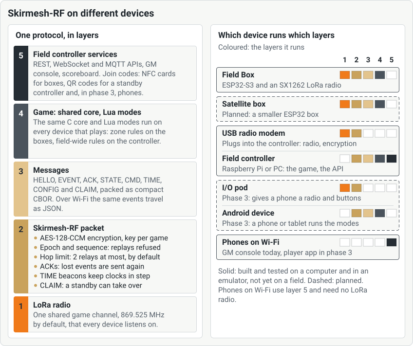

<!--
SPDX-FileCopyrightText: 2026 The Atalaia contributors
SPDX-License-Identifier: CC-BY-SA-4.0
-->

# Game master and field organiser manual

For the people who run a field: setting it up once, running a game day from the **GM console**, getting out of trouble and keeping the boxes up to date. In Portuguese: [Manual da organização](../pt/game-master.md). The optional site server (staff accounts, schedules, hosted mode) has its own manual: [Site server administration](site-admin.md).

> **Not field-ready yet.** Atalaia is pre-alpha. The controller has played whole games with real boards on a bench, but no controller, box, phone or server has been used on a real field. Every step below matches what the software shows today. Steps that depend on hardware say **Not yet tested on a field**. Words in *italics* are in the [glossary](https://atalaia-project.link/en/glossary/).

> **Versions.** The newest release is **v0.8.0** (4 November 2026). A feature marked **From v0.9.0 (not released yet)** is on the project's `main` branch only: you get it from the next release, or by building from `main` now.

## Contents

**A. [Set up a field](#set-up-a-field)** (once)
[What you need](#what-you-need) · [Phone or Raspberry Pi](#phone-or-raspberry-pi) · [Open the GM console](#open-the-gm-console) · [Access codes and day codes](#access-codes-and-day-codes) · [Radio region and channel](#radio-region-and-channel) · [Change the channel](#change-the-channel) · [Adopt the boxes](#adopt-the-boxes) · [The field's map](#the-fields-map) · [Indoor beacons](#indoor-beacons) · [Check-in rules and the poster](#check-in-rules-and-the-poster) · [Branding, box language and saved teams](#branding-box-language-and-saved-teams) · [Standby controller](#standby-controller)

**B. [Run a game day](#run-a-game-day)**
[Checklist](#game-day-checklist) · [Create a game](#create-a-game) · [Medic Kit](#medic-kit) · [Assign boxes](#assign-boxes) · [The check-in desk](#the-check-in-desk) · [Players' tags](#players-tags) · [Marshals](#marshals) · [Start the game](#start-the-game) · [During the game](#during-the-game) · [Outputs](#outputs) · [Targets](#targets) · [End the game](#end-the-game)

**C. [Recover from problems](#recover-from-problems)**
[A box is stuck in an ended game](#a-box-is-stuck-in-an-ended-game) · [Take a box out of its game](#take-a-box-out-of-its-game) · [A box or the radio goes quiet](#a-box-or-the-radio-goes-quiet) · [The controller restarted or lost the game key](#the-controller-restarted-or-lost-the-game-key) · [The controller was reinstalled or lost its data](#the-controller-was-reinstalled-or-lost-its-data) · [The controller clock](#the-controller-clock) · [Promote the standby](#promote-the-standby) · [A phone prop lost its I/O pod](#a-phone-prop-lost-its-io-pod) · [Troubleshooting](#troubleshooting)

**D. [Update boxes, modem and controller](#update-boxes-modem-and-controller)**
[Update the boxes](#update-the-boxes) · [Update the modem](#update-the-modem) · [Update the controller](#update-the-controller) · [The I/O pod's settings](#the-io-pods-settings)

**E. [Community modes](#community-modes)**

**Appendix. [Data and privacy](#data-and-privacy)**

## How the pieces fit

- The **field controller** is the base station. It keeps the official score, hears every box over the radio and serves the console. It is a Raspberry Pi with a USB radio modem, or an Android phone. See *[field controller](https://atalaia-project.link/en/glossary/#glossary-field-controller)*.
- The **GM console** is a web page the controller serves. You open it on a phone, a tablet or a laptop on the field's Wi-Fi.
- The **boxes** are the game props. They play by themselves and talk to the controller over *[LoRa](https://atalaia-project.link/en/glossary/#glossary-lora)*.
- **Players** use the app on their phones, on the same Wi-Fi.
- The **site server** is optional, for accounts, schedules, history and remote control. A game never waits for it. See *[works without internet](https://atalaia-project.link/en/glossary/#glossary-local-first)* and the [site server manual](site-admin.md).



---

## Set up a field

Do this once per field, in this order. Each step says where it is in the console.

<a id="on-a-raspberry-pi-or-another-linux-computer"></a>
### What you need

- **A field controller.** Either a Raspberry Pi with a USB radio modem ([controller setup guide](controller-setup.md), [set up the radio modem](modem.md)), or an Android phone ([phone controller guide](phone-controller.md)). The table below says what each can do.
- **The boxes**, flashed and set up ([Field Box manual](field-box.md)).
- **One Wi-Fi network at the field.** Players' phones, the console and phone props all use it. It does not need the internet: a travel router, a phone hotspot or the network a phone controller makes. Its name goes on the check-in poster.
- **A phone, tablet or laptop** for the console, and **a computer with a browser and a printer** for the poster, the labels and the grid map. The console inside the Atalaia app cannot print or save files.

### Phone or Raspberry Pi

Both run the same console. Where they differ:

| | Raspberry Pi | Android phone |
| --- | --- | --- |
| Radio to the boxes | USB radio modem | USB radio modem (over USB) or an I/O pod (over USB or Bluetooth). Without one, only phone props on Wi-Fi can play |
| Frees a box stuck in an ended game by itself, lists it under **Stuck in an ended game** | Yes, with a modem from v0.9.0 | Only with a USB radio modem from v0.9.0. An I/O pod cannot report such boxes |
| **Release every box not in this game** | From v0.9.0 | From v0.9.0 |
| Find a quiet channel (noise scan) | With the modem | With the modem or the I/O pod |
| Day codes (**Settings › Access tokens**) | Yes | No |
| Print the poster, labels and grid map; **Export CSV** | From a computer's browser | From a computer's browser on the field's network (not the app's own console) |
| Players' tags, registration list import | In the console | In the console, or on the controller's own screen |
| Standby and failover | `[controller] failover_mode`, `power_source` | **Site server, failover and ATAK** in the app's settings. A phone always counts as running on battery |
| Wrong-clock guard ([the controller clock](#the-controller-clock)) | Yes | From v0.9.0 |
| Firmware release keys | `[firmware] release_keys` | **Settings › Firmware release keys** |
| Tested | On a bench with real boards, not on a field | On a computer and an emulator, not on a real phone |

<a id="3-open-the-gm-console"></a>
### Open the GM console

1. On a phone or laptop on the field's Wi-Fi, open `https://` *the controller's address* `:8443/console/`, for example `https://192.168.4.1:8443/console/`. The first time, the browser warns that it does not know the certificate: it is the field's own (its fingerprint is on the check-in poster). Accept it once, or install it from `http://` *the controller's address* `:8080/api/v1/controller/ca`. The plain `http://…:8080/console/` page does not send your code: it shows the https address to use.
   In the Atalaia app you can also tap **Game master**, type the address under **Console's address** and tap **Open the console**.
2. Type the **Access code (GM or read-only)** and tap **Enter**. The console remembers it. **Sign out** is at the top right.
3. The header shows the game, its state and clock, the **Radio** state and any alerts, with the language picker next to it.

With the read-only code you see everything, with **Read only** in the header, and you can change nothing.

| Tab | What it is for |
| --- | --- |
| **Game** | Create, start, pause and end the game. Messages, score adjustments, outputs. |
| **Check-in** | The poster, the players, marshals, replicas to chrono, check-in rules, printed tickets, players' tags. |
| **Field** | The field's picture, floors, grid, map features, beacons, ATAK. |
| **Boxes** | Every box's health, mode commands, boxes stuck in an ended game, firmware updates, I/O pods' settings. |
| **Join** | Join cards, QR codes and text for boxes and standby controllers. |
| **Adopt** | Give new boxes the field's key. |
| **Presets** | Saved modes with their settings. Signed mode packages. |
| **Scenarios** | Write custom scenarios. |
| **Log** | Events and alerts. |
| **Controller** | The controller's own state. Promote a standby. |
| **Settings** | Radio region and channel, boxes left in a lost game, the controller clock, box language, branding, saved teams, access tokens. |

A tab can be missing when your controller does not serve that part. The **Controller** tab says which ones.

### Access codes and day codes

The controller has two permanent codes:

- the **GM code**, which runs the game. Keep it to yourself;
- the **read-only code**, which only watches. Give it to scoreboards and spectators.

To show them on a Pi, run in the controller's folder, as its user:

```
cd /opt/atalaia/controller
sudo -u atalaia python3 -m atalaia_controller tokens --config /etc/atalaia/controller.toml
```

On a phone controller, tap **Show the codes** under **Access codes**.

**Day codes** are for anyone else who needs the console for a while: a referee, the check-in desk, a visiting GM. Raspberry Pi only.

1. Open **Settings**, **Access tokens**.
2. Type a label, for example *Referee Ana, Saturday*.
3. Choose what the code may do:
   - **Read only**: watch the game;
   - **Read and manage marshals**: watch, plus add, change and remove marshals. Nothing else: this code cannot confirm check-ins or take tickets;
   - **Full GM**: everything the GM code does except making codes. Give this one to the check-in desk, limited to one game.
4. Choose how long it lasts (8 hours is a game day, 7 days the most) and, if you like, one game only.
5. Tap **Make access token**. The code is shown **once**, with a QR code. The person scans it with the phone's camera and the console opens already signed in (a read-only code opens the scoreboard). Copy it now: it cannot be shown again.

The list below shows each code's scope, its end and its last use. **Revoke** ends one at once, for example when a phone is lost: that phone is signed out within seconds. Codes also end by themselves. At the controller, `tokens --create "Referee Ana" --scope gm --ttl 8h` does the same, `--list` lists them and `--revoke <id>` ends one.

If a log or a screenshot with the GM code got out, set new `gm_token` and `read_token` values in the controller's `[api]` settings and restart it: the old codes stop working. The codes no longer appear in the controller's log.

### Radio region and channel

All boxes and the controller use **one channel**. Choose it before the first game.

1. Open **Settings**. Under **Radio region**, check **Region**: **Europe (EU868, 868 MHz)** or **Taiwan (AS923, 920–925 MHz)**. Change it only if the field is in the other region, and only if the modem and every box are built for it.
2. Under **Field radio channel**, choose one of:
   - **Keep the recommended channel**: tap **Use 869.525 MHz (recommended)** in Europe. It gives the most airtime (10 %) and power (500 mW) the European rules allow.
   - **Find a quiet channel**: tap **Scan**. The radio listens to the candidate channels without transmitting, **about 60 seconds in all**, split across them, and lists them quietest first with a suggestion. Tap **Use** to accept. Nothing changes until you do.
   - **Random channel**: **Draw a channel**. It is usually a 1 %, 25 mW channel.
   - **Pick from the list**: choose one and tap **Use this channel**.
3. A 1 %, 25 mW channel shows a warning: less range, and many boxes can run out of airtime. A 0.1 % channel is not recommended.

The channel is locked while a game exists: **A game is live: end it to change the channel.** The [radio page](https://atalaia-project.link/en/radio/) explains why 869.525 MHz. Not yet tested on a field.

### Change the channel

You can change the channel between games. The boxes that are switched on, free and in range follow the controller. The ones that are off or away do not.

1. End the game. Ask the box operators to switch every box on and keep it near.
2. In **Settings › Field radio channel**, choose the new channel as above.
3. The panel says **Telling the free boxes on the old channel (…) that the field is moving to …: said *n* of 3 times**. This takes about 5 seconds. Then: **The controller has moved to …**. Free boxes that heard it follow and announce themselves within about 15 seconds.
4. Tap **Look for boxes** (in the channel panel or the invite dialog). It also looks on the field's last four channels for boxes that were away when the channel changed, and tells them to move. It says **Also looked on the earlier channels: …**. Answers can take up to 30 seconds.
5. A box still missing: switch it on near the controller and tap **Look for boxes** again. If that does not bring it, adopt it again ([Adopt the boxes](#adopt-the-boxes)) or give it a join card.

On a channel with little airtime the sweeps of the earlier channels are rationed so the radio stays within its legal share: on a 1 % channel, two or three an hour. The console then says **No sweep of the earlier channels** and how many minutes to wait; the question on the new channel still went out. A 0.1 % channel allows no sweep at all.

### Adopt the boxes

Each new box needs the field's key once. Open **Adopt**. Three ways:

- **USB cable**: plug the box into the controller's USB with a data cable. Tap **Look for boxes**, check the box's name and MAC, tap **Adopt** and confirm.
- **Field card**: tap **Make the field card**. Write the bytes on an NTAG215 or NTAG216 card. Tap the card once on each new box. **The card is the field's master secret.** Keep it locked away. If it is lost or copied, rotate the key (on a Pi: `join-key --rotate`), restart the controller, adopt every box again and destroy the old cards.
- **Pair by code (radio)**: an unadopted box shows a 6-digit code. Tap **Look for boxes on the radio**, pick the box by its name (check the **id** on its screen if two share a name), type the code and tap **Pair**.

A box that belongs to another field asks for its **admin PIN** first. See the [Field Box manual](field-box.md).

### The field's map

Optional, but the boundary is what makes players' phones warn them when they leave the field.

1. Open **Field**.
2. Upload a picture with **Upload field image** (PNG, JPEG or WebP, up to 4 MB), or tap **Load the field from a map**: find the field, mark the corners of its outline (3 to 12), tap **Draw the field image**, then **Use as the field**. This saves the picture, its place on the map and the **field boundary**. That page needs the internet while you use it (OpenStreetMap, Overpass, Nominatim and aerial imagery, from your browser). To keep everything on the field, turn it off in **Settings › Map fetching** and upload a picture instead.
3. **Drag the boxes** to where they stand.
4. **Multi-story building**: tick it for a building with several floors. Each floor has its own plan.
5. **Grid on the map**: lettered rows and numbered columns, so people can say "I'm in C4". The players' app draws the same grid and tells each player their cell. **Print the grid map** prints the plan with a list of what is in each cell (from a computer's browser).
6. **Map features**: safe zones, respawns, HQs, the car park, first aid, objectives. Choose who sees each one: everyone, one team or the organisers only.
7. **Map position (ATAK)**: give two opposite corners of the image their latitude and longitude, to show the boxes on ATAK maps (`[atak]` in the controller's settings).

### Indoor beacons

Optional. Indoors GPS is weak. With iBeacon-type Bluetooth beacons in the rooms, a player's phone can tell the controller which room it is in. The controller shows the room, never a point to the metre.

1. In **Field**, under **Map features**, open **Indoor beacons** and tap **Add a beacon**.
2. Type its **UUID**, **Major** and **Minor** (from the beacon's app or label), the **Room** (for example "Lobby") and, to group rooms, a **Zone**. On a multi-story field choose the **Level**. Major and minor together must be different for every beacon. Use standard iBeacon hardware (not Eddystone). Do not use major 45253: it is the boxes'.
3. To show the room on the map, tap **Place on the plan** and click where the beacon is.
4. Tap **Save**. **Edit** changes a beacon (major and minor stay), **Delete** removes it.

**Field Boxes are beacons too.** A box in a game also advertises as an iBeacon. Place it on the plan in **Field** (its level and its place) and it appears under **Field Boxes as beacons**, with the box's name as its room (tap **Room** to rename it). **Disable** stops phones using one box; untick **The Field Boxes advertise as beacons** to stop them all (the boxes learn it at the next game). A box not placed on a plan is not a beacon. Place the boxes before the game: a phone reads the list when it starts sharing.

Players share their position only if they ticked **Share my position with the game during this game** at check-in, and on a field with beacons they can still choose **GPS only**. The phone reports the strongest beacon on your list every 5 seconds. Positions go to the organisers' ATAK devices, not to the console. Not tested with real beacons yet.

### Check-in rules and the poster

1. Open **Check-in**. Under **Check-in rules**, set:
   - **Confirmation**: **automatic**, or **by the GM or a marshal**.
   - **Federation number**: **do not ask**, **optional** or **required**, and its label (for example FPA). The app never checks the number.
   - The field's **country** (two letters, for example `PT`). Empty: `PT` if the controller's time zone is Portugal's, none otherwise. `PT` shows the APD texts and Portugal's APDs; another country shows **Association membership** and the associations the project knows for it.
   - **APD membership** (in Portugal) or association membership elsewhere: tick **Check the player's APD membership at check-in**; tick **Ask for the expiry date and check it** to check the expiry; tick the **APDs accepted** (none ticked: any). Add a missing one under **Add an APD of your own**. With this rule on, the card must be seen at check-in: see [The check-in desk](#the-check-in-desk) and [Data and privacy](#data-and-privacy).
   - **Replicas per player and game** and **Most players per game**.
   - **Chrono readings kept for (days)** and **Game data kept for (days)**: 30 to 3653; by default 365 for readings and 90 for game data ([Data and privacy](#data-and-privacy)).
   - **A chronograph counts for**: **the whole day** or **this game only**.

   Tap **Save**. With a site server and `[sync] branding = "site"`, these rules come from the site server and the console shows them read-only.
2. Tap **Print the poster** (from a computer). An A4 page opens. Print it once and put it up at check-in: it works for every game and holds no secret. If the Wi-Fi has a password, type it on the page and tap **Draw the Wi-Fi code** for a Wi-Fi QR code; the password is not stored or sent.
3. The **Check-in poster** form sets **The controller's https addresses (one per line)**, **The field's Wi-Fi network name** and **This game only**. If the poster cannot be made, the page says why: HTTPS is off, no address is set, or the text is too long for a QR code.

**Replica labels.** Marshals find a replica in the chrono queue by its QR label. Players make theirs in the app; you can print them too. In a player's row tap **Print labels**, or **Print labels for everyone checked in** at the top. A page opens with one 30 × 30 mm label per replica. Print it from a computer, cut and stick. Each QR holds only the label code (**ATL-** and eight characters).

### Branding, box language and saved teams

In **Settings**:

- **Box language**: the language of the boxes' screens; by default the console's. A game keeps the language it was created with. The console warns when a name has letters the boxes' fonts lack (most Chinese letters, Cyrillic): the boxes draw "?" or an empty square for them.
- **Field branding**: the field's name, logo, wallpaper and colour, shown in the app, the scoreboard, the poster and the console. PNG, JPEG or WebP; upload only images you may use. The boxes do not show the logo. With `[sync] branding = "site"` this card says **From the site server** and changes are made there.
- **Saved teams**: a club's team name and crest, to pick when you create a game. **Teams from the site server** are listed apart and cannot be edited here.
- **Check-in poster suggestion**: whether the console suggests printing the poster after you create a game.

### Standby controller

A second controller can follow the live game and take over if the main one stops. Not yet tested on a field.

**Set it up**

1. Set up the second controller like the first: a Pi with its own USB radio modem, or a phone with a radio. Same radio region.
2. Give it the **same field join key**: on a Pi, `[join] key` in its settings (show the main one's with `join-key`); on a phone, **Settings › Field join key**.
3. Choose the failover mode on both:
   - **Manual** (the default): you promote the standby yourself ([Promote the standby](#promote-the-standby)).
   - **Automatic**: a standby takes over after three missed beacons, about 30 seconds. Use it only after you have tried it on your field. On a Pi: `failover_mode = "auto"` under `[controller]`; on a phone: **Automatic failover** under **Site server, failover and ATAK**. Restart the controller.
4. On a Pi, set `power_source` under `[controller]`: `3` mains (the default), `2` large battery, `1` small battery. When two controllers stand, the one on better power wins. A phone always counts as a small battery, so it yields to a Pi on mains.

**Join it to each game**

1. After you create the game, open **Join** on the main controller. Under **For**, choose **a standby controller** and tap **Generate**.
2. On the standby's console, open **Join**, paste the text under **Join as a standby controller** and tap **Join the game**. It says **This controller is now on standby in game …**.
3. The text also carries where the boxes are placed and the beacon choices. After you move or place a box, or change those choices, generate it again and paste it again: the standby takes it as a refresh.

A standby cannot start the game (**This controller is not in charge of the game**), make join data, resend game-overs or release boxes. Its **Controller** tab shows its role as **standby**.

---

## Run a game day

### Game-day checklist

1. Charge the boxes, the controller and the phones. Fit every antenna.
2. Start the controller. Check that the **Radio** pill says **up** and that no yellow clock banner shows ([The controller clock](#the-controller-clock)).
3. Open the console. Check the channel in **Settings**.
4. Put up the poster, if it is not up.
5. Create the game ([Create a game](#create-a-game)).
6. Invite the boxes. Wait for **Ready to start: every role has a box**. Look at the **Boxes** tab for boxes **stuck in an ended game**.
7. If a standby controller is used, join it ([Standby controller](#standby-controller)).
8. Open the check-in desk. Confirm players, assign teams, add marshals, write tags if the mode needs them.
9. Have the marshals chrono the replicas. Check that **Replicas to chrono** is empty.
10. Brief the players. Start the game.
11. Watch **Log**, **Boxes** and the score.
12. End the game. Export the check-in list if you need it. Charge everything.

### Create a game

1. Open **Game**. With no game running you see **New game**.
2. Fill in:
   - **Game name** (up to 64 characters).
   - **Mode or preset**: a built-in or installed mode, a saved preset, or a scenario.
   - **Teams**: names separated by commas, in the order of the boxes' buttons, for example `red, blue`. The known colours are red, blue, green, yellow, orange and purple. 1 to 8 teams.
   - **Team names and crests** (optional). The boxes keep showing the colour.
   - **Duration (minutes)**: `0` means no limit.
   - **Squads per team**: `0` means teams only (up to 16). With a scenario, also **Who a squad's objectives go to** and **Objectives at the start**.
   - **Modifiers**: for example **Codes** ([below](#modifiers-scenarios-and-presets)).
   - **Props with a role of their own**: for example **Medic Kit** ([Medic Kit](#medic-kit)).
   - **Mode parameters**: the mode's settings, each with a short description.
3. Tap **Create game**.

If free boxes were heard, **Boxes for this game** opens at once ([Assign boxes](#assign-boxes)). If not, the console may suggest printing the poster.

Settings cannot change once the game exists. **To change them, end this game and create another one.**

#### Modes

| Mode | Português | Notes |
| --- | --- | --- |
| Domination | Domínio | One box or many. Hold time and points are parameters. |
| Hold-All Domination | Domínio Total | A team scores only while it holds every box. |
| Bomb / Rush | Bomba / Rush | Fuse, arm and defuse times. An explosion ends the game and the team that armed it wins; a defuse does not end it (use **End**). Optional **Team codes** (`red=1234,blue=5678`), **Smoke when it explodes** and **Siren when it explodes** ([Outputs](#outputs)). |
| Sabotage | Sabotagem | Bomb rounds until the time runs out: an explosion scores for the attackers, a defuse for the defenders. |
| Last Stand | Último Elemento | Attackers, defenders, countdown to defeat. |
| Kill Confirmed | Baixa Confirmada | Needs players' tags. |
| Respawn and Lives | Reentradas e Vidas | Needs tags, or team buttons. |
| Player Check-in | Registo de Presença | Needs players' tags. |
| Master and Satellites | Mestre e Satélites | Optional siren on the master when one team holds every satellite ([Outputs](#outputs)). |
| Progressive Domination | Domínio Progressivo | One active box at a time. |
| Hacking Terminal | Hackeia o terminal | Works without the controller. Puzzle: code, wires or sequence. |
| VIP / Payload | VIP / Carga | The VIP shares a position from the app. |
| Money Factory | Fábrica de Dinheiro | Needs tags. |
| Target Windows | Janelas de Alvo | Needs a target on the box ([Targets](#targets)). Not yet tried on hardware. |
| Codes (modifier) | Códigos (modificador) | Keypad codes alongside any mode. |
| Medic Kit (role) | Ligaduras | A kit next to any mode ([Medic Kit](#medic-kit)). |
| Objectives (role) | Objetivos | The boxes of a custom scenario. |

The [modes page](https://atalaia-project.link/en/modes/) shows each one with an animation.

#### Modifiers, scenarios and presets

- **Codes**: tick it under **Modifiers** and type `digits:kind[:points][:team]` separated by commas. The kind is `points`, `hint` or `unlock`, for example `4711:points:50,0815:hint,2222:unlock:red`. Each code works once per game. You see every code; the log shows who used it.
- **Scenarios**: a custom game with objectives. Open **Scenarios**, write or paste the YAML (or use **Blocks**), tap **Check**, then **Install**. In **Game**, pick it under **Mode or preset** and tick **Objectives**, then give each box one of the scenario's names in **Join**. A scenario's **triggers** can switch box outputs (a siren for some seconds, at most 600 s) when objectives complete or fail or the game starts or ends. The [controller guide](../../../controller/README.md#scenarios) has the format.
- **Presets**: open **Presets**, tap **New preset**, pick a mode and its parameters, name it and tap **Save**.

### Medic Kit

The Medic Kit (pt **Ligaduras**) puts kit boxes next to any mode. A hit player scans their tag on the kit and holds a button to be healed.

1. In **New game**, under **Props with a role of their own**, tick **Medic Kit**.
2. Set its parameters:
   - **Seconds a player holds the button to be healed**: 1 to 120 (10 by default). Letting go early cancels.
   - **Heals in the kit**: 1 to 999 (5).
   - **Heals per player in the game, at every kit**: 0 for no limit (2).
   - **Seconds a player waits between two heals**: 0 for no wait (0).
   - **Team the kit serves**: empty for every team.
   - **Language of the kit's screen**: `pt`, `en`, `de` or `zh-tw`; empty for the game's language.
3. Give one or more boxes the role **medic** when you invite them. A kit box needs an NFC reader and team buttons; a screen and sound are used if it has them. A phone prop can be a kit too. The game waits for a kit box like any other role.
4. The mode needs [players' tags](#players-tags): write one for every player.

During the game the **Log** says ***player* was healed (heals left in the kit: …; heals in this game: …)** and **A medic kit is empty**. Players see each heal too. To refill a kit, open **Boxes** and, in the kit's row under **Commands**, tap **Refill the kit**; it shows **sent**. The kit refuses forged tags, tags from another game and players of a team it does not serve, and its screen says why.

<a id="6-assign-boxes"></a>
### Assign boxes

A game starts only when every role it needs has a box (or a phone prop).

**Invite boxes over the radio** (the normal way, for adopted boxes):

1. After **Create game**, the **Boxes for this game** dialog opens. Or tap **Invite boxes** on the **Game** tab.
2. Free boxes announce themselves within about 20 seconds, then about once a minute. **Look for boxes** asks them now.
3. The boxes of the last game come ticked. Tick the ones you want and pick each box's **Role**.
4. Tap **Invite (** *n* **)**. Watch **Progress**: **sending**, **invited**, **accepted, joining**, **joined**.
5. The dialog says **Ready to start: every role has a box**, or **Still waiting for a box for:** *roles*.

A box can answer **refused: in another game** ([A box is stuck in an ended game](#a-box-is-stuck-in-an-ended-game)), **refused**, **failed** or **too big**. If it says **the mode is not on the box**, tap **Send missing modes**: the box fetches the signed modes it lacks over the field's Wi-Fi (this needs the box mode keys and HTTPS).

**Join cards, QR codes and text** (for a box out of radio reach, or a phone prop):

1. Open **Join**. Under **For**, choose **a box**, pick the **Role in the mode** and leave **Id** on **automatic**.
2. Tap **Generate**. The console shows a **QR code**, a **Join text** (`atalaia:join:…`) and the bytes for an **NFC card (NTAG215/216)**.
3. The box reads the card on its NFC reader; a phone prop scans the QR code under **Game prop › Join a game**. **This code and the card carry the game key**: show them only to the people setting up.

### The check-in desk

Check-in is open from the moment a game is created. **Close check-in** stops it and **Open check-in** reopens it. The desk works in the console's **Check-in** tab, with the GM code or a **Full GM** [day code](#access-codes-and-day-codes). Marshals can also check players in by hand and do the card check in their app ([marshal manual](marshal.md)).

**Players who checked in with the app**

1. The **Check-ins** list shows each player's **Name**, **Status**, **Team › Squad**, **Role** and **Replicas**.
2. With confirmation **by the GM or a marshal**, a player **waiting for confirmation** has **Confirm**.
3. Give each player a **Team** (and a **Squad**) and a **Role**: **player**, **squad leader**, **VIP**, **marshal**, **GM** or **spectator**. The player's app picks it up at once.

**Registered players and printed tickets** (games made **From the schedule** of a site server, or from an imported list):

1. Registered players show as **expected** until they arrive.
2. A player with the app checks in as usual. A player with a **printed ticket**: in the **Printed ticket** card, scan or paste its code (`atalaia:ticket:…`) and tap **Check in**. It says ***name* checked in.** Scanning it twice changes nothing.
3. A ticket is refused if it is not on this game's roster, or if the player has asked for a newer ticket since (only the newest works).
4. A registered player with no ticket and no app: tap **Arrived** on their row.

**The card check** (when the federation number or the APD rule is on):

1. Each row shows what the player typed and, with the APD rule, a verdict: **valid**, **expired**, **APD not accepted** or **missing**. Nothing is checked online.
2. Compare it with the player's card. Tick **card seen, matches**. With the APD rule on, every player waits as **waiting for the card check** until someone ticks it, even with automatic confirmation and a printed ticket.
3. No card? **Let in without the card** admits the player anyway and logs it with the reason. You are never blocked.
4. You can correct the APD, the number or the expiry on the row; then tick again.

**Without the app**: **Check in by hand** takes a name, a team preference and replicas (and the card, with the APD rule on). Tick **Share my position with the game during this game** only if the player agrees.

**Lists**: **Export CSV** saves the list (from a computer's browser). **Import a registration list** reads a CSV or JSON list from another platform: pick the file, give the **Source**, tap **Check the file** (it changes nothing and shows each row as new, changed, unchanged, skipped or refused), tick that the field has its own legal basis for the list, then tap **Import**. The players show as **expected**. Importing the same file again changes nothing. On a phone controller the same is under **Registration list** on the controller's screen.

**Replicas to chrono** lists the declared replicas and their state; the start warns about any not yet chronographed. **Remove** takes a player out of the game.

### Players' tags

Kill Confirmed, Respawn and Lives, Player Check-in, Medic Kit and Money Factory need an NFC tag for each player. The controller signs every tag with the game's key, so a tag works only in the game it was made for: every new game needs new tags. Use blank NTAG213, NTAG215 or NTAG216 tags. Create the game first: an ended game has no key.

- **In the console**: under **Check-in**, the **Players' tags** card. Pick the **Player's id** and the **Team** (or **No team**) and tap **Make the tag**. With Chrome on an Android phone (console over HTTPS), tap **Write it with this device's NFC** and hold a blank tag to the phone. Otherwise the console shows the **NDEF record (hex)** and **Download the NDEF file**, to write with the Atalaia app or an NFC app.
- **On a phone controller**: under **Players' tags**, tap **Write players' tags** while a game runs.
- **A marshal** writes them in the marshal's app, on the field's Wi-Fi ([marshal manual](marshal.md)).

**A tag can be copied.** Anyone who reads a tag with a phone can write the same bytes to another tag, and a box takes the copy until the game ends. Treat tags as badges: hand them out at the briefing and keep them in sight until then. Locking a tag read-only stops overwriting, not copying. Details: [SECURITY.md](../../../SECURITY.md#player-tags-can-be-copied).

### Marshals

Only people on the **Marshals** list can act as marshals.

1. The person checks in as a player first.
2. Under **Marshals**, tap **Add a marshal** and pick the **Player who checked in**. Optionally type an **Id** or a **Name**. The controller gives an id such as M-01.
3. The table shows the **Signing key** as **registered** or **waiting for their app**.
4. **Remove** takes a marshal off at once. Their unsent readings are refused until you add them again.

See the [marshal manual](marshal.md).

### Start the game

1. Open the **Game** tab. The game is **ready**. Check **Game settings** if you like.
2. The console warns before you start:
   - **No box has joined for:** *roles*;
   - **A box lacks what its role needs:** *box (role): what*, for example a zone with no team buttons, or a target role with no hit sensor;
   - a note when something optional is missing, an output is fitted but not enabled at the box, or a box's simple output is **not checked** (look at it before the game);
   - ***n* declared replicas not chronographed yet**.
3. Tap **Start**, then **Yes**. If something is missing the button says **Start anyway**: starting anyway is logged and every console is told.

In the **Boxes for this game** dialog, **Start game** first asks **Review the game's other settings first?** (**Review settings**, **Start now** or **Back**). Boxes and phone apps too old to say what they have are never checked. A standby controller cannot start a game.

### During the game

**The Game tab**

- **State**, **Game time**, **Length**, **Mode**, **Teams** and the radio channel.
- **Pause**, **Resume** and **End** each ask first.
- **Message to every box**: up to 100 characters, shown on the boxes and the players' phones.
- **Adjust score**: a team, **Points (negative for a penalty)** and a **Reason**, then **Apply**.
- **Teams of this game**: names and crests can change until the end.
- **Score**: each team's total, with a graph. A box's points come with its status, up to about 15 seconds late. A smaller *estimated* number next to a total fills the gap; only the number without *estimated* is official.
- **Share the scoreboard with players**: a QR code players scan in the app under **Player**, to follow the game without checking in.

**The Boxes tab** shows each box's **No.**, **Name** (with a chip for each module or output), **Role**, **Owner** (you can change it), **Tier**, **Battery** (**low** below 20 %), **Signal**, **Last heard**, **Firmware** and **Epoch**. Mode commands such as **Refill the kit** are in **Commands**. A box not heard shows **not heard**.

**The Log tab** lists events as they come (captures, bombs, codes, kills, heals, objectives) with the game time, the team and the box. **Filter events** and **Critical only** narrow it. Alerts show above the list: **Radio down: the USB modem does not answer.**, **Box N has not been heard for more than 90 s.**, **Transmission failed**, **Modem error**, **This controller is now** *role*, and critical events such as tampering.

**Map and scoreboard.** **Field** shows the boxes where you placed them. Players' positions go to the organisers' ATAK devices, not to the console. The scoreboard for a TV is `http://` *address* `:8080/scoreboard#token=` *read-only code* (add `&lang=en` for English).

**Remote GM.** With a site server and remote GM turned on, a GM logged in there can start, pause, resume and end the game and turn every output off ([site server manual](site-admin.md#remote-gm)).

### Outputs

**Outputs** on the **Game** tab lists the outputs of the game's boxes: a siren, a strobe or a smoke machine. An output works only if the box's admin enabled it at the box with the admin PIN ([Field Box manual](field-box.md)). An output that is fitted but not enabled shows a chip such as **horn · fitted, not enabled by the box's admin**, and the start check notes it if the game would switch it.

1. Type the **Seconds** (5 by default, up to 600) and tap **On for 5 s**.
2. Check that nobody is next to it and tap **Yes**. It turns off by itself after that time, or the box's own limit if shorter.
3. **Off** turns one off at once. **All outputs off** turns every output of the game off.

A box takes a new start at most every 2 seconds. Outputs work only while the game runs, and the boxes turn them off when the game is paused or ends. The **Log** says who switched what.

**Modes that switch outputs.** *Bomb / Rush* fires the bomb box's **smoke** and **siren** when it explodes, for the seconds in **Smoke when it explodes** and **Siren when it explodes** (at most 10). *Master and Satellites* sounds the master's **siren** when one team holds every satellite. Left empty, nothing is switched. The form says which outputs a mode or scenario would use, and the start check says when a box has none of them.

**Phone props** with an I/O pod use the pod's outputs and modules the same way, and get the same chips and lines. See the [phone prop manual](phone-prop.md). Not yet tried on hardware.

### Targets

A box can carry a **target** on its expansion port: a plate that feels each hit. *Target Windows* is its mode (role **target**). Not yet tried on hardware.

1. **Before the game**, plug the target into the box, then let the box join. **Boxes** shows a chip such as **target 1.0.0: hit**. If the role needs a hit sensor and the box has none, the start check says so: check the cable.
2. **During the game**, a hit while the box shows a team's colour scores **Points for a hit in the window**, and the **Log** says **A target was hit**. **Weakest hit that counts** (0-255) ignores light taps: set it in a test game.
3. **If a target stops answering**, the **Log** says ***box* lost a module: …** and the chip goes. Plugged in again, it counts at once.

### End the game

1. Tap **End**, then **Yes**, or let the **Duration** run out. Some modes end the game themselves (a Bomb explosion, Sabotage's time limit on the box); the **Log** then says **The game ended: ended by box** *name*. While the game is paused, a box cannot end it: use **End**.
2. The controller tells the boxes over the radio. If it cannot, it says **The boxes could not be told over the radio**: see [A box is stuck in an ended game](#a-box-is-stuck-in-an-ended-game).
3. The boxes show **GAME OVER**, then **READY** after 30 seconds.
4. The **Game** tab says **The game "…" has ended.** The scoreboard and the players' phones show the winner.
5. Export the check-in list with **Export CSV** if you need it.

The controller keeps each game's events and scores in its database for the days you set ([Data and privacy](#data-and-privacy)). Its own log is the system log: on a Pi, `journalctl -u atalaia-controller`. With a site server, each game's history is on its staff pages.

---

## Recover from problems

### A box is stuck in an ended game

A box that was switched off when its game ended never heard the end. Switched on again, it is still in that game: it shows the game's screen and answers invites with **refused: in another game**. A box never leaves a game on its own.

Try these in order:

1. **Wait about a minute.** From v0.9.0 the controller hears the box, sends that game's end again by itself (at most once a minute per game) and the box shows **READY**. The game shows in the **Boxes** tab under **Stuck in an ended game**, with the box numbers heard, how long ago, the signal and how many times it was resent.
2. **Tap Release** on that game's row to send the end now. The toast says whether it went: the radio must be connected, and a game live on another channel must end first.
3. **The controller no longer knows the game** (it was reinstalled or lost its data): use [Release every box not in this game](#the-controller-was-reinstalled-or-lost-its-data).
4. **Take the box out at the box**: see [Take a box out of its game](#take-a-box-out-of-its-game).

**What each step needs.** All of this is **From v0.9.0 (not released yet)**:

| Step | Controller | USB radio modem | Box |
| --- | --- | --- | --- |
| 1 and 2: automatic resend, **Stuck in an ended game**, **Release** | v0.9.0 | v0.9.0. The modem has no update over the air: [reflash it over USB](#update-the-modem) | Any version |
| 3: **Release every box not in this game** | v0.9.0 | Any | v0.9.0, and it must have joined its game on that firmware |
| 4: **Leave the game** at the box, or `@leave` | Not needed | Not needed | v0.9.0 |

With an older modem the list says **The radio modem cannot report boxes still in an ended game: update its firmware**. On a phone controller with an I/O pod as its radio it says **An I/O pod cannot report boxes still in an ended game**: plug in a USB radio modem instead. Not yet tried on hardware.

### Take a box out of its game

At the box, with its admin PIN. This also pulls a box out of a game that is still running: the console then sees that box as ended, and the game goes on for the others. **From v0.9.0 (not released yet)** in the box's firmware.

1. Hold `*` for 3 seconds.
2. Type the admin PIN and press `#`.
3. Choose **Leave the game** and press `#`, then `#` again to confirm.

The box shows the game's last screen, then **READY**. It keeps its field, keys, Wi-Fi and modes and can be invited at once. A box with no keypad does the same over USB with `@leave` and the admin PIN. The box operator's steps are in the [Field Box manual](field-box.md#take-a-box-out-of-its-game).

A box on older firmware has no such menu. Steps 1 and 2 of [A box is stuck in an ended game](#a-box-is-stuck-in-an-ended-game) still free it, because they need a newer modem, not a newer box. Otherwise the only way out is erasing the box over USB and adopting it again ([firmware guide](firmware.md)).

### A box or the radio goes quiet

- **A box loses contact**: it keeps playing and catches up. Move it closer, or add a relay box. After 90 s the Log says **Box N has not been heard for more than 90 s.**
- **Radio down**: the header shows **Radio: no modem** or the Log says **Radio down: the USB modem does not answer.** Check the cable, the `[modem] port` setting and that the modem is flashed. The modem's screen says **LINK OK** when the controller talks to it. See the [modem troubleshooting](modem.md).
- **The modem is built for another region** (**The USB modem is built for …, but the field is in …** in **Settings**): use a modem and boxes built for the field's region, or change the region back. No game can start until they match.

### The controller restarted or lost the game key

- **The controller restarted**: the live game goes on from its last saved time and scores. Nothing to do.
- **It restarted with `persist_game_key = false`**: the game key was not kept, so the game can only be ended. Tap **End**: the end still reaches the boxes. From v0.9.0 the stuck-box resend works after such a restart too.

### The controller was reinstalled or lost its data

1. **Restore a backup if you have one** ([controller setup guide](controller-setup.md)). With the same join key the boxes go on working.
2. **Without a backup**, give the new controller the same field join key if you still have it. Otherwise adopt every box again.
3. **Boxes still in the old game.** The controller no longer knows that game, so it cannot end it. Open **Settings**, **Boxes left in a lost game**, tap **Release every box not in this game** (or **Release every box in a game** when no game is live) and confirm with **Release**. Every box of this field on this channel that is in another game leaves it and shows **READY**. **From v0.9.0 (not released yet)**, controller and boxes.

Careful: a game another controller of this field runs at the same time on the same channel loses its boxes too. A box that joined its game after the release is not affected. The release is refused from a standby, with a wrong controller clock, and more than once in 30 seconds. Not yet tried on hardware.

### The controller clock

The field has no internet, so the controller cannot ask the network for the time. **A Raspberry Pi 4 has no clock of its own**: after a power cut it starts with an old time. A Pi 5 keeps time only with its battery. Games, timers and the radio do not depend on the clock; timestamps, player codes, certificates and the deleting of old data do.

When the clock is behind, every screen shows a yellow banner: **The controller's clock is wrong.** The controller then deletes nothing until it is fixed.

1. Open the console on a phone or laptop whose time is right.
2. In the banner, or in **Settings › Controller clock**, tap **Set the controller's clock from this device**. Only the GM code can.
3. It says **The controller's clock is now …**.

The clock only moves forward: never before the newest data the controller holds, and never more than 14 days at a time when it already looks right. The setting lasts until the controller restarts, so a Pi 4 needs it after every power cut. Players who checked in while the clock was far behind may have to check in again (the app asks). **Release every box not in this game** is refused while the clock is wrong. To fix the clock for good, see the [controller setup guide](controller-setup.md). A phone controller has the same banner and button **from v0.9.0 (not released yet)**.

### Promote the standby

When the main controller stops answering and the failover is manual:

1. Open the standby's console, tab **Controller**.
2. Tap **Promote to controller** and confirm.
3. The Log says **This controller is now** *controller in charge*. The game goes on.

With automatic failover the standby does this by itself after about 30 seconds. If the old controller comes back, the one with the newer term stays in charge: the old one steps down by itself.

### A phone prop lost its I/O pod

The prop's screen says **The I/O pod link was lost. Reconnecting…** and tries by itself. If another pod answered, or it gives up, the prop's operator opens the game's admin menu and taps **Link the pod again**. Before the game, the start check checks such a prop without its pod and names what is missing. During the game a lost module raises an alert in the **Log**. See the [phone prop manual](phone-prop.md).

### Troubleshooting

| Problem | What to do |
| --- | --- |
| **No connection to the field controller. Reconnecting…** | Check your Wi-Fi, the controller's address and that the controller runs. |
| **Wrong access code.** | Use the GM code ([Access codes and day codes](#access-codes-and-day-codes)). The read-only code changes nothing. A revoked or expired day code is forgotten. |
| Yellow banner **The controller's clock is wrong.** | [The controller clock](#the-controller-clock). |
| **No free box heard yet.** | The boxes must be adopted and show **READY** on the field's channel. Wait up to a minute, tap **Look for boxes**, check the region and the range. After a channel change: [Change the channel](#change-the-channel). |
| **Look for boxes** did not look on the earlier channels | Sweeps are rationed on low-airtime channels. Wait the minutes it says. On a 0.1 % channel, adopt the missing box again. |
| A box says **refused: in another game** | [A box is stuck in an ended game](#a-box-is-stuck-in-an-ended-game). |
| A box stays in an old game after the controller was reinstalled | [The controller was reinstalled or lost its data](#the-controller-was-reinstalled-or-lost-its-data). |
| **Start waits for a box … for:** *role* | Invite or join a box for that role, or tap **Start anyway**. |
| **The poster cannot be made** | HTTPS is off, no address, or too long: set `[api] tls_names` or `[checkin] urls`, and a shorter field name. |
| Players cannot check in | They must be on the field's Wi-Fi, and the poster must list an address that works. Check that the **Field certificate** matches. |
| A printed ticket is refused | It is not on this game's roster, or the player has a newer ticket. Use **Arrived** or check them in by hand. |
| Phones warn they are out of bounds when they are not | Redraw the boundary in **Field**. |
| A marshal says **Ask the GM to add you** | Add them in **Check-in › Marshals**. They check in as players first. |
| I cannot change a game's settings | End the game and create another. |
| **This controller is not in charge of the game** | It is a standby. Use the main controller, or [promote it](#promote-the-standby). |
| The channel cannot be changed | **A game is live.** End it first. |
| A box's firmware update fails | [Update the boxes](#update-the-boxes): the game must be **ready**, the box needs the field's Wi-Fi, battery, and a release its firmware trusts. |

More help: the [controller guide](../../../controller/README.md), the project's [Discussions](https://github.com/vakaobr/atalaia-project/discussions) and the other manuals: [players](player.md), [marshals](marshal.md), [box operators](field-box.md).

---

## Update boxes, modem and controller

### Update the boxes

You update the boxes' firmware over the field's Wi-Fi, between games. Done on a bench with a real board; not yet tested on a field.

**Before the first update after v0.8.0: the release keys**

From the release after v0.7.0 the project signs its firmware with a new CI key (id `a4f6002b0122b131`). The old one (id `32b3c815ac30ad43`) is retired.

1. **Check the controller's list.** A Pi whose `controller.toml` has no `[firmware] release_keys` line already has the right keys. If it lists them by hand (the example file did), make the list exactly the root key `5tzPkN0AJSn+g34CP59linCRf/fcaWFc7GAAg7qzYNc=` and the CI key `76eY5BoMQ4RHohhX/8iSUlIUA5o5Entfk7EFBUxpbSY=`, drop the old `rIO8ogMU3LRLLtnt6Rys+URdKYfmNv5mxvuRJQsX9Tw=`, and restart the controller. Nothing removes the old key for you. On a phone controller, **Settings › Firmware release keys**: a phone that kept the default list took the new one by itself; an edited list needs the same change.
2. **Boxes on v0.6.1 or older** trust only the root key and the old CI key, so they refuse the newer releases. Flash them over USB once with the newest release, without erasing (they keep their field, keys and settings): see the [firmware guide](firmware.md). Boxes on v0.7.0 take the newer releases over the air.
3. **Boxes on v0.4.0 or older** have an old partition table that no update over the air can change. The console refuses the offer (*needs a newer partition table, USB flash required once*). Flash them over USB once, as above.

**Offer the update**

1. Open **Boxes**. Under **Firmware updates**, choose the **Image (.bin)** and its **Release (.release.json)** from the release and tap **Upload**. The controller takes only releases signed with a key on its list, and only with HTTPS on.
2. Create a game and let the boxes join. While the game is **ready**, tap **Update every box**, or **Update to** *version* on one box.
3. Watch each box: **sent, waiting for the box**, **installed, restarting**, **done**, **failed**, **rolled back** or **no news from the box**. **Send again** repeats an offer.
4. The game does not start while an update is on its way, unless you tap **Stop waiting for the updates on their way**.

Each box needs the field's Wi-Fi name and password in its setup, and enough battery (30 % or more, if it has a gauge). A box whose new firmware fails its self-test goes back to the old one by itself.

### Update the modem

The USB radio modem has **no update over the air**: it is reflashed over USB. Do it for each release that changes it, and when the console says **The radio modem cannot report boxes still in an ended game: update its firmware**. The stuck-box reports need a modem from v0.9.0 (not released yet).

1. Stop the controller (on a Pi: `sudo systemctl stop atalaia-controller`; on a phone: **Stop the controller**).
2. Flash the modem image of the same release as the boxes: [set up the radio modem](modem.md).
3. Plug it back in and start the controller. Check **LINK OK** on the modem's screen and **Radio: up** in the console.

Do it between games.

### Update the controller

- **Raspberry Pi**: follow the [controller setup guide](controller-setup.md). Back up first. A live game survives a restart.
- **Android phone**: install the newer app ([phone controller guide](phone-controller.md)). Stop the controller first, between games.

Update the controller, the modem and the boxes to the same release.

### The I/O pod's settings

If a phone uses an **I/O pod**, you can change the pod's button colours, ring brightness, volume and enclosure switch from the console. Not yet tried with a real pod.

1. Before a game starts or after it ends, with the pod's phone joined to the game, open **Boxes**, panel **I/O pods' settings**.
2. Set only what you want to change and tap **Send to the pod**. **Back to the build's settings first** drops everything sent before.
3. It shows **sent (1), waiting**, then **taken by the pod**. Without an answer it retries for about four minutes, then says **no answer**.

The pod keeps the settings across restarts. Details: [I/O pod, Settings over the radio](../../../hardware/io-pod/BUILD.md#settings-over-the-radio).

---

## Community modes

Anyone can share game modes as signed packages through the [community mode registry](https://vakaobr.github.io/atalaia-modes/). It is live but **has no modes yet**. Built and tested in software.

1. On the registry's page, find the mode and its **author's public key**.
2. If you trust that key, add its public half to the controller: on a Pi, `keys = ["<44 characters>"]` and `index = "https://vakaobr.github.io/atalaia-modes/index.json"` under `[modes]`; on a phone, **Settings › Mode packages (field controller)**. Restart the controller.
3. Open **Presets**, **Signed mode packages**. Check your key under **Trusted mode keys:**.
4. Under **From the registry index**, tap **Read again**. Each package shows its **State** (**available**, **installed**, **signed with a key this controller does not trust**, **its key is revoked**, **a built-in mode has this id**) and whether it is **reviewed by the project**.
5. Tap **Install** (or **Update to** *version*). The controller checks the signature, the package and the scripts first.
6. Offline: choose the **Package (.tar)** and its **Release (.release.json)** and tap **Upload and install**.

The mode then shows in **Mode or preset**. A community mode runs on the boxes: a box fetches it (**Send missing modes**) only if it is signed with a key built into the boxes' firmware. To write one, see [Submitting a community mode](../../../CONTRIBUTING.md#submitting-a-community-mode) and the [registry guide](../../community/README.md).

---

## Data and privacy

What the controller keeps about players, and for how long. The site server's side is in the [site server manual](site-admin.md#data-and-privacy).

- **Names** show only in **Check-in** and to marshals, never in events, the scoreboard or other players' views. A check-in's personal data (names, federation numbers) is erased **30 days** after the game by default.
- **Game data** (an ended game's events, scores and list of boxes) is deleted **90 days** after the game by default; **chrono readings** (including other fields' copies and marshals' earlier keys) after **365 days**. Both are set in **Check-in rules**, 30 to 3653 days. With a site server, a game is never deleted before the site server has all of it. A team's result without player ids is kept 365 days. Nothing is deleted while the [controller clock](#the-controller-clock) is wrong.
- **Erasing a player** on the controller (**Erase**, or at their request) also tells the site server, which erases its copy of their chrono records and the link of their id to an account.
- **APD membership.** In Portugal the field must check the physical card at check-in (Art. 6(1)(c) GDPR; Art. 6(1)(f) elsewhere). The player declares the APD, the number and the expiry; nothing is verified automatically. When **card seen, matches** is ticked, the controller records who ticked it and when, **erases the membership number** and keeps the APD, the expiry and the verdict of that day until the game data is erased. **Let in without the card** keeps the number and logs the reason, never the number. The site server erases its copy of the number when the game ends.
- **Positions** are shared only by players who ticked **Share my position with the game during this game**, a separate choice kept with its time and the notice version. The controller refuses position reports otherwise and drops a stored position when the player stops sharing.
- **Imported registration lists** need the field's own legal basis, which you confirm before **Import**. Only the columns `display_name`, `external_ref`, `team_preference`, `federation_number`, `apd_id`, `membership_expires` and `replicas` are read; any other column (an email, a phone number) is only named in the check.
- **Exports.** **Export CSV** and printed lists are personal data: keep them only as long as the game needs, then delete or destroy them.
