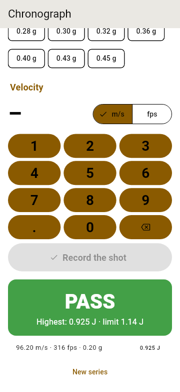

<!--
SPDX-FileCopyrightText: 2026 The Atalaia contributors
SPDX-License-Identifier: CC-BY-SA-4.0
-->

# Marshal manual

For the marshals of a field: the people who run the *chrono* (chronograph) at check-in and spot checks during the game. In Portuguese: [Manual de marshal](../pt/marshal.md).

> **Not field-ready yet.** Atalaia is pre-alpha. No real phone has been used on a field so far. Every step below matches what the app shows today. Steps that depend on hardware say **Not yet tested on a field**. Words in *italics* are in the [glossary](https://atalaia-project.link/en/glossary/).

## What you need

- An Android phone (Android 8.0 or later) with the Atalaia app. An iPhone works for the chrono, but it has **no NFC**: no NFC tags and no tag writing. See the [player manual](player.md#1-install-the-app) to install the app.
- A chronograph, and a way to see the replica's velocity.
- The field's Wi-Fi network, at least once, so the controller can confirm you.
- For player tags: an Android phone with NFC and blank NFC tags, and the field's Wi-Fi (see [section 7](#7-write-players-tags)). You do not need the field join key: the field controller signs the tags.

## 1. Become a marshal

You are a marshal only if the organisers put you on their **marshal list**. The app does not let you pick your own id.

1. Install the app and choose your language ([player manual](player.md#2-choose-your-language)).
2. **Check in at the field** as a player: **Player › Check in at the field**, as in the [player manual](player.md#3-check-in-at-the-field).
3. Ask the organisers to add you. In their console they open **Check-in › Marshals**, pick you under **Player who checked in** and tap **Add a marshal**. The controller gives you an id such as **M-01**.
4. On your phone, tap **Marshal**. The app shows **Asking the field controller…**, then **You are marshal M-01 (** *your name* **)**. The id and name come from the organisers' list.
5. If it says **The field controller does not have you on its marshal list. Ask the GM to add you as a marshal.**, wait for the organisers, then tap **Ask again**.

The app makes your **signing key** by itself. Every shot you record is signed with it, so nobody can change a reading afterwards. You do not have to do anything. Under **Who you are** you can see **Signing key**. **New key** makes a fresh one. Old readings keep the old key.

If the organisers take you off the list, your phone stops being a marshal at once. Readings you have not sent stay on the phone. They go out if the organisers add you again.

## 2. The Marshal screen

**Marshal** opens a list:

| Card | What it is for |
| --- | --- |
| **Replicas to chrono** | The field's list of declared replicas that still need the chrono. |
| **Chronograph** | Check-in and spot checks: record shots and see PASS, WARN or FAIL. |
| **Replica registry** | The replicas registered on this phone. |
| **Players' tags** | Write signed NFC tags for a game. |

Below, **Who you are** has **Chronograph's id** (a name for your device, for example *chrono-1*) and **Signing key**. **Stored readings** says how many readings are on this phone. They are kept for 365 days and then deleted. **Erase someone's readings** erases one player's readings: type the **Player's id** and tap **Erase**.

## 2b. The APD verdict at check-in

When the field checks APD membership, a player's card in the queue shows their APD, membership number and expiry with a badge: **Valid membership**, **Membership expired**, **APD not accepted here** or **Membership missing**. The app does not verify anything: compare the number and the date with the player's card. A player whose badge is not valid is **waiting**; **Let in** admits them anyway. You are never blocked, and the controller logs it without the number (the card then says **let in by a marshal**). The queue lists players who declared replicas; the GM console lists everyone.

## 3. The queue: replicas to chrono

1. Tap **Replicas to chrono**.
2. At the top you see **To chrono: 4 · passed: 2 · refused: 0**. Tap the **refresh** icon to update the list.
3. Each card is a player, with their team and their declared replicas. A chip next to each replica says **not chronographed**, **passed** or **refused**. A player who has not been confirmed yet shows **waiting for confirmation**. A replica without a registry entry shows **not registered yet**.
4. To find a replica by its label, tap the **scan** icon and point the camera at its QR label.
5. Tap a replica to chrono it ([section 4](#4-chrono-a-replica)).
6. If you chrono several replicas offline, tap **Send** *n* **series not sent yet** when you are back on the field's Wi-Fi. A series the controller does not accept stays on your phone.
7. A player without the app: tap **Check in by hand**, type their name and tap **Check in**. The controller gives them an id.

The organisers can also see this list in their console. The list needs the organisers' confirmation that you are a marshal.

## 4. Chrono a replica

1. In the queue, tap the replica. The **Chronograph** screen opens with the replica filled in.
2. Under **Field's limits**, pick the country the organisers use: **Portugal**, **United Kingdom**, **Germany** or **Generic CQB**. The screen warns: **The "…" limits are unverified**. The figures come from the project's research. They are not an official source and not the law. Check them against the rules of the field. The controller also judges each series with its own limits. If they differ, the controller's answer is the one that counts.
3. Choose **Check-in**. (Use **Spot check** later, during the game.)
4. The line **Limit: 1.14 J (350 fps with 0.20 g)** shows the limit of the replica's class. If it says **The field's limits have no "…" class.**, pick another list or ask the organisers.
5. Under **BB weight**, tap the weight of the BB you use for the test (0.20 g to 0.45 g).
6. Fire a shot over the chronograph. Under **Velocity**, choose **m/s** or **fps** and type the number on the keypad. The line **Energy:** shows the joules. It turns red above the limit.
7. Tap **Record the shot**. Repeat for every shot of the series.
8. After each shot you see the result:
   - **PASS** (green): the series' highest energy is at or below the limit.
   - **WARN** (amber): only in a spot check. Under the limit, but above the replica's energy at check-in plus 5%.
   - **FAIL** (red): above the limit.
   The badge says **Highest: 0.925 J · limit 1.14 J**. The list below shows each shot with its m/s, fps, BB weight and energy.
9. Tap **Send to the controller**. You see **Sent: passed.**, **Sent: refused.** or **Sent: warning.** The replica's chip in the queue changes.
10. Tap **New series** for the next replica.

A person always decides any penalty. The app shows the numbers. Do not rely on a colour alone.

If the replica is not in the list, the app registers it for you when you tap it in the queue. See [section 6](#6-the-replica-registry). On a phone with NFC the app first asks **Use an NFC sticker?**: hold the replica's NFC sticker to the phone and its number becomes the replica's tag (a sticker already on another replica is refused), or tap **Use the QR label** to use the printed label as before. **Cancel** registers nothing. A phone without NFC goes straight to the QR label.

A pass counts for the rest of the day or for this game only, depending on the field's rules.

## 5. Spot checks during the game

1. Open **Marshal › Chronograph**.
2. Choose **Spot check**.
3. Pick the replica under **Replica**, or hold the replica's NFC tag to the back of your phone (Android only). If the tag is not in the registry it says **This tag is not in the replica registry.**
4. Record the shots, as in a check-in.
5. The badge shows the result and **At check-in: 0.88 J (+5% tolerance)** when your phone has the replica's check-in.
6. Open the queue to send the series.

A WARN or FAIL shows to the organisers in their log as a `chrono.violation` event.

## 6. The replica registry

The registry on your phone lists the replicas you know.

1. Tap **Replica registry**. It says **n replicas registered**.
2. To add one, tap **Register a replica** and fill in **Player's id**, **Type**, **Class** and **Make and model**.
3. Under **Replica's tag**, hold the replica's NFC tag to the phone, or tap **Scan a QR label**. Then tap **Save**.

A replica you chrono from the queue is registered automatically. The registry shows its label code (**ATL-** and eight characters). Any QR code that holds that text can be scanned.

### Labels for stickers

The app makes the QR label for you. A replica with a QR tag has two buttons in the registry (and the queue shows a small QR icon on a declared replica):

- **Show label**: a big QR code with the code under it. The screen stays on and as bright as it goes, so you can scan it from another phone or photograph it.
- **Share / print label**: a PNG picture for a sticker of 30 × 30 mm. The phone's share sheet opens: choose a printing service, or save or send the picture.

The printer icon in the registry's title bar, **Share / print all labels**, makes A4 sheets with 54 labels each and a thin line to cut along. The same label works on any marshal's phone: scan it in the queue and the app finds the declared replica, even if this phone has not registered it yet. The QR holds only the code, nothing about the player. A replica with an NFC tag has no QR label. The app cannot share files on iOS yet: use **Show label** there.

## 7. Write players' tags

Some modes (Kill Confirmed, Respawn and Lives, Player Check-in, Medic Kit, Money Factory) need each player to carry an NFC tag. You write them on your phone. This needs an Android phone with NFC. Not yet tested on a field.

The **field controller signs each tag** with the game's key and your phone writes what it gets. Your phone never holds the field join key or the game key. The price is that you must be on the field's Wi-Fi for every tag: there is no way to write tags without the controller.

1. Join the field's Wi-Fi and open **Marshal**.
2. Tap **Players' tags**. The screen shows **Game: ** and the name of the game you checked in to.
3. Type the **Player's id** (shown on the player's **My check-in** page, for example *p-17*, and under their name in the console's check-in list). Pick the team, or **No team**.
4. Tap **Write the tag**. The app asks the controller for the tag. When it says **Hold the tag to the back of the phone…**, hold it still until it is written. It then appears under **Written just now**.
5. Repeat for each player.

A tag works only in the game it was written for. Every new game needs new tags. The game master can also write tags from the console or from a phone controller's own screen (see the [game master manual](game-master.md#players-tags)).

## 8. Offline limits

The controller's "yes" is what makes your phone a marshal. It works like this:

- The app asks the controller each time you open **Marshal** and again about every 10 minutes while it can.
- If the controller cannot be reached, your phone stays a marshal for **about 2 hours** after the last "yes". You see **Offline: the field controller confirmed you as marshal M-01 on** *date* **. That holds until** *date*.
- After that, you see **The field controller cannot be reached, and its confirmation … has run out. Join the field's network and ask again.** You cannot record readings until you do.
- A phone that was **never** confirmed cannot work offline: **The field controller cannot be reached, and this phone has not been confirmed as a marshal here yet.** Join the Wi-Fi once.
- Readings you took stay on the phone and are sent later.

Plan to be back on the field's Wi-Fi every couple of hours.

## Troubleshooting

| Problem | What to do |
| --- | --- |
| **Check in at the field with the poster first** | You have not checked in. Tap **Check in at the field** in the message, or go to **Player › Check in at the field**. |
| **This check-in is no longer valid: check in again.** | Check in again at the field. |
| **Ask the GM to add you as a marshal** | The organisers must add you in **Check-in › Marshals**. Then tap **Ask again**. |
| **The GM took you off the marshal list** | The organisers removed you. The unsent series stay on the phone. Ask them to add you again. |
| **Record the shot** is grey | You need a replica, a limit for its class and a velocity. Pick a replica first. |
| **Not sent … It stays on this phone to send later.** | The controller could not be reached. Join the field's Wi-Fi and tap **Send** *n* **series not sent yet** in the queue. |
| **n series were not accepted because the controller does not have you on its marshal list** | Ask the organisers to add you again. The series wait on your phone. |
| **This replica is not declared in this game** | Pick the player's declaration in the list. The player must declare the replica first. |
| The NFC tag does not write | **This tag is locked**, **too small** or **does not take NDEF data**: use a new NTAG tag. Keep the tag still. On an iPhone you cannot write tags. |
| **The field controller cannot be reached: join the field's Wi-Fi and try again.** | Players' tags need the controller for every tag. Join the field's Wi-Fi and try again. |
| **The field controller says you are not a marshal here: ask the game master.** | The game master must add you to the marshal list. |
| **Your check-in has run out: check in again.** | Open the check-in page and check in again. |
| **The game is not running on the controller (it ended, or it lost the game's key), so it cannot sign tags.** | Tags can only be made for the game that is running. Ask the game master. |
| **The field controller refused the tag:** … | The controller says why, for example that the id has a space in it. Fix the id. |

More help: ask the organisers, or the project's [Discussions](https://github.com/vakaobr/atalaia-project/discussions).
