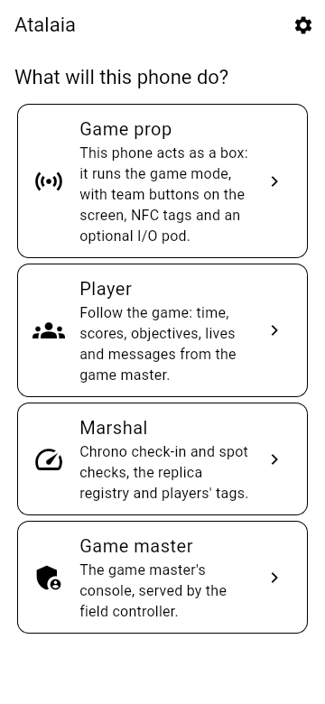
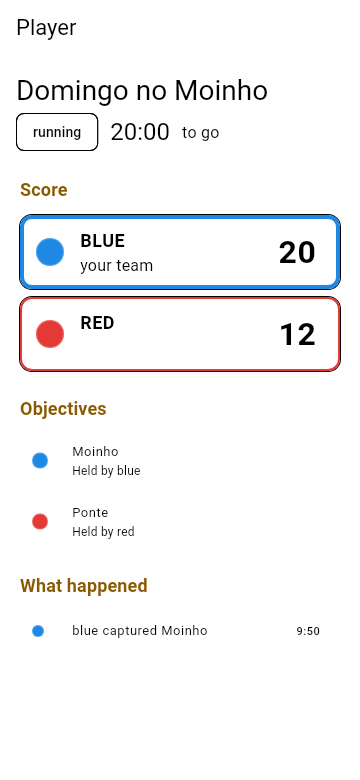
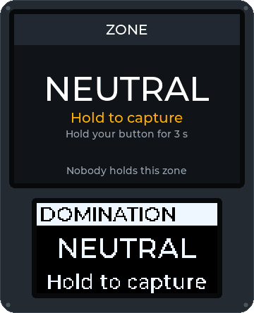
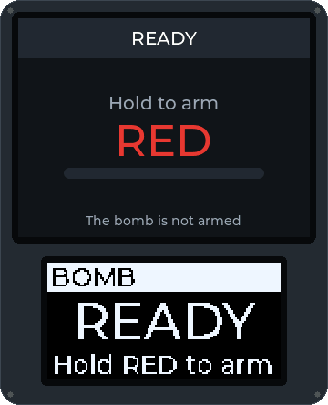

<!--
SPDX-FileCopyrightText: 2026 The Atalaia contributors
SPDX-License-Identifier: CC-BY-SA-4.0
-->

# Player manual

For people who play on an Atalaia field. You install the app, check in at the field, take your replicas to the marshals and play. In Portuguese: [Manual de quem joga](../pt/player.md).

> **Not field-ready yet.** Atalaia is pre-alpha. No real phone and no real box has been used on a field so far. Every step below matches what the software shows today. Steps that depend on hardware say **Not yet tested on a field**. Words in *italics* are in the [glossary](https://atalaia-project.link/en/glossary/).

## What you need

- An Android phone with Android 8.0 or later, or an iPhone with iOS 15 or later.
- The field's Wi-Fi network. The game does not need the internet. Everything runs on the field.
- Permission for the camera (to read QR codes) and, if you want to share your position, for the location.
- A phone that can vibrate. The player app never makes a sound.

## 1. Install the app

The app is **not in Google Play or the App Store yet**. Ask the organisers: they may give you the installation file (`atalaia-debug.apk`), or you can build it yourself with the [app guide](../../../app/README.md#install-it-on-an-android-phone-from-windows).

### Android

1. Get the `atalaia-debug.apk` file onto your phone (USB cable, memory card or a shared folder). It is about 150 MB.
2. Open it in the phone's file manager.
3. If Android asks, allow **Install unknown apps** for that file manager.
4. Tap **Install**, then open **Atalaia**.
5. Allow the permissions the app asks for when you use them: camera, location and notifications.

### iPhone

The iPhone app has the **Player**, **Marshal** and **Game master** roles only. It differs from Android in these ways:

- It is built on a Mac and installed with a cable. See [the iPhone guide](../../../app/docs/ios-on-a-mac.md). With a free Apple ID the install stops working after **7 days** and must be done again (your settings stay).
- There is **no NFC**. You cannot use or write NFC tags with an iPhone.
- Your position is shared only while Atalaia is open on the screen.
- When you join the field's Wi-Fi, iOS says "no internet". Stay connected. Answer **Allow** when iOS asks about the local network.

Not yet tested on a field: QR scanning, the `atalaia://` links and position sharing on an iPhone.

## 2. Choose your language

The app starts in **Portuguese**, whatever language your phone uses.

1. On the first screen, tap the **gear** icon at the top right. This opens **Settings**.
2. Under **Language**, tap **English** (or **Português**, **Deutsch**, **中文（台灣）**).
3. Under **Look**, you can choose **System**, **Dark** or **Light (sun)**. Light is easier to read in the sun.
4. Go back with the phone's back button.

The boxes on the field show the language the organisers chose for the game, not the one in your app.

## 3. Check in at the field

The organisers put up a **check-in poster** with a QR code. It holds no secret.

1. Join the field's Wi-Fi network. Its name is on the poster. Your phone may say there is no internet. That is fine.
2. Open Atalaia. Tap **Player**.
3. Tap **Check in at the field**.
4. Tap **Scan the poster** and point the camera at the poster's QR code. Without a camera, paste the poster's text (it starts with `atalaia:checkin:`) under **Or paste the poster's text** and tap **Use this text**.
5. The app connects to the field's controller. This takes a few seconds.
6. Read **Your data at** *(the field's name)*. Tap **I have read it, go on**.
7. Fill in the form. At the top it shows the field's name and **Field certificate** with a short code. This is normal.
   - **Game**: pick one if the field has more than one open.
   - **Name or callsign**: up to 32 characters. Only the organisers and marshals see it. Other players do not.
   - **Federation number**: only if the field asks for it. The organisers look at your card at the desk. The app does not check it.
   - **APD membership**: if the field asks for it, pick your APD (or **Not in the list**), type your membership number and its expiry date (YYYY-MM-DD). The app does not check them: a marshal compares them with your card. If your membership is not valid for the game, your check-in waits for a marshal, who decides. At a field that requires it to register, the registration is refused without a valid membership.
     At a field outside Portugal this reads **Association membership**: pick your association (club, federation or insurance body) instead of an APD; the list is the one for the field's country, and **Not in the list** is always there.
   - **Preferred team**: **Any**, or a team. The organisers decide the final team.
   - **Online registration**: only if you registered on the field's site. See [section 8](#8-if-you-registered-online).
   - **Replicas you bring**: tick the replicas you saved earlier. You can also do this later ([section 4](#4-declare-your-replicas)).
8. Tap **Check in**.

Now you see **My check-in**. It shows:

- the status: **Waiting for confirmation at the organisers' desk.** or **Checked in.** Some fields confirm every check-in by hand. Go to the desk if it stays on "waiting";
- your role (**Player**, **Squad leader**, **VIP**, **Spectator**), your team (and squad) and your player id;
- your replicas and their chrono state.

Later, tap **Player** then **Continue:** *(game name)* to come back to this page.

If the app says something is wrong:

| The app says | What to do |
| --- | --- |
| *The field's controller does not answer. Are you on the field's Wi-Fi?* | Join the Wi-Fi named on the poster. Keep the Wi-Fi on. Try again. |
| *The controller answering is not the poster's …* | **Stop.** Do not go on. Tell the organisers. Someone may be pretending to be the field. |
| *This field was trusted with another certificate …* | Only if the organisers confirm they changed their equipment: tap **Forget this field**, then scan the poster again. |
| *No game is open for check-in at this field.* | The organisers have not created a game yet, or check-in is closed. Ask them. |
| *This check-in is no longer valid: check in again.* | Check in again from **Player › Check in at the field**. |

You do not need a phone to play. Check in at the organisers' desk. They can check you in by hand and give you a player id.

## 4. Declare your replicas

A *chrono* (chronograph) measures how fast your replica shoots. Each field has a limit per replica class. **Declare** the replicas you will use in this game, so the marshals can chrono them.

1. On **My check-in**, tap **Pick the replicas**.
2. Tick each replica you will use. You can pick up to the number the screen says.
3. If your replica is not in the list, tap **Add a replica**. Choose its **Type** (AEG, GBB, HPA, Bolt action, DMR, Sniper, Pistol or Shotgun), its **Class** and, if you want, its **Make and model**. Tap **Save**. The app remembers it for the next games.
4. Tap **Save**. You see **Saved: the organisers and marshals see them now.**
5. Take your replicas to the marshals' chrono point.

The chip next to each replica shows where it is:

| Chip | Meaning |
| --- | --- |
| **not chronographed** | A marshal has not measured it yet. |
| **passed** | It passed. Depending on the field, this counts for the whole day or for this game only. |
| **refused** | It is over the limit. You may not use it. Ask a marshal what to do. |
| **refused today** | It was refused earlier today. |
| **withdrawn** | It was taken out of the list. |

A replica that was already chronographed stays declared. Ask a marshal if you need to change it.

### Put a label on your replica

Once you have saved a replica for a game, two buttons appear under it:

- **Show label**: a big QR code with a code under it (**ATL-** and eight characters). The screen stays on and bright.
- **Share / print label**: a picture for a sticker of 30 × 30 mm. The share sheet opens, where you can pick a printing service or save the picture. **Share / print all labels**, at the bottom of the list, makes A4 sheets with several labels.

Stick the label on the replica. A marshal scans it in the chrono queue to find your replica at once. The label holds only that code, nothing about you. Before you save a replica for a game, the list says the label shows once you have declared it. After a marshal has registered the replica, its label stays the same in the next games at that field.

The class limits in the app come from the project's research. They are **not verified** and they are not the law. The field's organisers and its marshals decide, and a person always decides any penalty. See *[chrono and joules](https://atalaia-project.link/en/glossary/#glossary-chrono)*.

## 5. Play

The app **follows** the game. You capture boxes **at the box**, not on the phone.

1. On **My check-in**, tap **Follow the game**. (Without a check-in: **Player**, then **Scan the scoreboard's QR code**, or type the controller's **Address** and **Access code** under **Or type them**, then tap **Connect**. The organisers give you a read-only code. A scoreboard code that names the field's certificate (a phone-controller field) is remembered: next time it is under **Fields remembered**, one tap connects. **Forget this field** removes it, and it goes by itself if the field's certificate changes.)
2. You see:
   - the game's name, its state (**ready**, **running**, **paused**, **ended**) and the time. With a time limit it shows the time **to go**;
   - **You:** your role and team, for example *Player, blue › squad 2*;
   - messages from the organisers (**Game master:** …). They are the last three;
   - **Score**: one card per team. Your team has a thick border. Tap a team card to highlight your team if you have none;
   - **Objectives**: each box and who holds it (**Held by** *(team)* or **Held by nobody**);
   - **Lives**, when the mode counts lives, and eliminated teams;
   - **What happened**: the last 30 events, in words.
3. If you see **Offline. Reconnecting…**, you are out of Wi-Fi range. The game goes on without you looking. The app reconnects by itself.

Points from a box can arrive up to about 15 seconds after they appear on the box's screen.

The app shows **how many positions you can see** but it does not draw a map.

### Capturing a box

A box has big coloured buttons, one per team, a screen and a ring of lights. In *Domination*:

1. Walk up to a box that shows **ZONE · NEUTRAL** or another team's colour.
2. **Hold your team's button.** The screen shows a bar filling. By default you hold for 3 seconds. The organisers can change this. If you let go, the bar empties.
3. When the bar is full, the box shows **ZONE HELD** with your team's name and the ring takes your colour.
4. While your team holds it, your points count up. Another team can take it from you the same way.

### The Bomb

In *Bomb / Rush* there are attackers and defenders. The organisers say which team is which.

1. Attackers **hold their button** on the bomb box for 5 seconds by default. The bomb is **ARMED** and a countdown starts (5:00 by default).
2. Defenders must **hold their button for 10 seconds** by default before the countdown ends. The box shows **DEFUSED** and the defenders win.
3. If the countdown reaches zero, the box shows **EXPLODED** and the attackers win.
4. Some games use **team codes**. Then you type your team's code on the keypad to arm, and another team's code to defuse.

### The other modes

Your organisers choose the mode. The [modes page](https://atalaia-project.link/en/modes/) shows each one with an animation. In short:

| Mode | What you do |
| --- | --- |
| Hold-All Domination | Capture boxes as in Domination. A team scores only while it holds **every** box. |
| Last Stand | The defenders start with every box. When they hold only one, a countdown to defeat runs until they retake another. |
| Master and Satellites | Capture satellite boxes. The master box pays more points for every satellite your team holds. |
| Progressive Domination | Only one box can be captured at a time. The app and the boxes tell you which one is **ACTIVE**. Your phone buzzes when a new one starts. |
| Kill Confirmed | Players carry an NFC tag. At a station, your team scans the enemy tags it collected to confirm kills. |
| Respawn and Lives | Hold your tag to the respawn box (or press your team's button) to come back. Each respawn costs a life. |
| Medic Kit | If you are hit, hold your tag to a medic kit and hold its button until you are healed. Each player has a limited number of heals. |
| Hacking Terminal | Solve the puzzle on the terminal's keypad: a code, wires or a sequence. A wrong answer locks it for a short time. |
| Codes | Type a code on a box's keypad to get points, a hint or an unlock. Each code works once. |
| Money Factory | Hold factory boxes. Scan your tag at your team's factory to take money and at a bank box to bank it. |
| VIP / Payload | See [VIP](#vip) below. |

A tag is a sticker, a card or a wristband. A marshal writes yours for each game with your player id (shown on **My check-in**). A tag only works in the game it was written for. Not yet tested on a field.

### Squads and squad leaders

In a big game each team splits into **squads**. The organisers put you in one. You see it as *blue › squad 2*. If you are the **Squad leader**:

- the organisers may send the squad's objectives **to you only**;
- the other members see **Orders for your squad: your squad leader will pass them on**, and their phones buzz twice, briefly;
- if the leader is absent, the organisers can send objectives to every member instead.

### VIP

In *VIP / Payload* one team escorts its **VIP** to an extraction zone. The other teams try to stop them. If you are the VIP:

1. Check in. The organisers set your role to **VIP**.
2. Follow the game and switch on **Share my position** ([section 6](#6-share-your-position-and-the-field-boundary)).
3. Walk to the extraction zone with your team. Your position stays on the controller and your phone. Only "extracted" goes out to everyone.

Not yet tested on a field with real GPS.

### Objectives

In a game with a *scenario*, you see **Scenario objectives**. Each objective says where it is:

- **Starts with the game**, **In progress**;
- **Completed by** *(team)*;
- **Failed**, with the reason: *taken by another team*, *the bomb was defused*, *out of time*, *an earlier objective failed* or *too few lives left*.

An objective can say **For** *(team)* or **For** *(team)***, squad** *(number)*. You only see the objectives meant for you. A hidden objective shows up when the organisers reveal it. Points show as **+10**, for example.

## 6. Share your position and the field boundary

Sharing your position is optional. Your position goes to the field controller only, during the game. The controller decides who may see it: the organisers and marshals, and your squad if the game allows it. If the field has a remote GM signed in on the site server, the remote GM sees it too, while you share it; the site server does not keep it. The organisers see it on their ATAK devices, if they use them. The app draws a map of the field with the positions you may see (see below); the console does not draw players. In *VIP / Payload* the VIP's position is what extracts the team.

1. Check in, then tap **Follow the game**.
2. While the game is **running**, switch on **Share my position**. It says *Only during the game; the controller decides who sees it …*.
3. Allow the location when the phone asks. Choose **While using the app** on an iPhone. On Android 13 or later also allow notifications.
4. A notification **Atalaia: sharing your position** stays on. Switch **Share my position** off to stop. It also stops when the game ends.

**Indoors, if the field has beacons.** Some fields put small Bluetooth beacons in their buildings. If this one does, the app asks first, with **Indoor positions**: it can listen for the field's own beacons while you share, and it sends only which one is strongest. Tap **Continue** and Android asks for **Bluetooth** (nearby devices) and the **location**. Tap **Not now**, or refuse, and nothing else changes: the app says **Indoor positions are off** and keeps sharing your GPS position. Bluetooth has to be switched on.

- Indoors your position becomes the **room**. Under the switch it says **Your position: Lobby (Ground floor)**. The organisers see the room, not a point on the floor.
- The app listens only for the field's beacons and keeps nothing it hears. It listens only while you share, and stops when you stop.
- When you are out of every beacon's range for a few seconds, your GPS position is shared again.
- On an iPhone the beacons are not used yet: the position stays GPS.

**Which floor are you on?** If the field has several floors, a row of buttons appears under the switch while you share: the floors' names (for example **Ground**, **Level 1**) and **Not sure**. Your phone cannot tell floors apart, so say it once; it is kept while you play, and it goes with your GPS position so your team sees you on the right floor. Choose **Not sure** if you do not know: nobody guesses it for you. Indoors, the room's beacon gives the floor and the buttons give way to *Your floor comes from the room beacon*.

**The field map.** If the organisers put the field's plan on the controller, a **Field map** card shows it (with their grid over it, if they turned one on: thin lines with letters down the side and numbers along the top, and under the map **Your cell: C4**, so you can say where you are on the radio): the plan, the places the organisers marked for you (safe zones, respawns, car park, first aid, objectives, your team's headquarters), the field's boundary as an outline with the outside dimmed, and the positions you may see: you (a ringed dot), and the others in their team's colour. With several floors, buttons choose the floor shown; it opens on yours. A hollow dot is a player who has not said which floor they are on. Under the map it counts positions that are not on this plan (a beacon the organisers did not place, a position off the plan). A short list under the map names each kind of place. The map shows only what the controller sends you: another team's places and positions are not there. There is no street map, only the plan; a field with no plan shows no card.

If the organisers drew the **field boundary**, the app watches it **on your phone**. Nothing about it is sent to anyone.

- You are warned only if you are a player, a squad leader or a VIP, and only while the game runs.
- Under the switch it says **This phone vibrates if you leave the field's boundary.**
- When you have stayed outside for a moment (more than your GPS accuracy and 10 metres), a red banner shows **Out of bounds. You have left the field's boundary. Go back inside.** The phone gives three long buzzes. It does it again every minute while you stay outside. There is no sound.
- When you are back inside, you get one short buzz.

Not yet tested on a field. GPS can be weak under trees or inside buildings.

## 7. Buzzes on your phone

In **Settings**, **Vibrate on game events** is on by default. The phone buzzes with a pattern, and never with a sound. Your phone's silent settings apply.

On **Android** the buzzes also come **with the app closed or the screen off**, while you have the game open and it is not ended: the app keeps a quiet ongoing notification (**Atalaia: following the game**) so Android lets it run. It goes away when the game ends, when you leave the game page or when you switch **Vibrate on game events** off. It needs no Google services. A spectator has no buzzes, so no notification. On an **iPhone** there is no such notification: the buzzes only play while the game page is open.

| Event | The buzz |
| --- | --- |
| A message from the organisers | One long buzz |
| A box of your team was captured | One short buzz |
| A box of your team was taken, or freed | Two short buzzes |
| The game starts | Three quick ticks |
| The game ends | Two medium buzzes |
| Progressive Domination: a new active box | A long buzz, then a short one |
| New orders for your squad | Two short buzzes |

Several events at once give one buzz. Keep the app open on the game page. Spectators get no buzz. Not yet tested on a field.

## 8. If you registered online

Some fields let you register for a game on their site, with an account.

1. Open the field's game page in a browser. Tap **Register**, then **Open in the Atalaia app**. Or in the app: **Player › Online registration**, paste the page's address and tap **Open**.
2. The app shows the site's name and asks if it is the right one. Tap **This is the site, go on**.
3. Log in with your **Username** and **Password**. If your account has two-step verification, type the 6-digit code. If the site offers them, you can instead tap **Log in with a passkey** (the phone asks for your fingerprint, face or screen lock), or **Log in with Google** (or Microsoft, or Apple): the phone's browser opens, you sign in there and it brings you back to the app. The very first time with Google, Microsoft or Apple, tick the box that agrees to a new account being made; if you forget, the app says so and you try again. Passkeys need Android 14 or newer.
4. Pick the game, fill in the form and tap **Register**.
5. The app keeps your **check-in ticket**. At the field, show its QR code to a marshal, or at **Check in at the field** pick your registration under **Online registration**.

Do not share the ticket. Whoever has it can check in in your place. You can change or cancel a registration while it is open: **Change your registration** or **Cancel the registration**. The field erases your registration data 30 days after the game.

**Your game history.** After you log in, tap **Game history** to see the games you played, newest first. Tap a game for its scores, the winner and your own events. The app keeps nothing: it asks the site each time.

**Your login methods.** After you log in, tap **Ways to log in to the account** to link or unlink Google, Microsoft or Apple, add, rename or remove passkeys, set, change or remove your password, and turn the authenticator code on or off. The account keeps at least one way to log in, and the app tells you in words when something is refused. An account with a password asks for it at the top of the screen before each change; an account without one asks you to confirm first with an authenticator code, a passkey or the provider, then repeat the action. If a social login opens the phone's browser but never comes back to the app, the site was not set up for the app yet: use the password, and tell the organisers.

The app can log you in to an account that already exists, or make one with Google, Microsoft or Apple (with the box ticked). It cannot yet create a password account. Ask the field's organisers how to get one.

## 9. Leave a game and your data

- **Leave the game** (on **My check-in**) erases your name and federation number from this game. Replicas already chronographed stay on record.
- The organisers and marshals see your name. It never goes in the game's events, the scoreboard or other players' views.
- The controller erases names, federation and APD membership numbers (with the APD and expiry) some days after the game (30 by default).

## Troubleshooting

| Problem | What to do |
| --- | --- |
| The app is in Portuguese | **Settings** (gear) › **Language** › **English**. |
| **Scan the poster** does nothing, or "There is no camera to read the code." | Allow the camera in the phone's settings, or paste the poster's text. |
| "The access code was refused." | The code is wrong or old. Ask the organisers for the current read-only code. |
| The app says "This is a field's check-in poster. Use it under Player > Check in at the field." | You scanned the poster in the wrong place. Go back and use **Check in at the field**. |
| The game page says **No game is running yet.** | The organisers have not started a game. Wait, or ask. |
| **Offline. Reconnecting…** for a long time | Go back into Wi-Fi range. Keep the field's Wi-Fi on even when it says "no internet". |
| No buzzes | **Settings** › **Vibrate on game events** must be on. On an iPhone keep the app open on the game page; on Android do not leave the game page (the notification says the app is following the game). Check the phone is not on silent. |
| **Share my position** says "No permission for the location." | Allow the location for Atalaia in the phone's settings. |
| **Your position: …** never shows indoors | The field may have no beacons, or you chose **Not now**. Check Bluetooth is on and Atalaia may use it (nearby devices and location), then switch **Share my position** off and on. Walk closer to a beacon. |
| My team is not highlighted | You have no team yet, or you are following without a check-in. Tap your team's card. |
| I cannot capture a box with my phone | That is right. You capture boxes at the box, by holding your team's button. |

More help: ask the organisers, or the project's [Discussions](https://github.com/vakaobr/atalaia-project/discussions).
