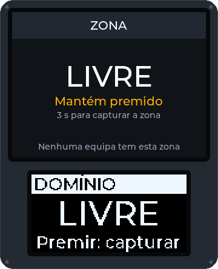
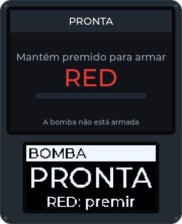
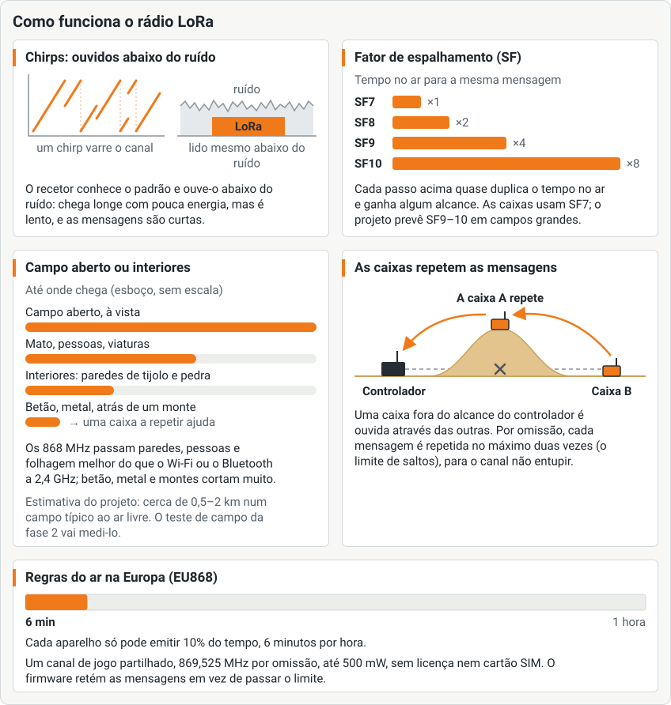

<!--
SPDX-FileCopyrightText: 2026 The Atalaia contributors
SPDX-License-Identifier: CC-BY-SA-4.0
-->

# Manual de operação da Field Box

Para quem cuida das caixas num campo: ligá-las, pô-las num jogo e mantê-las vivas. Em inglês: [Field Box operator manual](../en/field-box.md).

**Montar uma caixa não está neste manual.** Segue o [guia de montagem](https://atalaia-project.link/montagem/) da página do projeto, ou o [manual de montagem da Field Box](../../../hardware/field-box/BUILD.pt.md) passo a passo. Pôr o firmware numa placa está no [guia do firmware](firmware.md). Um telemóvel Android usado como caixa, e o módulo de E/S, têm um manual próprio: [Telemóvel como dispositivo de jogo e módulo de E/S](phone-prop.md).

> **Ainda não está pronta para o campo.** A Atalaia está em pré-alfa. Placas Heltec V4.3 a sério já jogaram jogos inteiros numa bancada com o controlador de campo. Nenhuma caixa montada foi usada num campo. Cada passo abaixo corresponde ao que o firmware mostra hoje. Os passos que dependem de hardware dizem **Ainda não testado num campo**. As palavras em *itálico* estão no [glossário](https://atalaia-project.link/glossario/).

> **Que firmware.** A versão publicada mais recente é a **v0.9.0** (2026-11-06). Algumas coisas abaixo precisam da **v0.9.0** ou seguinte, e di-lo onde aparecem: tirar uma caixa do jogo na própria caixa, o controlador libertar sozinho uma caixa nessa situação, nomes de Wi-Fi com espaços na consola USB e as regras de Wi-Fi da página de configuração.

## Índice

1. [O que é uma Field Box](#1-o-que-é-uma-field-box)
2. [Segurança](#2-segurança)
3. [Ligar, desligar e carregar](#3-ligar-desligar-e-carregar)
4. [Primeira configuração](#4-primeira-configuração)
5. [Adota a caixa no campo](#5-adota-a-caixa-no-campo)
6. [Põe a caixa num jogo](#6-põe-a-caixa-num-jogo)
7. [Os ecrãs e as luzes da caixa](#7-os-ecrãs-e-as-luzes-da-caixa)
8. [Saídas e módulos](#8-saídas-e-módulos)
9. [As Ligaduras na caixa](#9-as-ligaduras-na-caixa)
10. [Tirar uma caixa do jogo](#take-a-box-out-of-its-game)
11. [Bateria](#11-bateria)
12. [Atualizar as caixas](#update-the-boxes)
13. [Rádio: o essencial para um campo](#13-rádio-o-essencial-para-um-campo)
14. [Resolução de problemas](#14-resolução-de-problemas)

## 1. O que é uma Field Box

A *Field Box* é o dispositivo de jogo principal da Atalaia. Tem:

- dois a quatro **botões de equipa** grandes, cada um com a sua cor e a sua luz;
- um **ecrã** (2,8 polegadas, a cores) e um **teclado**;
- um anel de **luzes** que mostra a cor da equipa;
- um **leitor NFC** para etiquetas e cartões;
- um **ecrã OLED** pequeno na placa, uma linha de estado para a organização;
- um **altifalante** opcional, um **besouro piezoelétrico** opcional, ou os dois (o besouro toca os sons do jogo como sequências curtas de bipes);
- uma ou duas **saídas simples** opcionais que ligam uma sirene, um estroboscópio, uma luz ou o comando de uma máquina de fumo, e uma **porta de expansão** opcional para um módulo de saídas ou um módulo de alvo ([secção 8](#8-saídas-e-módulos));
- um rádio *LoRa* e uma **bateria** (uma célula de iões de lítio, recarregada por USB-C).

Corre as regras do jogo sozinha e fala com o controlador de campo por rádio. Se perder o controlador, continua a jogar e a contar pontos.

**É também uma baliza Bluetooth.** Enquanto uma caixa está num jogo (desde que entra até o jogo acabar) emite um pequeno sinal Bluetooth iBeacon, de meio em meio segundo. O telemóvel de quem joga, se o ouvir, fica na divisão e no piso onde a organização pôs a caixa na planta do campo; por isso, num edifício com vários pisos, o campo só precisa de balizas à parte onde não houver caixa. Não precisas de fazer nada: vem ligado por omissão, a organização pode desligá-lo para o campo na consola, e a caixa usa a mesma antena de 2,4 GHz do Wi-Fi (nada a acrescentar). Não afeta o rádio LoRa e está desligado entre jogos. Os pormenores estão no [manual da organização](game-master.md) e no [guia do firmware](firmware.md#4-as-opções-de-quem-monta).

Um **Satélite** é uma Field Box com menos peças (sem teclado nem ecrã grande). Corre o mesmo firmware; onde este manual usa o teclado, um Satélite usa a consola USB.

## 2. Segurança

- **Nunca ligues uma caixa sem a antena LoRa montada.** O rádio pode estragar-se.
- Mantém o aspeto de dispositivo de jogo: cores vivas e uma etiqueta **GAME PROP**. Nada que pareça um explosivo a sério. Transporta as caixas em malas com etiqueta e nunca deixes uma sozinha fora do campo.
- Trata a bateria de lítio com cuidado. Carrega-a onde a possas vigiar. Nunca uses uma célula inchada, amolgada ou quente.
- Não uses uma caixa num jogo antes de ter feito, para ela, a verificação da potência de emissão da [lista de arranque](../../../firmware/esp32/docs/BRING_UP.md) (em inglês). Ainda não testado num campo.
- As saídas e os alvos têm regras de segurança próprias: [secção 8](#8-saídas-e-módulos).

## 3. Ligar, desligar e carregar

1. Confirma que as antenas estão montadas.
2. Liga o **interruptor principal**. O OLED pequeno e o ecrã grande mostram a torre da Atalaia e a versão do firmware: o OLED durante 2 segundos, o ecrã grande durante cerca de 2,5 segundos (mais tempo só se o primeiro ecrã da caixa ainda não estiver pronto). Depois o ecrã grande mostra o primeiro ecrã da caixa ([secção 4](#4-primeira-configuração) ou [secção 6](#6-põe-a-caixa-num-jogo)).
3. Para desligar, usa o interruptor principal.

**Carregar.** Liga um carregador USB-C de 5 V à ficha do painel com o **interruptor principal ligado**. Com o interruptor desligado, a bateria fica isolada e não carrega. Carrega num sítio que possas vigiar, não dentro de uma mala de transporte fechada. Carrega só entre cerca de 0 °C e 45 °C. Não carregues uma caixa fria logo à saída de um campo no inverno.

**Guardar e viajar.** Por mais do que umas semanas, guarda a caixa meio carregada, desligada, num sítio fresco e seco. Em voos e envios, segue as regras da transportadora para baterias de lítio.

**Se a energia falhar durante um jogo**, a caixa volta no mesmo jogo. Mantém a pontuação e o tempo de jogo. Se estava armada como bomba, volta armada com o rastilho que lhe restava.

## 4. Primeira configuração

Uma caixa nova mostra **PRIMEIRA CONFIGURAÇÃO** com o nome de uma rede Wi-Fi como `atalaia-1A2B`.

1. No telemóvel, liga-te a essa rede Wi-Fi. Não tem palavra-passe, por isso faz isto longe de quem joga.
2. Se a página de configuração não abrir sozinha, abre um browser e vai a `192.168.4.1`.
3. Preenche a página **Configuração da caixa Atalaia**. Abre na língua da caixa; os links no fundo (**English**, **Português**, **Deutsch**, **繁體中文**) mudam a língua:
   - **Nome da caixa**: um nome para esta caixa, por exemplo `field-box-01`.
   - **Região de rádio**: escolhe a região para que esta caixa foi feita (**EU868** ou **AS923-TW**). A caixa só aceita a sua.
   - **Número de equipas**: 2, 3 ou 4.
   - **PIN de administração**: 4 a 8 algarismos. **Não há PIN por omissão.** PIN fáceis como 1234, 0000, 9876 ou 1212 são recusados. Anota-o e guarda-o em segurança.
   - **Brilho do ecrã** e **Volume do som**.
   - **Chave de ligação ao campo** (opcional): a chave de 64 algarismos que a organização te dá. Também a podes juntar depois ([secção 5](#5-adota-a-caixa-no-campo)).
   - **Nome do Wi-Fi do campo** e **Palavra-passe do Wi-Fi do campo** (opcionais): precisos para as atualizações de firmware ([secção 12](#update-the-boxes)). O Wi-Fi do campo tem de ser de 2,4 GHz. Vê as regras abaixo.
4. Toca em **Guardar e reiniciar**.

A caixa reinicia. Uma caixa ainda sem campo mostra **Emparelhar caixa** e um código de 6 algarismos ([secção 5](#5-adota-a-caixa-no-campo)).

**As regras do Wi-Fi do campo.** A partir da v0.9.0, a página de configuração recusa o que a caixa não conseguiria usar, e diz porquê:

- o **nome** tem 1 a 32 bytes. Uma letra acentuada ocupa 2 bytes e um carácter chinês 3, por isso um nome com elas pode ser recusado com menos de 32 caracteres;
- a **palavra-passe** fica vazia (uma rede aberta), tem 8 a 63 caracteres, ou exatamente 64 algarismos hexadecimais.

Na v0.8.0 e anteriores, a página corta, sem avisar, um nome com mais de 32 bytes ou uma palavra-passe com mais de 64 caracteres. Segue as regras acima e funciona nas duas.

**O mesmo na consola USB.** A caixa também aceita o Wi-Fi do campo a partir de um computador, por USB: `@wifi <nome> <palavra-passe>` (numa rede aberta: `@wifi <nome>`). A partir da v0.9.0, um nome ou uma palavra-passe com espaços vai entre aspas: `@wifi "O Meu Campo" "palavra passe"`; dentro das aspas, `\"` é uma aspa e `\\` uma barra invertida. A caixa responde `field Wi-Fi: stored (network "O Meu Campo")`, ou `field Wi-Fi: refused:` e o motivo, e nesse caso não guarda nada. Na v0.8.0, o `@wifi` não aceita espaços no nome. Como abrir a consola USB: [guia do firmware, secção 3.4](firmware.md#34-reiniciar-e-observar).

**Abrir outra vez a página de configuração.** A página de configuração só abre sozinha numa caixa que ainda não foi configurada. Numa caixa já configurada:

1. Carrega numa tecla qualquer, escreve o PIN de administração e `#`.
2. Escolhe **Configurar o Wi-Fi** (a seguir aos jogos) e carrega em `#`.
3. Confirma com `#`.

A caixa reinicia na página de configuração. Guarda o campo, a chave de entrada e os jogos, e volta a pedir o resto (nome, PIN de administração, Wi-Fi). Não funciona durante um jogo. Uma caixa sem teclado faz o mesmo por USB, com `@setup` e o PIN de administração ([guia do firmware, secção 5](firmware.md#5-primeiro-arranque-e-configuração)). Ainda não testado num campo.

## 5. Adota a caixa no campo

Uma caixa tem de ser **adotada** uma vez por um campo antes de poder jogar nele. Adotar dá-lhe a *chave de entrada do campo*. A organização faz isso no separador **Adotar** da consola. Tem três maneiras:

| Maneira | O que fazes |
| --- | --- |
| **Cabo USB** | Liga a caixa ao controlador com um cabo **de dados** (não um cabo só de carga). A organização procura-a e carrega em **Adotar**. |
| **Cartão de campo (NFC)** | Encosta o **cartão de campo** ao leitor NFC da caixa uma vez. O ecrã mostra **Adotada**. O cartão de campo é o segredo-mestre do campo: guarda-o fechado à chave. |
| **Código de emparelhamento (rádio)** | Uma caixa não adotada mostra **Emparelhar caixa** e **Código: 042 137** (seis algarismos). Diz o código à organização. Ela escolhe a tua caixa pelo nome na consola e escreve o código. Sem cabo nem cartão. |

Quando resulta, a caixa mostra **Adotada**, o nome do campo e uma impressão digital curta como `A1B2-C3D4`. A organização compara-a com a consola.

- Um código errado muda o código da caixa. Lê o novo. Três códigos errados fazem a caixa esperar um minuto. Dez códigos errados param o emparelhamento até a caixa reiniciar. Carrega em `#` no teclado para um código novo.
- Uma caixa que pertence a **outro campo** pede o seu **PIN de administração** (**PIN para mudar de campo**) no teclado. Depois de cinco PIN errados, obriga-te a esperar 1, 2, 4 … até 60 minutos. A espera sobrevive a um reinício. O ecrã mostra **PIN bloqueado** e os minutos de espera.
- Uma caixa sem PIN de administração não pode passar para outro campo. Mostra **Consola USB: @admin-pin**. Quem a montou pode definir um PIN.

**Passar uma caixa adotada para outro campo por código.**

1. Na caixa, carrega numa tecla qualquer, escreve o PIN de administração e `#`.
2. Escolhe **Mudar de campo** (a entrada a seguir aos jogos e a **Configurar o Wi-Fi**; só aparece numa caixa adotada, com rádio e com PIN de administração) e carrega em `#`.
3. O ecrã pergunta **MUDAR DE CAMPO?**: `#` continua e `*` volta atrás.
4. A caixa mostra **Emparelhar caixa** e um código, como uma caixa nova. A organização do outro campo emparelha-a na sua consola como na tabela acima.

A caixa fica com o campo antigo até o novo a emparelhar: `*`, cinco minutos sem emparelhamento ou um jogo em que entre deixam-na como estava.

Ainda não testado num campo: o cartão de campo NFC e o emparelhamento por rádio.

## 6. Põe a caixa num jogo

Depois da adoção, uma caixa por usar mostra **PRONTA** e **Próximo jogo**. Anuncia-se pelo rádio. Há três maneiras de entrar num jogo.

### 6.1 A organização convida-a (o modo normal)

1. A organização cria o jogo e abre **Convidar caixas** na consola.
2. A tua caixa aparece na lista, pelo nome. Aparece até cerca de 20 segundos depois de estar pronta ou de um jogo acabar. Depois repete-se mais ou menos uma vez por minuto.
3. A organização marca-a e dá-lhe uma função.
4. A caixa mostra **Convidada:** *função* e depois **À ESPERA** com **Jogo** *N* e **O jogo ainda não começou**.
5. Quando a organização carregar em **Começar**, a caixa mostra **JOGO EM CURSO** e depois o ecrã próprio do modo.

Quando entra, a caixa diz à consola o que tem (botões, NFC, saídas, módulos). Se o jogo precisar de algo que a caixa não tem, a organização vê-o antes de começar e pode pedir-te que troques de caixa ou ligues um módulo.

### 6.2 Um cartão de entrada

Sem nenhum jogo a decorrer, encosta o **cartão de entrada** ao leitor NFC. A caixa mostra **Entrou:** *função*. Um cartão feito para outro campo é recusado.

As mesmas palavras aparecem em inglês, alemão ou chinês tradicional quando a organização define a **Língua das caixas** para o jogo.

### 6.3 Um jogo sem controlador (autónomo)

Podes jogar com uma caixa sozinha, sem controlador:

1. Em **PRONTA**, carrega numa tecla qualquer. Diz **Uma tecla: escolher jogo aqui**.
2. **Marca o PIN de administração.** `#` confirma e `*` apaga.
3. **ESCOLHE UM JOGO**: carrega de `1` a `9` para escolher o jogo. `0` mostra mais. `#` avança. `*` volta.
4. **DURAÇÃO DO JOGO**: `2` junta 5 minutos, `8` tira 5 minutos. **Sem limite** quer dizer que o jogo continua até a organização o terminar. `#` avança.
5. **COMEÇAR O JOGO?**: `#` começa, `*` volta.

Num jogo autónomo a caixa não tem chave do jogo. **Recusa etiquetas de quem joga.** Os modos que precisam de etiquetas precisam de um controlador.

## 7. Os ecrãs e as luzes da caixa

Manténs premido o botão da tua equipa na caixa. A caixa mostra o que se passa.

| No ecrã | Significado |
| --- | --- |
| **PRONTA** · a torre da Atalaia · **Próximo jogo** | Adotada, sem jogo. Pode ser convidada. |
| **À ESPERA** · **Jogo** *N* · **O jogo ainda não começou** | Juntou-se. Espera pelo **Começar** da organização. |
| **JOGO EM CURSO** | O jogo começou. Segue-se o ecrã próprio do modo. |
| **ZONA · LIVRE** · **Mantém premido** | Uma zona que nenhuma equipa tem (Domínio, Domínio Total, Último Elemento, Mestre e Satélites; em Mestre e Satélites o cabeçalho diz **MESTRE** ou **SATÉLITE** depois de o controlador dizer à caixa qual é). Mantém premido o botão da tua equipa. Uma barra enche. |
| **ZONA OCUPADA** · equipa | Uma equipa tem a zona. O anel fica com a cor dela. Os dois ecrãs mostram há quanto tempo a tem, a contar em frente (**ocupada há 1:23**). No Domínio o ecrã grande mostra também os pontos de cada equipa nesta caixa, com as cores das equipas, no canto de cima à direita. Em Mestre e Satélites o cabeçalho diz o que a caixa é (**MESTRE OCUPADA**, **SATÉLITE OCUPADO**), e o ecrã grande da mestre conta o tempo em frente e mostra a pontuação de cada equipa da mesma maneira. No Domínio Progressivo e nos pontos de controlo do VIP e Carga o ecrã grande também conta o tempo em frente. |
| **Mantém o botão premido para a tomar** | Outra equipa pode tomar a zona da mesma maneira. Enquanto uma equipa mantém o botão premido, uma barra com o nome dela enche ao longo da margem de baixo do ecrã grande, como no OLED. |
| **PRONTA** · **Mantém premido para armar** | *Bomba / Rush*: a bomba ainda não está armada. Os atacantes mantêm premido o botão. |
| **ARMADA** · tempo **até à explosão** | A bomba está armada. Os defensores mantêm premido o botão para a desarmar. |
| **DESARMADA** / **EXPLODIU** | A bomba terminou. A equipa vencedora é nomeada. Depois de uma explosão o jogo termina. |
| **EM PAUSA** · **Aguarda a organização** | A organização pôs o jogo em pausa. Não mexas na caixa. |
| **FIM DO JOGO** · **Pontuações finais** | O jogo acabou. Passados 30 segundos a caixa mostra outra vez **PRONTA**. |
| **CÓDIGO** com pontos | Pede-se um código no teclado (*Códigos*, códigos de equipa na *Bomba*). Escreve-o. `#` confirma e `*` apaga. |

Os outros modos têm ecrãs próprios: *Baixa Confirmada* (**carrega no botão e lê as etiquetas**), *Reentradas e Vidas* (**Lê a tua etiqueta para voltares ao jogo**), *Ligaduras* ([secção 9](#9-as-ligaduras-na-caixa)) e *Hackeia o terminal* (um enigma no teclado). A [página dos modos](https://atalaia-project.link/modos/) mostra-os.

**As línguas dos modos.** Os ecrãs da caixa seguem a **Língua das caixas** do jogo. As *Ligaduras* e o *Hackeia o terminal* são a exceção: cada um usa a língua do ecrã da sua própria definição **Língua** no jogo; se estiver vazia, é a língua do jogo. O *VIP / Carga* segue a língua da caixa, como os outros modos (a sua antiga definição **Língua** já não é usada).

**O logótipo.** A caixa mostra a torre da Atalaia, no ecrã de arranque (o pequeno e o grande, com a versão do firmware ao lado), no ecrã **PRONTA**, e no ecrã de *Bomba / Rush* enquanto a bomba não está armada. O logótipo do próprio campo (as *Definições* da consola) aparece na app, no placar e no cartaz, não na caixa: as caixas já não o vão buscar. Quem monta a caixa pode compilá-la com outra imagem de arranque: [guia do firmware, secção 4](firmware.md#4-as-opções-de-quem-monta).

**O OLED pequeno** mostra o modo em cima, um valor grande (a fase, o tempo ou a equipa) e uma dica por baixo. Numa zona ocupada (Domínio, Domínio Progressivo, Mestre e Satélites, pontos de controlo do VIP e Carga) a dica é há quanto tempo a equipa a tem (**ocupada 1:23**). Enquanto uma equipa mantém premido o botão, o OLED mostra uma barra que enche.

**A barra do tempo.** Num jogo com limite de tempo que começou na própria caixa, o ecrã grande tem uma barra fina ao longo da margem de baixo que mostra quanto falta do jogo (fica vermelha no último minuto), e o OLED mostra o tempo que falta, em minutos e segundos, à direita da linha de cima. Um jogo **Sem limite** não tem nenhuma das duas. Um jogo conduzido pelo controlador do campo acaba quando a organização o termina, por isso não tem barra.

**Luzes e mensagens.**

| Vês | Quer dizer |
| --- | --- |
| O anel mostra a cor de uma equipa | Essa equipa tem a zona. Ainda não testado num campo. |
| Os botões estão acesos | A caixa está ligada. |
| O ecrã grande está apagado e o OLED pequeno aceso | A caixa está ligada. Confirma os fios do ecrã grande, ou fala com quem a montou. |
| **Adotada** com o nome de um campo | A caixa pertence agora a esse campo. |
| **Não adotada** / **Já adotada** | O estado da adoção, quando encostas um cartão de campo ou usas o cabo. |
| **Cartão de campo inválido** | O cartão está danificado. |
| **PIN errado** / **Adoção bloqueada** | Vê a [secção 5](#5-adota-a-caixa-no-campo). |
| **Falta o PIN** | A caixa ainda não tem PIN. Fala com quem a montou. |
| **Em jogo** | Tentaste adotar uma caixa que está num jogo. Termina primeiro o jogo, ou [tira a caixa do jogo](#take-a-box-out-of-its-game). |

## 8. Saídas e módulos

Uma caixa pode ligar aparelhos e receber acessórios de três maneiras. As três são opcionais e quem monta a caixa é que as instala.

| O quê | Onde liga | O que faz | Desde |
| --- | --- | --- | --- |
| **Saída simples** | Uma tomada M8 com a etiqueta **SAÍDA 1** (às vezes também **SAÍDA 2**) | Um interruptor de relé RC por saída, para uma sirene, um estroboscópio, uma luz ou o comando de uma máquina de fumo com a bateria deles. A maneira preferida para um ou dois aparelhos | v0.7.0 |
| **Módulo de saídas** | A **porta de expansão** (uma tomada M12) | Uma placa pequena própria que liga até 4 relés com a sua própria alimentação, atrás de um isolador. Para mais canais do que a saída simples tem | v0.8.0 |
| **Módulo de alvo** | A porta de expansão | Uma placa para onde quem joga dispara, com sensor e placa próprios. Usado pelas *Janelas de Alvo* | v0.8.0 |

Nenhum deles foi ainda experimentado em hardware: o firmware está escrito e testado num computador. Guias de montagem: [saída simples](../../../hardware/field-box/BUILD.pt.md#910-saída-simples-opcional), [porta de expansão](../../../hardware/expansion-port/BUILD.pt.md), [módulo de saídas](../../../hardware/output-module/BUILD.pt.md), [módulo de alvo](../../../hardware/target-addon/BUILD.pt.md). As placas dos módulos gravam-se como no [guia do firmware, secção 11](firmware.md#11-os-módulos-de-expansão-módulo-de-alvo-e-módulo-de-saídas).

### 8.1 O que o jogo faz com uma saída

Cada saída tem um **uso**, o nome que um jogo pede: **siren** (sirene), **strobe** (estroboscópio), **smoke** (fumo), **light** (luz), **horn** (buzina), ou o seu número (**out.1**). É o jogo que a liga: fumo ou uma sirene quando a bomba explode (**Fumo quando explode** e **Sirene quando explode** da *Bomba / Rush*), a sirene da mestre quando uma equipa tem todos os satélites (*Mestre e Satélites*), ou a organização a partir da consola. Dá à saída o uso que o modo pede.

O que a caixa faz, com qualquer saída (simples ou de um módulo):

- Liga saídas **só durante um jogo** (e o teste de 1 segundo entre jogos). As definições só mudam entre jogos.
- **Desliga** todas as saídas quando arranca, quando o jogo é **pausado** (continuam desligadas quando o jogo retoma) e quando o jogo **acaba**. Uma buzina de fim de jogo ainda pode tocar até 10 segundos.
- Uma saída nunca fica ligada mais tempo do que o seu tempo máximo. Muda no máximo de meio em meio segundo.
- Se a caixa deixar de funcionar, ficar sem energia ou reiniciar, o interruptor perde o sinal e desliga-se em cerca de um segundo. Um módulo de saídas desliga as suas saídas 1,5 segundos depois de a caixa deixar de lhe falar.
- A organização vê as saídas da caixa na consola (uma etiqueta debaixo da caixa, marcada **não verificado**, e a lista **Saídas** no separador **Jogo**) e pode ligar uma durante uns segundos no jogo, desligá-la ou desligar todas as saídas de uma vez ([manual da organização](game-master.md)).
- Quando se junta a um jogo, a caixa também diz à consola que saídas estão instaladas mas **não ativadas**. A organização vê então, por exemplo, **horn · instalada, não ativada pela administração da caixa** debaixo da caixa, e uma nota antes de começar se o jogo usaria essa saída, e pode pedir-te que a ative. Uma saída desativada continua a nunca ligar.

### 8.2 Ativar uma saída na caixa

**As saídas ficam desligadas até as ativares, na caixa.** É de propósito: uma caixa emprestada por outro campo, ou ligada na zona segura, nunca dispara até que uma pessoa junto dessa caixa o diga. A entrada **Saídas** só aparece numa caixa que tenha pelo menos uma saída (uma saída simples, ou um módulo de saídas ligado).

1. Em **PRONTA**, carrega numa tecla qualquer. **Marca o PIN de administração.**
2. Vai à última entrada da lista, **Saídas**, e carrega em `#`.
3. O ecrã mostra uma saída, o seu uso e se está ativada: **SAÍDA 1 GPIO 46** numa saída simples, ou **SAÍDA 2 I2C 5c/1** no canal 1 de um módulo de saídas. Carrega:
   - em `1` para a ativar ou desativar;
   - em `2` para mudar o seu uso: **out.1**, **siren**, **strobe**, **smoke**, **light**, **horn**;
   - em `3` para mudar o tempo máximo que pode ficar ligada: 5, 10, 30, 60, 120, 300 ou 600 segundos (num módulo, nunca mais do que o limite do próprio módulo);
   - em `5` para a testar: ligada durante 1 segundo;
   - em `0` para a saída seguinte; em `#` ou `*` para voltar à lista.
4. Uma saída simples guarda cada mudança logo, também depois de reiniciar.

Podes fazer o mesmo na consola USB: `@outputs` lista-as, `@output 1 enable <PIN>`, `@output 1 function siren <PIN>`, `@output 1 max 30 <PIN>`, `@output 1 test <PIN>`.

### 8.3 Um módulo de saídas na porta de expansão

1. **Liga o módulo antes do jogo**, com a alimentação dele ligada. A caixa encontra-o em 2 segundos, ligada ou desligada; o registo USB diz `expansion: 0x5C added: ...` (o endereço do módulo).
2. A caixa junta os canais do módulo às suas saídas, depois das saídas simples: no máximo **8 canais de módulos** ao todo. Cada um começa **desativado**, com o uso que quem montou deu a esse canal, e um tempo máximo nunca acima do do próprio módulo.
3. Ativa cada canal de que precisas, entre jogos, como em [8.2](#82-ativar-uma-saída-na-caixa).

O que muda em relação a uma saída simples:

- **As definições de um módulo não ficam guardadas.** Cada vez que a caixa encontra o módulo (depois de a caixa reiniciar, ou de voltar a ligar o cabo) os canais começam outra vez desativados. Ativa-os outra vez antes de cada dia de jogo, e depois de qualquer reinício.
- **O módulo tem os seus próprios limites.** Quem monta define, no firmware do módulo, o tempo máximo ligado de cada canal (e um tempo de descanso depois). A caixa só os pode baixar.
- **Ligado durante um jogo,** os canais do módulo chegam desativados, e as definições não mudam durante um jogo, por isso não liga nada nesse jogo.
- Se o cabo sair durante um jogo, o registo da organização diz que a caixa perdeu um módulo. As saídas dele ficam desligadas.

### 8.4 Um módulo de alvo na porta de expansão

Um **módulo de alvo** é uma placa para onde quem joga dispara, com um sensor e uma pequena placa própria atrás, num cabo de até 2 m. O jogo *Janelas de Alvo* usa-o: a caixa acende-se na cor de uma equipa durante uns segundos, e um impacto na placa nesse tempo pontua para essa equipa.

1. **Liga o alvo antes de a caixa entrar no jogo** (com a caixa ligada ou desligada). A caixa encontra-o em 2 segundos; ligado mais tarde, a caixa encontra-o na mesma, e o jogo usa-o logo.
2. A consola da organização mostra-o como uma etiqueta debaixo da caixa: **target 1.0.0: hit**.
3. Em *Janelas de Alvo* o alvo só conta impactos enquanto o jogo decorre: nem antes de começar, nem em pausa, nem depois de acabar.
4. Se o cabo sair durante o jogo, o registo da organização diz **box-4 perdeu um módulo: 58:target/1.0.0:hit (deixou de responder)**. Volta a ligá-lo: continua logo.

### 8.5 Segurança

- **Só aparelhos de baixa tensão com bateria ou alimentação própria** (no máximo 24 V; num módulo de saídas, no máximo 2 A por canal). **Nunca** a rede elétrica.
- Uma máquina de fumo só pela sua entrada de comando de baixa tensão documentada; nunca pirotecnia. Fumo nunca numa sala fechada sem autorização do recinto.
- Proteção auditiva perto de sirenes e buzinas.
- Antes do primeiro jogo, quem monta verifica cada interruptor: tem de desligar quando se tira o cabo ([manual de montagem, secção 9.10](../../../hardware/field-box/BUILD.pt.md#910-saída-simples-opcional)).
- **Alvos:** proteção dos olhos e da cara para toda a gente ao alcance do alvo, a placa inclinada para baixo para as BB irem para o chão, e nunca disparar para a caixa, o cabo ou o invólucro do alvo: só para a placa. Os limites de potência do campo valem para os alvos como para quem joga.

## 9. As Ligaduras na caixa

As *Ligaduras* são uma função que um jogo pode juntar a qualquer modo principal: uma caixa com a função **medic** corre só o kit. Quem foi atingido trata-se nela com a sua etiqueta de jogador. Precisa do leitor NFC e dos botões da caixa, e de um jogo conduzido pelo controlador de campo (uma caixa autónoma recusa etiquetas de quem joga). Ainda não testado num campo.

A organização define-as quando cria o jogo: os segundos a premir o botão (10 por omissão), as ligaduras no kit (5), os tratamentos por pessoa no jogo todo, em todos os kits (2; 0 para sem limite), a espera entre dois tratamentos da mesma pessoa (nenhuma por omissão), a equipa que o kit serve (todas por omissão) e a **Língua** do kit.

O que a pessoa faz, e o que a caixa mostra:

1. A caixa mostra **LIGADURAS** com o número que resta (**Restam 4 ligaduras**). Na cor da equipa que serve, se servir uma.
2. A pessoa encosta a sua etiqueta ao leitor NFC.
3. Em 15 segundos, mantém premido um botão de equipa. A caixa mostra **Mantém premido para tratar**, uma barra que enche e os segundos que faltam. Largar antes do tempo cancela: lê a etiqueta outra vez.
4. A caixa mostra **DE VOLTA AO JOGO**, e a organização e quem joga veem o tratamento.

Se a caixa recusar, mostra **RECUSADO** e porquê: uma etiqueta falsificada, uma etiqueta de outro jogo, uma equipa que o kit não serve, uma pessoa que já chegou ao limite de tratamentos, ou os segundos que ainda tem de esperar.

Quando o kit fica vazio, mostra **Sem ligaduras** e **A organização pode repor o kit**. A organização repõe-no no separador **Caixas** da consola (**Repor as ligaduras**). Não há nada a fazer na caixa. Depois de um reinício num jogo de campo, o kit recomeça com as ligaduras todas; a contagem de cada pessoa em todos os kits fica guardada no controlador.

## 10. Tirar uma caixa do jogo

Uma caixa que estava desligada quando o jogo terminou nunca ouve o fim. Ao voltar a ser ligada, continua nesse jogo: mostra o ecrã do jogo e recusa todos os convites e cartões de entrada (a consola diz **recusou: noutro jogo**). Uma caixa nunca sai sozinha de um jogo quando o controlador se cala. **Não a apagues.** Há três maneiras de sair. As três precisam de firmware a partir da **v0.9.0**, na peça indicada.

| Maneira | Quem faz | Precisa da v0.9.0 em |
| --- | --- | --- |
| **O controlador liberta-a sozinho.** Ouve a caixa, volta a dizer que o jogo dela terminou e, em cerca de um minuto, a caixa mostra o último ecrã do jogo e depois **PRONTA**. A organização também vê a caixa no separador **Caixas** da consola, em **Presas num jogo terminado**, e **Libertar** avisa-a logo | Ninguém, ou a organização | O **controlador** e o seu **modem de rádio USB** (o modem não tem atualização pelo ar: grava-se outra vez por USB, [guia do modem](modem.md#update-the-modem)). Qualquer firmware de caixa. A caixa tem de estar no canal do campo. Um módulo de E/S usado como rádio do controlador não o consegue fazer |
| **Libertar todas as caixas que não estão neste jogo** (consola, **Definições**). Para um controlador que foi reinstalado ou perdeu os dados, e já não conhece o jogo antigo. Liberta todas as caixas do campo que estão noutro jogo, se a caixa entrou nesse jogo antes | A organização | O **controlador** e a **caixa** (uma caixa mais antiga ignora-o) |
| **Sair do jogo, na caixa** (abaixo). Funciona sempre, também com um controlador ou um modem mais antigos | Tu, com o PIN de administração | A **caixa** |

O lado da organização está no [manual da organização, Recuperar de problemas](game-master.md#recover-from-problems).

**Sair do jogo na caixa** (o menu de administração da caixa; não o **Sair do jogo** da app de quem joga, que só apaga o nome da pessoa):

1. Mantém `*` premido durante 3 segundos. O toque em si continua a ir para o jogo, como um `*`. O menu só abre quando o jogo não pode receber teclas de quem joga: a caixa está à espera do início, o jogo está em pausa, ou a caixa não ouve nada do controlador há 5 minutos (uma caixa presa: espera 5 minutos depois de a ligar). Com o jogo a decorrer e o controlador ao alcance, manter `*` premido não faz mais nada.
2. **Marca o PIN de administração.** `#` confirma. `*` apaga; sem nada escrito, `*` volta ao jogo.
3. **ADMINISTRAÇÃO** mostra uma entrada, **Sair do jogo**. Carrega em `#`.
4. **SAIR DO JOGO?**: `#` sai, `*` volta.

A caixa termina o jogo como se a organização o tivesse terminado: o último ecrã do jogo e, 30 segundos depois, **PRONTA**. Nunca mais entra nesse jogo. Mantém o campo, a chave de entrada, o Wi-Fi, o PIN de administração e os jogos. Pode ser convidada, ou receber um cartão de entrada, logo a seguir.

- Para tirar uma caixa de um jogo que ainda decorre (um botão avariado, uma caixa no sítio errado), **põe o jogo em pausa** na consola primeiro e depois mantém `*` premido. Ou usa `@leave <PIN de administração>` na consola USB, que funciona a qualquer momento. A consola da organização passa a ver essa caixa como terminada e o jogo continua para as outras caixas quando for retomado.
- O menu só aparece enquanto a caixa está num jogo do controlador ou de um cartão de entrada. Fecha sozinho ao fim de 30 segundos sem tecla, quando o jogo termina ou quando o jogo volta a decorrer (retomado, ou o controlador ouvido de novo).
- Cinco PIN errados neste menu obrigam a esperar antes da tentativa seguinte neste menu (1, 2, 4 ... minutos, como em todo o lado). Estas tentativas têm a sua própria contagem: nunca bloqueiam o seletor de jogos, a adoção nem o `@leave` da consola USB, por isso quem joga e marca PIN errados não consegue impedir o GM de usar a caixa.
- Uma caixa sem teclado (um Satélite) faz o mesmo na consola USB: `@leave <PIN de administração>`. A caixa responde `leave: game N is over on this box; it is free for the next game` ([guia do firmware, secção 5](firmware.md#5-primeiro-arranque-e-configuração)).

Testado só num computador; ainda não experimentado em hardware.

## 11. Bateria

- A caixa comunica o nível da bateria ao controlador. A organização vê-o no separador **Caixas** da consola. Abaixo de 20% aparece **fraca**.
- Quando o nível de uma caixa desce abaixo do seu limite, ela envia um alerta de bateria fraca, uma vez.
- Uma caixa sem medidor de bateria não mostra nível.
- Uma célula de iões de lítio (duas células 18650 em paralelo) deve durar bem mais do que um jogo de duas horas. **Isto ainda não foi medido.** O anel de luzes e o altifalante gastam mais.
- Carrega as caixas na véspera. Troca ou carrega uma caixa que mostre **fraca** entre jogos, não durante um.

## 12. Atualizar as caixas

A organização atualiza o firmware de uma caixa pelo Wi-Fi do campo, entre jogos. Nada se instala enquanto há um jogo a decorrer. Feito uma vez numa placa real numa bancada; ainda não testado num campo.

### 12.1 Antes da primeira atualização

- A caixa precisa do **Nome do Wi-Fi do campo** e da **Palavra-passe do Wi-Fi do campo** ([secção 4](#4-primeira-configuração)).
- O controlador tem de servir HTTPS (a consola avisa se não servir).
- A caixa tem de estar num jogo criado mas **ainda não começado**: convida-a, atualiza-a e só depois começa o jogo.
- A bateria tem de estar a 30% ou mais, se a caixa tiver medidor.
- A caixa tem de correr já um firmware que se atualiza pelo ar, com a tabela de partições atual. Uma caixa gravada com a **v0.4.0 ou anterior** precisa primeiro de uma gravação por USB ([12.4](#124-caixas-na-v040-ou-anterior)).

### 12.2 Atualizar

1. Transfere a versão mais recente da [página de Releases](https://github.com/vakaobr/atalaia-project/releases): o ficheiro simples `atalaia-field-box-<versão>.bin` e o seu `atalaia-field-box-<versão>.bin.release.json`.
2. No separador **Caixas** da consola, em **Atualizações de firmware**, escolhe os dois ficheiros e carrega em **Carregar**. O controlador verifica a assinatura com as suas chaves de versões. Uma versão em que não confia é recusada (vê [12.3](#123-as-chaves-de-versões-depois-da-v080)).
3. Carrega em **Atualizar todas as caixas**, ou em **Atualizar para** *versão* numa caixa.
4. Acompanha o estado: **enviada, à espera da caixa**, **instalada, a reiniciar**, **concluída**, **falhou**, **revertida** ou **sem notícias da caixa**. Uma falha diz o motivo (a caixa não tem o Wi-Fi do campo, bateria demasiado fraca, não é mais recente do que a da caixa, e assim por diante).
5. A caixa descarrega a imagem, volta a verificar a assinatura com as chaves incluídas no seu próprio firmware, instala-a e reinicia. Se a versão nova falhar o autoteste, a caixa volta sozinha à antiga.

Não desligues a caixa durante uma atualização. Uma caixa que não está no jogo, ou um jogo que já começou, não recebe atualização.

### 12.3 As chaves de versões depois da v0.8.0

A partir da v0.8.0 o projeto assina as suas versões com uma chave da CI nova. A chave antiga da CI, id `32b3c815ac30ad43`, foi retirada. O firmware **v0.7.0** confia na antiga e na nova; a **v0.8.0 e seguintes** só confiam na nova (e na chave raiz do projeto); a **v0.6.1 e anteriores** só confiam na antiga. Por isso, uma vez por campo:

1. **Vê a versão de cada caixa.** Está no ecrã de arranque da caixa, e no separador **Caixas** da consola (**Versão instalada**).
2. **Confirma as chaves de versões do controlador.**
   - Um Raspberry Pi cujo `controller.toml` não tem a linha `release_keys` já usa as duas chaves atuais do projeto.
   - Um `controller.toml` que as lista à mão (o antigo ficheiro de exemplo listava-as) tem de listar exatamente a chave raiz e a chave nova da CI, e **não** a antiga. As chaves estão no [guia do firmware, secção 7.1](firmware.md#71-com-as-versões-publicadas-do-projeto). Reinicia o controlador depois da alteração ([guia de montagem do controlador](controller-setup.md)).
   - Um telemóvel controlador que ficou com a omissão da app passa sozinho à lista nova. Uma lista que editaste fica como está: confirma-a em **Chaves das versões de firmware**, nas definições do controlador na app.
3. **Caixas na v0.7.0 ou seguintes:** atualiza-as para a versão mais recente como em [12.2](#122-atualizar).
4. **Caixas na v0.6.1 ou anteriores** não conseguem receber a v0.8.0 ou seguintes pelo ar. Ou:
   - **gravas a versão mais recente por USB**, sem apagar a caixa ([guia do firmware, secção 3.3](firmware.md#33-escrever-a-imagem)): mantém o campo, as chaves e as definições. É a maneira mais simples; ou
   - **passas pela v0.7.0 pelo ar**: a v0.7.0 está assinada com a chave antiga, por isso o controlador tem de confiar nela neste passo. Junta a chave antiga às `release_keys` do controlador, por agora, carrega a v0.7.0 e atualiza essas caixas para ela, depois **tira outra vez a chave antiga** e atualiza-as para a versão mais recente como no passo 3.
5. **Confirma:** todas as caixas mostram a versão nova, e a lista de versões da consola não tem nenhuma marcada **chave já não aceite**. Apaga as que tiverem.

As chaves do projeto, e o que acontece se uma vazar, estão em [RELEASE_SIGNING.md](../../../firmware/esp32/docs/RELEASE_SIGNING.md#rotating-the-ci-key-2026-11) (em inglês).

### 12.4 Caixas na v0.4.0 ou anterior

A partir da v0.5 os espaços de firmware são maiores (uma tabela de partições nova) e uma atualização pelo ar não consegue mudar a tabela. Uma caixa gravada com a v0.4.0 ou anterior tem de ser gravada por USB uma vez, **sem a apagar**: mantém o campo, as chaves e as definições, e volta a obter no jogo seguinte os modos de jogo que lhe faltem. Uma caixa que mostra **Instala por USB** é uma caixa com a tabela antiga e o firmware novo. Depois dessa gravação, as atualizações pelo ar funcionam como antes. Como: [guia do firmware, secção 3.3](firmware.md#33-escrever-a-imagem).

O modem de rádio USB e o módulo de E/S nunca se atualizam pelo ar: gravam-se outra vez por USB ([guia do modem](modem.md#update-the-modem), [guia do firmware](firmware.md)).

## 13. Rádio: o essencial para um campo

- **Um canal para o campo todo.** Todas as caixas, o modem USB do controlador e os módulos de E/S dos telemóveis usam o mesmo canal. O canal por omissão é **869,525 MHz** na Europa. A organização escolhe-o na consola, antes do primeiro jogo, e a caixa fica a saber qual é quando entra num jogo. Uma caixa recusa um jogo de outra região.
- **Alcance.** O *LoRa* chega longe com muito pouca energia. A estimativa do projeto é de **0,5 a 2 km ao ar livre**, e muito menos dentro de edifícios ou atrás de betão, metal ou um monte. É uma estimativa, não uma medição. Ainda não testado num campo.
- **Repetidores.** Uma caixa que não chega ao controlador é ouvida **através das outras caixas**. Cada caixa repete as mensagens das outras, no máximo **duas vezes** por omissão. Em terreno difícil, a organização pode pôr caixas a mais no meio, como repetidores. Vê *rede mesh* no glossário.
- **Antenas.** Mantém a antena LoRa montada para sempre, na vertical se puderes, e o mais longe que conseguires da bateria e dos fios.
- **Ouvir antes de falar.** Uma caixa ouve o canal antes de emitir. Se ouvir outra emissão, espera uma fração de segundo (20 a 200 ms) e tenta outra vez. Depois de 8 respostas de «ocupado» seguidas, emite na mesma.
- **Tempo de emissão limitado.** As regras europeias deixam cada aparelho emitir só 10% do tempo no canal por omissão, e 1% ou menos nos outros canais. Uma caixa que gastou o seu tempo não emite até recuperar. Um canal com 25 mW e 1% dá cerca de um décimo do tempo de emissão e muito menos alcance. A consola avisa disso.
- **Mensagens.** As caixas enviam o que muda, como «vermelha capturou B». Os pontos chegam à consola em cerca de 15 segundos.

Mais: a [página do rádio](https://atalaia-project.link/radio/), o [guia do teste de rádio no campo](../../runbooks/radio-field-test.md) (em inglês) e as entradas *[rede mesh](https://atalaia-project.link/glossario/#glossario-mesh)* e *[LoRa](https://atalaia-project.link/glossario/#glossario-lora)*.

## 14. Resolução de problemas

| Problema | O que fazer |
| --- | --- |
| Não acontece nada quando ligo | Verifica o interruptor principal, o fusível e a bateria. Carrega por USB-C com o interruptor **ligado**. Se cheirar mal ou estiver quente, desliga e tira as células. |
| A caixa não está na lista de **Convidar caixas** da organização | Tem de mostrar **PRONTA** e estar adotada. Espera até um minuto, ou pede à organização que carregue em **Procurar caixas**. Confirma a região e aproxima-te do controlador. |
| O convite diz **recusou: noutro jogo** | A caixa ainda está num jogo antigo. Se esse jogo ainda decorre, termina-o ou [tira a caixa do jogo](#take-a-box-out-of-its-game). Se já tinha terminado (a caixa estava desligada quando acabou), vê a mesma secção. Não a apagues. |
| A caixa ignora **Libertar** ou **Libertar todas as caixas que não estão neste jogo** | O firmware dela ou o modem do controlador são anteriores à v0.9.0, ou a caixa está noutro canal. Tira-a na própria caixa: [Sair do jogo](#take-a-box-out-of-its-game). |
| O convite diz **recusou**, «chave de entrada de outro campo?» | A caixa pertence a outro campo. Adota-a outra vez ([secção 5](#5-adota-a-caixa-no-campo)). |
| A consola diz **A caixa N não dá notícias há mais de 90 s** | Aproxima a caixa, junta uma caixa no meio como repetidor, ou verifica a antena. A caixa pode estar bem: continua a jogar e põe-se em dia. |
| A consola diz **Duas caixas partilham o n.º N** | A mesma entrada foi usada em duas caixas. Tira uma do jogo e junta-a de novo com outra entrada. |
| Um botão só funciona às vezes | Mantém-no premido até ao fim. Qualquer largada recomeça o tempo. Se for instável, fala com quem montou a caixa. Um fio solto é a causa habitual. |
| O leitor NFC não lê | Encosta a etiqueta ao leitor, bem plana, durante um segundo. Confirma que é uma etiqueta NTAG. Cada jogo precisa de etiquetas de jogador novas. |
| O ecrã está na língua errada | A organização define a **Língua das caixas** antes de criar o jogo. As Ligaduras e o Hackeia o terminal têm a sua própria definição **Língua**. |
| A caixa só mostra inglês | Firmware mais antigo. A organização pode atualizá-lo ([secção 12](#update-the-boxes)). |
| **PIN bloqueado · tente daqui a N min** | Espera. A contagem sobrevive a um reinício. Não continues a adivinhar. |
| A caixa reiniciou num jogo | Volta no mesmo jogo. A organização vê **node.rebooted** no registo dela, com o motivo que a caixa indica (alimentação, queda de tensão, software, falha do programa, watchdog); o fluxo da consola diz **Uma caixa falhou e reiniciou** quando foi uma falha do programa ou um reinício do watchdog. Um fio solto no teclado ou no ecrã já não reinicia a caixa: a peça que falha é posta de lado por um tempo e o jogo continua (o teclado conta então como sem tecla). |
| O ecrã pequeno está apagado | Fala com quem montou a caixa. O ecrã grande pode continuar a funcionar. |
| A página de configuração recusa o nome ou a palavra-passe do Wi-Fi | Segue as regras da [secção 4](#4-primeira-configuração): um nome de 1 a 32 bytes, uma palavra-passe de 8 a 63 caracteres ou 64 algarismos hexadecimais, ou nenhuma. |
| A atualização é recusada por causa da assinatura (ao carregar, ou **a assinatura não foi aceite pela caixa**) | O controlador ou a caixa não confiam na chave que a assinou. Vê [12.3](#123-as-chaves-de-versões-depois-da-v080). |
| A sirene (ou o estroboscópio, o fumo) nunca liga | Se a consola disser **instalada, não ativada pela administração da caixa**, ativa a saída na caixa (PIN de administração, **Saídas**). Dá-lhe o uso que o jogo pede. Só funciona durante um jogo, ou com o teste de 1 segundo entre jogos. Verifica a bateria do próprio interruptor. |
| Os relés de um módulo de saídas nunca ligam | Ativa os canais na caixa: começam desativados cada vez que a caixa encontra o módulo, também depois de um reinício. Verifica a alimentação do módulo. Se não aparecer a entrada **Saídas**, a caixa não encontrou o módulo: verifica o cabo e o endereço ([guia da porta](../../../hardware/expansion-port/BUILD.pt.md)). |
| Um interruptor fica ligado com a caixa desligada | Deixa de usar esse interruptor: tem de desligar quando perde o sinal. Fala com quem montou a caixa. |

Para um telemóvel usado como caixa, ou um módulo de E/S, vê [Telemóvel como dispositivo de jogo e módulo de E/S](phone-prop.md#10-resolução-de-problemas). Para avarias de montagem e de bancada, vê [a tabela de resolução de problemas do manual de montagem](../../../hardware/field-box/BUILD.pt.md#13-resolução-de-problemas).
