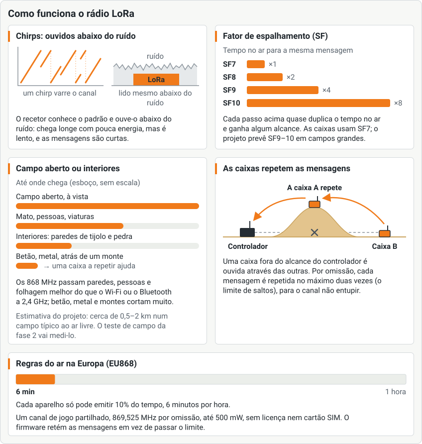

<!--
SPDX-FileCopyrightText: 2026 The Atalaia contributors
SPDX-License-Identifier: CC-BY-SA-4.0
-->

# Manual de operação da Field Box

Para quem cuida das caixas num campo: ligá-las, pô-las num jogo e mantê-las vivas. Em inglês: [Field Box operator manual](../en/field-box.md).

**Montar uma caixa não está neste manual.** Segue o [guia de montagem](https://atalaia-project.link/montagem/) da página do projeto, ou o [manual de montagem da Field Box](../../../hardware/field-box/BUILD.pt.md) passo a passo.

> **Ainda não está pronta para o campo.** A Atalaia está em pré-alfa. Placas Heltec V4.3 a sério já jogaram jogos inteiros numa bancada com o controlador de campo. Nenhuma caixa montada foi usada num campo. Cada passo abaixo corresponde ao que o firmware mostra hoje. Os passos que dependem de hardware dizem **Ainda não testado num campo**. As palavras em *itálico* estão no [glossário](https://atalaia-project.link/glossario/).

## 1. O que é uma Field Box

A *Field Box* é o dispositivo de jogo principal da Atalaia. Tem:

- dois a quatro **botões de equipa** grandes, cada um com a sua cor e a sua luz;
- um **ecrã** (2,8 polegadas, a cores) e um **teclado**;
- um anel de **luzes** que mostra a cor da equipa;
- um **leitor NFC** para etiquetas e cartões;
- um **ecrã OLED** pequeno na placa, uma linha de estado para a organização;
- um **altifalante** opcional;
- um rádio *LoRa* e uma **bateria** (uma célula de iões de lítio, recarregada por USB-C).

Corre as regras do jogo sozinha e fala com o controlador de campo por rádio. Se perder o controlador, continua a jogar e a contar pontos.

### Segurança primeiro

- **Nunca ligues uma caixa sem a antena LoRa montada.** O rádio pode estragar-se.
- Mantém o aspeto de dispositivo de jogo: cores vivas e uma etiqueta **GAME PROP**. Nada que pareça um explosivo a sério. Transporta as caixas em malas com etiqueta e nunca deixes uma sozinha fora do campo.
- Trata a bateria de lítio com cuidado. Carrega-a onde a possas vigiar. Nunca uses uma célula inchada, amolgada ou quente.
- Não uses uma caixa num jogo antes de ter feito, para ela, a verificação da potência de emissão da [lista de arranque](../../../firmware/esp32/docs/BRING_UP.md) (em inglês). Ainda não testado num campo.

## 2. Ligar, desligar e carregar

1. Confirma que as antenas estão montadas.
2. Liga o **interruptor principal**. O OLED pequeno mostra a torre da Atalaia e a versão do firmware durante 2 segundos. Depois o ecrã grande mostra o primeiro ecrã da caixa ([secção 3](#3-primeira-configuração-caixa-nova) ou [secção 5](#5-põe-a-caixa-num-jogo)).
3. Para desligar, usa o interruptor principal.

**Carregar.** Liga um carregador USB-C de 5 V à ficha do painel com o **interruptor principal ligado**. Com o interruptor desligado, a bateria fica isolada e não carrega. Carrega num sítio que possas vigiar, não dentro de uma mala de transporte fechada. Carrega só entre cerca de 0 °C e 45 °C. Não carregues uma caixa fria logo à saída de um campo no inverno.

**Guardar e viajar.** Por mais do que umas semanas, guarda a caixa meio carregada, desligada, num sítio fresco e seco. Em voos e envios, segue as regras da transportadora para baterias de lítio.

**Se a energia falhar durante um jogo**, a caixa volta no mesmo jogo. Mantém a pontuação e o tempo de jogo. Se estava armada como bomba, volta armada com o rastilho que lhe restava.

## 3. Primeira configuração (caixa nova)

Uma caixa nova mostra **PRIMEIRA CONFIGURAÇÃO** com o nome de uma rede Wi-Fi como `atalaia-1A2B`.

1. No telemóvel, liga-te a essa rede Wi-Fi.
2. Se a página de configuração não abrir sozinha, abre um browser e vai a `192.168.4.1`.
3. Preenche a página **Configuração da caixa Atalaia**. Abre na língua da caixa; os links no fundo (**English**, **Português**, **Deutsch**, **繁體中文**) mudam a língua:
   - **Nome da caixa**: um nome para esta caixa, por exemplo `field-box-01`.
   - **Região de rádio**: escolhe a região para que esta caixa foi feita (**EU868** ou **AS923-TW**). A caixa só aceita a sua.
   - **Número de equipas**: 2, 3 ou 4.
   - **PIN de administração**: 4 a 8 algarismos. **Não há PIN por omissão.** PIN fáceis como 1234, 0000, 9876 ou 1212 são recusados. Anota-o e guarda-o em segurança.
   - **Brilho do ecrã** e **Volume do som**.
   - **Chave de ligação ao campo** (opcional): a chave de 64 algarismos que a organização te dá. Também a podes juntar depois ([secção 4](#4-adota-a-caixa-no-campo)).
   - **Nome do Wi-Fi do campo** e **Palavra-passe do Wi-Fi do campo** (opcionais): precisos para as atualizações de firmware ([secção 9](#9-atualizações-pelo-ar)).
4. Toca em **Guardar e reiniciar**.

A caixa reinicia. Uma caixa ainda sem campo mostra **Emparelhar caixa** e um código de 6 algarismos ([secção 4](#4-adota-a-caixa-no-campo)).

A página de configuração só abre sozinha numa caixa que ainda não foi configurada. Para a abrir de novo numa caixa já configurada: carrega numa tecla, escreve o PIN de administração e `#`, escolhe **Configurar o Wi-Fi** (a seguir aos jogos) e confirma com `#`. A caixa reinicia na página de configuração; guarda o campo, a chave de entrada e os jogos, e volta a pedir o resto (nome, PIN de administração, Wi-Fi). Uma caixa sem teclado faz o mesmo a partir de um computador por USB (o [guia do firmware](firmware.md)). Ainda não testado num campo.

## 4. Adota a caixa no campo

Uma caixa tem de ser **adotada** uma vez por um campo antes de poder jogar nele. Adotar dá-lhe a *chave de entrada do campo*. A organização faz isso no separador **Adotar** da consola. Tem três maneiras:

| Maneira | O que fazes |
| --- | --- |
| **Cabo USB** | Liga a caixa ao controlador com um cabo **de dados** (não um cabo só de carga). A organização procura-a e carrega em **Adotar**. |
| **Cartão de campo (NFC)** | Encosta o **cartão de campo** ao leitor NFC da caixa uma vez. O ecrã mostra **Adotada**. O cartão de campo é o segredo-mestre do campo: guarda-o fechado à chave. |
| **Código de emparelhamento (rádio)** | Uma caixa não adotada mostra **Emparelhar caixa** e **Código: 042 137** (seis algarismos). Diz o código à organização. Ela escolhe a tua caixa pelo nome na consola e escreve o código. Sem cabo nem cartão. |

Quando resulta, a caixa mostra **Adotada**, o nome do campo e uma impressão digital curta como `A1B2-C3D4`. A organização compara-a com a consola.

- Um código errado muda o código da caixa. Lê o novo. Três códigos errados fazem a caixa esperar um minuto. Dez códigos errados param o emparelhamento até a caixa reiniciar. Carrega em `#` no teclado para um código novo.
- Uma caixa que pertence a **outro campo** pede o seu **PIN de administração** (**PIN para mudar de campo**) no teclado. Depois de cinco PIN errados, obriga-te a esperar 1, 2, 4 … até 60 minutos. A espera sobrevive a um reinício. O ecrã mostra **PIN bloqueado** e os minutos de espera.
- Uma caixa sem PIN de administração não pode passar para outro campo. Mostra **Consola USB: @admin-pin**. Quem a montou pode definir um PIN.
- **Passar uma caixa adotada para outro campo por código.** Na caixa que pertence a um campo, carrega numa tecla, marca o PIN de administração e `#`, escolhe **Mudar de campo** (a entrada a seguir aos jogos e a **Configurar o Wi-Fi**; só aparece numa caixa adotada, com rádio e com PIN de administração) e carrega em `#`. O ecrã pergunta **MUDAR DE CAMPO?**: `#` continua e `*` volta atrás. A caixa passa a mostrar **PAIR THIS BOX** (em português, **Emparelhar caixa**) e um código, como uma caixa nova, e a organização do outro campo emparelha-a na sua consola como na tabela acima. A caixa fica com o campo antigo até o novo a emparelhar: `*`, cinco minutos sem emparelhamento ou um jogo em que entre deixam-na como estava.

Ainda não testado num campo: o cartão de campo NFC e o emparelhamento por rádio.

## 5. Põe a caixa num jogo

Depois da adoção, uma caixa por usar mostra **PRONTA** e **Próximo jogo**. Anuncia-se pelo rádio. Há duas maneiras de entrar num jogo:

### A. A organização convida-a (o modo normal)

1. A organização cria o jogo e abre **Convidar caixas** na consola.
2. A tua caixa aparece na lista, pelo nome. Aparece até cerca de 20 segundos depois de estar pronta ou de um jogo acabar. Depois repete-se mais ou menos uma vez por minuto.
3. A organização marca-a e dá-lhe uma função.
4. A caixa mostra **Convidada:** *função* e depois **À ESPERA** com **Jogo** *N* e **O jogo ainda não começou**.
5. Quando a organização carregar em **Começar**, a caixa mostra **JOGO EM CURSO** e depois o ecrã próprio do modo.

### B. Um cartão de entrada

Sem nenhum jogo a decorrer, encosta o **cartão de entrada** ao leitor NFC. A caixa mostra **Entrou:** *função*. Um cartão feito para outro campo é recusado.

As mesmas palavras aparecem em inglês, alemão ou chinês tradicional quando a organização define a **Língua das caixas** para o jogo.

### C. Um jogo sem controlador (autónomo)

Podes jogar com uma caixa sozinha, sem controlador:

1. Em **PRONTA**, carrega numa tecla qualquer. Diz **Uma tecla: escolher jogo aqui**.
2. **Marca o PIN de administração.** `#` confirma e `*` apaga.
3. **ESCOLHE UM JOGO**: carrega de `1` a `9` para escolher o jogo. `0` mostra mais. `#` avança. `*` volta.
4. **DURAÇÃO DO JOGO**: `2` junta 5 minutos, `8` tira 5 minutos. **Sem limite** quer dizer que o jogo continua até a organização o terminar. `#` avança.
5. **COMEÇAR O JOGO?**: `#` começa, `*` volta.

Num jogo autónomo a caixa não tem chave do jogo. **Recusa etiquetas de quem joga.** Os modos que precisam de etiquetas precisam de um controlador.

## 6. Os ecrãs e os botões da caixa

Manténs premido o botão da tua equipa na caixa. A caixa mostra o que se passa.

| No ecrã | Significado |
| --- | --- |
| **PRONTA** · logótipo do campo · **Próximo jogo** | Adotada, sem jogo. Pode ser convidada. O logótipo é o do campo, ou a torre da Atalaia se a caixa não tiver nenhum. |
| **À ESPERA** · **Jogo** *N* · **O jogo ainda não começou** | Juntou-se. Espera pelo **Começar** da organização. |
| **JOGO EM CURSO** | O jogo começou. Segue-se o ecrã próprio do modo. |
| **ZONA · LIVRE** · **Mantém premido** | Uma zona que nenhuma equipa tem (Domínio, Domínio Total, Último Elemento, Mestre e Satélites). Mantém premido o botão da tua equipa. Uma barra enche. |
| **ZONA OCUPADA** · equipa | Uma equipa tem a zona. O anel fica com a cor dela. O OLED pequeno mostra há quanto tempo a tem. |
| **Mantém o botão premido para a tomar** | Outra equipa pode tomar a zona da mesma maneira. |
| **PRONTA** · **Mantém premido para armar** | *Bomba / Rush*: a bomba ainda não está armada. Os atacantes mantêm premido o botão. |
| **ARMADA** · tempo **até à explosão** | A bomba está armada. Os defensores mantêm premido o botão para a desarmar. |
| **DESARMADA** / **EXPLODIU** | A bomba terminou. A equipa vencedora é nomeada. |
| **EM PAUSA** · **Aguarda a organização** | A organização pôs o jogo em pausa. Não mexas na caixa. |
| **FIM DO JOGO** · **Pontuações finais** | O jogo acabou. Passados 30 segundos a caixa mostra outra vez **PRONTA**. |
| **CÓDIGO** com pontos | Pede-se um código no teclado (*Códigos*, códigos de equipa na *Bomba*). Escreve-o. `#` confirma e `*` apaga. |

Os outros modos têm ecrãs próprios: *Baixa Confirmada* (**carrega no botão e lê as etiquetas**), *Reentradas e Vidas* (**Lê a tua etiqueta para voltares ao jogo**), *Ligaduras* (**Lê a tua etiqueta** e **mantém premido o botão**) e *Hackeia o terminal* (um enigma no teclado). A [página dos modos](https://atalaia-project.link/modos/) mostra-os.

**O logótipo do campo.** Se a organização definiu um logótipo para o campo (nas *Definições* da consola), a caixa mostra-o no ecrã **PRONTA**, e no ecrã de *Bomba / Rush* enquanto a bomba não está armada. A caixa vai buscá-lo sozinha pela Wi-Fi do campo quando se junta a um jogo, por isso precisa do **nome** e da **palavra-passe da Wi-Fi do campo** (como nas [atualizações](#9-atualizações-pelo-ar)); guarda-o e só volta a buscá-lo quando o logótipo muda. Chega à caixa um logótipo em PNG, JPEG ou WebP (num JPEG ou WebP, a consola converte-o no navegador quando o carregas); sem logótipo, a caixa mostra a torre da Atalaia. Uma caixa que nunca se juntou a um jogo na Wi-Fi deste campo mostra também a torre. O OLED pequeno mostra sempre a torre da Atalaia.

No OLED pequeno vês o modo em cima, um valor grande (a fase, o tempo ou a equipa) e uma dica por baixo. Enquanto uma equipa mantém premido o botão, o OLED mostra uma barra que enche.

Num jogo com limite de tempo que começou na própria caixa, o ecrã grande tem uma barra fina ao longo da margem de baixo que mostra quanto falta do jogo (fica vermelha no último minuto), e o OLED mostra o tempo que falta, em minutos e segundos, à direita da linha de cima. Um jogo **Sem limite** não tem nenhuma das duas. Um jogo conduzido pelo controlador do campo acaba quando a organização o termina, por isso não tem barra.

As *Ligaduras*, o *Hackeia o terminal* e o *VIP / Carga* não seguem a língua da caixa. Cada um usa a língua do ecrã da sua própria definição **Língua** no jogo, e por omissão é o português. Pede à organização que a defina.

## 7. O que te dizem as luzes e os ecrãs

| Vês | Quer dizer |
| --- | --- |
| O anel mostra a cor de uma equipa | Essa equipa tem a zona. Ainda não testado num campo. |
| Os botões estão acesos | A caixa está ligada. |
| O ecrã grande está apagado e o OLED pequeno aceso | A caixa está ligada. Confirma os fios do ecrã grande, ou fala com quem a montou. |
| **Adotada** com o nome de um campo | A caixa pertence agora a esse campo. |
| **Não adotada** / **Já adotada** | O estado da adoção, quando encostas um cartão de campo ou usas o cabo. |
| **Cartão de campo inválido** | O cartão está danificado. |
| **PIN errado** / **Adoção bloqueada** | Vê a [secção 4](#4-adota-a-caixa-no-campo). |
| **Falta o PIN** | A caixa ainda não tem PIN. Fala com quem a montou. |
| **Em jogo** | Tentaste adotar uma caixa que está num jogo. Termina primeiro o jogo. |

## 8. Bateria

- A caixa comunica o nível da bateria ao controlador. A organização vê-o no separador **Caixas** da consola. Abaixo de 20% aparece **fraca**.
- Quando o nível de uma caixa desce abaixo do seu limite, ela envia um alerta de bateria fraca, uma vez.
- Uma caixa sem medidor de bateria não mostra nível.
- Uma célula de iões de lítio (duas células 18650 em paralelo) deve durar bem mais do que um jogo de duas horas. **Isto ainda não foi medido.** O anel de luzes e o altifalante gastam mais.
- Carrega as caixas na véspera. Troca ou carrega uma caixa que mostre **fraca** entre jogos, não durante um.

## 9. Atualizações pelo ar

A organização pode atualizar o firmware de uma caixa pelo Wi-Fi do campo, entre jogos. Nada corre enquanto há um jogo a decorrer.

1. A caixa precisa do **Nome do Wi-Fi do campo** e da **Palavra-passe do Wi-Fi do campo** (definidos na página de configuração, [secção 3](#3-primeira-configuração-caixa-nova)) e de um jogo a que se tenha juntado.
2. A organização carrega uma versão assinada no separador **Caixas** da consola (**Atualizações de firmware**) e depois carrega em **Atualizar todas as caixas** ou em **Atualizar para** *versão* numa caixa. A caixa descarrega-a, volta a verificar a assinatura, instala-a e reinicia.
3. Se a versão nova falhar o autoteste, a caixa volta sozinha à antiga.
4. A consola mostra **enviada, à espera da caixa**, **instalada, a reiniciar**, **concluída**, **falhou**, **revertida** ou **sem notícias da caixa**.

Não desligues a caixa durante uma atualização. Mantém a bateria carregada: uma caixa com a bateria fraca recusa. Ainda não testado num campo.

**Uma caixa gravada com a v0.4.0 ou anterior não aceita esta atualização.** A partir da v0.5 os espaços de firmware são maiores (uma tabela de partições nova) e uma atualização pelo ar não consegue mudar a tabela. A caixa tem de ser gravada por USB uma vez, sem a apagar: mantém o campo, as chaves e as definições, e volta a obter os modos de jogo e o logótipo do campo no jogo seguinte. Uma caixa que mostra **Instala por USB** é uma caixa com a tabela antiga e o firmware novo. Depois dessa gravação, as atualizações pelo ar funcionam como antes. Como: [guia de firmware, secção 3.3](firmware.md#33-escrever-a-imagem).

## 10. Rádio: o essencial para um campo

- **Um canal para o campo todo.** Todas as caixas, o modem USB do controlador e os módulos das apps usam o mesmo canal. O canal por omissão é **869,525 MHz** na Europa. A organização escolhe-o na consola, antes do primeiro jogo, e a caixa fica a saber qual é quando entra num jogo. Uma caixa recusa um jogo de outra região.
- **Alcance.** O *LoRa* chega longe com muito pouca energia. A estimativa do projeto é de **0,5 a 2 km ao ar livre**, e muito menos dentro de edifícios ou atrás de betão, metal ou um monte. É uma estimativa, não uma medição. Ainda não testado num campo.
- **Repetidores.** Uma caixa que não chega ao controlador é ouvida **através das outras caixas**. Cada caixa repete as mensagens das outras, no máximo **duas vezes** por omissão. Em terreno difícil, a organização pode pôr caixas a mais no meio, como repetidores. Vê *rede mesh* no glossário.
- **Antenas.** Mantém a antena LoRa montada para sempre, na vertical se puderes, e o mais longe que conseguires da bateria e dos fios.
- **Ouvir antes de falar.** Uma caixa ouve o canal antes de emitir. Se ouvir outra emissão, espera uma fração de segundo (20 a 200 ms) e tenta outra vez. Depois de 8 respostas de «ocupado» seguidas, emite na mesma.
- **Tempo de emissão limitado.** As regras europeias deixam cada aparelho emitir só 10% do tempo no canal por omissão, e 1% ou menos nos outros canais. Uma caixa que gastou o seu tempo não emite até recuperar. Um canal com 25 mW e 1% dá cerca de um décimo do tempo de emissão e muito menos alcance. A consola avisa disso.
- **Mensagens.** As caixas enviam o que muda, como «vermelha capturou B». Os pontos chegam à consola em cerca de 15 segundos.

Mais: a [página do rádio](https://atalaia-project.link/radio/), o [guia do teste de rádio no campo](../../runbooks/radio-field-test.md) (em inglês) e as entradas *[rede mesh](https://atalaia-project.link/glossario/#glossario-mesh)* e *[LoRa](https://atalaia-project.link/glossario/#glossario-lora)*.

## 11. Um telemóvel como dispositivo de jogo

Um telemóvel Android também pode ser uma caixa. Na app escolhe **Dispositivo de jogo**, depois **Entrar num jogo** e lê o **código QR de entrada** que a organização mostra, ou encosta um cartão de entrada. O telemóvel mostra o ecrã do modo com os botões das equipas no ecrã. Um **módulo de E/S** opcional junta um rádio e botões grandes. Define a **Chave de entrada do campo** e o **PIN da organização** nas **Definições**. Nas **Definições**, o **Modo quiosque** prende o telemóvel à app e **Bateria e segundo plano** diz-te como impedir que o Android adormeça a app. Se o jogo usa um modo que a app não tem, e a organização o permitir, o telemóvel obtém o modo do controlador do campo, pelo Wi-Fi do campo, antes de começares: só aceita um pacote **assinado** por uma chave de modo em que confias. Acrescenta a chave do projeto (ou do teu clube) em **Definições › Chaves dos modos obtidos** e pede-a à organização. Um pacote sem assinatura, assinado por outra chave ou danificado é recusado com uma mensagem e nunca é executado. Ainda não testado num campo. Vê o [guia da app](../../../app/README.md) (em inglês).

## Resolução de problemas

| Problema | O que fazer |
| --- | --- |
| Não acontece nada quando ligo | Verifica o interruptor principal, o fusível e a bateria. Carrega por USB-C com o interruptor **ligado**. Se cheirar mal ou estiver quente, desliga e tira as células. |
| A caixa não está na lista de **Convidar caixas** da organização | Tem de mostrar **PRONTA** e estar adotada. Espera até um minuto, ou pede à organização que carregue em **Procurar caixas**. Confirma a região e aproxima-te do controlador. |
| O convite diz **recusou: noutro jogo** | A caixa ainda está num jogo antigo. Desliga-a e volta a ligá-la, ou termina esse jogo. |
| O convite diz **recusou**, «chave de entrada de outro campo?» | A caixa pertence a outro campo. Adota-a outra vez ([secção 4](#4-adota-a-caixa-no-campo)). |
| A consola diz **A caixa N não dá notícias há mais de 90 s** | Aproxima a caixa, junta uma caixa no meio como repetidor, ou verifica a antena. A caixa pode estar bem: continua a jogar e põe-se em dia. |
| A consola diz **Duas caixas partilham o n.º N** | A mesma entrada foi usada em duas caixas. Tira uma do jogo e junta-a de novo com outra entrada. |
| Um botão só funciona às vezes | Mantém-no premido até ao fim. Qualquer largada recomeça o tempo. Se for instável, fala com quem montou a caixa. Um fio solto é a causa habitual. |
| O leitor NFC não lê | Encosta a etiqueta ao leitor, bem plana, durante um segundo. Confirma que é uma etiqueta NTAG. Cada jogo precisa de etiquetas de jogador novas. |
| O ecrã está na língua errada | A organização define a **Língua das caixas** antes de criar o jogo. |
| A caixa só mostra inglês | Firmware mais antigo. A organização pode atualizá-lo. |
| **PIN bloqueado · tente daqui a N min** | Espera. A contagem sobrevive a um reinício. Não continues a adivinhar. |
| A caixa reiniciou num jogo | Volta no mesmo jogo. A organização vê **node.rebooted** no registo dela. |
| O ecrã pequeno está apagado | Fala com quem montou a caixa. O ecrã grande pode continuar a funcionar. |

Para avarias de montagem e de bancada, vê [a tabela de resolução de problemas do manual de montagem](../../../hardware/field-box/BUILD.pt.md#13-resolução-de-problemas).
