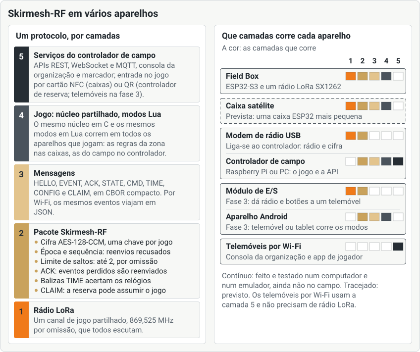

<!--
SPDX-FileCopyrightText: 2026 The Atalaia contributors
SPDX-License-Identifier: CC-BY-SA-4.0
-->

# Manual da organização

Para quem dirige um campo: montar o *controlador de campo*, preparar um jogo, dirigi-lo a partir da **consola da organização** e encerrá-lo. Em inglês: [Game master and field organiser manual](../en/game-master.md).

> **Ainda não está pronta para o campo.** A Atalaia está em pré-alfa. O controlador já jogou jogos inteiros com placas a sério numa bancada, mas nenhum controlador, caixa, telemóvel ou servidor foi usado num campo a sério. Cada passo abaixo corresponde ao que o software mostra hoje. Os passos que dependem de hardware dizem **Ainda não testado num campo**. As palavras em *itálico* estão no [glossário](https://atalaia-project.link/glossario/).

## Índice

1. [Como encaixam as peças](#1-como-encaixam-as-peças)
2. [Monta o controlador de campo](#2-monta-o-controlador-de-campo)
3. [Abre a consola da organização](#3-abre-a-consola-da-organização)
4. [Prepara o campo (uma vez)](#4-prepara-o-campo-uma-vez)
5. [Cria um jogo](#5-cria-um-jogo)
6. [Atribui as caixas](#6-atribui-as-caixas)
7. [Check-in, equipas e marshals](#7-check-in-equipas-e-marshals)
8. [Começa o jogo](#8-começa-o-jogo)
9. [Durante o jogo](#9-durante-o-jogo)
10. [Termina o jogo e os registos](#10-termina-o-jogo-e-os-registos)
11. [Instala modos da comunidade](#11-instala-modos-da-comunidade-a-partir-do-registo)
12. [O servidor do site e o modo alojado](#12-o-servidor-do-site-e-o-modo-alojado-em-breve)
13. [Lista para o dia do jogo](#13-lista-para-o-dia-do-jogo)
14. [Resolução de problemas](#resolução-de-problemas)

## 1. Como encaixam as peças

- O **controlador de campo** é a base. Guarda a pontuação oficial, ouve todas as caixas pelo rádio e serve a consola. É um Raspberry Pi com um modem de rádio USB, ou um telemóvel Android. Vê *[controlador de campo](https://atalaia-project.link/glossario/#glossario-controlador-de-campo)*.
- A **consola da organização** é uma página web que o controlador serve. Abres-a num telemóvel, num tablet ou num portátil, no Wi-Fi do campo.
- As **caixas** são os dispositivos de jogo. Jogam sozinhas e falam com o controlador por *[LoRa](https://atalaia-project.link/glossario/#glossario-lora)*.
- **Quem joga** usa a app nos telemóveis, no mesmo Wi-Fi.
- O **servidor do site** é opcional, para contas, agendas, histórico e controlo remoto. Nenhum jogo fica à espera dele. Vê *[funciona sem internet](https://atalaia-project.link/glossario/#glossario-sem-internet)*.

## 2. Monta o controlador de campo

### Num Raspberry Pi (ou outro computador Linux)

Ainda não testado num campo: nenhum Raspberry Pi com um modem a sério e caixas a sério correu um jogo até hoje. Para uma montagem passo a passo que não presume que és programador, usa o [guia de montagem do controlador](controller-setup.md). Os comandos completos estão no [guia do controlador](../../../controller/README.md#running-it) (em inglês). Em resumo:

1. Grava o firmware do modem numa placa Heltec V4.3 sobresselente e liga-a ao USB do Pi. É o **modem de rádio USB**. O ecrã pequeno dele mostra `LINK OK` quando o controlador está a falar com ele. Vê o [guia do firmware](../../../firmware/esp32/README.md#usb-radio-modem-variant).
2. Instala os pacotes e compila o núcleo, como no guia.
3. Copia `controller/controller.example.toml` para `controller.toml` e edita-o. As definições que vais querer:
   - `[modem] port`: a porta do modem (normalmente `/dev/ttyACM0`). Vazio quer dizer sem rádio: dá para criar jogos, mas nada chega às caixas.
   - `[radio] region`: `eu868` (Europa) ou `as923-tw` (Taiwan). O modem e todas as caixas têm de ser feitos para a mesma região.
   - `[checkin]`: `field_id`, `field_name` (aparece a quem joga), `wifi_ssid` (impresso no cartaz), `confirm` (`auto` ou `staff`), `federation`, `limit_template`.
   - `[api] tls_names`: os endereços que os telemóveis usam para chegar ao controlador, por exemplo `["10.42.0.1", "campo.local"]`.
4. Arranca-o. Para arrancar com o computador, usa o ficheiro `systemd` de `controller/deploy/`.
5. Mostra os **códigos de acesso**:
   `python3 -m atalaia_controller tokens`
   São dois: o **código da organização**, que dirige o jogo, e o **código só de leitura**, que só vê. Dá o código só de leitura a marcadores e espectadores. Guarda o código da organização para ti.
6. Mostra a **chave de entrada do campo** (64 algarismos e letras):
   `python3 -m atalaia_controller join-key`
   É o segredo-mestre do campo. As caixas recebem-na uma vez, quando as adotas ([secção 4](#adota-as-caixas)). Dá-a só a quem é da organização e é de confiança.

No primeiro arranque o controlador cria o **certificado** do próprio campo e serve HTTPS na porta 8443, ao lado do HTTP simples na porta 8080. O cartaz de check-in leva a impressão digital dele, para os telemóveis de quem joga verificarem que falam com o teu controlador. O código da organização, e os códigos de quem joga, só são aceites por HTTPS: ninguém no Wi-Fi os consegue ler no ar.

### Num telemóvel Android

Um telemóvel pode ser o controlador de um jogo pequeno, sem Raspberry Pi. Só Android. Ainda não testado num campo: já correu num computador e num emulador, não num telemóvel a sério.

1. Na app, toca em **Controlador de campo**.
2. Se pedir, autoriza as notificações. Em **A otimização da bateria pode parar o controlador a meio de um jogo.**, toca em **Pedir a exceção**.
3. Em **Rede do campo**, escolhe como os telemóveis lhe chegam:
   - o hotspot do próprio telemóvel (**Definições do hotspot**: guarda o nome e a palavra-passe para o cartaz);
   - um router a que o telemóvel se liga (**Definições de Wi-Fi**);
   - **Criar uma rede para o jogo**: o Android cria um nome e uma palavra-passe novos de cada vez. Quem joga entra com o código QR que está no ecrã. Não os ponhas no cartaz.
4. Liga **Aberto na rede Wi-Fi do campo**.
5. Para o rádio das caixas, liga um **módulo de E/S** (por USB ou Bluetooth) ou um modem de rádio USB (por USB) em **Rádio**. Sem um, só jogam telemóveis por Wi-Fi.
6. Define a **Chave de entrada do campo** nas **Definições** (roda dentada). A app cria uma no primeiro arranque se não houver nenhuma. Dá a mesma chave às caixas.
7. Toca em **Arrancar o controlador**. O telemóvel continua a correr com o ecrã apagado.
8. Em **Códigos de acesso**, toca em **Mostrar os códigos**. O **Código da organização** dirige o jogo. Não o mostres a quem joga. O **Código só de leitura (marcador)** só vê.
9. Toca em **Abrir a consola**, ou abre num computador os endereços de **A consola, nos computadores da rede do campo:**. **O cartaz de check-in tem de ser impresso num computador** (separador Check-in).

Se pararem e voltarem a arrancar o controlador, um jogo em curso continua.

### O Wi-Fi do campo

Os telemóveis de quem joga, a consola e os dispositivos de jogo Android usam todos uma rede Wi-Fi do campo. Não precisa de internet. Usa um router, o hotspot de um telemóvel ou a rede que o telemóvel controlador cria. Põe o nome dela no cartaz (`wifi_ssid` num Pi, ou **Nome da rede Wi-Fi do campo** no formulário **Cartaz de check-in** do separador **Check-in**).

## 3. Abre a consola da organização

1. Num telemóvel ou portátil no Wi-Fi do campo, abre `https://` *o endereço do controlador* `:8443/console/`. Por exemplo `https://192.168.4.1:8443/console/`. Da primeira vez, o navegador avisa que não conhece o certificado: é o do próprio campo (a impressão digital está no cartaz de check-in). Aceita-o uma vez, ou instala-o a partir de `http://` *o endereço do controlador* `:8080/api/v1/controller/ca`. Se abrires antes a página simples `http://…:8080/console/`, a consola não envia o código: mostra o endereço https a usar.
   Na app Atalaia também podes tocar em **Organização**, escrever o endereço do controlador em **Endereço da consola** e tocar em **Abrir a consola**.
2. Escreve o **Código de acesso (da organização ou só de leitura)** e toca em **Entrar**. A consola lembra-se dele. **Sair** está no canto superior direito.
3. Um cabeçalho mostra o jogo, o estado e o relógio, o estado do **Rádio** e os alertas. O seletor de língua está ao lado.

Com o código só de leitura vês tudo, com **Só leitura** no cabeçalho, e não podes mudar nada.

Os separadores são:

| Separador | Para que serve |
| --- | --- |
| **Jogo** | Criar, começar, pôr em pausa e terminar o jogo. Mensagens e ajustes de pontuação. |
| **Check-in** | O cartaz de check-in, a lista de participantes, os marshals, as réplicas por cronografar, as regras do check-in. |
| **Campo** | A imagem do campo, os pisos, a quadrícula, as marcações no mapa, o ATAK. |
| **Caixas** | A saúde de cada caixa. Atualizações de firmware. |
| **Juntar** | Cartões de entrada, códigos QR e texto para caixas e controladores de reserva. |
| **Adotar** | Dar às caixas novas a chave do campo. |
| **Predefinições** | Modos guardados com as suas definições. Pacotes de modos assinados. |
| **Cenários** | Escrever cenários à medida. |
| **Registo** | Acontecimentos e alertas. |
| **Controlador** | O estado do próprio controlador. Promover um de reserva. |
| **Definições** | Canal e região de rádio, língua das caixas, identidade do campo, equipas guardadas. |

Pode faltar um separador quando o teu controlador não serve essa parte. O separador **Controlador** diz quais.

## 4. Prepara o campo (uma vez)

### O canal e a região de rádio

Faz isto antes do primeiro jogo. Todas as caixas usam **um canal**.

1. Abre **Definições**. Em **Região de rádio**, confirma a **Região**. Só a mudes se o campo estiver noutra região, e só se o modem e as caixas forem feitos para ela.
2. Em **Canal de rádio do campo**, escolhe uma destas:
   - **Manter o canal recomendado**: 869,525 MHz na Europa. Toca em **Usar 869,525 MHz (recomendado)**. Dá o máximo de tempo de emissão e de potência que as regras europeias permitem.
   - **Procurar um canal calmo**: toca em **Procurar**. O modem USB escuta cada canal cerca de um minuto sem emitir e mostra-os do mais calmo para o mais ruidoso. Sugere um. Toca em **Usar** para aceitar.
   - **Canal ao acaso**: **Tirar um canal**. Normalmente calha um canal fraco de 1% e 25 mW.
   - **Escolher da lista**: escolhe um canal e toca em **Usar este canal**.
3. Um canal com 1% de tempo de emissão e 25 mW mostra um aviso. Um canal de 0,1% não é recomendado.

O canal fica bloqueado enquanto existir um jogo. **Há um jogo em curso: termina-o para mudar de canal.** Vê a [página do rádio](https://atalaia-project.link/radio/) para saber porquê 869,525 MHz.

Ainda não testado num campo.

### Adota as caixas

Cada caixa nova precisa da chave do campo uma vez. Abre **Adotar**. Três maneiras:

- **Cabo USB**: liga a caixa ao USB do controlador (um cabo de dados). Toca em **Procurar caixas**, confirma o nome e o MAC da caixa, toca em **Adotar** e confirma.
- **Cartão de campo**: toca em **Gerar o cartão de campo**. Escreve os bytes num cartão NTAG215 ou NTAG216 como um cartão de entrada. Encosta-o uma vez a cada caixa nova. **O cartão é o segredo-mestre do campo.** Guarda-o fechado à chave. Se se perder ou for copiado, muda a chave (`python3 -m atalaia_controller join-key --rotate`), reinicia o controlador, adota de novo todas as caixas e destrói os cartões antigos.
- **Emparelhar por código (rádio)**: uma caixa não adotada mostra um código de 6 algarismos. Toca em **Procurar caixas pelo rádio**. Escolhe a caixa pelo nome (confere o **id** no ecrã dela se duas tiverem o mesmo nome), escreve o código e toca em **Emparelhar**.

Uma caixa que pertence a outro campo pede o seu **PIN de administração**. Vê o [manual da Field Box](field-box.md#4-adota-a-caixa-no-campo).

### Atualizações de firmware (opcional)

Podes atualizar o firmware das caixas pelo Wi-Fi do campo, entre jogos. Ainda não testado num campo.

1. Abre **Caixas**. Em **Atualizações de firmware**, escolhe a **Imagem (.bin)** e a sua **Versão (.release.json)** e toca em **Carregar**. O controlador só aceita versões assinadas com uma chave que tenhas indicado (`[firmware] release_keys`), e só com HTTPS ligado.
2. Enquanto o jogo está **pronto** e as caixas já se juntaram, toca em **Atualizar todas as caixas**, ou em **Atualizar para** *versão* numa caixa.
3. Acompanha cada caixa: **enviada, à espera da caixa**, **instalada, a reiniciar**, **concluída**, **falhou**, **revertida** ou **sem notícias da caixa**. **Enviar de novo** repete uma oferta. O jogo não começa enquanto houver uma atualização em curso, a não ser que toques em **Deixar de esperar pelas atualizações em curso**.

Uma caixa precisa do nome e da palavra-passe do Wi-Fi do campo na sua configuração, de bateria suficiente e da chave da versão gravada no firmware dela.

**Uma exceção: uma caixa gravada com a v0.4.0 ou anterior.** A partir da v0.5 os espaços de firmware são maiores, o que é uma tabela de partições nova, e uma atualização pelo ar não a consegue mudar. A consola recusa a oferta a essa caixa (o resultado diz: precisa de uma tabela de partições nova, é preciso instalar por USB uma vez). Grava essa caixa por USB uma vez, sem a apagar (mantém o campo, as chaves e as definições): ver o [guia de firmware, secção 3.3](firmware.md#33-escrever-a-imagem). Depois disso, as atualizações pelo ar funcionam como antes.

### As definições do módulo de E/S (opcional)

Se um telemóvel usa um **módulo de E/S** como rádio, podes mudar as definições do módulo a partir da consola, sem cabo nem nova compilação: as cores dos quatro botões, o brilho do anel de LEDs, o volume e se o interruptor da caixa avisa. Ainda não experimentado com um módulo a sério.

1. Faz isto **antes de um jogo começar ou depois de ele acabar**. O painel fica desativado durante um jogo. O telemóvel com o módulo tem de ter entrado no jogo.
2. Abre **Caixas**, painel **Definições dos módulos de E/S**. Procura o telemóvel com o módulo, define só o que queres mudar (**Definir as cores**, o brilho, o volume, o interruptor da caixa) e toca em **Enviar ao módulo**. **Voltar primeiro às definições da compilação** anula tudo o que foi enviado antes.
3. O painel mostra **enviado (1), a aguardar** e depois **aceite pelo módulo**. Se o módulo não responder, o controlador volta a enviar passados 8, 16, 32, 64 e 128 segundos e depois diz **sem resposta**: o telemóvel não tem módulo, o firmware do módulo é anterior a esta funcionalidade, ou está fora de alcance ou sem bateria.

O módulo guarda o que enviaste, também depois de reiniciar. O guia de montagem tem os pormenores: [Módulo de E/S, Definições pelo rádio](../../../hardware/io-pod/BUILD.pt.md#definições-pelo-rádio).

### Língua das caixas, identidade do campo e equipas guardadas

Nas **Definições**:

- **Língua das caixas**: a língua dos ecrãs das caixas. Um jogo mantém a língua com que foi criado. Por omissão é a língua da consola. Por baixo das caixas das equipas, das predefinições e do nome do campo, a consola avisa quando um nome tem letras que os tipos de letra das caixas não têm (a maior parte das letras chinesas, o cirílico): as caixas desenham «?» ou um quadrado vazio, enquanto a app e a consola mostram o nome como foi escrito.
- **Identidade do campo**: o nome, o logótipo, a imagem de fundo e a cor do campo. Aparecem na app, no marcador, no cartaz e na consola. Carrega só imagens que possas usar. PNG, JPEG ou WebP. Para um logótipo JPEG ou WebP, o navegador prepara também a cópia pequena que as Field Boxes mostram (um aviso di-lo; mantém a consola aberta até aparecer); um logótipo PNG é preparado pelo próprio controlador. Se o aviso disser que o logótipo não pôde ser convertido, carrega-o outra vez, ou em PNG: entretanto as caixas continuam a mostrar a torre da Atalaia. Quando o controlador recebe a identidade do servidor do campo (`[sync] branding = "site"`), este cartão diz **Vem do servidor do campo** e mostra o nome e a cor sem formulário: mudam-se no servidor do campo e o controlador recebe-os na sincronização seguinte.
- **Equipas guardadas**: o nome e o emblema da equipa de um clube, para escolher quando crias um jogo. Com o servidor do campo, as **Equipas do servidor do campo** são uma lista à parte, com um distintivo em cada uma: não se editam nem se apagam aqui. As equipas que guardas na consola ficam por baixo.
- **Sugestão do cartaz de check-in**: se a consola sugere imprimir o cartaz depois de criares um jogo.

### A imagem e o limite do campo

Opcional, mas o limite é o que faz os telemóveis de quem joga avisarem quando sai do campo.

1. Abre **Campo**.
2. Carrega uma imagem com **Carregar imagem do campo** (PNG, JPEG ou WebP, até 4 MB), ou toca em **Carregar o campo de um mapa**. Essa página precisa de internet enquanto preparas o jogo. Encontra o campo, marca os cantos do contorno (3 a 12) e toca em **Desenhar a imagem do campo** e depois em **Usar como campo**. Guarda a imagem, o lugar dela no mapa e o **limite do campo**. O controlador não precisa de internet para isto.
3. **Arrasta as caixas** para o sítio onde estão no campo.
4. **Edifício com vários pisos**: marca-o para um edifício com vários pisos. Cada piso tem a sua planta.
5. **Quadrícula no mapa**: liga-a para teres linhas com letras e colunas com números, para as pessoas dizerem «estou em C4» no rádio. A app de quem joga desenha a mesma quadrícula sobre a planta no **Mapa do campo** e diz a cada pessoa a sua quadrícula. **Imprimir o mapa com a quadrícula** imprime a planta sob a quadrícula com a lista do que está em cada quadrado, como cartaz ou PDF pela janela de impressão do navegador (não na consola dentro da app: abre-se a consola no navegador de um computador). No ATAK, uma caixa, uma marcação no mapa ou uma pessoa dentro de um edifício, num piso com quadrícula, diz o seu quadrado nas observações, como `grid C4`.
6. **Marcações no mapa**: marca zonas seguras, respawns, bases, o estacionamento, primeiros socorros e objetivos. Escolhe quem vê cada uma: toda a gente, uma equipa ou só a organização.
7. **Posição no mapa (ATAK)**: dá a dois cantos opostos da imagem a latitude e a longitude, para mostrar as caixas nos mapas ATAK.
8. **Balizas interiores**: para um edifício com balizas Bluetooth, vê [Balizas interiores](#balizas-interiores) mais abaixo.

### Balizas interiores

Opcional. Dentro de um edifício o GPS é fraco. Se puseres balizas Bluetooth do tipo iBeacon nas divisões, o telemóvel de quem joga pode dizer ao controlador em que divisão está. O controlador mostra a divisão, nunca um ponto ao metro.

1. Em **Campo**, por baixo de **Marcações no mapa**, abre **Balizas interiores** e toca em **Adicionar uma baliza**.
2. Escreve o **UUID**, o **Major** e o **Minor** da baliza (da app da própria baliza ou da etiqueta), a **Divisão** (um nome como «Átrio») e, se quiseres agrupar divisões, uma **Zona**. Num campo de vários pisos escolhe o **Nível**. O major e o minor juntos têm de ser diferentes em cada baliza do campo. Usa material iBeacon padrão; as balizas Eddystone não são suportadas.
3. Para mostrar a divisão no mapa, toca em **Pôr na planta** e clica na planta onde está a baliza, ou escreve um lugar ao longo e para baixo da planta. Sem lugar a baliza dá na mesma a divisão, mas o ATAK não mostra marcador.
4. **Guardar**. Muda uma baliza com **Editar** (o major e o minor ficam) e tira uma com **Apagar**.

Só se partilha a posição se a pessoa marcou a caixa separada **Partilhar a minha posição com o jogo durante este jogo** no check-in (ou a ligar depois na app); o controlador recusa os relatos de posição caso contrário e apaga a posição guardada quando a pessoa pára. A escolha fica guardada no check-in com a hora e a versão do aviso.

Como funciona: quem partilha a posição num campo com balizas é perguntado primeiro e pode dizer **Agora não**. O telemóvel só ouve as balizas da tua lista, comunica a mais forte de 5 em 5 segundos, e o controlador só aceita balizas da tua lista. No interior a baliza substitui a posição por GPS; no exterior o GPS continua. A posição passa então a mostrar a divisão (e a zona) no ATAK, que põe a pessoa no lugar da baliza na planta quando lhe deste um e a planta tem posição no mapa. A consola não desenha as posições de quem joga. Com menos níveis, as balizas dos níveis retirados passam para o piso térreo, sem lugar. Ainda não testado com balizas reais.

**As caixas de campo também são balizas.** Uma caixa num jogo emite também como iBeacon; por isso uma caixa na parede de uma divisão, num piso, diz aos telemóveis que estão perto que divisão é essa, e só precisas de balizas à parte onde não houver caixa. Não há nada a registar: põe a caixa na planta em **Campo** (o nível e o lugar dela) e ela aparece em **Balizas interiores**, em **Caixas de campo como balizas**, como **Caixa de campo**. A divisão dela é o nome da caixa (ou o nome que lhe deste num cenário); toca em **Divisão** para lhe dar outra. Se mudares a caixa de sítio, ou a puseres noutro nível, a baliza vai com ela. Não editas uma caixa como uma baliza, mas podes **Desativar** uma (os telemóveis passam a ignorá-la) e marcar ou desmarcar **As caixas de campo emitem como balizas** para o campo todo: as caixas sabem-no quando o jogo seguinte é ligado, e o controlador deixa logo de as listar aos telemóveis. Uma caixa que não puseste numa planta não é baliza (ainda não tem piso nem lugar). Põe as caixas antes do jogo: o telemóvel lê a lista quando começa a partilhar. Balizas e caixas funcionam em conjunto, e ganha o sinal mais forte. O major 45253 está reservado às caixas: não o uses numa baliza. Ainda não testado num campo.

### Regras do check-in e o cartaz

1. Abre **Check-in**. Em **Regras do check-in** define:
   - **Confirmação**: **automática**, ou **pela organização ou um marshal**;
   - **Número de federado**: **não pedir**, **opcional** ou **obrigatório**, e o rótulo (por exemplo FPA). A app nunca verifica o número. Marca **cartão visto, confere** quando tiveres comparado o cartão com o que a pessoa escreveu;
   - **Filiação numa APD** (em Portugal, quem joga pertence a uma APD reconhecida para airsoft e tem um número de associado com validade): marca **Verificar a filiação em APD à receção**; marca **Pedir a data de validade e verificá-la** se quiseres a validade verificada; e marca as **APD aceites** (nenhuma marcada: qualquer APD). Uma APD que falte na lista junta-se em **Juntar uma APD própria** (nome, nome curto, sítio web). Com um servidor do site, a administração do campo define a mesma regra lá e o controlador adota-a com `[sync] branding = "site"`, com as outras definições de check-in do campo; nesse caso a consola mostra a regra do site e não a pode alterar. Nada é verificado automaticamente: quem joga declara a APD, o número e a validade, e vês um veredicto (ver abaixo). **O campo tem de conferir o cartão físico no check-in** (art. 6.º, n.º 1, al. c), do RGPD nos campos em Portugal; al. f) nos restantes), por isso, com esta regra ativa, um check-in fica *à espera de confirmação* até um marshal ou tu marcarem **cartão visto, confere**, mesmo com confirmação automática e veredicto válido;
     Define o **país** do campo (duas letras: `PT`, `ES`, ...) mesmo acima. `PT` mostra os textos de APD e lista as APD de Portugal; qualquer outro país, ou nenhum, fala de **Filiação numa associação**, **Associações aceites** e por aí fora, e lista só as associações que o projeto conhece para esse país mais as que juntares em **Juntar uma associação própria** (um clube, uma federação ou uma seguradora). Se ficar vazio, o controlador usa `PT` quando o fuso horário é o de Portugal e nenhum país nos outros casos. Com `[sync] branding = "site"` o país é o do servidor do site (a administração do campo define-o lá com as outras definições) e a consola não o pode mudar.
   - **Réplicas por pessoa e jogo** e **Máximo de participantes por jogo**;
   - **Registos de cronografagem guardados (dias)** e **Dados dos jogos guardados (dias)** (de 30 a 3653, 365 por omissão): quanto tempo o controlador guarda as leituras do cronógrafo (também as cópias de outros campos e as chaves antigas dos marshals) e, depois de um jogo terminar, os eventos, as pontuações e a lista de dispositivos desse jogo. Passado o prazo, a limpeza diária apaga-os. Com um servidor do site configurado, um jogo nunca é apagado antes de o servidor o ter por inteiro (um jogo que não se consiga enviar fica até se conseguir); sem ele, só a idade decide. Com `[sync] branding = "site"` os dois são os do servidor (a administração do campo define-os nas definições do campo) e a consola não os altera;
   - **Uma cronografagem vale**: **o dia todo** ou **só este jogo**.
   Toca em **Guardar**.
2. Toca em **Imprimir o cartaz**. Abre uma página A4. Imprime-a uma vez e afixa-a na zona de check-in. Serve para todos os jogos do campo e não leva segredos. Se o Wi-Fi do campo tem palavra-passe, escreve-a na página e toca em **Desenhar o código do Wi-Fi**: cria um código QR do Wi-Fi ao lado do código do cartaz. A palavra-passe não é guardada nem enviada.
3. O formulário **Cartaz de check-in** mais abaixo deixa definir **Endereços https do controlador (um por linha)**, **Nome da rede Wi-Fi do campo** e **Só para este jogo**. Se o cartaz não puder ser feito, a página diz porquê: o HTTPS está desligado, não há nenhum endereço, ou o texto é grande demais para um código QR.

Imprime o cartaz num computador. A consola dentro da app não consegue imprimir.

### Imprimir etiquetas de réplicas

Os marshals encontram uma réplica na lista do cronógrafo lendo a etiqueta QR dela. Quem joga pode fazer a sua na app. Também as podes imprimir a partir da consola:

1. Abre **Check-in**. Na linha de uma pessoa, junto ao número de réplicas, toca em **Imprimir etiquetas**. Para imprimir para todas, toca em **Imprimir as etiquetas de quem já fez check-in** no topo (quem ainda espera confirmação fica de fora).
2. Abre uma página com uma etiqueta de 30 × 30 mm por réplica declarada, com uma linha fina para recortar. Toca em **Imprimir**. O nome da pessoa e o tipo de réplica aparecem só no ecrã, nunca no autocolante.
3. Recorta e cola nas réplicas.

Cada QR leva só o código da etiqueta (**ATL-** e oito caracteres), nada sobre quem joga. Imprime num computador, como o cartaz.

## 5. Cria um jogo

1. Abre **Jogo**. Sem jogo a decorrer vês **Novo jogo**.
2. Preenche:
   - **Nome do jogo** (até 64 caracteres);
   - **Modo ou predefinição**: um modo de **Modos**, ou um guardado em **Predefinições**;
   - **Equipas**: nomes separados por vírgulas, pela ordem dos botões das caixas, por exemplo `red, blue`. As cores conhecidas são red, blue, green, yellow, orange e purple. De 1 a 8 equipas;
   - **Nomes e emblemas das equipas** (opcional): um nome para mostrar e um emblema para cada cor de equipa. As caixas continuam a mostrar a cor;
   - **Duração (minutos)**: `0` quer dizer sem limite. No fim, o jogo termina sozinho;
   - **Squads por equipa**: `0` quer dizer só equipas. Num milsim ou num jogo grande, cada equipa divide-se em squads (até 16). Com um cenário podes escolher **A quem vão os objetivos de um squad**;
   - **Objetivos no início** (num jogo de cenário): se os objetivos que dependem de outros, e nada dizem sobre isso, ficam visíveis desde o início (**Todos visíveis desde o início**) ou escondidos até abrirem (**Só os ativos**: o seguinte é revelado quando o anterior é concluído). Na opção por omissão, um jogo com squads mostra só os objetivos ativos e um jogo sem squads mostra-os todos, a não ser que o `reveal` do próprio cenário diga outra coisa; a `visibility` própria de um objetivo no cenário prevalece sempre. Fica fixo quando o jogo é criado, e a página do jogo diz qual vale. No controlador do telemóvel a mesma escolha está no formulário de novo jogo;
   - **Modificadores**: marca **Códigos**, por exemplo, para correr códigos no teclado ao lado do modo;
   - **Props com uma função própria**: por exemplo **Ligaduras**;
   - **Parâmetros do modo**: as definições do modo, com uma descrição curta.
3. Toca em **Criar jogo**.

Se se ouviram caixas livres pelo rádio, abre logo **Caixas para este jogo** ([secção 6](#6-atribui-as-caixas)). Se não, a consola pode sugerir imprimir o cartaz. Essa mensagem fecha-se sozinha ao fim de 10 segundos. Marca **Não mostrar outra vez** para a deixares de ver.

As definições não se podem mudar depois de criares o jogo. **Para as mudar, termina este jogo e cria outro.**

### Modos

Todos os modos incluídos aparecem em **Modo ou predefinição**. Os nomes em inglês e em português:

| Modo (inglês) | Português | Notas |
| --- | --- | --- |
| Domination | Domínio | Uma caixa ou várias. O tempo a premir e os pontos são parâmetros. |
| Hold-All Domination | Domínio Total | Uma equipa só pontua enquanto tiver todas as caixas. |
| Bomb / Rush | Bomba / Rush | Rastilho, tempos a premir para armar e desarmar. Uma explosão termina o jogo e vence a equipa que armou a bomba; um desarme não o termina (usa **Terminar**). **Códigos de equipa** opcionais, por exemplo `red=1234,blue=5678`. |
| Sabotage | Sabotagem | Rondas da bomba até acabar o tempo de jogo: uma explosão pontua para os atacantes, um desarme para os defensores, e há uma pausa curta. Vence a equipa com mais pontos. Pausa, tempo de jogo e **Códigos de equipa** opcionais são parâmetros. |
| Last Stand | Último Elemento | Atacantes, defensores, contagem para a derrota. |
| Kill Confirmed | Baixa Confirmada | Precisa de etiquetas de quem joga. |
| Respawn and Lives | Reentradas e Vidas | Precisa de etiquetas, ou de botões de equipa. |
| Player Check-in | Registo de Presença | Precisa de etiquetas de quem joga. |
| Master and Satellites | Mestre e Satélites | |
| Progressive Domination | Domínio Progressivo | Uma caixa ativa de cada vez. |
| Hacking Terminal | Hackeia o terminal | Funciona sem o controlador. Enigma: código, fios ou sequência. |
| VIP / Payload | VIP / Carga | O VIP partilha a posição a partir da app. |
| Money Factory | Fábrica de Dinheiro | Precisa de etiquetas. |
| Target Windows | Janelas de Alvo | Precisa do módulo de alvo, que ainda não está feito. |
| Codes (modificador) | Códigos (modificador) | Códigos no teclado ao lado de qualquer modo. |
| Medic Kit (função) | Ligaduras | Uma caixa de kit ao lado de qualquer modo. |
| Objectives (função) | Objetivos | As caixas de um cenário à medida. |

A [página dos modos](https://atalaia-project.link/modos/) mostra cada modo com uma animação.

### Modificadores e o modificador Códigos

Marca **Códigos** em **Modificadores**. Em **Códigos**, escreve `algarismos:tipo[:pontos][:equipa]` separados por vírgulas. O tipo é `points`, `hint` ou `unlock`. Por exemplo `4711:points:50,0815:hint,2222:unlock:red`. Cada código vale uma vez por jogo.

### Cenários

Um *cenário* é um jogo à medida, com objetivos (capturar, código, etiquetas, bomba, escolta, defesa, sobrevivência). Abre **Cenários**, escreve ou cola o manifesto em **YAML** (ou usa **Blocos**), toca em **Verificar** e depois em **Instalar**. Depois, em **Jogo**, escolhe o cenário em **Modo ou predefinição** e marca **Objetivos**. Dá a cada caixa um dos nomes do cenário no separador **Juntar**. O [guia do controlador](../../../controller/README.md#scenarios) (em inglês) explica o formato.

### Predefinições

Uma *predefinição* é um modo com as suas definições guardadas. Abre **Predefinições**, toca em **Nova predefinição**, escolhe um modo e os parâmetros, dá-lhe um nome e toca em **Guardar**.

## 6. Atribui as caixas

Um jogo só começa quando cada função de que precisa tem uma caixa. Há três maneiras de pôr uma caixa no jogo.

### Convidar caixas pelo rádio

O modo normal, para caixas adotadas.

1. Depois de **Criar jogo**, abre a janela **Caixas para este jogo**. Ou toca em **Convidar caixas** no separador **Jogo**.
2. As caixas cujo último jogo acabou anunciam-se. Aparecem até cerca de 20 segundos depois, e depois mais ou menos uma vez por minuto. Toca em **Procurar caixas** para lhes perguntares agora.
3. As caixas do **último jogo** vêm marcadas. Marca as que queres e escolhe o **Papel** de cada uma.
4. Toca em **Convidar (** *n* **)**. O controlador envia a cada caixa a sua entrada pelo rádio, cifrada com a chave do campo.
5. Acompanha o **Estado**: **a enviar**, **convidada**, **aceitou, a juntar-se**, **juntou-se**. Uma caixa pode dizer **recusou: noutro jogo**, **recusou**, **falhou** ou **grande demais**.
6. A janela diz **Tudo pronto para começar: cada papel tem uma caixa**, ou **Ainda à espera de uma caixa para:** *funções*.

Se uma caixa disser **o modo não está na caixa**, toca em **Enviar os modos em falta**. A caixa vai buscar ao controlador, pelo Wi-Fi do campo, os modos assinados que lhe faltam. Isto precisa das chaves de modos das caixas e de HTTPS no controlador.

### Cartões de entrada, códigos QR e texto

1. Abre **Juntar**.
2. Em **Para**, escolhe **uma caixa**. Escolhe o **Papel no modo**. Deixa o **Identificador** em **automático**.
3. Toca em **Gerar**.
4. A consola mostra um **código QR**, um **Texto de entrada** (`atalaia:join:…`) com **Copiar texto**, e os bytes de um **Cartão NFC (NTAG215/216)**.
5. A caixa lê o cartão no leitor NFC dela. Um telemóvel como dispositivo de jogo lê o código QR em **Dispositivo de jogo › Entrar num jogo**. Mostra o cartão ou o código só a quem está a montar o campo: **este código e o cartão levam a chave do jogo**.

### Um controlador de reserva

Em **Para**, escolhe **um controlador de reserva**, toca em **Gerar** e cola o texto no separador **Juntar** do outro controlador, em **Entrar como controlador de reserva**. Os dois têm de partilhar a mesma chave de entrada do campo. O de reserva recebe também, com esse texto, as escolhas das balizas das caixas (o interruptor do campo, as caixas que desativaste, as salas que deste) e os sítios onde colocaste as caixas, por isso, depois de uma passagem de testemunho, os telemóveis recebem o mesmo registo de balizas; depois de mudares ou colocares uma caixa ou de alterares essas escolhas, gera outra vez o texto do de reserva e cola-o outra vez (ele aceita-o como uma atualização). Se o controlador principal deixar de responder, abre o separador **Controlador** do de reserva e toca em **Promover a controlador**. A substituição automática vem desligada por omissão.

## 7. Check-in, equipas e marshals

Abre **Check-in**. O check-in está aberto desde o momento em que um jogo é criado. **Fechar o check-in** pára-o e **Abrir o check-in** volta a abri-lo.

### Participantes

1. A lista **Check-ins** mostra cada pessoa: **Nome**, **Estado**, **Equipa › squad**, **Papel**, **Réplicas**.
2. Um estado **à espera de confirmação** (quando a confirmação é **pela organização ou um marshal**) tem um botão **Confirmar**. Quem se inscreveu e está **por chegar** tem **Chegou**.
3. Dá a cada pessoa uma **Equipa**, e um **Squad** se o jogo tiver squads, com as listas. Define o **Papel**: **jogador/a**, **líder de squad**, **VIP**, **marshal**, **organização** ou **espectador/a**. A mudança vale logo. A app da pessoa apanha a mudança sozinha.
4. Marca **cartão visto, confere** quando tiveres comparado o cartão de quem joga com o que escreveu. Com a regra de APD ativa, cada linha mostra a APD, o número de associado e a validade e um veredicto: **válida**, **caducada**, **APD não aceite** ou **em falta**. Toda a gente fica **à espera da verificação do cartão** (mesmo com veredicto válido e confirmação automática) até um marshal ou tu marcarem **cartão visto, confere**. A marca admite a pessoa e regista **quem marcou e quando**; o controlador **apaga então o número de associado** e guarda a APD, a validade, o veredicto desse dia (**válida em 2027-01-15**) e quem verificou, até os dados do jogo serem apagados. **Admitir sem o cartão** (em vez de **Confirmar** quando a regra verifica no check-in) admite a pessoa na mesma: nunca bloqueias a entrada; o controlador regista-o com o motivo (*sem cartão*, ou o veredicto; nunca o número), guarda o número e marca a linha como **admitido sem o cartão**. Também podes corrigir a APD, o número ou a validade na linha; uma correção substitui uma verificação anterior, por isso marca outra vez. O servidor do site apaga a cópia dele do número quando chega o resultado do jogo ou o jogo termina.
5. **Retirar** tira uma pessoa do jogo.
6. **Check-in à mão**: para quem não tem a app. Escreve um nome, uma preferência de equipa e réplicas; com a regra de APD ativa, marca **cartão visto, confere** se tens o cartão na mão. O formulário tem ainda **Partilhar a minha posição com o jogo durante este jogo**, uma caixa separada que fica desmarcada salvo se a pessoa concordar; um selo **partilha a posição** na linha mostra quem a escolheu. Quem não a escolhe faz o check-in na mesma, e a app pode desligá-la a qualquer momento. O controlador cria um identificador, que se pode gravar numa etiqueta (vê [Etiquetas de quem joga](#etiquetas-de-quem-joga)).
7. **Exportar CSV** guarda a lista. Para isto abre a consola no browser de um computador. A consola dentro da app não consegue guardá-lo.
8. **Importar uma lista de inscrições**: para um campo sem servidor do campo, onde as pessoas se inscrevem noutro sítio. Escolhe o ficheiro CSV (ou JSON) da outra plataforma, indica a **Origem** (o nome dessa plataforma) e toca em **Verificar o ficheiro**: lista cada linha como nova, alterada, igual, ignorada ou recusada, com o motivo, e não muda nada. Só se leem as colunas `display_name`, `external_ref`, `team_preference`, `federation_number` (o número de associado), `apd_id` (o identificador da APD ou associação, em minúsculas, por exemplo `x-minha-sigla`), `membership_expires` (AAAA-MM-DD) e `replicas`, no formato de importação do servidor do campo; qualquer outra coluna (um email, um telefone) é apenas nomeada. As três colunas de filiação são opcionais, um ficheiro antigo sem elas importa como dantes, e são descartadas (com um aviso) quando o campo não pede filiação. **Exportar CSV** tem as mesmas colunas `apd_id` e `membership_expires`, por isso uma lista exportada volta a importar-se. Depois marca que o campo tem base legal própria para a lista e toca em **Importar**: as pessoas aparecem como **por chegar** e assinalas **Chegou** quando chegarem. Importar o mesmo ficheiro outra vez não muda nada, e quem já chegou nunca é alterado. A consola não retira uma inscrição que o ficheiro deixou de listar: só diz quantas são. Num controlador no telemóvel podes fazer o mesmo no ecrã do próprio controlador: em **Lista de inscrições**, toca em **Importar uma lista de inscrições** enquanto um jogo decorre, depois em **Escolher um ficheiro** (o seletor de ficheiros do Android), indica a **Origem**, marca a base e toca em **Verificar o ficheiro** e depois em **Importar**, com as mesmas regras e o mesmo resultado por linha. Um ficheiro ou uma linha recusados são explicados por palavras.

Os nomes só aparecem aqui e aos marshals. Nada do nome de uma pessoa vai para os acontecimentos, o marcador nem as vistas de quem joga.

### Etiquetas de quem joga

Alguns modos (Baixa Confirmada, Reentradas e Vidas, Registo de Presença, Ligaduras, Fábrica de Dinheiro) precisam de uma etiqueta NFC por pessoa. O controlador assina cada etiqueta com a chave do jogo. A chave nunca sai do controlador, por isso ninguém precisa da chave de entrada do campo para gravar etiquetas. Uma etiqueta só funciona no jogo para que foi feita; cada jogo novo precisa de etiquetas novas. Usa etiquetas NTAG213, NTAG215 ou NTAG216 virgens. Há três maneiras de gravar uma:

1. **Na consola**: em **Check-in**, o cartão **Etiquetas de quem joga**. Escolhe o **Identificador de quem joga** entre quem já fez o check-in (ou escreve um identificador, de 1 a 32 letras, algarismos, `-`, `_` ou `.`; o identificador de cada pessoa está por baixo do nome dela na lista). Escolhe a **Equipa**, ou **Sem equipa**. Toca em **Fazer a etiqueta**. Se o teu navegador escrever NFC (o Chrome num telemóvel Android, com a consola aberta por HTTPS), toca em **Escrever com o NFC deste aparelho** e encosta uma etiqueta virgem às costas do telemóvel. Se não, a consola diz que não e mostra o **Registo NDEF (hex)**, com **Descarregar o ficheiro NDEF**. Grava-o com a app Atalaia num telemóvel (o ecrã do marshal, ou o ecrã do controlador abaixo) ou com uma app NFC que escreva um registo NDEF em bruto a partir de hex.
2. **Num controlador no telemóvel**: no ecrã do controlador, em **Etiquetas de quem joga**, toca em **Escrever etiquetas de quem joga** enquanto um jogo decorre. O formulário é o do marshal. O telemóvel grava a etiqueta com o NFC dele e pede-a ao próprio controlador.
3. **Um marshal**: a app do marshal pede cada etiqueta ao controlador (vê o [manual do marshal](marshal.md#7-grava-as-etiquetas-de-quem-joga)). O marshal tem de estar no Wi-Fi do campo e na tua lista de marshals. Já não precisa da chave de entrada do campo para isto.

Se a consola disser que não se pode fazer uma etiqueta porque o jogo não está a decorrer, cria primeiro o jogo: um jogo terminado não tem chave.

**Uma etiqueta pode ser copiada.** A assinatura não cobre o chip, por isso quem consiga ler uma etiqueta com um telemóvel pode gravar os mesmos bytes noutra, e uma caixa toma a cópia por quem joga. Funciona até o jogo acabar (a chave do jogo é nova em cada jogo). Trata a etiqueta como um crachá: não lhe dês valor fora do jogo, entrega as etiquetas no briefing e mantém-nas à vista até lá. Bloquear uma etiqueta só para leitura (uma app NFC consegue; não se desfaz, por isso só nas etiquetas que não vais gravar outra vez) impede que alguém a escreva por cima, mas **não impede a cópia**. As etiquetas NTAG 424 DNA impediriam; a app ainda não as suporta. Pormenores: [SECURITY.md](../../../SECURITY.md#player-tags-can-be-copied).

### Marshals

Só quem está na lista **Marshals** pode agir como marshal.

1. A pessoa faz primeiro o check-in.
2. Em **Marshals**, **Acrescentar marshal**: escolhe **Quem fez o check-in**. Se quiseres, escreve um **Identificador** ou um **Nome**. O controlador dá um identificador como M-01.
3. A tabela mostra a **Chave de assinatura** como **registada** ou **à espera da app**.
4. **Retirar** tira um marshal da lista logo. As medições dele por enviar são recusadas até o voltares a acrescentar.

Vê o [manual de marshal](marshal.md).

### Réplicas por cronografar

**Réplicas por cronografar** lista as réplicas declaradas e o estado de cada uma. Quando começas, a consola avisa se ainda há réplicas por cronografar.

### Da agenda do site

Com um servidor do site, **Da agenda do site** lista os jogos publicados para os próximos dias. **Criar o jogo** faz um jogo com o título, o modo e as equipas, e quem se inscreveu aparece como **por chegar**. Quem se inscreveu pode fazer o check-in com a app, com um bilhete impresso (**Bilhete impresso**: ler ou colar o código dele), ou pelo nome.

## 8. Começa o jogo

1. Abre o separador **Jogo**. O jogo está **pronto**. Vê as **Definições do jogo** se as quiseres rever.
2. Se uma função não tem caixa, a consola diz **Nenhuma caixa se juntou para:** *funções*.
3. Se há réplicas declaradas por cronografar, diz **Há n réplica(s) declarada(s) por cronografar**.
4. Toca em **Começar**. Pergunta **Começar o jogo agora?**. Toca em **Sim**.
5. Se uma função não tem caixa, o botão diz **Começar mesmo assim** e pergunta **Começar mesmo assim?**. Começar assim fica registado e todas as consolas são avisadas: **Jogo começado sem caixa para:** *funções*.
6. Na janela **Caixas para este jogo**, **Começar o jogo** pergunta **Rever primeiro as outras definições do jogo?**. **Rever definições** fecha a janela e abre as **Definições do jogo**. **Começar agora** começa o jogo. **Voltar** volta atrás.

**Início remoto.** Se o campo usa um servidor do site com o **GM remoto** ligado, uma pessoa da organização com sessão iniciada lá pode começar, pôr em pausa, retomar e terminar o jogo em curso a partir da página **GM remoto** do site. Escolhe o controlador e toca em **Começar**. Se uma função não tem caixa, pergunta **Falta uma caixa (ou um telemóvel ligado) para: …. Começar mesmo assim?**. É a mesma verificação do **Começar mesmo assim** da consola. O controlador é que abre a ligação. Vê a [secção 12](#12-o-servidor-do-site-e-o-modo-alojado-em-breve).

Um controlador de reserva não pode começar um jogo. Diz **Este controlador não está a mandar no jogo**. Promove-o primeiro.

## 9. Durante o jogo

### O separador Jogo

- **Estado**, **Tempo de jogo**, **Duração**, **Modo**, **Equipas** e o **Canal** de rádio.
- **Pausa** pergunta **Pôr o jogo em pausa?**. **Retomar** pergunta **Retomar o jogo?**. **Terminar** pergunta **Tens a certeza?**. Responde **Sim**.
- **Mensagem para todas as caixas**: escreve até 100 caracteres e toca em **Enviar**. Aparece no ecrã das caixas e nos telemóveis de quem joga.
- **Ajustar pontuação**: escolhe uma equipa, escreve os **Pontos (negativo para penalizar)** e um **Motivo**, e toca em **Aplicar**.
- **Equipas deste jogo**: muda os nomes e os emblemas das equipas até o jogo acabar.
- **Definições do jogo**: as definições que usaste, só de leitura.
- **Pontuação**: o total de cada equipa, com um gráfico. Os pontos de uma caixa chegam com o estado dela, por isso podem atrasar-se até cerca de 15 segundos. Ao lado de um total, a consola pode mostrar um número mais pequeno *estimado*: entre dois relatórios de uma caixa que está a ser mantida, soma os pontos que a caixa fez desde então, e acompanha uma captura que a caixa tenha relatado até ao estado seguinte dela. Só o número sem *estimado* é a pontuação oficial.

### O separador Caixas

Cada caixa mostra o **N.º**, o **Nome**, o **Papel**, a **Dona** (equipa), o **Nível**, a **Bateria** (com **fraca** abaixo de 20%), o **Sinal**, a **Última notícia**, o **Firmware** e a **Época**. Uma caixa de que não há notícias mostra **sem notícias**. Podes mudar a equipa dona de uma caixa com a lista. Alguns modos juntam botões, por exemplo a recarga de um kit de ligaduras.

### O separador Registo

A página **Registo e alertas** lista os acontecimentos à medida que chegam: capturas, bombas, códigos, baixas, tratamentos, objetivos, mensagens. Cada linha tem o tempo de jogo, o nome do tipo do acontecimento (por exemplo `zone.captured` ou `bomb.armed`), a equipa e a caixa. Os acontecimentos do terminal de hacking, do kit de ligaduras, do VIP, da fábrica de dinheiro e dos cenários também vêm escritos por palavras. Escreve em **Filtrar acontecimentos** ou marca **Só críticos**. Os alertas aparecem por cima da lista:

- **Rádio em baixo: o modem USB não responde.** e **Rádio de volta.**
- **A caixa N não dá notícias há mais de 90 s.**
- **Envio falhado** e **Erro do modem**.
- **O controlador agora é** *papel*.
- Um acontecimento crítico, como mexerem numa caixa.

### Códigos

- **Códigos de jogo.** O modificador **Códigos**, os códigos de equipa da *Bomba* e o código do *Hackeia o terminal* são segredos das equipas. Tu vês-los. O registo mostra quem usou cada código e que equipa tinha a caixa. Um terminal resolvido mostra o código que revelou.
- **Códigos de acesso.** Os códigos da organização e só de leitura saem de `python3 -m atalaia_controller tokens`. Quem joga nunca recebe o código da organização.

### Mapa do campo e marcador

Em **Campo** vês as caixas onde as puseste (e as balizas, se juntaste alguma). A consola não desenha as posições de quem joga. Vão para os aparelhos ATAK da organização quando os configuras (`[atak]` em `controller.toml`), e podem ser lidas na API do controlador. O **marcador** é uma página para uma TV ou um portátil. Abre-a com o código só de leitura:
`http://` *o endereço do controlador* `:8080/scoreboard#token=` *o código só de leitura*
Junta `&lang=en` para inglês.

Para quem joga acompanhar o jogo na aplicação sem fazer o registo, abre o separador **Jogo**, procura **Partilhar o marcador com quem joga** e toca para mostrar o código QR. Quem joga lê-o na aplicação, em **Participante**. Se o controlador tiver mais do que um endereço, escolhe o que quem joga consegue alcançar. Um endereço com `ca=` e um número comprido é o seguro: a aplicação confere o certificado do controlador com esse número, por isso não é preciso fazer mais nada. Mantém-no entre quem joga: quem o tiver pode acompanhar o jogo.

### Se uma caixa ou o controlador ficar calado

- Uma caixa que perde contacto continua a jogar e põe-se em dia. Aproxima-a ou junta uma caixa repetidora.
- Se o controlador reiniciar, o jogo em curso continua a partir do último tempo e das últimas pontuações guardadas.
- Se reiniciou com a definição que não guarda a chave do jogo, o jogo só pode ser terminado. **Terminar** avisa então as caixas pelo rádio.

## 10. Termina o jogo e os registos

1. Toca em **Terminar** e depois em **Sim**. Ou deixa a **Duração** esgotar-se. Alguns modos terminam o jogo sozinhos: na Bomba / Rush uma explosão termina-o (vence a equipa que armou a bomba) e no Sabotagem, por exemplo, o limite de tempo da própria caixa termina-o, e o jogo termina então no controlador com a equipa vencedora da caixa (ou em empate). O separador **Registo** diz **O jogo terminou: terminado pela caixa** *nome*. Isto só acontece com o jogo a decorrer e só para uma caixa que está no jogo: se puseste o jogo em pausa, uma caixa que anuncie o fim durante a pausa não o termina, por isso termina tu o jogo com **Terminar**.
2. O controlador avisa as caixas pelo rádio de que o jogo acabou. Se não conseguir, diz **Não foi possível avisar as caixas pelo rádio**: reinicia cada caixa ou junta-a ao próximo jogo com um cartão.
3. As caixas mostram **FIM DO JOGO**. Passados 30 segundos mostram **PRONTA**.
4. O separador **Jogo** diz **O jogo «…» terminou.** O marcador e os telemóveis de quem joga mostram a equipa vencedora.
5. Exporta a lista de check-in com **Exportar CSV** se a quiseres guardar.

**Registos**

- Separador **Registo**: o registo do jogo em direto.
- Separador **Caixas**: a saúde de cada caixa no fim.
- O controlador guarda cada jogo, os acontecimentos e as pontuações na sua base de dados. Os nomes e os números de federado são apagados 30 dias depois do jogo, por omissão.
- O controlador apaga um jogo terminado, com os acontecimentos, as pontuações e as caixas, **365 dias** depois de terminar, por omissão (uma definição do campo, de 30 a 3653 dias, nas definições do check-in), e as leituras do cronógrafo segundo a definição própria das leituras. Quando apagas uma pessoa no controlador (**Apagar**, ou a pedido da própria pessoa), o controlador avisa o servidor do site, que apaga a sua cópia dos registos de cronografagem dessa pessoa e a ligação do identificador a uma conta; não é preciso pedir à administração do campo no site à parte.
- Com um servidor do site, o histórico e o registo de acontecimentos de cada jogo estão nas páginas da organização dele. Vê a [secção 12](#12-o-servidor-do-site-e-o-modo-alojado-em-breve).
- O registo do próprio controlador é o registo do sistema. Num Pi com o ficheiro `systemd` fornecido, usa `journalctl -u atalaia-controller`.

## 11. Instala modos da comunidade a partir do registo

Qualquer pessoa pode partilhar modos de jogo como pacotes assinados através do [registo de modos da comunidade](https://vakaobr.github.io/atalaia-modes/). Hoje está no ar, mas **ainda não tem modos**, e a chave de assinatura do projeto ainda não foi acrescentada. Tudo o que se segue está feito e testado em software.

1. Na página do registo, procura o modo e a **chave pública do autor**.
2. Decide confiar nessa chave. Põe a metade pública dela nas definições `[modes]` do controlador: `keys = ["<44 caracteres>"]`. Define `index = "https://vakaobr.github.io/atalaia-modes/index.json"`. Num controlador Android usa **Definições › Pacotes de modos (controlador de campo)**. Reinicia o controlador.
3. Abre **Predefinições**. Procura **Pacotes de modos assinados**. Em **Chaves de modos de confiança:** confirma que a tua chave está na lista.
4. Em **Do índice do registo**, toca em **Ler de novo**. Cada pacote mostra o seu **Estado**: **disponível**, **instalado**, **assinado com uma chave em que este controlador não confia**, **a chave foi revogada** ou **um modo incluído tem este id**. Mostra também **revisto pelo projeto** ou **não revisto pelo projeto**.
5. Toca em **Instalar** (ou **Atualizar para** *versão*). O controlador verifica a assinatura, o pacote e os scripts antes de instalar o que quer que seja.
6. Sem internet, carrega um pacote: escolhe o **Pacote (.tar)** e a sua **Versão (.release.json)** e toca em **Enviar e instalar**.
7. O modo aparece em **Modo ou predefinição** no separador **Jogo**.

Um modo da comunidade corre nas caixas, por isso cada caixa tem de o ter. Uma caixa só vai buscar ao controlador um modo em falta (**Enviar os modos em falta** na janela de convites) se o modo estiver assinado com uma chave gravada no firmware das caixas. Uma caixa sem essa chave não o consegue correr.

Qualquer pessoa pode escrever um modo. Lê [Submitting a community mode](../../../CONTRIBUTING.md#submitting-a-community-mode) e o [guia do registo](../../community/README.md) (em inglês).

## 12. O servidor do site e o modo alojado, em breve

O **servidor do site** é opcional. Guarda o que dura para lá de um jogo. Nenhum jogo fica à espera dele. Está feito e testado em software. Ainda não correu como instalação a sério. Vê o [guia do servidor do site](../../../server/README.md) (em inglês). As páginas da organização estão em `/staff/`.

- **Contas e funções.** As funções são por campo: `player`, `squad_leader`, `vip`, `marshal`, `gm`, `spectator`, `admin`. As funções de administração, GM e marshal precisam de um **segundo fator**: um **código TOTP** de uma app de autenticação, ou uma **chave de acesso** (passkey; conta como os dois fatores de uma vez). A primeira administração faz-se na linha de comandos: `docker compose exec server python -m atalaia_server create-admin --username NOME`.
- **A imagem e as regras do campo nos controladores.** No site, a administração do campo define a imagem do campo (nome, cor, logótipo, imagem de fundo) e as equipas guardadas e, nas definições do campo, as regras do check-in (modelo de limites, réplicas por participante, rótulo da federação). Um controlador iniciado com `[sync] branding = "site"` recebe-as do site: também um controlador de reserva, na sua própria sincronização, com ou sem jogo. Quando a organização as muda no site, os controladores ligados recebem um aviso e puxam-nas logo; sem ligação, puxam-nas na sincronização seguinte. Num controlador assim, a consola não muda a imagem do campo, e uma mudança às definições do check-in só dura até à puxada seguinte.
- **Onde se definem as definições do campo.** A administração do campo (`admin`) abre a página **Definições** do campo em `/staff/fields/<campo>/settings` (a ligação **Definições** nas secções do campo, ou em `/staff/`; não é preciso usar a API). Tem cinco secções, cada uma guardada à parte: **Página pública** (página pública e feeds ligados ou desligados, descrição, morada, etiqueta da federação), **Regras de check-in** (modelo de limites, máximo de réplicas por pessoa), **Filiação numa APD / numa associação** (lista aceite ou qualquer, exigida na inscrição, verificada no check-in, validade, e as entradas próprias do campo, que se juntam e removem aí e só contam depois de guardar a secção), **Partilha de cronos** e **País**. O país escolhe as palavras: `PT` diz **APD** e oferece as APD de Portugal, qualquer outro país (ou nenhum) diz **Filiação numa associação** e oferece as que o projeto conhece para ele; ao guardar um país novo, as palavras e a lista mudam logo na página. Uma alteração às regras de check-in, à etiqueta da federação, à filiação ou ao país chega logo aos controladores (o servidor envia-lhes `field.changed`). Um valor recusado aparece por palavras e nada dele fica guardado.
- **Quanto tempo se guardam os dados.** Na página **Definições** do campo, a secção **Conservação de dados** (a administração do campo, `admin`) define dois prazos em dias, de 30 a 3653 (365 por omissão): **Registos de cronografagem** (o registo do servidor com leituras, infrações, réplicas e chaves de marshals, e as mesmas leituras nos controladores do campo) e **Dados dos jogos** (eventos, pontuações e nós de um jogo terminado, nos controladores). Os controladores recebem os dois logo; com `[sync] branding = "site"` seguem-nos e as suas consolas não os alteram. Um controlador só apaga um jogo depois de o servidor o ter por inteiro. O historial de jogos do servidor tem o seu próprio prazo (a página **Historial**).
- **Agendas e inscrições.** A administração ou a organização (`admin` ou `gm`) de um campo cria os jogos agendados. Só a administração do campo os publica. Um jogo publicado tem uma página pública em `/f/` *o nome do campo* com um botão **Fazer a inscrição**, em português e em inglês. Quem joga inscreve-se com uma conta na app (**Participante › Inscrições online**) e recebe um bilhete de check-in. **Da agenda do site**, no separador **Check-in**, transforma um jogo agendado num jogo em curso. **Nem a app nem as páginas conseguem ainda criar uma conta de participante**: as contas fazem-se pela API do servidor. Nas páginas da organização, a **Agenda** lista os jogos do campo (**Próximos**, **Passados** ou **Todos**). Preenche o formulário no fim (título, início e fim, equipas, lugares, a janela de inscrição, se se pede o número de federado) e toca em **Criar rascunho**. Um rascunho só se vê nas páginas da organização. A administração (`admin`) toca em **Publicar** para o pôr na página pública e nos feeds, e em **Cancelar jogo** (com um motivo) para cancelar um jogo publicado. Quem é GM (`gm`) cria, edita e apaga rascunhos e edita um jogo publicado, mas não publica nem cancela. As horas são as do fuso horário do campo, indicado por cima da lista. Sem hora de abertura nem de fecho, o jogo não aceita inscrição online.
- **Inscrições e lista do dia.** O botão **Inscrições** de um jogo publicado lista quem se inscreveu: nome no jogo, equipa pedida, número de federado (se o jogo o pede), réplicas, se há bilhete e o estado. Até o jogo começar, a administração e quem é GM podem tocar em **Editar** para mudar um nome, uma equipa, um número de federado ou as réplicas declaradas (**Juntar réplica**, **Tirar**), em **Mudar de jogo** para passar a inscrição para outro jogo publicado do campo que ainda não tenha começado, em **Retirar** para tirar uma inscrição ou em **Repor** para trazer de volta uma retirada, havendo lugar. Mudar de jogo mantém a pessoa, as réplicas e o bilhete (o bilhete que quem se inscreveu já tem serve no novo jogo); a equipa e o número de federado ajustam-se ao novo jogo e a página diz o que saiu. Uma inscrição reposta fica sem bilhete: quem se inscreveu toca em *Novo bilhete* na app, ou o marshal assinala o nome à chegada. **Marcar pago** e **Desmarcar pago** guardam uma nota de quem marcou e quando: é só uma nota, o servidor não recebe pagamentos. Depois do jogo, **Sem comparência** marca quem não veio (podes desfazer a tua marca; o check-in do controlador nunca se desfaz aqui e os resultados dele substituem a tua marca). São dados pessoais: só a administração e quem é GM no campo os veem. A **Lista do dia** mostra a lista que o controlador puxa (as inscrições ativas, pela ordem em que foram feitas) e **Imprimir** dá uma cópia em papel com uma caixa para marcar por pessoa. Imprime só o que o dia do jogo pede e destrói o papel depois. A página diz se o controlador já fez um jogo a partir do jogo agendado e quantas chegadas sem inscrição comunicou. Diz também quando um controlador puxou a lista pela última vez, com o nome da chave que usou e o programa; o que chegou confirma-se no controlador, em **Check-in › Da agenda do site**. As chegadas não se marcam aqui: são do controlador e vêm da sincronização dele. No fim de **Inscrições**, **Exportar CSV** guarda a lista (dados pessoais: guarda-a só enquanto o jogo precisar; cada exportação fica registada, sem nomes) e **Importar uma lista** lê um ficheiro CSV ou JSON com inscrições que o campo recebeu por outra via: dá um nome à origem, toca em **Verificar o ficheiro** para ver o que aconteceria (nada se guarda), marca que o campo tem fundamento próprio para ter a lista e toca em **Importar**. As inscrições importadas não têm conta nem bilhete e são apagadas 30 dias depois do jogo. **Filiação em APD:** a administração do campo define a regra de APD do campo pela API (`PATCH /api/v1/fields/{field}` com `{"apd": {"accepted": [...] ou null, "register": true, "checkin": true, "expiry": true, "custom": [...]}}`): que APD o campo aceita (`null`: qualquer), se a inscrição exige filiação válida (`register`), se é verificada à receção (`checkin`) e se a validade conta (`expiry`); as APD próprias do campo vão em `custom` (identificadores que começam por `x-`). Quem joga declara a APD, o número de associado e a validade ao inscrever-se; a página das inscrições e a lista do dia mostram-nos com o veredicto (válida, caducada, não aceite, em falta) e a organização pode corrigi-los. A página pública do jogo diz o que o campo pede. O controlador adota a regra com `[sync] branding = "site"`. O antigo número de federado é o número de associado com a APD desconhecida. O número, a APD e a validade são apagados 30 dias depois do jogo, como o número de federado.
- **Listas.** Quem se inscreveu aparece como **por chegar** em **Check-in** até chegar. As inscrições também se podem importar de um ficheiro.
- **Páginas da organização.** Entra em `/staff/login` com a tua palavra-passe (e depois o código TOTP), com uma **chave de acesso** (o botão *Entrar com chave de acesso*, sem nome de utilizador) ou com **Google**, **Microsoft** ou **Apple**, quando quem gere o servidor os ativou (a primeira entrada com um destes cria uma conta se marcares, junto dos botões, que leste o aviso de privacidade e que tens 16 anos ou mais; a conta assenta no contrato, não no consentimento; só se guarda um identificador dado pelo fornecedor, nunca o teu email). Entrar só com Google, Microsoft ou Apple não conta como segundo fator: no topo de cada página aparece **Confirmar o segundo fator**, com o código TOTP ou uma chave de acesso, e as funções de administração, GM e marshal contam a partir daí. Quando o aviso de privacidade do campo mudou desde a versão que foi mostrada pela última vez à conta, aparece no topo o painel **Aviso de privacidade**: ler o aviso (a ligação abre-o), marcar e confirmar que o leste; é informação, não consentimento, e entretanto nada fica bloqueado. Se o servidor desligou a entrada com palavra-passe, só aparecem a chave de acesso e os botões dos fornecedores. A **Conta** (a ligação no topo à direita de cada página) mostra as tuas formas de entrar: adicionar uma **chave de acesso** (*Adicionar chave de acesso*, dar-lhe um nome, e o navegador, o telemóvel ou a chave de segurança pede a confirmação), mudar o nome ou remover uma, ligar ou desligar **Google**, **Microsoft** ou **Apple** (*Ligar Google*: o fornecedor pede para entrares e voltas à página), definir, mudar ou remover a palavra-passe, e ativar o **código TOTP** (juntar à app de autenticação o segredo mostrado e escrever o código) ou desativá-lo. Uma conta criada por um primeiro início de sessão com Google, Microsoft ou Apple começa com um passo **Escolher o nome de utilizador** nesta página (começa com um nome provisório; *Usar o meu nome de Google* pede o nome ao fornecedor só quando carregas, e o nome não fica guardado, só o nome de utilizador que guardares; *Ignorar por agora* deixa-o para depois), e a secção **Nome de utilizador** muda o nome de qualquer conta. Se ligares um início de sessão que já pertence a outra conta tua, a página oferece **Juntar a outra conta a esta**: os inícios de sessão, as chaves de acesso e as funções da outra conta passam para aqui, a palavra-passe dela não, e ela fica fechada; contas com função de equipa não se juntam por este caminho. Se o primeiro início de sessão com um fornecedor for recusado porque a caixa do aviso ou a da idade não está marcada (ou porque a pessoa tem menos de 16 anos, que fazem o check-in no campo sem conta), a mensagem aparece mesmo acima das duas caixas, por baixo dos botões dos fornecedores. As alterações pedem para confirmares que és tu: escrever a palavra-passe atual na caixa do topo ou, se a conta não tem palavra-passe, confirmar com o código TOTP, uma chave de acesso ou o fornecedor (vale 10 minutos). A página diz por palavras porque recusa uma ação: por exemplo, que é a última forma de entrar, ou que uma função que tens precisa de segundo fator (TOTP ou chave de acesso), pelo que fica pelo menos um. Criar uma chave de acesso antes de largar o TOTP. Páginas: **Campos**, **Histórico**, **Agenda**, **Cenários**, **Predefinições**, **Dispositivos**, **GM remoto**, **ATAK** e, para a administração, **Dados e limites**. O **Histórico** lista cada jogo com o resumo, a evolução da pontuação e o registo de acontecimentos. A cronologia está em tempo de jogo (as pausas não contam) e a página de um jogo só abre no campo a que pertence. **Dados e limites** (só a administração do campo) tem **Preparar a exportação**, que descarrega tudo o que o servidor guarda do campo num ficheiro ZIP (dados pessoais: guardar com cuidado; credenciais, e-mails e endereços de rede não vão lá; cada exportação fica registada e mostrada com o seu SHA-256) e, num servidor alojado, uma tabela do que o campo usa de cada limite. A página pública de um clube lista os campos com página pública onde joga. As definições dele (só a administração do campo) têm um **Marcador público**, um **Atraso para quem não é da organização** e **Guardar o histórico durante**. Os **Dispositivos** mostram a saúde de cada caixa por palavras: **bateria fraca**, **desligada**, **em silêncio**, **violada**, **firmware desatualizado**.
- **Sincronização do controlador.** Nas definições `[sync]` do controlador, `enabled = true`, o `url` do servidor e a chave de API do campo. Dá a cada controlador a sua própria chave, com um nome (um campo pode ter duas ativas), para a página da lista saber qual a descarregou. O controlador é que abre todas as ligações. Primeiro offline: o jogo nunca fica à espera da rede.
- **GM remoto.** Liga `remote_gm = true` em `[sync]`. Quem for GM na página **GM remoto** do site vê o jogo em curso, **as posições de quem as partilha** (uma lista: jogador, equipa, função, onde, há quanto tempo; o servidor do site só as passa, não guarda nenhuma) e pode **Começar**, **Pausa**, **Retomar**, **Terminar**, **Enviar mensagem** e **Enviar comando do modo**. Cada comando fica registado nos dois lados.
- **Modo alojado.** O espaço da comunidade prevê servidores geridos para clubes sem apoio informático, um por campo. Vem desligado por omissão e não entra no ar antes de uma revisão jurídica. Vê [o modo alojado](../../../server/README.md#hosted-mode) e [os modelos de privacidade e de tratamento de dados](../../README.md#templates) (em inglês).

## 13. Lista para o dia do jogo

1. Carrega as caixas, o controlador e os telemóveis. Monta todas as antenas.
2. Arranca o controlador. Confirma que o **Rádio** diz **ligado**.
3. Abre a consola. Confirma o canal de rádio em **Definições**.
4. Imprime o cartaz, se ainda não está afixado.
5. Cria o jogo. Escolhe equipas, modos e a duração.
6. Convida as caixas. Espera por **Tudo pronto para começar: cada papel tem uma caixa**.
7. Abre o check-in. Faz o check-in de quem joga. Confirma, atribui equipas, acrescenta marshals.
8. Pede aos marshals que cronografem as réplicas. Confirma que **Réplicas por cronografar** está vazio.
9. Faz o briefing de quem joga. Começa o jogo.
10. Vigia o **Registo**, as **Caixas** e a pontuação.
11. Termina o jogo. Exporta a lista de check-in. Carrega tudo.

## Resolução de problemas

| Problema | O que fazer |
| --- | --- |
| A consola mostra **Sem ligação ao controlador de campo. A voltar a ligar…** | Verifica o teu Wi-Fi e o endereço do controlador. Verifica que o controlador está a correr. |
| **Código de acesso errado.** | Usa o código de `python3 -m atalaia_controller tokens`. Só o código da organização muda coisas, não o só de leitura. |
| **Rádio: sem modem** ou **Rádio em baixo: o modem USB não responde.** | Verifica que o modem USB está ligado, que `[modem] port` está certo e que o firmware do modem está gravado. |
| O ecrã do modem diz que foi feito para outra região | Usa um modem e caixas feitos para a região do campo, ou volta à região anterior. Nenhum jogo pode começar até coincidirem. |
| **Ainda não se ouviu nenhuma caixa livre.** | As caixas têm de estar adotadas e mostrar **PRONTA**. Espera até um minuto, toca em **Procurar caixas** e confirma a região do rádio e o alcance. |
| **Procurar caixas** diz que não procurou nos canais anteriores e indica um número de minutos | As procuras nos canais anteriores são limitadas em canais com pouco tempo de emissão (num canal de 1%, duas ou três por hora) para o rádio ficar dentro da sua parte legal. Espera os minutos indicados; a pergunta no canal do campo seguiu na mesma. Um canal de 0,1% não permite nenhuma procura: uma caixa que continue em falta tem de ser adotada de novo. |
| Uma caixa diz **recusou: noutro jogo** | Desliga-a e volta a ligá-la, ou termina o jogo antigo dela. |
| **O início espera por uma caixa … para:** *papel* | Convida ou junta uma caixa para esse papel, ou toca em **Começar mesmo assim**. |
| **O cartaz não pode ser feito** | **O HTTPS está desligado**, **nenhum endereço** ou **grande demais**: define `[api] tls_names` ou `[checkin] urls` e um nome de campo mais curto. |
| Quem joga não consegue fazer o check-in | Tem de estar no Wi-Fi do campo. O cartaz tem de listar um endereço que funcione. Confirma que o **Certificado do campo** coincide. |
| Os telemóveis avisam que estão fora do campo sem estarem | O limite está errado. Desenha-o de novo em **Campo**. |
| Um marshal diz **Pede à organização para te acrescentar** | Acrescenta-o em **Check-in › Marshals**. Tem de fazer primeiro o check-in como participante. |
| Não consigo mudar as definições de um jogo | As definições fixam-se quando o jogo é criado. Termina o jogo e cria outro. |
| **Este controlador não está a mandar no jogo** | É um de reserva. Usa o controlador principal, ou toca em **Promover a controlador** no separador **Controlador**. |
| Não se consegue mudar o canal | **Há um jogo em curso.** Termina-o primeiro. |
| A atualização do firmware de uma caixa falha | As atualizações só correm enquanto o jogo está **pronto**. A caixa precisa do Wi-Fi do campo na configuração, de bateria suficiente e da chave da versão gravada. |

Mais ajuda: o [guia do controlador](../../../controller/README.md) (em inglês), as [Discussões](https://github.com/vakaobr/atalaia-project/discussions) do projeto e os outros manuais: [quem joga](player.md), [marshals](marshal.md) e [quem opera as caixas](field-box.md).
