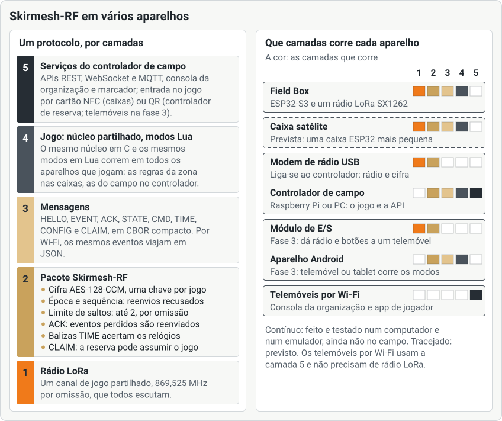

<!--
SPDX-FileCopyrightText: 2026 The Atalaia contributors
SPDX-License-Identifier: CC-BY-SA-4.0
-->

# Manual da organização

Para quem dirige um campo: prepará-lo uma vez, dirigir um dia de jogo a partir da **consola da organização**, sair de apuros e manter as caixas atualizadas. Em inglês: [Game master and field organiser manual](../en/game-master.md). O servidor do site, opcional (contas da organização, agendas, modo alojado), tem o seu próprio manual: [Administração do servidor do site](site-admin.md).

> **Ainda não está pronta para o campo.** A Atalaia está em pré-alfa. O controlador já jogou jogos inteiros com placas a sério numa bancada, mas nenhum controlador, caixa, telemóvel ou servidor foi usado num campo a sério. Cada passo abaixo corresponde ao que o software mostra hoje. Os passos que dependem de hardware dizem **Ainda não testado num campo**. As palavras em *itálico* estão no [glossário](https://atalaia-project.link/glossario/).

> **Versões.** A versão mais recente é a **v0.12.0** (12 de novembro de 2026). Uma funcionalidade marcada **A partir da v0.9.0** precisa dessa versão ou de uma seguinte no controlador, no modem ou na caixa, como o texto indica. **Vindo da v0.9.0 ou anterior, atualiza o controlador e as caixas ao mesmo tempo para a v0.10.0 ou seguinte**, e grava de novo por USB o modem de rádio USB; a partir da v0.10.0 nada tem de ir junto: vê [Atualizar as caixas](#update-the-boxes).

## Índice

**A. [Preparar um campo](#set-up-a-field)** (uma vez)
[Do que precisas](#what-you-need) · [Telemóvel ou Raspberry Pi](#phone-or-raspberry-pi) · [Abrir a consola da organização](#open-the-gm-console) · [Códigos de acesso e códigos de um dia](#access-codes-and-day-codes) · [Região e canal de rádio](#radio-region-and-channel) · [Mudar de canal](#change-the-channel) · [Adotar as caixas](#adopt-the-boxes) · [O mapa do campo](#the-fields-map) · [Balizas interiores](#indoor-beacons) · [Regras do check-in e o cartaz](#check-in-rules-and-the-poster) · [Identidade, língua das caixas e equipas guardadas](#branding-box-language-and-saved-teams) · [Controlador de reserva](#standby-controller)

**B. [Dirigir um dia de jogo](#run-a-game-day)**
[Lista](#game-day-checklist) · [Criar um jogo](#create-a-game) · [Ligaduras](#medic-kit) · [Atribuir as caixas](#assign-boxes) · [A mesa do check-in](#the-check-in-desk) · [Etiquetas de quem joga](#players-tags) · [Marshals](#marshals) · [Começar o jogo](#start-the-game) · [Durante o jogo](#during-the-game) · [Saídas](#outputs) · [Alvos](#targets) · [Terminar o jogo](#end-the-game)

**C. [Resolver problemas](#recover-from-problems)**
[Uma caixa presa num jogo terminado](#a-box-is-stuck-in-an-ended-game) · [Tirar uma caixa do jogo](#take-a-box-out-of-its-game) · [Uma caixa ou o rádio ficam calados](#a-box-or-the-radio-goes-quiet) · [O controlador reiniciou ou perdeu a chave do jogo](#the-controller-restarted-or-lost-the-game-key) · [O controlador foi reinstalado ou perdeu os dados](#the-controller-was-reinstalled-or-lost-its-data) · [O relógio do controlador](#the-controller-clock) · [Promover o de reserva](#promote-the-standby) · [Um dispositivo de jogo perdeu o módulo de E/S](#a-phone-prop-lost-its-io-pod) · [Resolução de problemas](#troubleshooting)

**D. [Atualizar caixas, modem e controlador](#update-boxes-modem-and-controller)**
[Atualizar as caixas](#update-the-boxes) · [Atualizar o modem](#update-the-modem) · [Atualizar o controlador](#update-the-controller) · [As definições do módulo de E/S](#the-io-pods-settings)

**E. [Modos da comunidade](#community-modes)**

**Anexo. [Dados e privacidade](#data-and-privacy)**

<a id="how-the-pieces-fit"></a>
## Como encaixam as peças

- O **controlador de campo** é a base. Guarda a pontuação oficial, ouve todas as caixas pelo rádio e serve a consola. É um Raspberry Pi com um modem de rádio USB, ou um telemóvel Android. Vê *[controlador de campo](https://atalaia-project.link/glossario/#glossario-controlador-de-campo)*.
- A **consola da organização** é uma página web que o controlador serve. Abres-a num telemóvel, num tablet ou num portátil, no Wi-Fi do campo.
- As **caixas** são os dispositivos de jogo. Jogam sozinhas e falam com o controlador por *[LoRa](https://atalaia-project.link/glossario/#glossario-lora)*.
- **Quem joga** usa a app nos telemóveis, no mesmo Wi-Fi.
- O **servidor do site** é opcional, para contas, agendas, histórico e controlo remoto. Nenhum jogo fica à espera dele. Vê *[funciona sem internet](https://atalaia-project.link/glossario/#glossario-sem-internet)* e o [manual do servidor do site](site-admin.md).



---

<a id="set-up-a-field"></a>
## Preparar um campo

Faz isto uma vez por campo, por esta ordem. Cada passo diz onde fica na consola.

<a id="num-raspberry-pi-ou-outro-computador-linux"></a>
<a id="what-you-need"></a>
### Do que precisas

- **Um controlador de campo.** Ou um Raspberry Pi com um modem de rádio USB ([guia de montagem do controlador](controller-setup.md), [montar o modem de rádio](modem.md)), ou um telemóvel Android ([guia do controlador no telemóvel](phone-controller.md)). A tabela abaixo diz o que cada um faz.
- **As caixas**, gravadas e configuradas ([manual da Field Box](field-box.md)).
- **Uma rede Wi-Fi no campo.** Os telemóveis de quem joga, a consola e os telemóveis usados como dispositivos de jogo usam-na. Não precisa de internet: um router de viagem, o hotspot de um telemóvel ou a rede que um telemóvel controlador cria. O nome dela vai para o cartaz de check-in.
- **Um telemóvel, tablet ou portátil** para a consola, e **um computador com navegador e impressora** para o cartaz, as etiquetas e o mapa com a quadrícula. A consola dentro da app Atalaia não imprime nem guarda ficheiros.

<a id="phone-or-raspberry-pi"></a>
### Telemóvel ou Raspberry Pi

Os dois servem a mesma consola. Onde diferem:

| | Raspberry Pi | Telemóvel Android |
| --- | --- | --- |
| Rádio para as caixas | Modem de rádio USB | Modem de rádio USB (por USB) ou um módulo de E/S (por USB ou Bluetooth). Sem nenhum, só jogam dispositivos de jogo por Wi-Fi |
| Liberta sozinho uma caixa presa num jogo terminado, mostra-a em **Presas num jogo terminado** | Sim, com um modem a partir da v0.9.0 | Só com um modem de rádio USB a partir da v0.9.0. Um módulo de E/S não consegue dizer que caixas ficaram presas |
| **Libertar todas as caixas que não estão neste jogo** | A partir da v0.9.0 (a forma ligada ao canal a partir da v0.10.0) | A partir da v0.9.0 (a forma ligada ao canal a partir da v0.10.0) |
| Procurar um canal calmo (medição de ruído) | Com o modem | Com o modem ou o módulo de E/S |
| Códigos de um dia (**Definições › Códigos de acesso temporários**) | Sim | Não |
| Imprimir o cartaz, as etiquetas e o mapa com a quadrícula; **Exportar CSV** | No navegador de um computador | No navegador de um computador na rede do campo (não na consola da própria app) |
| Etiquetas de quem joga, importar uma lista de inscrições | Na consola | Na consola, ou no ecrã do próprio controlador |
| Reserva e substituição | `[controller] failover_mode`, `power_source` | **Servidor do site, substituição e ATAK** nas definições da app. Um telemóvel conta sempre como estando a bateria |
| Proteção contra o relógio errado ([o relógio do controlador](#the-controller-clock)) | Sim | A partir da v0.9.0 |
| Chaves das versões de firmware | `[firmware] release_keys` | **Definições › Chaves das versões de firmware** |
| Testado | Numa bancada com placas a sério, não num campo | Num computador e num emulador, não num telemóvel a sério |

<a id="3-abre-a-consola-da-organização"></a>
<a id="open-the-gm-console"></a>
### Abrir a consola da organização

1. Num telemóvel ou portátil no Wi-Fi do campo, abre `https://` *o endereço do controlador* `:8443/console/`, por exemplo `https://192.168.4.1:8443/console/`. Da primeira vez o navegador avisa que não conhece o certificado: é o do próprio campo (a impressão digital está no cartaz de check-in). Aceita-o uma vez, ou instala-o a partir de `http://` *o endereço do controlador* `:8080/api/v1/controller/ca`. A página simples `http://…:8080/console/` não envia o teu código: mostra o endereço https a usar.
   Na app Atalaia também podes tocar em **Organização**, escrever o endereço em **Endereço da consola** e tocar em **Abrir a consola**.
2. Escreve o **Código de acesso (da organização ou só de leitura)** e toca em **Entrar**. A consola lembra-se dele. **Sair** está no canto superior direito.
3. O cabeçalho mostra o jogo, o estado e o relógio, o estado do **Rádio** e os alertas, com o seletor de língua ao lado.

Com o código só de leitura vês tudo, com **Só leitura** no cabeçalho, e não podes mudar nada.

| Separador | Para que serve |
| --- | --- |
| **Jogo** | Criar, começar, pôr em pausa e terminar o jogo. Mensagens, ajustes de pontuação, saídas. |
| **Check-in** | O cartaz, quem joga, os marshals, as réplicas por cronografar, as regras do check-in, os bilhetes impressos, as etiquetas de quem joga. |
| **Campo** | A imagem do campo, os pisos, a quadrícula, as marcações no mapa, as balizas, o ATAK. |
| **Caixas** | A saúde de cada caixa, os comandos do modo, as caixas presas num jogo terminado, as atualizações de firmware, as definições dos módulos de E/S. |
| **Juntar** | Cartões de entrada, códigos QR e texto para caixas e controladores de reserva. |
| **Adotar** | Dar às caixas novas a chave do campo. |
| **Predefinições** | Modos guardados com as suas definições. Pacotes de modos assinados. |
| **Cenários** | Escrever cenários à medida. |
| **Registo** | Acontecimentos e alertas. |
| **Controlador** | O estado do próprio controlador. Promover um de reserva. |
| **Definições** | Região e canal de rádio, caixas que ficaram num jogo perdido, o relógio do controlador, a língua das caixas, a identidade do campo, as equipas guardadas, os códigos de acesso temporários. |

Pode faltar um separador quando o teu controlador não serve essa parte. O separador **Controlador** diz quais.

<a id="access-codes-and-day-codes"></a>
### Códigos de acesso e códigos de um dia

O controlador tem dois códigos permanentes:

- o **código da organização**, que dirige o jogo. Guarda-o para ti;
- o **código só de leitura**, que só vê. Dá-o a marcadores e espectadores.

Para os mostrar num Pi, corre na pasta do controlador, com o utilizador dele:

```
cd /opt/atalaia/controller
sudo -u atalaia python3 -m atalaia_controller tokens --config /etc/atalaia/controller.toml
```

Num telemóvel controlador, toca em **Mostrar os códigos** em **Códigos de acesso**.

Os **códigos de um dia** são para quem mais precisar da consola durante algum tempo: um árbitro, a mesa do check-in, um GM visitante. Só no Raspberry Pi.

1. Abre **Definições**, **Códigos de acesso temporários**.
2. Escreve um nome, por exemplo *Árbitro Ana, sábado*.
3. Escolhe o que o código pode fazer:
   - **Só ler**: acompanhar o jogo;
   - **Ler e gerir marshals**: acompanhar, e ainda juntar, mudar e retirar marshals. Mais nada: este código não confirma check-ins nem aceita bilhetes (um marshal aceita bilhetes com o próprio check-in de marshal, na app);
   - **GM completo**: tudo o que o código da organização faz, menos fazer códigos. É este que se dá à mesa do check-in, limitado a um jogo.
4. Escolhe quanto tempo dura (8 horas é um dia de jogo, 7 dias o máximo) e, se quiseres, um só jogo.
5. Toca em **Fazer código de acesso**. O código aparece **uma só vez**, com um código QR. A pessoa lê-o com a câmara do telemóvel e a consola abre com a sessão já iniciada (um código só de leitura abre o marcador). Copia-o logo: não volta a aparecer.

A lista abaixo mostra o que cada código pode fazer, quando termina e quando foi usado pela última vez. **Revogar** termina um de imediato, por exemplo se um telemóvel se perder: esse telemóvel fica sem sessão em poucos segundos. Os códigos também terminam sozinhos. No controlador, `tokens --create "Árbitro Ana" --scope gm --ttl 8h` faz o mesmo, `--list` lista-os e `--revoke <id>` termina um.

Se um registo ou uma captura de ecrã com o código da organização saiu para fora, define novos `gm_token` e `read_token` na secção `[api]` das definições do controlador e reinicia-o: os códigos antigos deixam de funcionar. Os códigos já não aparecem no registo do controlador.

<a id="radio-region-and-channel"></a>
### Região e canal de rádio

Todas as caixas e o controlador usam **um canal**. Escolhe-o antes do primeiro jogo.

1. Abre **Definições**. Em **Região de rádio**, confirma a **Região**: **Europa (EU868, 868 MHz)** ou **Taiwan (AS923, 920–925 MHz)**. Só a mudes se o campo estiver na outra região, e só se o modem e todas as caixas forem feitos para ela.
2. Em **Canal de rádio do campo**, escolhe uma destas:
   - **Manter o canal recomendado**: toca em **Usar 869,525 MHz (recomendado)** na Europa. Dá o máximo de tempo de emissão (10 %) e de potência (500 mW) que as regras europeias permitem.
   - **Procurar um canal calmo**: toca em **Procurar**. O rádio escuta os canais possíveis sem emitir, **cerca de 60 segundos no total**, repartidos entre eles, e mostra-os do mais calmo para o mais ruidoso, com uma sugestão. Toca em **Usar** para aceitar. Nada muda até aceitares.
   - **Canal ao acaso**: **Tirar um canal**. Normalmente calha um canal de 1 % e 25 mW.
   - **Escolher da lista**: escolhe um e toca em **Usar este canal**.
3. Um canal de 1 % e 25 mW mostra um aviso: menos alcance, e com muitas caixas pode faltar tempo de emissão. Um canal de 0,1 % não é recomendado.

O canal fica bloqueado enquanto existir um jogo: **Há um jogo em curso: termina-o para mudar de canal.** A [página do rádio](https://atalaia-project.link/radio/) explica porquê 869,525 MHz. Ainda não testado num campo.

<a id="change-the-channel"></a>
### Mudar de canal

Podes mudar de canal entre jogos. As caixas ligadas, livres e ao alcance seguem o controlador. As que estão desligadas ou longe não.

1. Termina o jogo. Pede a quem opera as caixas que as ligue todas e as mantenha perto.
2. Em **Definições › Canal de rádio do campo**, escolhe o canal novo como acima.
3. O painel diz **A avisar as caixas livres no canal antigo (…) de que o campo vai para …: dito *n* de 3 vezes**. Demora cerca de 5 segundos. Depois: **O controlador já mudou para …**. As caixas livres que ouviram o aviso seguem-no e anunciam-se em cerca de 15 segundos.
4. Toca em **Procurar caixas** (no painel do canal ou na janela de convites). Também procura nos últimos quatro canais do campo as caixas que estavam ausentes quando o canal mudou, e diz-lhes para mudar. Diz **Procurou-se também nos canais anteriores: …**. As respostas podem demorar até 30 segundos.
5. Uma caixa que continue em falta: liga-a perto do controlador e toca outra vez em **Procurar caixas**. Se mesmo assim não aparecer, adota-a de novo ([Adotar as caixas](#adopt-the-boxes)) ou dá-lhe um cartão de entrada.

Num canal com pouco tempo de emissão, as procuras nos canais anteriores são racionadas para o rádio ficar dentro da sua parte legal: num canal de 1 %, duas ou três por hora. A consola diz então **Não se procurou nos canais anteriores** e quantos minutos esperar; a pergunta no canal novo seguiu na mesma. Um canal de 0,1 % não permite nenhuma procura.

<a id="adopt-the-boxes"></a>
### Adota as caixas

Cada caixa nova precisa da chave do campo uma vez. Abre **Adotar**. Três maneiras:

- **Cabo USB**: liga a caixa ao USB do controlador com um cabo de dados. Toca em **Procurar caixas**, confirma o nome e o MAC da caixa, toca em **Adotar** e confirma.
- **Cartão de campo**: toca em **Gerar o cartão de campo**. Escreve os bytes num cartão NTAG215 ou NTAG216 (com a app num telemóvel Android, ou [com o leitor de uma caixa](#write-cards-with-a-box)). Encosta o cartão uma vez a cada caixa nova. **O cartão é o segredo-mestre do campo.** Guarda-o fechado à chave. Se se perder ou for copiado, muda a chave (num Pi: `join-key --rotate`), reinicia o controlador, adota de novo todas as caixas e destrói os cartões antigos.
- **Emparelhar por código (rádio)**: uma caixa não adotada mostra um código de 6 algarismos. Toca em **Procurar caixas pelo rádio**, escolhe a caixa pelo nome (confere o **id** no ecrã se duas tiverem o mesmo nome), escreve o código e toca em **Emparelhar**.

Uma caixa que pertence a outro campo pede primeiro o seu **PIN de administração**. Vê o [manual da Field Box](field-box.md).

<a id="the-fields-map"></a>
### O mapa do campo

Opcional, mas o limite é o que faz os telemóveis de quem joga avisarem quando sai do campo.

1. Abre **Campo**.
2. Carrega uma imagem com **Carregar imagem do campo** (PNG, JPEG ou WebP, até 4 MB), ou toca em **Carregar o campo de um mapa**: encontra o campo, marca os cantos do contorno (3 a 12), toca em **Desenhar a imagem do campo** e depois em **Usar como campo**. Fica guardada a imagem, o lugar dela no mapa e o **limite do campo**. Essa página precisa de internet enquanto a usas (OpenStreetMap, Overpass, Nominatim e imagens aéreas, a partir do teu navegador). Para que nada saia do campo, desliga-a em **Definições › Obtenção de mapas** e carrega uma imagem.
3. **Arrasta as caixas** para o sítio onde estão.
4. **Edifício com vários pisos**: marca-o para um edifício com vários pisos. Cada piso tem a sua planta.
5. **Quadrícula no mapa**: linhas com letras e colunas com números, para se dizer «estou em C4». A app de quem joga desenha a mesma quadrícula e diz a cada pessoa a sua quadrícula. **Imprimir o mapa com a quadrícula** imprime a planta com a lista do que está em cada quadrado (no navegador de um computador).
6. **Marcações no mapa**: zonas seguras, respawns, bases, o estacionamento, primeiros socorros, objetivos. Escolhe quem vê cada uma: toda a gente, uma equipa ou só a organização.
7. **Posição no mapa (ATAK)**: dá a dois cantos opostos da imagem a latitude e a longitude, para mostrar as caixas nos mapas ATAK (`[atak]` nas definições do controlador).

<a id="indoor-beacons"></a>
### Balizas interiores

Opcional. No interior o GPS é fraco. Com balizas Bluetooth do tipo iBeacon nas divisões, o telemóvel de quem joga pode dizer ao controlador em que divisão está. O controlador mostra a divisão, nunca um ponto ao metro.

1. Em **Campo**, por baixo de **Marcações no mapa**, abre **Balizas interiores** e toca em **Adicionar uma baliza**.
2. Escreve o **UUID**, o **Major** e o **Minor** (da app ou da etiqueta da baliza), a **Divisão** (por exemplo «Átrio») e, para agrupar divisões, uma **Zona**. Num campo de vários pisos escolhe o **Nível**. O major e o minor juntos têm de ser diferentes em cada baliza. Usa material iBeacon padrão (não Eddystone). Não uses o major 45253: é o das caixas.
3. Para mostrar a divisão no mapa, toca em **Pôr na planta** e clica onde está a baliza.
4. Toca em **Guardar**. **Editar** muda uma baliza (o major e o minor ficam), **Apagar** tira-a.

**As caixas de campo também são balizas.** Uma caixa num jogo emite também como iBeacon. Põe-na na planta em **Campo** (o nível e o lugar dela) e ela aparece em **Caixas de campo como balizas**, com o nome da caixa como divisão (toca em **Divisão** para lhe dar outro). **Desativar** faz os telemóveis ignorarem uma caixa; desmarca **As caixas de campo emitem como balizas** para as parar todas (as caixas sabem-no no jogo seguinte). Uma caixa que não está numa planta não é baliza. Põe as caixas antes do jogo: o telemóvel lê a lista quando começa a partilhar.

Só partilha a posição quem marcou **Partilhar a minha posição com o jogo durante este jogo** no check-in, e num campo com balizas ainda pode escolher **Só GPS**. O telemóvel comunica a baliza mais forte da tua lista de 5 em 5 segundos. As posições vão para os aparelhos ATAK da organização, não para a consola. Ainda não testado com balizas reais.

<a id="check-in-rules-and-the-poster"></a>
### Regras do check-in e o cartaz

1. Abre **Check-in**. Em **Regras do check-in**, define:
   - **Confirmação**: **automática**, ou **pela organização ou um marshal**.
   - **Número de federado**: **não pedir**, **opcional** ou **obrigatório**, e o rótulo (por exemplo FPA). A app nunca verifica o número.
   - O **país** do campo (duas letras, por exemplo `PT`). Vazio: `PT` se o fuso horário do controlador for o de Portugal, nenhum nos outros casos. `PT` mostra os textos de APD e as APD de Portugal; outro país mostra **Filiação numa associação** e as associações que o projeto conhece para ele.
   - **Filiação numa APD** (em Portugal) ou numa associação noutros países: marca **Verificar a filiação em APD à receção**; marca **Pedir a data de validade e verificá-la** para verificar a validade; marca as **APD aceites** (nenhuma marcada: qualquer). Junta uma que falte em **Juntar uma APD própria**. Com esta regra ativa, o cartão tem de ser visto no check-in: vê [A mesa do check-in](#the-check-in-desk) e [Dados e privacidade](#data-and-privacy).
   - **Réplicas por pessoa e jogo** e **Máximo de participantes por jogo**.
   - **Registos de cronografagem guardados (dias)** e **Dados dos jogos guardados (dias)**: de 30 a 3653; por omissão 365 para as leituras e 90 para os dados dos jogos ([Dados e privacidade](#data-and-privacy)).
   - **Uma cronografagem vale**: **o dia todo** ou **só este jogo**.

   Toca em **Guardar**. Com um servidor do site e `[sync] branding = "site"`, estas regras vêm do servidor e a consola mostra-as só para leitura.
2. Toca em **Imprimir o cartaz** (num computador). Abre uma página A4. Imprime-a uma vez e afixa-a no check-in: serve para todos os jogos e não leva segredos. Se o Wi-Fi tem palavra-passe, escreve-a na página e toca em **Desenhar o código do Wi-Fi** para um código QR do Wi-Fi; a palavra-passe não é guardada nem enviada.
3. O formulário **Cartaz de check-in** define **Endereços https do controlador (um por linha)**, **Nome da rede Wi-Fi do campo** e **Só para este jogo**. Se o cartaz não puder ser feito, a página diz porquê: o HTTPS está desligado, não há endereço, ou o texto é grande demais para um código QR.

**Etiquetas de réplicas.** Os marshals encontram uma réplica na lista do cronógrafo pela etiqueta QR dela. Quem joga faz a sua na app; também as podes imprimir. Na linha de uma pessoa toca em **Imprimir etiquetas**, ou em **Imprimir as etiquetas de quem já fez check-in** no topo. Abre uma página com uma etiqueta de 30 × 30 mm por réplica. Imprime-a num computador, recorta e cola. Cada QR leva só o código da etiqueta (**ATL-** e oito caracteres).

<a id="branding-box-language-and-saved-teams"></a>
### Identidade, língua das caixas e equipas guardadas

Nas **Definições**:

- **Língua das caixas**: a língua dos ecrãs das caixas; por omissão a da consola. Um jogo mantém a língua com que foi criado. A consola avisa quando um nome tem letras que os tipos de letra das caixas não têm (a maior parte das letras chinesas, o cirílico): as caixas desenham «?» ou um quadrado vazio.
- **Identidade do campo**: o nome, o logótipo, a imagem de fundo e a cor do campo, mostrados na app, no marcador, no cartaz e na consola. PNG, JPEG ou WebP; carrega só imagens que possas usar. As caixas não mostram o logótipo. Com `[sync] branding = "site"` este cartão diz **Vem do servidor do campo** e as mudanças fazem-se lá.
- **Equipas guardadas**: o nome e o emblema da equipa de um clube, para escolher quando crias um jogo. As **Equipas do servidor do campo** aparecem à parte e não se editam aqui.
- **Sugestão do cartaz de check-in**: se a consola sugere imprimir o cartaz depois de criares um jogo.

<a id="standby-controller"></a>
### Controlador de reserva

Um segundo controlador pode acompanhar o jogo em curso e assumir se o principal parar. Ainda não testado num campo.

**Monta-o**

1. Monta o segundo controlador como o primeiro: um Pi com o seu próprio modem de rádio USB, ou um telemóvel com rádio. A mesma região de rádio.
2. Dá-lhe a **mesma chave de entrada do campo**: num Pi, `[join] key` nas definições dele (mostra a do principal com `join-key`); num telemóvel, **Definições › Chave de entrada do campo**.
3. Escolhe o modo de substituição nos dois:
   - **Manual** (por omissão): és tu que promoves o de reserva ([Promover o de reserva](#promote-the-standby)).
   - **Automático**: um de reserva assume depois de três sinais em falta, cerca de 30 segundos. Usa-o só depois de o experimentares no teu campo. Num Pi: `failover_mode = "auto"` em `[controller]`; num telemóvel: **Substituição automática** em **Servidor do site, substituição e ATAK**. Reinicia o controlador.
4. Num Pi, define `power_source` em `[controller]`: `3` corrente (por omissão), `2` bateria grande, `1` bateria pequena. Quando dois controladores se candidatam, ganha o que tem melhor alimentação. Um telemóvel conta sempre como bateria pequena, por isso cede a um Pi ligado à corrente.

**Junta-o a cada jogo**

1. Depois de criares o jogo, abre **Juntar** no controlador principal. Em **Para**, escolhe **um controlador de reserva** e toca em **Gerar**.
2. Na consola do de reserva, abre **Juntar**, cola o texto em **Entrar como controlador de reserva** e toca em **Entrar no jogo**. Diz **Este controlador está agora de reserva no jogo …**.
3. O texto leva também os sítios onde puseste as caixas e as escolhas das balizas. Depois de mudares ou pores uma caixa, ou de alterares essas escolhas, gera-o outra vez e cola-o outra vez: o de reserva aceita-o como uma atualização.

Um controlador de reserva não começa o jogo (**Este controlador não está a mandar no jogo**), não gera dados de entrada, não volta a enviar fins de jogo nem liberta caixas. O separador **Controlador** dele mostra o papel **de reserva**.

---

<a id="run-a-game-day"></a>
## Dirigir um dia de jogo

<a id="game-day-checklist"></a>
### Lista para o dia do jogo

1. Carrega as caixas, o controlador e os telemóveis. Monta todas as antenas.
2. Arranca o controlador. Confirma que o **Rádio** diz **ligado** e que não aparece a faixa amarela do relógio ([O relógio do controlador](#the-controller-clock)).
3. Abre a consola. Confirma o canal em **Definições**.
4. Afixa o cartaz, se ainda não está afixado.
5. Cria o jogo ([Criar um jogo](#create-a-game)).
6. Convida as caixas. Espera por **Tudo pronto para começar: cada papel tem uma caixa**. Vê no separador **Caixas** se há caixas **presas num jogo terminado**.
7. Se usas um controlador de reserva, junta-o ([Controlador de reserva](#standby-controller)).
8. Abre a mesa do check-in. Confirma quem joga, atribui equipas, acrescenta marshals, grava etiquetas se o modo as pedir.
9. Pede aos marshals que cronografem as réplicas. Confirma que **Réplicas por cronografar** está vazio.
10. Faz o briefing de quem joga. Começa o jogo.
11. Vigia o **Registo**, as **Caixas** e a pontuação.
12. Termina o jogo. Exporta a lista de check-in se precisares. Carrega tudo.

<a id="create-a-game"></a>
### Criar um jogo

1. Abre **Jogo**. Sem jogo a decorrer vês **Novo jogo**.
2. Preenche:
   - **Nome do jogo** (até 64 caracteres).
   - **Modo ou predefinição**: um modo incluído ou instalado, uma predefinição guardada, ou um cenário.
   - **Equipas**: nomes separados por vírgulas, pela ordem dos botões das caixas, por exemplo `red, blue`. As cores conhecidas são red, blue, green, yellow, orange e purple. De 1 a 8 equipas.
   - **Nomes e emblemas das equipas** (opcional). As caixas continuam a mostrar a cor.
   - **Duração (minutos)**: `0` quer dizer sem limite.
   - **Squads por equipa**: `0` quer dizer só equipas (até 16). Com um cenário, também **A quem vão os objetivos de um squad** e **Objetivos no início**.
   - **Modificadores**: por exemplo **Códigos** ([abaixo](#modifiers-scenarios-and-presets)).
   - **Props com uma função própria**: por exemplo **Ligaduras** ([Ligaduras](#medic-kit)).
   - **Parâmetros do modo**: as definições do modo, cada uma com uma descrição curta.
3. Toca em **Criar jogo**.

Se se ouviram caixas livres, abre logo **Caixas para este jogo** ([Atribuir as caixas](#assign-boxes)). Se não, a consola pode sugerir imprimir o cartaz.

As definições não mudam depois de o jogo existir. **Para as mudar, termina este jogo e cria outro.**

<a id="modes"></a>
#### Modos

| Modo (inglês) | Português | Notas |
| --- | --- | --- |
| Domination | Domínio | Uma caixa ou várias. O tempo a premir e os pontos são parâmetros. |
| Hold-All Domination | Domínio Total | Uma equipa só pontua enquanto tiver todas as caixas. |
| Bomb / Rush | Bomba / Rush | Tempos de rastilho, de armar e de desarmar. Uma explosão termina o jogo e vence a equipa que armou; um desarme não o termina (usa **Terminar**). **Códigos de equipa** (`red=1234,blue=5678`), **Fumo quando explode** e **Sirene quando explode** opcionais ([Saídas](#outputs)). |
| Sabotage | Sabotagem | Rondas da bomba até acabar o tempo: uma explosão pontua para os atacantes, um desarme para os defensores. |
| Last Stand | Último Elemento | Atacantes, defensores, contagem para a derrota. |
| Kill Confirmed | Baixa Confirmada | Precisa de etiquetas de quem joga. |
| Respawn and Lives | Reentradas e Vidas | Precisa de etiquetas, ou de botões de equipa. |
| Player Check-in | Registo de Presença | Precisa de etiquetas de quem joga. |
| Master and Satellites | Mestre e Satélites | Sirene opcional na mestre quando uma equipa tem todos os satélites ([Saídas](#outputs)). |
| Progressive Domination | Domínio Progressivo | Uma caixa ativa de cada vez. |
| Hacking Terminal | Hackeia o terminal | Funciona sem o controlador. Enigma: código, fios ou sequência. |
| VIP / Payload | VIP / Carga | O VIP partilha a posição a partir da app. |
| Money Factory | Fábrica de Dinheiro | Precisa de etiquetas. |
| Target Windows | Janelas de Alvo | Precisa de um alvo na caixa ([Alvos](#targets)). Ainda não testado em hardware. |
| Codes (modificador) | Códigos (modificador) | Códigos no teclado ao lado de qualquer modo. |
| Medic Kit (função) | Ligaduras | Um kit ao lado de qualquer modo ([Ligaduras](#medic-kit)). |
| Objectives (função) | Objetivos | As caixas de um cenário à medida. |

A [página dos modos](https://atalaia-project.link/modos/) mostra cada um com uma animação.

<a id="modifiers-scenarios-and-presets"></a>
#### Modificadores, cenários e predefinições

- **Códigos**: marca-o em **Modificadores** e escreve `algarismos:tipo[:pontos][:equipa]` separados por vírgulas. O tipo é `points`, `hint` ou `unlock`, por exemplo `4711:points:50,0815:hint,2222:unlock:red`. Cada código vale uma vez por jogo. Tu vês todos os códigos; o registo mostra quem usou cada um.
- **Cenários**: um jogo à medida, com objetivos. Abre **Cenários**, escreve ou cola o YAML (ou usa **Blocos**), toca em **Verificar** e depois em **Instalar**. Em **Jogo**, escolhe-o em **Modo ou predefinição** e marca **Objetivos**, e depois dá a cada caixa um dos nomes do cenário em **Juntar**. Os **gatilhos** de um cenário podem acionar saídas das caixas (uma sirene durante alguns segundos, no máximo 600 s) quando objetivos se cumprem ou falham, ou quando o jogo começa ou acaba. O [guia do controlador](../../../controller/README.md#scenarios) (em inglês) tem o formato.
- **Predefinições**: abre **Predefinições**, toca em **Nova predefinição**, escolhe um modo e os parâmetros, dá-lhe um nome e toca em **Guardar**.

<a id="medic-kit"></a>
### Ligaduras

As Ligaduras (em inglês **Medic Kit**) põem caixas de kit ao lado de qualquer modo. Quem foi atingido lê a sua etiqueta no kit e mantém um botão premido para receber o tratamento.

1. Em **Novo jogo**, em **Props com uma função própria**, marca **Ligaduras**.
2. Define os parâmetros:
   - **Segundos a premir o botão para receber o tratamento**: de 1 a 120 (10 por omissão). Largar antes do tempo cancela.
   - **Ligaduras no kit**: de 1 a 999 (5).
   - **Tratamentos por pessoa no jogo, em todos os kits**: 0 para sem limite (2).
   - **Segundos de espera entre dois tratamentos da mesma pessoa**: 0 para sem espera (0).
   - **Equipa que o kit serve**: vazio para todas.
   - **Língua do ecrã do kit**: `pt`, `en`, `de` ou `zh-tw`; vazio para a língua do jogo.
3. Dá a uma ou mais caixas o papel **medic** quando as convidares. Uma caixa de kit precisa de leitor NFC e de botões de equipa; usa o ecrã e o som se os tiver. Um telemóvel usado como dispositivo de jogo também pode ser um kit. O jogo espera por uma caixa de kit como por qualquer outro papel.
4. O modo precisa de [etiquetas de quem joga](#players-tags): grava uma para cada pessoa.

Durante o jogo o **Registo** diz ***pessoa* recebeu tratamento (ligaduras no kit: …; tratamentos neste jogo: …)** e **Um kit de ligaduras ficou vazio**. Quem joga também vê cada tratamento. Para repor um kit, abre **Caixas** e, na linha do kit, em **Comandos**, toca em **Repor as ligaduras**; aparece **enviado**. O kit recusa etiquetas falsificadas ou de outro jogo e pessoas de uma equipa que não serve, e o ecrã diz porquê.

<a id="6-atribui-as-caixas"></a>
<a id="assign-boxes"></a>
### Atribuir as caixas

Um jogo só começa quando cada papel de que precisa tem uma caixa (ou um telemóvel usado como dispositivo de jogo).

**Convidar caixas pelo rádio** (o modo normal, para caixas adotadas):

1. Depois de **Criar jogo**, abre a janela **Caixas para este jogo**. Ou toca em **Convidar caixas** no separador **Jogo**.
2. As caixas livres anunciam-se até cerca de 20 segundos depois, e depois mais ou menos uma vez por minuto. **Procurar caixas** pergunta-lhes já.
3. As caixas do último jogo vêm marcadas. Marca as que queres e escolhe o **Papel** de cada uma.
4. Toca em **Convidar (** *n* **)**. Acompanha o **Estado**: **a enviar**, **convidada**, **aceitou, a juntar-se**, **juntou-se**.
5. A janela diz **Tudo pronto para começar: cada papel tem uma caixa**, ou **Ainda à espera de uma caixa para:** *funções*.

Uma caixa pode responder **recusou: noutro jogo** ([Uma caixa presa num jogo terminado](#a-box-is-stuck-in-an-ended-game)), **recusou**, **falhou** ou **grande demais**. Se disser **o modo não está na caixa**, toca em **Enviar os modos em falta**: a caixa vai buscar os modos assinados que lhe faltam pelo Wi-Fi do campo (precisa das chaves de modos das caixas e de HTTPS).

**Cartões de entrada, códigos QR e texto** (para uma caixa fora do alcance do rádio, ou um telemóvel usado como dispositivo de jogo):

1. Abre **Juntar**. Em **Para**, escolhe **uma caixa**, escolhe o **Papel no modo** e deixa o **Identificador** em **automático**.
2. Toca em **Gerar**. A consola mostra um **código QR**, um **Texto de entrada** (`atalaia:join:…`) e os bytes de um **Cartão NFC (NTAG215/216)**.
3. A caixa lê o cartão no leitor NFC; um telemóvel lê o código QR em **Dispositivo de jogo › Entrar num jogo**. **Este código e o cartão levam a chave do jogo**: mostra-os só a quem está a montar o campo.

<a id="write-cards-with-a-box"></a>
**Escrever um cartão com uma caixa em vez de um telemóvel** (na bancada ou na oficina): um telemóvel Android com a app Atalaia (ou uma app NFC que escreva memória NDEF em bruto) é a forma normal de escrever cartões de entrada, o cartão de campo e etiquetas de quem joga. Sem ele, uma Field Box com leitor NFC escreve-os ela própria, a partir de um computador ligado pelo cabo USB (firmware a partir da v0.12.0):

1. Liga a caixa por USB. Não pode estar num jogo.
2. Copia os bytes do cartão na consola (os bytes do **Cartão NFC**, os do cartão de campo, ou o **Registo NDEF (hex)** de uma etiqueta de quem joga).
3. Corre `python3 tools/nfc_write.py --port <a porta da caixa> "<os bytes>"` a partir do repositório Atalaia (`--pin <PIN de administração>` numa caixa com firmware de lançamento; a ferramenta precisa do pyserial).
4. Nos 10 segundos seguintes, encosta um cartão NTAG213, NTAG215 ou NTAG216 virgem ao leitor da caixa. A ferramenta diz **write: ok** e quantas páginas escreveu. A caixa escreve só a memória de utilizador do cartão, lê-a toda de volta e recusa um cartão pequeno demais para os bytes ou um cartão bloqueado.

`--read` lê um cartão de volta para o verificar. Retira o cartão no fim: a caixa não entra num jogo com o cartão que acabou de escrever.

<a id="the-check-in-desk"></a>
### A mesa do check-in

O check-in está aberto desde o momento em que o jogo é criado. **Fechar o check-in** pára-o e **Abrir o check-in** volta a abri-lo. A mesa trabalha no separador **Check-in** da consola, com o código da organização ou com um [código de um dia](#access-codes-and-day-codes) **GM completo**. Os marshals também podem fazer o check-in à mão, verificar o cartão e aceitar bilhetes impressos na app deles, com o próprio check-in de marshal: sem código da organização nem código de um dia ([manual de marshal](marshal.md#bilhetes-impressos-e-inscrições)).

**Quem fez o check-in com a app**

1. A lista **Check-ins** mostra o **Nome**, o **Estado**, a **Equipa › squad**, o **Papel** e as **Réplicas** de cada pessoa.
2. Com a confirmação **pela organização ou um marshal**, quem está **à espera de confirmação** tem **Confirmar**.
3. Dá a cada pessoa uma **Equipa** (e um **Squad**) e um **Papel**: **jogador/a**, **líder de squad**, **VIP**, **marshal**, **organização** ou **espectador/a**. A app da pessoa apanha a mudança logo.

**Inscrições e bilhetes impressos** (jogos feitos **Da agenda do site** de um servidor, ou a partir de uma lista importada):

1. Quem se inscreveu aparece como **por chegar** até chegar.
2. Quem tem a app faz o check-in como de costume. Quem traz um **bilhete impresso**: no cartão **Bilhete impresso**, lê ou cola o código (`atalaia:ticket:…`) e toca em **Fazer o check-in**, ou deixa um marshal aceitá-lo em **Marshal › Check-in com bilhete** na app. Diz **Check-in feito: *nome*.**, ou que a pessoa espera pela verificação do cartão quando a regra de APD está ativa. Quem fez o check-in na app e espera por ti não fica confirmado só com a leitura: o cartão mostra o nome que essa app deu, a hora do check-in e o nome que está na lista para o bilhete, e (a partir da v0.11.0) se essa app provou que é o telemóvel da inscrição (uma cópia do bilhete não consegue; a lista mostra-o num distintivo **telemóvel da inscrição** ou **telemóvel por provar**). **É a mesma pessoa: confirmar** confirma (o aviso diz *confirmado*), a não ser que ainda falte a verificação do cartão da regra de APD; **Não é: anular o check-in da app e fazer o check-in a quem tem o bilhete** desfaz o check-in da app, tira esse telemóvel do jogo e faz o check-in de quem tem o bilhete com o nome da lista. Uma filiação cujo resultado guardado não passa também nunca entra só com a leitura: **Fazer o check-in mesmo assim (exceção)** regista a exceção. Um bilhete funciona como uma etiqueta: quem tiver uma cópia pode mostrá-la ([manual de marshal](marshal.md#bilhetes-impressos-e-inscrições)). Ler duas vezes não muda nada, e diz isso. O check-in guarda quem aceitou o bilhete e quando (**ticket_scanned_by**, **ticket_scanned_at** no CSV: o identificador de quem joga do marshal, ou *gm*); cada telemóvel (e o código da organização) aceita até 60 bilhetes por minuto.
3. Um bilhete é recusado se não estiver na lista deste jogo, ou se a pessoa pediu entretanto um bilhete mais novo (só o mais recente serve).
4. Quem se inscreveu e não tem bilhete nem app: toca em **Chegou** na linha dela.

**A verificação do cartão** (quando o número de federado ou a regra de APD estão ligados):

1. Cada linha mostra o que a pessoa escreveu e, com a regra de APD, um veredicto: **válida**, **caducada**, **APD não aceite** ou **em falta**. Nada é verificado em linha.
2. Compara com o cartão da pessoa. Marca **cartão visto, confere**. Com a regra de APD ativa, toda a gente fica **à espera da verificação do cartão** até alguém o marcar, mesmo com confirmação automática e bilhete impresso.
3. Sem cartão? **Admitir sem o cartão** admite a pessoa na mesma e regista-o com o motivo. Nunca ficas bloqueado.
4. Podes corrigir a APD, o número ou a validade na linha; depois marca outra vez.

**Sem a app**: **Check-in à mão** pede um nome, uma preferência de equipa e as réplicas (e o cartão, com a regra de APD ativa). Marca **Partilhar a minha posição com o jogo durante este jogo** só se a pessoa concordar.

**Listas**: **Exportar CSV** guarda a lista (no navegador de um computador). **Importar uma lista de inscrições** lê uma lista CSV ou JSON de outra plataforma: escolhe o ficheiro, indica a **Origem**, toca em **Verificar o ficheiro** (não muda nada e mostra cada linha como nova, alterada, igual, ignorada ou recusada), marca que o campo tem base legal própria para a lista e toca em **Importar**. As pessoas aparecem como **por chegar**. Importar o mesmo ficheiro outra vez não muda nada. Num telemóvel controlador, o mesmo está em **Lista de inscrições**, no ecrã do controlador.

**Réplicas por cronografar** lista as réplicas declaradas e o estado de cada uma; o início avisa se alguma ainda não foi cronografada. **Retirar** tira uma pessoa do jogo.

<a id="players-tags"></a>
### Etiquetas de quem joga

Baixa Confirmada, Reentradas e Vidas, Registo de Presença, Ligaduras e Fábrica de Dinheiro precisam de uma etiqueta NFC por pessoa. O controlador assina cada etiqueta com a chave do jogo, por isso uma etiqueta só funciona no jogo para que foi feita: cada jogo novo precisa de etiquetas novas. Usa etiquetas NTAG213, NTAG215 ou NTAG216 virgens. Cria primeiro o jogo: um jogo terminado não tem chave.

- **Na consola**: em **Check-in**, o cartão **Etiquetas de quem joga**. Escolhe o **Identificador de quem joga** e a **Equipa** (ou **Sem equipa**) e toca em **Fazer a etiqueta**. Com o Chrome num telemóvel Android (consola por HTTPS), toca em **Escrever com o NFC deste aparelho** e encosta uma etiqueta virgem ao telemóvel. Caso contrário a consola mostra o **Registo NDEF (hex)** e **Descarregar o ficheiro NDEF**, para gravar com a app Atalaia ou uma app NFC (ou [com o leitor de uma caixa](#write-cards-with-a-box), na bancada).
- **Num telemóvel controlador**: em **Etiquetas de quem joga**, toca em **Escrever etiquetas de quem joga** enquanto um jogo decorre.
- **Um marshal** grava-as na app de marshal, no Wi-Fi do campo ([manual de marshal](marshal.md)).

**Uma etiqueta pode ser copiada.** Quem ler uma etiqueta com um telemóvel pode gravar os mesmos bytes noutra, e uma caixa aceita a cópia até o jogo acabar. Trata as etiquetas como crachás: entrega-as no briefing e mantém-nas à vista até lá. Bloquear uma etiqueta só para leitura impede escrever por cima, não copiar. Pormenores: [SECURITY.md](../../../SECURITY.md#player-tags-can-be-copied).

<a id="marshals"></a>
### Marshals

Só quem está na lista **Marshals** pode agir como marshal.

1. A pessoa faz primeiro o check-in como participante.
2. Em **Marshals**, toca em **Acrescentar marshal** e escolhe **Quem fez o check-in**. Se quiseres, escreve um **Identificador** ou um **Nome**. O controlador dá um identificador como M-01.
3. A tabela mostra a **Chave de assinatura** como **registada** ou **à espera da app**.
4. **Retirar** tira um marshal logo. As medições dele por enviar são recusadas até o voltares a acrescentar.

Vê o [manual de marshal](marshal.md).

<a id="start-the-game"></a>
### Começar o jogo

1. Abre o separador **Jogo**. O jogo está **pronto**. Vê as **Definições do jogo** se quiseres.
2. A consola avisa antes de começares:
   - **Nenhuma caixa se juntou para:** *funções*;
   - **Falta a uma caixa o que o seu papel precisa:** *caixa (papel): o quê*, por exemplo uma zona sem botões de equipa, ou um papel de alvo sem sensor de impacto;
   - uma nota quando falta algo opcional, quando uma saída está instalada mas não ativada na caixa, ou quando a saída simples de uma caixa está **não verificado** (confirma-a antes do jogo);
   - **Há *n* réplicas declaradas por cronografar**.
3. Toca em **Começar** e depois em **Sim**. Se faltar alguma coisa, o botão diz **Começar mesmo assim**: começar assim fica registado e todas as consolas são avisadas.

Na janela **Caixas para este jogo**, **Começar o jogo** pergunta primeiro **Rever primeiro as outras definições do jogo?** (**Rever definições**, **Começar agora** ou **Voltar**). As caixas e as apps demasiado antigas para dizer o que têm nunca são verificadas. Um controlador de reserva não começa um jogo.

<a id="during-the-game"></a>
### Durante o jogo

**O separador Jogo**

- **Estado**, **Tempo de jogo**, **Duração**, **Modo**, **Equipas** e o canal de rádio.
- **Pausa**, **Retomar** e **Terminar** perguntam primeiro.
- **Mensagem para todas as caixas**: até 100 caracteres, mostrada nas caixas e nos telemóveis de quem joga.
- **Ajustar pontuação**: uma equipa, **Pontos (negativo para penalizar)** e um **Motivo**, e depois **Aplicar**.
- **Equipas deste jogo**: os nomes e os emblemas podem mudar até ao fim.
- **Pontuação**: o total de cada equipa, com um gráfico. Os pontos de uma caixa chegam com o estado dela, até cerca de 15 segundos depois. Um número mais pequeno *estimado* ao lado de um total preenche esse intervalo; só o número sem *estimado* é oficial.
- **Partilhar o marcador com quem joga**: um código QR que quem joga lê na app, em **Participante**, para acompanhar o jogo sem fazer o check-in.

**O separador Caixas** mostra o **N.º**, o **Nome** (com uma etiqueta por cada módulo ou saída), o **Papel**, a **Dona** (podes mudá-la), o **Nível**, a **Bateria** (**fraca** abaixo de 20 %), o **Sinal**, a **Última notícia**, o **Firmware** e a **Época** de cada caixa. Os comandos do modo, como **Repor as ligaduras**, estão em **Comandos**. Uma caixa de que não há notícias mostra **sem notícias**.

**O separador Registo** lista os acontecimentos à medida que chegam (capturas, bombas, códigos, baixas, tratamentos, objetivos) com o tempo de jogo, a equipa e a caixa. **Filtrar acontecimentos** e **Só críticos** reduzem a lista. Os alertas aparecem por cima: **Rádio em baixo: o modem USB não responde.**, **A caixa N não dá notícias há mais de 90 s.**, **Envio falhado**, **Erro do modem**, **O controlador agora é** *papel*, e acontecimentos críticos como mexerem numa caixa.

**Mapa e marcador.** **Campo** mostra as caixas onde as puseste. As posições de quem joga vão para os aparelhos ATAK da organização, não para a consola. O marcador para uma TV é `http://` *endereço* `:8080/scoreboard#token=` *código só de leitura* (junta `&lang=en` para inglês).

**GM remoto.** Com um servidor do site e o GM remoto ligado, uma pessoa da organização com sessão iniciada lá pode começar, pôr em pausa, retomar e terminar o jogo e desligar todas as saídas ([manual do servidor do site](site-admin.md#remote-gm)).

<a id="outputs"></a>
### Saídas

**Saídas**, no separador **Jogo**, lista as saídas das caixas do jogo: uma sirene, um estroboscópio ou uma máquina de fumo. Uma saída só funciona se a administração da caixa a ativou na própria caixa, com o PIN de administração ([manual da Field Box](field-box.md)). Uma saída instalada mas não ativada mostra uma etiqueta como **horn · instalada, não ativada pela administração da caixa**, e a verificação antes de começar assinala-a se o jogo a acionaria.

1. Escreve os **Segundos** (5 por omissão, até 600) e toca em **Ligar 5 s**.
2. Confirma que não está ninguém ao lado e toca em **Sim**. Desliga-se sozinha passado esse tempo, ou o limite da própria caixa, se for menor.
3. **Desligar** desliga uma logo. **Desligar todas as saídas** desliga todas as saídas do jogo.

Uma caixa aceita um novo arranque no máximo de 2 em 2 segundos. As saídas só funcionam com o jogo a decorrer, e as caixas desligam-nas quando o jogo é posto em pausa ou acaba. O **Registo** diz quem acionou o quê.

**Modos que acionam saídas.** A *Bomba / Rush* aciona o **fumo** (smoke) e a **sirene** (siren) da caixa da bomba quando explode, durante os segundos em **Fumo quando explode** e **Sirene quando explode** (até 10). O *Mestre e Satélites* toca a **sirene** da mestre quando uma equipa tem todos os satélites. Vazios, nada é acionado. O formulário diz que saídas um modo ou um cenário usaria, e a verificação antes de começar diz quando uma caixa não tem nenhuma delas.

Os **telemóveis usados como dispositivos de jogo** com um módulo de E/S usam as saídas e os módulos do módulo de E/S da mesma maneira, e têm as mesmas etiquetas e linhas. Vê o [manual do telemóvel como dispositivo de jogo](phone-prop.md). Ainda não experimentado em hardware.

<a id="targets"></a>
### Alvos

Uma caixa pode levar um **alvo** na porta de expansão: uma placa que sente cada impacto. *Janelas de Alvo* é o modo dele (papel **target**). Ainda não testado em hardware.

1. **Antes do jogo**, liga o alvo à caixa e depois deixa a caixa entrar. **Caixas** mostra uma etiqueta como **target 1.0.0: hit**. Se o papel precisa de um sensor de impacto e a caixa não o tem, a verificação antes de começar di-lo: vê o cabo.
2. **Durante o jogo**, um impacto enquanto a caixa mostra a cor de uma equipa dá-lhe os **Pontos por um tiro na janela**, e o **Registo** diz **Um alvo foi atingido**. **Impacto mais fraco que conta** (0-255) ignora toques leves: acerta-o num jogo de teste.
3. **Se um alvo deixar de responder**, o **Registo** diz ***caixa* perdeu um módulo: …** e a etiqueta desaparece. Ligado outra vez, conta logo.

<a id="end-the-game"></a>
### Terminar o jogo

1. Toca em **Terminar** e depois em **Sim**, ou deixa a **Duração** esgotar-se. Alguns modos terminam o jogo sozinhos (uma explosão da Bomba, o limite de tempo do Sabotagem na caixa); o **Registo** diz então **O jogo terminou: terminado pela caixa** *nome*. Com o jogo em pausa, uma caixa não o consegue terminar: usa **Terminar**.
2. O controlador avisa as caixas pelo rádio. Se não conseguir, diz **Não foi possível avisar as caixas pelo rádio**: vê [Uma caixa presa num jogo terminado](#a-box-is-stuck-in-an-ended-game).
3. As caixas mostram **FIM DO JOGO** e, passados 30 segundos, **PRONTA**.
4. O separador **Jogo** diz **O jogo «…» terminou.** O marcador e os telemóveis de quem joga mostram a equipa vencedora.
5. Exporta a lista de check-in com **Exportar CSV** se precisares.

O controlador guarda os acontecimentos e as pontuações de cada jogo na sua base de dados durante os dias que definiste ([Dados e privacidade](#data-and-privacy)). O registo do próprio controlador é o registo do sistema: num Pi, `journalctl -u atalaia-controller`. Com um servidor do site, o histórico de cada jogo está nas páginas da organização dele.

---

<a id="recover-from-problems"></a>
## Resolver problemas

<a id="a-box-is-stuck-in-an-ended-game"></a>
### Uma caixa presa num jogo terminado

Uma caixa que estava desligada quando o jogo terminou nunca ouviu o fim. Ligada outra vez, continua nesse jogo: mostra o ecrã do jogo e responde aos convites com **recusou: noutro jogo**. Uma caixa nunca sai de um jogo sozinha.

Tenta por esta ordem:

1. **Espera cerca de um minuto.** A partir da v0.9.0 o controlador ouve a caixa, volta a enviar sozinho o fim desse jogo e a caixa mostra **PRONTA**. Fá-lo entre jogos e enquanto um jogo está a ser preparado, para um jogo terminado por minuto no máximo (a partir da v0.10.0). **Depois de um jogo começar (ou enquanto está em pausa), espera que esse jogo termine**, para que o jogo em curso fique com o tempo de emissão do rádio: durante um jogo, usa o passo 2. O jogo aparece no separador **Caixas** em **Presas num jogo terminado**, com os números das caixas ouvidas (as 32 ouvidas por último, e quantas mais), há quanto tempo, o sinal e quantas vezes foi reenviado.
2. **Toca em Libertar** na linha desse jogo para enviar o fim já, também durante um jogo. O aviso diz se seguiu: o rádio tem de estar ligado, e um jogo a decorrer noutro canal tem de terminar primeiro.
3. **O controlador já não conhece o jogo** (foi reinstalado ou perdeu os dados): usa [Libertar todas as caixas que não estão neste jogo](#the-controller-was-reinstalled-or-lost-its-data).
4. **Tira a caixa do jogo na própria caixa**: vê [Tirar uma caixa do jogo](#take-a-box-out-of-its-game).

**Do que cada passo precisa.** Tudo isto é **A partir da v0.9.0**:

| Passo | Controlador | Modem de rádio USB | Caixa |
| --- | --- | --- | --- |
| 1 e 2: reenvio automático, **Presas num jogo terminado**, **Libertar** | v0.9.0 | v0.9.0. O modem não se atualiza pelo ar: [grava-o de novo por USB](#update-the-modem) | Qualquer versão |
| 3: **Libertar todas as caixas que não estão neste jogo** | v0.9.0; a partir da v0.10.0, uma forma nova que indica o canal | Qualquer | A mesma forma que o controlador: uma caixa v0.9.0 e um controlador v0.10.0, ou o contrário, não se entendem (atualiza os dois). Tem de ter entrado no jogo já com esse firmware |
| 4: **Sair do jogo** na caixa, ou `@leave` | Não é preciso | Não é preciso | v0.9.0 |

Com um modem mais antigo a lista diz **O modem de rádio não consegue dizer que caixas ficaram num jogo terminado: atualiza o seu firmware**. Num telemóvel controlador com um módulo de E/S como rádio diz **Um módulo de E/S não consegue dizer que caixas ficaram num jogo terminado**: liga antes um modem de rádio USB. Ainda não experimentado em hardware.

<a id="take-a-box-out-of-its-game"></a>
### Tirar uma caixa do jogo

Na própria caixa, com o PIN de administração dela. Também serve para tirar uma caixa de um jogo ainda a decorrer: **põe primeiro o jogo em pausa**, porque o menu não abre com o jogo a decorrer e o controlador ao alcance (assim quem joga não o abre a meio do jogo). A consola passa a ver essa caixa como terminada, e o jogo continua para as outras. Uma caixa presa não ouve nada do controlador, por isso o menu dela abre 5 minutos depois de ser ligada. **A partir da v0.9.0** no firmware da caixa; pôr primeiro em pausa é preciso a partir da v0.10.0.

1. Mantém `*` premido 3 segundos.
2. Escreve o PIN de administração e carrega em `#`.
3. Escolhe **Sair do jogo** e carrega em `#`, e outra vez `#` para confirmar.

A caixa mostra o último ecrã do jogo e depois **PRONTA**. Mantém o campo, as chaves, o Wi-Fi e os modos e pode ser convidada logo. Uma caixa sem teclado faz o mesmo por USB, com `@leave` e o PIN de administração. Os passos de quem opera a caixa estão no [manual da Field Box](field-box.md#take-a-box-out-of-its-game).

Uma caixa com firmware mais antigo não tem este menu. Os passos 1 e 2 de [Uma caixa presa num jogo terminado](#a-box-is-stuck-in-an-ended-game) libertam-na na mesma, porque precisam de um modem mais novo, não de uma caixa mais nova. Caso contrário, a única saída é apagar a caixa por USB e adotá-la de novo ([guia do firmware](firmware.md)).

<a id="a-box-or-the-radio-goes-quiet"></a>
### Uma caixa ou o rádio ficam calados

- **Uma caixa perde contacto**: continua a jogar e põe-se em dia. Aproxima-a, ou junta uma caixa repetidora. Passados 90 s o Registo diz **A caixa N não dá notícias há mais de 90 s.**
- **Rádio em baixo**: o cabeçalho mostra **Rádio: sem modem** ou o Registo diz **Rádio em baixo: o modem USB não responde.** Vê o cabo, a definição `[modem] port` e se o modem está gravado. O ecrã do modem diz **LINK OK** quando o controlador fala com ele. Vê a [resolução de problemas do modem](modem.md).
- **O modem foi feito para outra região** (**O modem USB foi feito para …, mas o campo está em …** em **Definições**): usa um modem e caixas feitos para a região do campo, ou volta à região anterior. Nenhum jogo começa até coincidirem.

<a id="the-controller-restarted-or-lost-the-game-key"></a>
### O controlador reiniciou ou perdeu a chave do jogo

- **O controlador reiniciou**: o jogo em curso continua a partir do último tempo e das últimas pontuações guardadas. Não há nada a fazer.
- **Reiniciou com `persist_game_key = false`**: a chave do jogo não ficou guardada, por isso o jogo só pode ser terminado. Toca em **Terminar**: o fim chega na mesma às caixas. A partir da v0.9.0 o reenvio às caixas presas também funciona depois de um reinício assim.

<a id="the-controller-was-reinstalled-or-lost-its-data"></a>
### O controlador foi reinstalado ou perdeu os dados

1. **Repõe uma cópia de segurança, se tiveres** ([guia de montagem do controlador](controller-setup.md)). Com a mesma chave de entrada as caixas continuam a funcionar.
2. **Sem cópia de segurança**, dá ao controlador novo a mesma chave de entrada do campo, se ainda a tiveres. Caso contrário, adota de novo todas as caixas.
3. **Caixas ainda no jogo antigo.** O controlador já não conhece esse jogo, por isso não o consegue terminar. Abre **Definições**, **Caixas que ficaram num jogo perdido**, toca em **Libertar todas as caixas que não estão neste jogo** (ou **Libertar todas as caixas que estão num jogo** quando não há jogo a decorrer) e confirma com **Libertar**. Todas as caixas deste campo, neste canal, que estejam noutro jogo e não ouçam o controlador desse jogo há minuto e meio saem dele e mostram **PRONTA**. Uma caixa desligada e ligada entretanto é libertada logo. **A partir da v0.9.0**, no controlador e nas caixas; **a partir da v0.10.0 (ainda não publicada)** a libertação indica o canal, e o controlador e as caixas têm de estar os dois na v0.10.0.

Uma caixa cujo controlador ainda fala com ela não é afetada, por isso um jogo que outro controlador deste campo faça no mesmo canal fica com as suas caixas. Uma caixa noutro canal, ou que entrou no seu jogo depois da libertação, também não é afetada. A libertação é recusada num controlador de reserva, com o relógio do controlador errado, com o relógio do controlador mais de 5 minutos adiantado em relação ao dispositivo que usas, e mais de uma vez em 30 segundos. Se disser que o relógio está adiantado, reinicia o controlador (o acerto desaparece) ou verifica o relógio deste dispositivo. Ainda não experimentado em hardware.

<a id="the-controller-clock"></a>
### O relógio do controlador

O campo não tem internet, por isso o controlador não pode perguntar a hora à rede. **Um Raspberry Pi 4 não tem relógio próprio**: depois de um corte de energia arranca com uma hora antiga. Um Pi 5 só guarda a hora com a bateria dele. Os jogos, os temporizadores e o rádio não dependem do relógio; as datas, os códigos de quem joga, os certificados e o apagar de dados antigos dependem.

Quando o relógio está atrasado, todos os ecrãs mostram uma faixa amarela: **O relógio do controlador está errado.** O controlador não apaga nada até ser corrigido.

1. Abre a consola num telemóvel ou portátil com a hora certa.
2. Na faixa, ou em **Definições › Relógio do controlador**, toca em **Acertar o relógio do controlador por este dispositivo**. Só o código da organização o pode fazer.
3. Diz **O relógio do controlador é agora …**.

O relógio só avança: nunca para antes dos dados mais recentes que o controlador guarda, e nunca mais de 14 dias de cada vez quando já parece certo. O acerto dura até o controlador reiniciar, por isso um Pi 4 precisa dele depois de cada corte de energia. Quem fez o check-in com o relógio muito atrasado pode ter de o fazer outra vez (a app pede). **Libertar todas as caixas que não estão neste jogo** é recusado enquanto o relógio estiver errado, e enquanto estiver mais de 5 minutos adiantado em relação ao dispositivo a partir do qual o envias. Para corrigir o relógio de vez, vê o [guia de montagem do controlador](controller-setup.md). Um telemóvel controlador tem a mesma faixa e o mesmo botão **a partir da v0.9.0**.

<a id="promote-the-standby"></a>
### Promover o de reserva

Quando o controlador principal deixa de responder e a substituição é manual:

1. Abre a consola do de reserva, separador **Controlador**.
2. Toca em **Promover a controlador** e confirma.
3. O Registo diz **O controlador agora é** *controlador ativo*. O jogo continua.

Com a substituição automática, o de reserva fá-lo sozinho passados cerca de 30 segundos. Se o antigo voltar, fica a mandar o que tem o mandato mais recente: o antigo afasta-se sozinho.

<a id="a-phone-prop-lost-its-io-pod"></a>
### Um dispositivo de jogo perdeu o módulo de E/S

O ecrã do telemóvel diz **A ligação ao módulo de E/S perdeu-se. A religar…** e tenta sozinho. Se respondeu outro módulo, ou se desistir, quem opera o telemóvel abre o menu de administração do jogo e toca em **Ligar o módulo outra vez**. Antes do jogo, a verificação de arranque verifica esse telemóvel sem o módulo e diz o que falta. Durante o jogo, um módulo perdido dá um alerta no **Registo**. Vê o [manual do telemóvel como dispositivo de jogo](phone-prop.md).

<a id="troubleshooting"></a>
### Resolução de problemas

| Problema | O que fazer |
| --- | --- |
| **Sem ligação ao controlador de campo. A voltar a ligar…** | Verifica o teu Wi-Fi, o endereço do controlador e se o controlador está a correr. |
| **Código de acesso errado.** | Usa o código da organização ([Códigos de acesso e códigos de um dia](#access-codes-and-day-codes)). O código só de leitura não muda nada. Um código de um dia revogado ou expirado é esquecido. |
| Faixa amarela **O relógio do controlador está errado.** | [O relógio do controlador](#the-controller-clock). |
| **Ainda não se ouviu nenhuma caixa livre.** | As caixas têm de estar adotadas e mostrar **PRONTA** no canal do campo. Espera até um minuto, toca em **Procurar caixas**, confirma a região e o alcance. Depois de mudar de canal: [Mudar de canal](#change-the-channel). |
| **Procurar caixas** não procurou nos canais anteriores | As procuras são racionadas nos canais com pouco tempo de emissão. Espera os minutos indicados. Num canal de 0,1 %, adota de novo a caixa em falta. |
| Uma caixa diz **recusou: noutro jogo** | [Uma caixa presa num jogo terminado](#a-box-is-stuck-in-an-ended-game). |
| Uma caixa fica num jogo antigo depois de o controlador ter sido reinstalado | [O controlador foi reinstalado ou perdeu os dados](#the-controller-was-reinstalled-or-lost-its-data). |
| **O início espera por uma caixa … para:** *papel* | Convida ou junta uma caixa para esse papel, ou toca em **Começar mesmo assim**. |
| **O cartaz não pode ser feito** | HTTPS desligado, nenhum endereço ou grande demais: define `[api] tls_names` ou `[checkin] urls`, e um nome de campo mais curto. |
| Quem joga não consegue fazer o check-in | Tem de estar no Wi-Fi do campo, e o cartaz tem de listar um endereço que funcione. Confirma que o **Certificado do campo** coincide. |
| Um bilhete impresso é recusado | Não está na lista deste jogo, ou a pessoa tem um bilhete mais novo. Usa **Chegou** ou faz o check-in à mão. |
| Os telemóveis avisam que estão fora do campo sem estarem | Desenha de novo o limite em **Campo**. |
| Um marshal diz **Pede à organização para te acrescentar** | Acrescenta-o em **Check-in › Marshals**. Faz primeiro o check-in como participante. |
| Não consigo mudar as definições de um jogo | Termina o jogo e cria outro. |
| **Este controlador não está a mandar no jogo** | É um de reserva. Usa o controlador principal, ou [promove-o](#promote-the-standby). |
| Não se consegue mudar o canal | **Há um jogo em curso.** Termina-o primeiro. |
| A atualização do firmware de uma caixa falha | [Atualizar as caixas](#update-the-boxes): o jogo tem de estar **pronto**, a caixa precisa do Wi-Fi do campo, de bateria, e de uma versão em que o firmware dela confie. |

Mais ajuda: o [guia do controlador](../../../controller/README.md) (em inglês), as [Discussões](https://github.com/vakaobr/atalaia-project/discussions) do projeto e os outros manuais: [quem joga](player.md), [marshals](marshal.md), [quem opera as caixas](field-box.md).

---

<a id="update-boxes-modem-and-controller"></a>
## Atualizar caixas, modem e controlador

<a id="update-the-boxes"></a>
### Atualizar as caixas

Atualizas o firmware das caixas pelo Wi-Fi do campo, entre jogos. Feito numa bancada com uma placa a sério; ainda não testado num campo.

**v0.12.0: nada tem de ser atualizado ao mesmo tempo.** Vindo da v0.11.0, atualiza as caixas quando te der jeito, pelo ar ou por USB: o firmware novo da Field Box deixa uma caixa escrever cartões no seu próprio leitor NFC, a partir de um computador, na bancada ou na oficina ([Escrever um cartão com uma caixa](#write-cards-with-a-box)), e mais nada no campo depende disso. Os controladores, a app de quem joga e o servidor do site só mudam de número de versão, e o modem de rádio USB não precisa de imagem nova. O I/O pod lê cartões com o mesmo controlador do leitor, agora mais rigoroso; gravá-lo de novo por USB é opcional. Vindo da v0.10.0, vale também o parágrafo da v0.11.0 abaixo.

**v0.11.0: nada tem de ser atualizado ao mesmo tempo.** Vindo da v0.10.0, atualiza os controladores, as caixas, o servidor do site e a app de quem joga quando te der jeito: as apps, as listas e os controladores mais antigos continuam a funcionar com os mais recentes. O firmware da Field Box só mudou em código que a imagem endurecida usa, e nenhuma caixa usa essa imagem, por isso atualizar as caixas pelo ar é opcional; o modem de rádio USB não precisa de imagem nova. Para um check-in na app mostrar ao marshal que veio do **telemóvel da inscrição**, atualiza o servidor do site, o controlador e a app de quem joga; até lá, os check-ins na app aparecem como **telemóvel por provar** e continuam a entrar ([manual de marshal](marshal.md#bilhetes-impressos-e-inscrições)). Vindo da v0.9.0 ou anterior, continua a valer a regra da v0.10.0 abaixo.

**v0.10.0: atualiza os controladores e as caixas ao mesmo tempo.** A partir da v0.10.0, **Libertar todas as caixas que não estão neste jogo** indica o canal: uma caixa v0.9.0 recusa a de um controlador v0.10.0, e uma caixa v0.10.0 recusa a de um controlador v0.9.0. Atualiza o controlador (Raspberry Pi ou telemóvel) e todas as caixas para a v0.10.0 no mesmo dia, e grava de novo o modem de rádio USB com a imagem da v0.10.0, por USB (não tem atualização pelo ar). Enquanto não estiverem os dois atualizados, uma caixa presa continua a sair do jogo com **Sair do jogo** na própria caixa, `@leave` na consola USB dela, ou o reenvio automático do controlador.

**Antes da primeira atualização depois da v0.8.0: as chaves das versões**

A partir da versão seguinte à v0.7.0, o projeto assina o firmware com uma chave de CI nova (id `a4f6002b0122b131`). A antiga (id `32b3c815ac30ad43`) foi retirada.

1. **Confirma a lista do controlador.** Um Pi cujo `controller.toml` não tem a linha `[firmware] release_keys` já tem as chaves certas. Se as lista à mão (o ficheiro de exemplo listava), deixa a lista exatamente com a chave raiz `5tzPkN0AJSn+g34CP59linCRf/fcaWFc7GAAg7qzYNc=` e a chave de CI `76eY5BoMQ4RHohhX/8iSUlIUA5o5Entfk7EFBUxpbSY=`, tira a antiga `rIO8ogMU3LRLLtnt6Rys+URdKYfmNv5mxvuRJQsX9Tw=` e reinicia o controlador. Nada tira a chave antiga por ti. Num telemóvel controlador, **Definições › Chaves das versões de firmware**: um telemóvel que manteve a lista por omissão passou sozinho para a nova; uma lista editada precisa da mesma mudança.
2. **As caixas na v0.6.1 ou anterior** só confiam na chave raiz e na chave de CI antiga, por isso recusam as versões mais novas. Grava-as uma vez por USB com a versão mais recente, sem as apagar (mantêm o campo, as chaves e as definições): vê o [guia do firmware](firmware.md). As caixas na v0.7.0 aceitam as versões mais novas pelo ar.
3. **As caixas na v0.4.0 ou anterior** têm uma tabela de partições antiga que nenhuma atualização pelo ar consegue mudar. A consola recusa a oferta (*precisa de uma tabela de partições nova, é preciso instalar por USB uma vez*). Grava-as uma vez por USB, como acima.

**Oferecer a atualização**

1. Abre **Caixas**. Em **Atualizações de firmware**, escolhe a **Imagem (.bin)** e a sua **Versão (.release.json)** da versão publicada e toca em **Carregar**. O controlador só aceita versões assinadas com uma chave da sua lista, e só com HTTPS ligado.
2. Cria um jogo e deixa as caixas entrarem. Enquanto o jogo está **pronto**, toca em **Atualizar todas as caixas**, ou em **Atualizar para** *versão* numa caixa.
3. Acompanha cada caixa: **enviada, à espera da caixa**, **instalada, a reiniciar**, **concluída**, **falhou**, **revertida** ou **sem notícias da caixa**. **Enviar de novo** repete uma oferta.
4. O jogo não começa enquanto houver uma atualização em curso, a não ser que toques em **Deixar de esperar pelas atualizações em curso**.

Cada caixa precisa do nome e da palavra-passe do Wi-Fi do campo na sua configuração, e de bateria suficiente (30 % ou mais, se tiver medidor). Uma caixa cujo firmware novo falhe o autoteste volta sozinha ao antigo.

<a id="update-the-modem"></a>
### Atualizar o modem

O modem de rádio USB **não se atualiza pelo ar**: grava-se de novo por USB. Fá-lo em cada versão que o mude, e quando a consola disser **O modem de rádio não consegue dizer que caixas ficaram num jogo terminado: atualiza o seu firmware**. Os avisos de caixas presas precisam de um modem a partir da v0.9.0.

1. Pára o controlador (num Pi: `sudo systemctl stop atalaia-controller`; num telemóvel: **Parar o controlador**).
2. Grava a imagem do modem da mesma versão das caixas: [montar o modem de rádio](modem.md).
3. Liga-o outra vez e arranca o controlador. Confirma **LINK OK** no ecrã do modem e **Rádio: ligado** na consola.

Fá-lo entre jogos.

<a id="update-the-controller"></a>
### Atualizar o controlador

- **Raspberry Pi**: segue o [guia de montagem do controlador](controller-setup.md). Faz primeiro uma cópia de segurança. Um jogo em curso sobrevive a um reinício.
- **Telemóvel Android**: instala a app mais nova ([guia do controlador no telemóvel](phone-controller.md)). Pára primeiro o controlador, entre jogos.

Atualiza o controlador, o modem e as caixas para a mesma versão.

<a id="the-io-pods-settings"></a>
### As definições do módulo de E/S

Se um telemóvel usa um **módulo de E/S**, podes mudar a partir da consola as cores dos botões, o brilho do anel, o volume e o interruptor da caixa do módulo. Ainda não experimentado com um módulo a sério.

1. Antes de um jogo começar ou depois de acabar, com o telemóvel do módulo no jogo, abre **Caixas**, painel **Definições dos módulos de E/S**.
2. Define só o que queres mudar e toca em **Enviar ao módulo**. **Voltar primeiro às definições da compilação** anula tudo o que foi enviado antes.
3. Mostra **enviado (1), a aguardar** e depois **aceite pelo módulo**. Sem resposta, volta a tentar durante cerca de quatro minutos e depois diz **sem resposta**.

O módulo guarda as definições depois de reiniciar. Pormenores: [Módulo de E/S, Definições pelo rádio](../../../hardware/io-pod/BUILD.pt.md#definições-pelo-rádio).

---

<a id="community-modes"></a>
## Modos da comunidade

Qualquer pessoa pode partilhar modos de jogo como pacotes assinados através do [registo de modos da comunidade](https://vakaobr.github.io/atalaia-modes/). Está no ar mas **ainda não tem modos**. Feito e testado em software.

1. Na página do registo, procura o modo e a **chave pública do autor**.
2. Se confias nessa chave, junta a metade pública dela ao controlador: num Pi, `keys = ["<44 caracteres>"]` e `index = "https://vakaobr.github.io/atalaia-modes/index.json"` em `[modes]`; num telemóvel, **Definições › Pacotes de modos (controlador de campo)**. Reinicia o controlador.
3. Abre **Predefinições**, **Pacotes de modos assinados**. Confirma a tua chave em **Chaves de modos de confiança:**.
4. Em **Do índice do registo**, toca em **Ler de novo**. Cada pacote mostra o seu **Estado** (**disponível**, **instalado**, **assinado com uma chave em que este controlador não confia**, **a chave foi revogada**, **um modo incluído tem este id**) e se foi **revisto pelo projeto**.
5. Toca em **Instalar** (ou **Atualizar para** *versão*). O controlador verifica primeiro a assinatura, o pacote e os scripts.
6. Sem internet: escolhe o **Pacote (.tar)** e a sua **Versão (.release.json)** e toca em **Enviar e instalar**.

O modo aparece então em **Modo ou predefinição**. Um modo da comunidade corre nas caixas: uma caixa só o vai buscar (**Enviar os modos em falta**) se estiver assinado com uma chave gravada no firmware das caixas. Para escrever um, vê [Submitting a community mode](../../../CONTRIBUTING.md#submitting-a-community-mode) e o [guia do registo](../../community/README.md) (em inglês).

---

<a id="data-and-privacy"></a>
## Dados e privacidade

O que o controlador guarda sobre quem joga, e durante quanto tempo. O lado do servidor do site está no [manual do servidor do site](site-admin.md#data-and-privacy).

- **Os nomes** só aparecem em **Check-in** e aos marshals, nunca nos acontecimentos, no marcador nem nas vistas de quem joga. Os dados pessoais de um check-in (nomes, números de federado) são apagados **30 dias** depois do jogo, por omissão.
- **Os dados dos jogos** (acontecimentos, pontuações e lista de caixas de um jogo terminado) são apagados **90 dias** depois do jogo, por omissão; **as leituras do cronógrafo** (incluindo as cópias de outros campos e as chaves antigas dos marshals) passados **365 dias**. Os dois definem-se em **Regras do check-in**, de 30 a 3653 dias. Com um servidor do site, um jogo nunca é apagado antes de o servidor o ter por inteiro. O resultado de uma equipa, sem identificadores de quem jogou, guarda-se 365 dias. Nada é apagado enquanto o [relógio do controlador](#the-controller-clock) estiver errado.
- **Apagar uma pessoa** no controlador (**Apagar**, ou a pedido dela) avisa também o servidor do site, que apaga a sua cópia dos registos de cronografagem dessa pessoa e a ligação do identificador a uma conta.
- **Filiação numa APD.** Em Portugal o campo tem de conferir o cartão físico no check-in (art. 6.º, n.º 1, al. c), do RGPD; al. f) nos restantes). A pessoa declara a APD, o número e a validade; nada é verificado automaticamente. Quando se marca **cartão visto, confere**, o controlador regista quem marcou e quando, **apaga o número de associado** e guarda a APD, a validade e o veredicto desse dia até os dados do jogo serem apagados. **Admitir sem o cartão** guarda o número e regista o motivo, nunca o número. O servidor do site apaga a cópia dele do número quando o jogo termina.
- **As posições** só são partilhadas por quem marcou **Partilhar a minha posição com o jogo durante este jogo**, uma escolha à parte guardada com a hora e a versão do aviso. O controlador recusa os relatos de posição caso contrário e apaga a posição guardada quando a pessoa deixa de partilhar.
- **As listas de inscrições importadas** precisam de base legal própria do campo, que confirmas antes de **Importar**. Só se leem as colunas `display_name`, `external_ref`, `team_preference`, `federation_number`, `apd_id`, `membership_expires` e `replicas`; qualquer outra coluna (um email, um telefone) é apenas nomeada na verificação.
- **Exportações.** O **Exportar CSV** e as listas impressas são dados pessoais: guarda-os só enquanto o jogo precisar, e depois apaga-os ou destrói-os.
