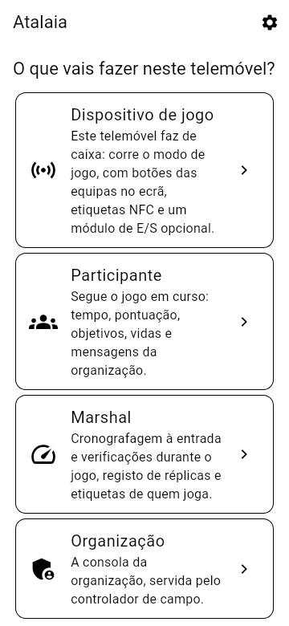
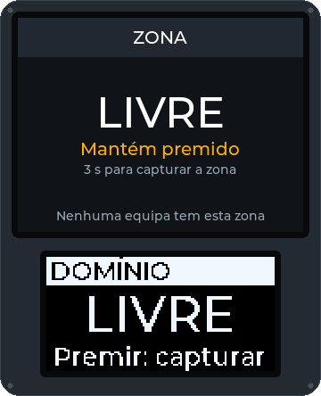
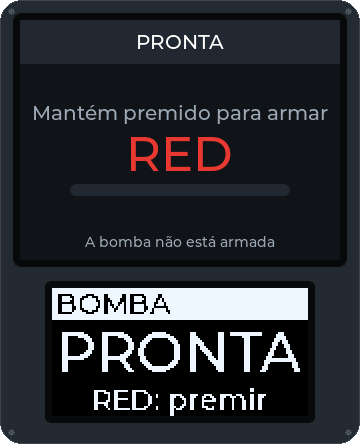

<!--
SPDX-FileCopyrightText: 2026 The Atalaia contributors
SPDX-License-Identifier: CC-BY-SA-4.0
-->

# Manual de quem joga

Para quem joga num campo com a Atalaia. Instalas a app, fazes o check-in no campo, levas as réplicas aos marshals e jogas. Em inglês: [Player manual](../en/player.md).

> **Ainda não está pronta para o campo.** A Atalaia está em pré-alfa. Nenhum telemóvel nem nenhuma caixa a sério foi usado num campo até hoje. Cada passo abaixo corresponde ao que o software mostra hoje. Os passos que dependem de hardware dizem **Ainda não testado num campo**. As palavras em *itálico* estão no [glossário](https://atalaia-project.link/glossario/).

## O que precisas

- Um telemóvel Android com Android 8.0 ou mais recente, ou um iPhone com iOS 15 ou mais recente.
- A rede Wi-Fi do campo. O jogo não precisa de internet. Tudo corre no campo.
- Autorização para a câmara (para ler códigos QR) e, se quiseres partilhar a tua posição, para a localização.
- Um telemóvel que vibre. A app de quem joga nunca faz som.

## 1. Instala a app

A app **ainda não está no Google Play nem na App Store**. Pergunta à organização: pode dar-te o ficheiro de instalação (`atalaia-debug.apk`), ou podes fazê-lo tu com o [guia da app](../../../app/README.md#install-it-on-an-android-phone-from-windows) (em inglês).

### Android

1. Põe o ficheiro `atalaia-debug.apk` no telemóvel (cabo USB, cartão de memória ou uma pasta partilhada). Tem cerca de 150 MB.
2. Abre-o no gestor de ficheiros do telemóvel.
3. Se o Android perguntar, permite **Instalar apps desconhecidas** a esse gestor de ficheiros.
4. Toca em **Instalar** e abre a **Atalaia**.
5. Aceita as autorizações que a app pedir quando as usares: câmara, localização e notificações.

### iPhone

A app para iPhone tem só as funções **Participante**, **Marshal** e **Organização**. Difere do Android nestes pontos:

- É feita num Mac e instalada com um cabo. Vê [o guia do iPhone](../../../app/docs/ios-on-a-mac.md) (em inglês). Com um Apple ID gratuito, a instalação deixa de funcionar ao fim de **7 dias** e tem de ser repetida (as tuas definições ficam).
- **Não há NFC.** Num iPhone não podes usar nem gravar etiquetas NFC.
- A tua posição só é partilhada enquanto a Atalaia está aberta no ecrã.
- Quando te ligas ao Wi-Fi do campo, o iOS diz «sem internet». Fica ligado. Responde **Permitir** quando o iOS perguntar pela rede local.

Ainda não testado num campo: a leitura de códigos QR, as ligações `atalaia://` e a partilha da posição num iPhone.

## 2. Escolhe a língua

A app arranca em **português**, qualquer que seja a língua do telemóvel.

1. No primeiro ecrã, toca na **roda dentada** no canto superior direito. Abre as **Definições**.
2. Em **Língua**, toca em **Português** (ou **English**, **Deutsch**, **中文（台灣）**).
3. Em **Aspeto**, podes escolher **Do sistema**, **Escuro** ou **Claro (sol)**. O claro lê-se melhor ao sol.
4. Volta com o botão de voltar do telemóvel.

As caixas do campo mostram a língua que a organização escolheu para o jogo, não a da tua app.

## 3. Faz o check-in no campo

A organização afixa um **cartaz de check-in** com um código QR. Não leva nenhum segredo.

1. Liga-te à rede Wi-Fi do campo. O nome está no cartaz. O telemóvel pode dizer que não há internet. Não faz mal.
2. Abre a Atalaia. Toca em **Participante**.
3. Toca em **Check-in no campo**.
4. Toca em **Ler o cartaz** e aponta a câmara ao código QR do cartaz. Sem câmara, cola o texto do cartaz (começa por `atalaia:checkin:`) em **Ou cola o texto do cartaz** e toca em **Usar este texto**.
5. A app liga-se ao controlador do campo. Demora uns segundos.
6. Lê **Os teus dados em** *(nome do campo)*. Toca em **Li e quero continuar**.
7. Preenche o formulário. No topo mostra o nome do campo e o **Certificado do campo**, com um código curto. É normal.
   - **Jogo**: escolhe um, se o campo tiver mais do que um aberto.
   - **Nome ou alcunha**: até 32 caracteres. Só a organização e os marshals o veem. Quem joga contigo não.
   - **Número de federado**: só se o campo o pedir. A organização confere o cartão à entrada. A app não o verifica.
   - **Filiação numa APD**: se o campo a pedir, escolhe a tua APD (ou **Não consta da lista**), escreve o número de filiação e a data de validade (AAAA-MM-DD). A app não os verifica: um marshal compara-os com o teu cartão. Se a filiação não for válida para o jogo, o check-in fica à espera de um marshal, que decide. Num campo que a exija para a inscrição, a inscrição é recusada sem filiação válida.
   - **Equipa preferida**: **Qualquer uma**, ou uma equipa. A organização decide a equipa final.
   - **Inscrição online**: só se te inscreveste no site do campo. Vê a [secção 8](#8-se-te-inscreveste-online).
   - **Réplicas que trazes**: marca as réplicas que guardaste antes. Também o podes fazer depois ([secção 4](#4-declara-as-tuas-réplicas)).
8. Toca em **Fazer o check-in**.

Agora vês o **O meu check-in**. Mostra:

- o estado: **À espera de confirmação na mesa da organização.** ou **Check-in feito.** Alguns campos confirmam cada check-in à mão. Vai à mesa se ficar em «à espera»;
- a tua função (**Jogador/a**, **Líder de squad**, **VIP**, **Espectador/a**), a tua equipa (e squad) e o teu identificador;
- as tuas réplicas e o estado de cada uma na cronografagem.

Mais tarde, toca em **Participante** e depois em **Continuar:** *(nome do jogo)* para voltares a esta página.

Se a app disser que algo está mal:

| A app diz | O que fazer |
| --- | --- |
| *O controlador do campo não responde. Estás ligado à rede Wi-Fi do campo?* | Liga-te ao Wi-Fi que está no cartaz. Mantém o Wi-Fi ligado. Tenta outra vez. |
| *O controlador que responde não é o do cartaz …* | **Pára.** Não continues. Avisa a organização. Alguém pode estar a fazer-se passar pelo campo. |
| *Este campo já foi confiado com outro certificado …* | Só se a organização confirmar que mudou de equipamento: toca em **Esquecer este campo** e lê o cartaz outra vez. |
| *Não há nenhum jogo aberto para check-in neste campo.* | A organização ainda não criou um jogo, ou o check-in está fechado. Pergunta-lhe. |
| *Este check-in já não é válido: faz o check-in outra vez.* | Faz o check-in outra vez em **Participante › Check-in no campo**. |

Não precisas de telemóvel para jogar. Faz o check-in na mesa da organização. A organização pode fazer-te o check-in à mão e dar-te um identificador.

## 4. Declara as tuas réplicas

Um *cronógrafo* mede a velocidade a que a tua réplica dispara. Cada campo tem um limite por classe de réplica. **Declara** as réplicas que vais usar neste jogo, para os marshals as poderem cronografar.

1. Em **O meu check-in**, toca em **Escolher as réplicas**.
2. Marca cada réplica que vais usar. Podes escolher até ao número que o ecrã indica.
3. Se a tua réplica não está na lista, toca em **Juntar uma réplica**. Escolhe o **Tipo** (AEG, GBB, HPA, Ferrolho, DMR, Sniper, Pistola ou Caçadeira), a **Classe** e, se quiseres, a **Marca e modelo (opcional)**. Toca em **Guardar**. A app lembra-se dela para os jogos seguintes.
4. Toca em **Guardar**. Vês **Guardado: a organização e os marshals já as veem.**
5. Leva as réplicas ao posto de cronografagem dos marshals.

O símbolo junto de cada réplica mostra em que ponto está:

| Símbolo | Significado |
| --- | --- |
| **por cronografar** | Nenhum marshal a mediu ainda. |
| **aprovada** | Passou. Conforme o campo, vale para o dia todo ou só para este jogo. |
| **recusada** | Está acima do limite. Não a podes usar. Pergunta a um marshal o que fazer. |
| **recusada hoje** | Foi recusada mais cedo, hoje. |
| **retirada** | Foi tirada da lista. |

Uma réplica já cronografada fica declarada. Fala com um marshal se precisares de a mudar.

### Põe uma etiqueta na tua réplica

Depois de guardares uma réplica para um jogo, aparecem dois botões por baixo dela:

- **Mostrar etiqueta**: um código QR grande, com um código por baixo (**ATL-** e oito caracteres). O ecrã fica ligado e com brilho.
- **Partilhar / imprimir etiqueta**: uma imagem para um autocolante de 30 × 30 mm. Abre a partilha do telemóvel, onde podes escolher um serviço de impressão ou guardar a imagem. **Partilhar / imprimir todas as etiquetas**, no fim da lista, faz folhas A4 com várias etiquetas.

Cola a etiqueta na réplica. Um marshal lê-a na lista do cronógrafo e encontra logo a tua réplica. A etiqueta leva só esse código, nada sobre ti. Antes de guardares uma réplica para um jogo, a lista diz que a etiqueta aparece depois de a declarares. Depois de um marshal registar a réplica, a etiqueta é a mesma nos jogos seguintes nesse campo.

Os limites por classe da app vêm da pesquisa do projeto. **Não estão verificados** e não são a lei. A organização do campo e os marshals é que decidem, e qualquer penalização é sempre decidida por uma pessoa. Vê *[cronografagem e joules](https://atalaia-project.link/glossario/#glossario-cronografagem)*.

## 5. Joga

A app **acompanha** o jogo. Capturas as caixas **na caixa**, não no telemóvel.

1. Em **O meu check-in**, toca em **Seguir o jogo**. (Sem check-in: **Participante** e depois **Ler o código QR do marcador**, ou escreve o **Endereço do controlador** e o **Código de acesso** em **Ou escreve** e toca em **Ligar**. A organização dá-te um código só de leitura.)
2. Vês:
   - o nome do jogo, o estado (**pronto**, **a decorrer**, **em pausa**, **terminado**) e o tempo. Com limite de tempo mostra o que falta, **para o fim**;
   - **Tu:** a tua função e equipa, por exemplo *Jogador/a, azul › squad 2*;
   - mensagens da organização (**Organização:** …). São as últimas três;
   - **Pontuação**: um cartão por equipa. A tua equipa tem uma margem grossa. Toca no cartão de uma equipa para destacar a tua, se ainda não tens equipa;
   - **Objetivos**: cada caixa e quem a tem (**Da equipa** *(equipa)* ou **De ninguém**);
   - **Vidas**, quando o modo conta vidas, e as equipas eliminadas;
   - **O que aconteceu**: os últimos 30 acontecimentos, por palavras.
3. Se vires **Sem ligação. A voltar a ligar…**, estás fora do alcance do Wi-Fi. O jogo continua mesmo que não estejas a ver. A app volta a ligar-se sozinha.

Os pontos de uma caixa podem chegar até cerca de 15 segundos depois de aparecerem no ecrã da caixa.

A app mostra **quantas posições podes ver**, mas não desenha um mapa.

### Capturar uma caixa

Uma caixa tem botões grandes coloridos, um por equipa, um ecrã e um anel de luzes. No *Domínio*:

1. Aproxima-te de uma caixa que mostre **ZONA · LIVRE** ou a cor de outra equipa.
2. **Mantém premido o botão da tua equipa.** O ecrã mostra uma barra a encher. Por omissão manténs premido 3 segundos. A organização pode mudar isto. Se largares, a barra esvazia.
3. Quando a barra estiver cheia, a caixa mostra **ZONA OCUPADA** com o nome da tua equipa e o anel fica com a tua cor.
4. Enquanto a tua equipa a tiver, os teus pontos sobem. Outra equipa pode tirá-la da mesma maneira.

### A Bomba

Na *Bomba / Rush* há atacantes e defensores. A organização diz que equipa é qual.

1. Os atacantes **mantêm premido o botão** na caixa da bomba durante 5 segundos, por omissão. A bomba fica **ARMADA** e começa uma contagem (5:00 por omissão).
2. Os defensores têm de **manter premido o botão durante 10 segundos**, por omissão, antes de a contagem acabar. A caixa mostra **DESARMADA** e os defensores ganham.
3. Se a contagem chegar a zero, a caixa mostra **EXPLODIU** e os atacantes ganham.
4. Alguns jogos usam **códigos de equipa**. Então escreves o código da tua equipa no teclado para armar, e o de outra equipa para desarmar.

### Os outros modos

A organização escolhe o modo. A [página dos modos](https://atalaia-project.link/modos/) mostra cada um com uma animação. Em resumo:

| Modo | O que fazes |
| --- | --- |
| Domínio Total | Captura caixas como no Domínio. Uma equipa só pontua enquanto tiver **todas** as caixas. |
| Último Elemento | Os defensores começam com todas as caixas. Quando ficam só com uma, corre uma contagem para a derrota até recuperarem outra. |
| Mestre e Satélites | Captura as caixas satélite. A caixa mestre paga mais pontos por cada satélite que a tua equipa tiver. |
| Domínio Progressivo | Só se pode capturar uma caixa de cada vez. A app e as caixas dizem qual está **ATIVA**. O teu telemóvel vibra quando começa uma nova. |
| Baixa Confirmada | Quem joga leva uma etiqueta NFC. Numa estação, a tua equipa lê as etiquetas inimigas que recolheu para confirmar baixas. |
| Reentradas e Vidas | Encosta a tua etiqueta à caixa de reentrada (ou carrega no botão da tua equipa) para voltares. Cada reentrada custa uma vida. |
| Ligaduras | Se levares um toque, encosta a etiqueta a um kit de ligaduras e mantém premido o botão dele até receberes o tratamento. Cada pessoa tem um número limitado de tratamentos. |
| Hackeia o terminal | Resolve o enigma no teclado do terminal: um código, fios ou uma sequência. Uma resposta errada bloqueia-o por um bocado. |
| Códigos | Escreve um código no teclado de uma caixa para teres pontos, uma pista ou um desbloqueio. Cada código vale uma vez. |
| Fábrica de Dinheiro | Mantém caixas de fábrica. Lê a tua etiqueta na fábrica da tua equipa para levar dinheiro e numa caixa de banco para o depositar. |
| VIP / Carga | Vê [VIP](#vip) abaixo. |

Uma etiqueta é um autocolante, um cartão ou uma pulseira. Um marshal grava a tua em cada jogo, com o teu identificador (aparece em **O meu check-in**). Uma etiqueta só funciona no jogo para que foi gravada. Ainda não testado num campo.

### Squads e líderes de squad

Num jogo grande, cada equipa divide-se em **squads**. A organização põe-te num. Vês isso como *azul › squad 2*. Se és **Líder de squad**:

- a organização pode enviar os objetivos do squad **só a ti**;
- os outros elementos vêem **Ordens para o teu squad: o líder de squad passa-as**, e o telemóvel vibra duas vezes, de leve;
- se o líder estiver ausente, a organização pode enviar os objetivos a todos os elementos.

### VIP

No *VIP / Carga*, uma equipa escolta o seu **VIP** até uma zona de extração. As outras equipas tentam impedi-lo. Se és o VIP:

1. Faz o check-in. A organização põe a tua função em **VIP**.
2. Segue o jogo e liga **Partilhar a minha posição** ([secção 6](#6-partilha-a-tua-posição-e-o-limite-do-campo)).
3. Vai com a tua equipa até à zona de extração. A tua posição fica no controlador e no telemóvel. Só «extraído» chega a toda a gente.

Ainda não testado num campo com GPS a sério.

### Objetivos

Num jogo com um *cenário*, vês **Objetivos do cenário**. Cada objetivo diz em que ponto está:

- **Começa com o jogo**, **Em curso**;
- **Cumprido pela equipa** *(equipa)*;
- **Falhado**, com o motivo: *tomado por outra equipa*, *a bomba foi desarmada*, *o tempo acabou*, *um objetivo anterior falhou* ou *sem vidas suficientes*.

Um objetivo pode dizer **Para a equipa** *(equipa)* ou **Para a equipa** *(equipa)***, squad** *(número)*. Só vês os objetivos que são para ti. Um objetivo escondido aparece quando a organização o revela. Os pontos aparecem como **+10**, por exemplo.

## 6. Partilha a tua posição e o limite do campo

Partilhar a posição é opcional. A tua posição vai só para o controlador do campo, durante o jogo. O controlador decide quem a pode ver: a organização e os marshals, e o teu squad se o jogo o permitir. Se o campo tiver um GM remoto com sessão iniciada no servidor do site, o GM remoto também a vê, enquanto a partilhares; o servidor do site não a guarda. A organização vê-a nos seus aparelhos ATAK, se os usar. A app desenha um mapa do campo com as posições que podes ver (mais abaixo); a consola não desenha quem joga. No *VIP / Carga*, a posição do VIP é o que extrai a equipa.

1. Faz o check-in e toca em **Seguir o jogo**.
2. Enquanto o jogo **decorre**, liga **Partilhar a minha posição**. Diz *Só durante o jogo; o controlador decide quem a vê …*.
3. Autoriza a localização quando o telemóvel perguntar. No iPhone, escolhe **Ao Usar a Aplicação**. No Android 13 ou mais recente, autoriza também as notificações.
4. Uma notificação **Atalaia: a partilhar a posição** fica visível. Desliga **Partilhar a minha posição** para parar. Pára também quando o jogo acaba.

**No interior, se o campo tiver balizas.** Alguns campos põem pequenas balizas Bluetooth nos edifícios. Se este tiver, a app pergunta primeiro, com **Posições no interior**: pode ouvir as balizas do campo enquanto partilhas, e envia apenas qual é a mais forte. Toca em **Continuar** e o Android pede **Bluetooth** (dispositivos próximos) e a **localização**. Toca em **Agora não**, ou recusa, e o resto não muda: a app diz que **as posições no interior estão desligadas** e continua a partilhar a posição por GPS. O Bluetooth tem de estar ligado.

- No interior a tua posição passa a ser a **divisão**. Por baixo do botão diz **A tua posição: Átrio (Rés do chão)**. A organização vê a divisão, não um ponto no chão.
- A app só ouve as balizas do campo e não guarda nada do que ouve. Só ouve enquanto partilhas, e pára quando paras.
- Quando estás fora do alcance de todas as balizas durante alguns segundos, volta a ser partilhada a tua posição por GPS.
- No iPhone as balizas ainda não são usadas: a posição continua a ser por GPS.

**Em que piso estás?** Se o campo tiver vários pisos, enquanto partilhas aparece por baixo do botão uma fila de botões: os nomes dos pisos (por exemplo **R/C**, **Piso 1**) e **Não sei**. O telemóvel não distingue os pisos, por isso dizes uma vez; fica guardado enquanto jogas e vai com a tua posição por GPS, para a tua equipa te ver no piso certo. Escolhe **Não sei** se não souberes: ninguém o adivinha por ti. No interior, a baliza da sala dá o piso e os botões dão lugar a *O teu piso vem da baliza da sala*.

**O mapa do campo.** Se a organização pôs a planta do campo no controlador, um cartão **Mapa do campo** mostra-a: a planta, os locais que a organização marcou para ti (zonas seguras, respawns, estacionamento, primeiros socorros, objetivos, o quartel-general da tua equipa), o limite do campo como contorno com o exterior escurecido, e as posições que podes ver: tu (um ponto com anel) e os outros na cor da sua equipa. Com vários pisos, os botões escolhem o piso mostrado; abre no teu. Um ponto vazio é quem ainda não disse em que piso está. Por baixo do mapa conta as posições que não estão nesta planta (uma baliza que a organização não pôs na planta, uma posição fora da planta). Uma lista curta por baixo diz o que é cada tipo de local. O mapa mostra só o que o controlador te envia: os locais e as posições de outra equipa não estão lá. Não há mapa de ruas, só a planta; um campo sem planta não mostra o cartão.

Se a organização desenhou o **limite do campo**, a app vigia-o **no teu telemóvel**. Nada disso é enviado a ninguém.

- O aviso só aparece se fores participante, líder de squad ou VIP, e só enquanto o jogo decorre.
- Por baixo do botão diz **Este telemóvel vibra se saíres do limite do campo.**
- Quando estiveres fora por um momento (mais do que a precisão do GPS e 10 metros), aparece uma faixa vermelha **Fora do campo. Saíste do limite do campo. Volta para dentro.** O telemóvel dá três vibrações longas. Repete-as todos os minutos enquanto estiveres fora. Não há som.
- Quando voltas para dentro, sentes uma vibração curta.

Ainda não testado num campo. O GPS pode ser fraco debaixo de árvores ou dentro de edifícios.

## 7. Vibrações do telemóvel

Nas **Definições**, **Vibrar nos eventos do jogo** vem ligado. O telemóvel vibra com um padrão, e nunca com som. Valem as definições de silêncio do telemóvel.

| Acontecimento | A vibração |
| --- | --- |
| Uma mensagem da organização | Uma vibração longa |
| Uma caixa da tua equipa foi capturada | Uma vibração curta |
| Uma caixa da tua equipa foi tirada, ou ficou livre | Duas vibrações curtas |
| O jogo começa | Três toques rápidos |
| O jogo acaba | Duas vibrações médias |
| Domínio Progressivo: uma nova caixa ativa | Uma vibração longa e depois uma curta |
| Novas ordens para o teu squad | Duas vibrações curtas |

Vários acontecimentos ao mesmo tempo dão uma só vibração. Mantém a app aberta na página do jogo. Quem é espectador não sente vibrações. Ainda não testado num campo.

## 8. Se te inscreveste online

Alguns campos deixam-te inscrever num jogo no site deles, com uma conta.

1. Abre a página do jogo do campo num browser. Toca em **Fazer a inscrição** e depois em **Abrir na app Atalaia**. Ou, na app: **Participante › Inscrições online**, cola o endereço da página e toca em **Abrir**.
2. A app mostra o nome do site e pergunta se é o certo. Toca em **É este o site, continuar**.
3. Entra com o teu **Nome de utilizador** e a tua **Palavra-passe**. Se a conta tiver verificação em dois passos, escreve o código de 6 algarismos.
4. Escolhe o jogo, preenche o formulário e toca em **Fazer a inscrição**.
5. A app guarda o teu **bilhete de check-in**. No campo, mostra o código QR dele a um marshal, ou em **Check-in no campo** escolhe a tua inscrição em **Inscrição online**.

Não partilhes o bilhete. Quem o tiver pode fazer o check-in no teu lugar. Podes alterar ou cancelar uma inscrição enquanto estiver aberta: **Alterar a inscrição** ou **Cancelar a inscrição**. O campo apaga os dados da inscrição 30 dias depois do jogo.

**O teu histórico de jogos.** Depois de entrares, toca em **Histórico de jogos** para ver os jogos em que participaste, do mais recente para o mais antigo. Toca num jogo para ver as pontuações, a equipa vencedora e os teus eventos. A app não guarda nada: pergunta ao site de cada vez.

A app ainda não cria contas. Pergunta à organização do campo como obter uma.

## 9. Sair de um jogo e os teus dados

- **Sair do jogo** (em **O meu check-in**) apaga o teu nome e o número de federado deste jogo. As réplicas já cronografadas ficam registadas.
- A organização e os marshals veem o teu nome. Nunca vai para os acontecimentos do jogo, o marcador nem as vistas de quem joga.
- O controlador apaga nomes, números de federado e de filiação em APD (com a APD e a validade) alguns dias depois do jogo (30 por omissão).

## Resolução de problemas

| Problema | O que fazer |
| --- | --- |
| A app está em inglês (ou noutra língua) | **Definições** (roda dentada) › **Língua** › **Português**. |
| **Ler o cartaz** não faz nada, ou «Não há câmara disponível para ler o código.» | Permite a câmara nas definições do telemóvel, ou cola o texto do cartaz. |
| «O código de acesso não foi aceite.» | O código está errado ou é antigo. Pede à organização o código de leitura atual. |
| A app diz «Isto é o cartaz de check-in de um campo. Usa-o em Participante > Check-in no campo.» | Leste o cartaz no sítio errado. Volta atrás e usa **Check-in no campo**. |
| A página do jogo diz **Ainda não há jogo a decorrer.** | A organização ainda não começou um jogo. Espera, ou pergunta. |
| **Sem ligação. A voltar a ligar…** durante muito tempo | Volta para o alcance do Wi-Fi. Mantém o Wi-Fi do campo ligado mesmo que diga «sem internet». |
| Não vibra | **Definições** › **Vibrar nos eventos do jogo** tem de estar ligado. Mantém a app aberta na página do jogo. Confirma que o telemóvel não está em silêncio. |
| **Partilhar a minha posição** diz «Sem autorização para a localização.» | Permite a localização à Atalaia nas definições do telemóvel. |
| **A tua posição: …** nunca aparece no interior | O campo pode não ter balizas, ou escolheste **Agora não**. Confirma que o Bluetooth está ligado e que a Atalaia o pode usar (dispositivos próximos e localização), e desliga e volta a ligar **Partilhar a minha posição**. Chega-te mais perto de uma baliza. |
| A minha equipa não está destacada | Ainda não tens equipa, ou estás a seguir sem check-in. Toca no cartão da tua equipa. |
| Não consigo capturar uma caixa com o telemóvel | É assim mesmo. Capturas as caixas na caixa, mantendo premido o botão da tua equipa. |

Mais ajuda: pergunta à organização, ou nas [Discussões](https://github.com/vakaobr/atalaia-project/discussions) do projeto.
