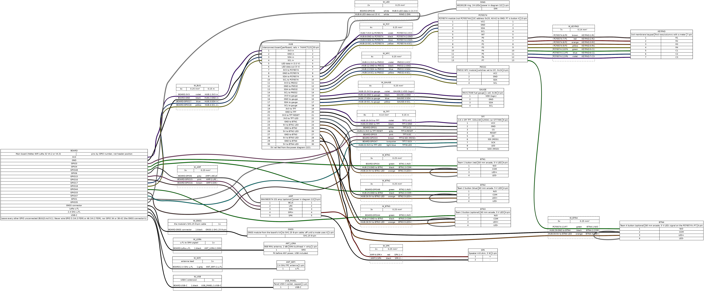
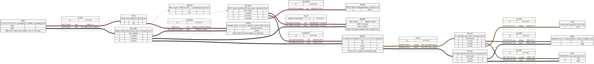

<!--
SPDX-FileCopyrightText: 2026 The Atalaia contributors
SPDX-License-Identifier: CC-BY-SA-4.0
-->

# Manual de montagem da Field Box

> Em inglês: [Field Box build manual](BUILD.md). Este é o mesmo manual em português (pt-PT). Os diagramas de ligações estão em inglês.

De um saco de peças a uma caixa gravada, pronta para a lista de verificação de
arranque do hardware ([`BRING_UP.md`](../../firmware/esp32/docs/BRING_UP.md),
em inglês). Escrito para quem é do clube e sabe soldar pinos e fios e usar um
multímetro. Não precisas de escrever código.

> **Estado: ainda não foi montada nenhuma caixa completa.** Placas Heltec V4.3
> reais já foram usadas numa bancada com o controlador de campo: arranque,
> envio e receção de rádio, o ecrã OLED da própria placa, dois botões de
> equipa (GPIO 4 e 48), adoção por cabo USB e por código pelo rádio, e uma
> atualização pelo ar. Tudo isso foi em placas nuas. **Ainda não testado numa
> placa real:** o ecrã de 2,8 polegadas, o teclado, o anel de LEDs, o leitor
> NFC, o amplificador, o medidor de bateria, o botão 3 e o botão 4, o circuito
> de energia (fusível, interruptor, conversor elevador, carga), a página de
> configuração por Wi-Fi, o logótipo do campo no ecrã e o alcance através de
> um invólucro. As atribuições de pinos são verificadas automaticamente em
> relação ao firmware (vê
> [Regenerar os diagramas](#14-regenerar-os-diagramas)). Os passos marcados
> **Verifica na primeira montagem** são perguntas em aberto; diz-nos o que
> encontrares numa issue, para o manual ser corrigido. As fotografias serão
> juntas depois da primeira montagem de um protótipo; este manual nunca usa
> fotografias simuladas nem geradas.
>
> Guias relacionados: a [referência de pinos](#15-referência-de-pinos) (cada
> sinal, com a cor do fio e a tensão) e o [guia do firmware](../../docs/manuals/pt/firmware.md)
> (obter, gravar e configurar o firmware, em passos simples).

> **Novo mapa de pinos (2026-10-21): volta a ligar os fios se seguiste o
> antigo.** O conector GNSS da placa passou a manter todos os pinos (GPIO 34,
> 38-42), para o módulo GNSS do kit poder ser usado por modos de jogo futuros.
> Mudaram: botão 2 **GPIO 39 -> GPIO 48**, botão 3 **GPIO 33 -> GPIO 44**,
> botão 4 **GPIO 34 -> o P7 do PCF8574**, dados do anel de LEDs **GPIO 48 ->
> GPIO 35**, MOSI do ecrã **40 -> 33**, SCK **41 -> 47**, CS **42 -> 1**,
> RESET do ecrã **GPIO 38 -> 3V3**, LED do ecrã (luz de fundo) **GPIO 47 ->
> 3V3**. Não mudaram: botão 1 (GPIO 4), DC do ecrã (GPIO 3), I2C (17/18),
> áudio (6/15/16). Um fio deixado no GPIO 39 lutaria com a saída do módulo
> GNSS; um fio no GPIO 34 ligaria e desligaria a energia dele. Os diagramas
> são sempre desenhados a partir dos valores por omissão atuais do firmware;
> **se o texto e um diagrama discordarem, ganha o diagrama**; confirma também a
> [tabela de pinos](README.md#peripheral-pins) (em inglês).

## Índice

1. [O que estás a montar](#1-o-que-estás-a-montar)
2. [Peças e onde comprar](#2-peças-e-onde-comprar)
3. [Ferramentas e consumíveis](#3-ferramentas-e-consumíveis)
4. [Regras de segurança](#4-regras-de-segurança)
5. [Preparação do invólucro](#5-preparação-do-invólucro)
6. [Revisão da placa e antenas](#6-revisão-da-placa-e-antenas)
7. [Energia e segurança da bateria](#7-energia-e-segurança-da-bateria)
8. [A placa de interligação](#8-a-placa-de-interligação)
9. [Ligações, passo a passo](#9-ligações-passo-a-passo)
10. [Primeira ligação à energia](#10-primeira-ligação-à-energia)
11. [Primeira gravação](#11-primeira-gravação)
12. [Passagem para o bring-up](#12-passagem-para-o-bring-up)
13. [Resolução de problemas](#13-resolução-de-problemas)
14. [Regenerar os diagramas](#14-regenerar-os-diagramas)
15. [Referência de pinos](#15-referência-de-pinos)

## 1. O que estás a montar

Uma caixa à prova de intempéries com dois a quatro botões de equipa grandes,
um teclado, um ecrã a cores de 2,8 polegadas, um anel de LEDs, um leitor NFC,
um altifalante opcional e um rádio LoRa, tudo à volta de uma placa ESP32-S3
(Heltec WiFi LoRa 32 V4, revisão V4.2 ou V4.3). Funciona com uma célula de
iões de lítio (duas células 18650 em paralelo) e carrega por USB-C.

```
battery 1S --fuse--+--switch--+-- board battery socket --> main board --> 3.3 V rail
              diode-+          +-- MAX17048 (battery sense)       |          |
                               +-- 5 V boost --> LED ring,        |    keypad (via PCF8574),
                                                 amplifier,       |    NFC, gauge, display
                                                 button LEDs      +--> GPIOs: buttons, display,
                                                                       LED data, audio
```

As ligações estão desenhadas em dois diagramas, gerados a partir de ficheiros
de texto em [`wiring/`](wiring/):

- **Diagrama 1/2, sinais e 3,3 V:** [SVG](wiring/field-box-wiring.svg)
  (com zoom), [PNG](wiring/field-box-wiring.png). Cada fio dos GPIO da placa
  principal, a placa de interligação, os dispositivos I2C, o teclado, o ecrã,
  os botões, os dados dos LEDs, o áudio, as antenas e o USB.
- **Diagrama 2/2, energia:** [SVG](wiring/field-box-power.svg),
  [PNG](wiring/field-box-power.png). Bateria, fusível, díodo, interruptor,
  junções, conversor elevador de 5 V, e os pinos de alimentação do anel, do
  amplificador, do medidor e da placa de interligação.





Como os ler: cada caixa é uma peça, com os pinos listados; cada caixa
tracejada é um cabo ou um molho de fios, com uma linha por fio (`from`, cor,
`to`). Os pinos da placa principal são nomeados **pelo número do GPIO**
(`GPIO4`), nunca pela posição no conector: encontra cada um pelo número do
GPIO impresso junto ao pino do conector da tua placa e confirma-o no mapa de
pinos da revisão da tua placa. Nos módulos, os números pequenos são só a
ordem dos pinos no desenho; guia-te pelos nomes dos pinos impressos em cada
módulo.

Os números dos GPIO vêm dos valores por omissão do firmware em
[`firmware/esp32/main/Kconfig.projbuild`](../../firmware/esp32/main/Kconfig.projbuild)
e estão resumidos na [referência de pinos](#15-referência-de-pinos) e na
[tabela de pinos](README.md#peripheral-pins). Se ligares um pino de outra
maneira, o firmware tem de ser configurado de acordo
([secção 12](#12-passagem-para-o-bring-up)).

### Cores dos fios

As cores dos diagramas são uma sugestão; o que importa é usares uma só
convenção em tudo e **etiquetares as duas pontas de cada fio** (marcadores
termorretráteis ou uma caneta permanente fina sobre fita).

| Cor | Uso |
| --- | --- |
| Vermelho | Bateria + (depois do fusível), 0,5 mm² |
| Preto | Massa (GND), em todo o lado |
| Laranja | Barramento de 5 V; LED do botão + |
| Violeta | 3,3 V (3V3) |
| Azul / amarelo | I2C SDA / SCL |
| Verde | Sinais dos botões |
| Branco | Dados do anel de LEDs |
| Cinzento, rosa, castanho, turquesa, azul-claro | Sinais do ecrã e do áudio |

Secções dos fios: 0,5 mm² (AWG 20) para a bateria e a alimentação de 5 V,
0,25 mm² (AWG 24) para sinais e alimentação de pouca corrente, 0,14 mm²
(AWG 26) ou cabo plano para o teclado e o ecrã. Usa fio multifilar (flexível)
em tudo: o fio rígido parte-se com as vibrações.

## 2. Peças e onde comprar

Descrições genéricas e as especificações a verificar. Não se recomenda
nenhuma loja: compra em qualquer fornecedor que indique as especificações
abaixo, e prefere anúncios com uma folha de dados a sério. Total aproximado
para uma caixa: 70-110 € a preços de mercado de hobby
([visão geral do hardware](../README.md)).

| # | Peça | Qtd. | O que verificar | Alternativas e armadilhas |
| --- | --- | --- | --- | --- |
| 1 | Heltec WiFi LoRa 32 V4 (revisão V4.2 ou V4.3), placa nua, 863-928 MHz | 1 | A versão de 863-928 MHz, **não** a de 433/470 MHz; placa nua, sem a caixa de plástico | Qualquer das revisões serve, depois de dizeres ao firmware qual é ([secção 6](#6-revisão-da-placa-e-antenas)). Os kits podem incluir uma antena de 868 MHz, uma LiPo 1S de 3000 mAh, pinos e um módulo GNSS: a antena e a LiPo são aproveitáveis (linhas 2 e 14), e o módulo GNSS também: liga-se ao conector GNSS da própria placa ([secção 9.1](#91-placa-principal-e-barramentos)) e fica desligado até um modo com GPS o usar. A Heltec V3 funciona no escalão de memória reduzida |
| 2 | Antena de 868 MHz, 2 dBi ou menos | 1 | Ganho indicado em dBi; sintonizada para 868 MHz | A antena do kit (um cabo IPEX de cerca de 120 mm com uma haste curta, ou uma pequena antena de mola) funciona atrás da parede de plástico da caixa. Para mais alcance: uma antena SMA no exterior, no cabo adaptador da linha 3. Uma antena de maior ganho obriga a alterar a definição do firmware ([secção 6](#6-revisão-da-placa-e-antenas)). **Em Taiwan** (920-925 MHz, firmware compilado com `--region=as923-tw`, RFC 0001 Amendment 12): uma antena sintonizada para 915-925 MHz, com o ganho definido também no firmware; uma antena de 868 MHz fica dessintonizada aí (decisão RF-AS923-13) |
| 3 | Cabo adaptador U.FL (IPEX 1.0) para SMA passa-paredes, cerca de 10-15 cm | 1 | SMA passa-paredes **fêmea** (ou a condizer com a ficha da tua antena), com O-ring e porca, IPEX **1.0** (não IPEX 4 / MHF4) | Só é preciso para uma antena no exterior da caixa |
| 4 | Antena FPC de 2,4 GHz com cabo IPEX 1.0 | 1 | Conector IPEX 1.0, 2,4 GHz | Obrigatória: o kit só tem a antena LoRa |
| 5 | Botão arcade de 60 mm com LED | 2 (até 4) | Microinterruptor com terminais COM, NO e NC; LED para **5 V** | As versões com LED de 12 V ficam fracas a 5 V; o LED é opcional. Não são estanques: vê a [secção 5](#5-preparação-do-invólucro). Os botões industriais de cogumelo IP65 são uma alternativa mais robusta |
| 6 | Teclado de membrana 3x4, 7 pinos | 1 | 12 teclas (1-9, *, 0, #), cabo plano de 7 pinos, costas autocolantes | A ordem dos pinos varia consoante o fabricante: identificá-la-ás com um multímetro |
| 7 | Módulo expansor de E/S PCF8574 | 1 | Chip marcado **PCF8574** ou **PCF8574A**, pontes de endereço A0-A2 | Os anúncios vendem os dois com o mesmo nome: o firmware encontra qualquer um (0x20-0x27, ou 0x38-0x3F para o A). Alimenta-o a **3V3** mesmo que o anúncio diga 5V: as resistências de pull-up dele vão para a alimentação. **Não** uses uma «placa de apoio I2C para LCD»: os pinos dela estão ligados a um conector de LCD e a um transístor |
| 8 | TFT SPI de 2,8", 320x240, ILI9341 (ou ST7789) | 1 | Interface SPI (pinos CS, RESET, DC, SDI/MOSI, SCK, LED); lógica de 3,3 V | Os pinos do toque podem ficar por ligar. Anota o controlador que tem: o ST7789 precisa de uma definição do firmware ([secção 12](#12-passagem-para-o-bring-up)) |
| 9 | Anel de LEDs WS2812B, 24 LEDs | 1 | 5 V, pads DIN / DOUT / 5V / GND | Anéis de 12 ou 16 LEDs funcionam com uma definição do firmware (`LED_COUNT`) |
| 10 | 74AHCT125 (ou 74HCT125), DIP-14, mais um suporte de 14 pinos | 1 | As letras **AHCT** ou **HCT** | **Não** o 74HC125 nem o 74AHC125: esses precisam de mais de 3,3 V à entrada quando alimentados a 5 V |
| 11 | Módulo NFC PN532 (com I2C) | 1 | Interruptores ou pontes de modo para HSU / I2C / SPI | Cartões NTAG215 ou NTAG216 para os cartões de entrada |
| 12 | Módulo medidor de carga MAX17048 | 1 | Medidor de uma célula de iões de lítio, I2C | Não o MAX17049 (duas células) |
| 13 | Módulo amplificador I2S MAX98357A + altifalante de 4-8 ohm, 3 W | 1 | Entrada I2S (BCLK, LRC, DIN) | Opcional. Um altifalante resistente ao tempo (cone de mylar) aguenta melhor a humidade |
| 14 | Células 18650 de iões de lítio com proteção | 2 | **Com proteção** (circuito de proteção integrado, em geral com topo de botão e ~69 mm de comprimento), do mesmo modelo, compradas juntas, de uma marca de confiança | Evita células sem marca com capacidades absurdas («9900 mAh»). Um pack 1S2P já feito, com placa de proteção (BMS) e ficha com guia, é uma alternativa. A LiPo de 3000 mAh do kit (cerca de 58 x 39 mm) pode servir num primeiro protótipo ([secção 7](#7-energia-e-segurança-da-bateria)) |
| 15 | Suporte para 2 células 18650, ligação em **paralelo**, com fios | 1 | Serve células com proteção (mais compridas); paralelo (3,7 V), não série (7,4 V) | Mede: um suporte em paralelo lê a tensão de uma célula |
| 16 | Módulo conversor elevador de 5 V | 1 | A gama de entrada cobre 3,0-4,2 V; saída de 5 V a **2,5 A ou mais**; ajustável ou fixo a 5 V | Os módulos elevadores pequenos «de 1 A» fazem reiniciar o sistema com o anel de LEDs |
| 17 | Porta-fusível em linha + fusível de 5 A (e um sobresselente) | 1 | De lâmina (mini/standard) ou 5x20 mm, com fios de 0,5 mm² | |
| 18 | Díodo Schottky, 3 A ou mais, 20 V ou mais (p. ex. 1N5822) | 1 | Furo passante | Proteção contra polaridade invertida, vê a [secção 7](#7-energia-e-segurança-da-bateria) |
| 19 | Interruptor principal, SPST | 1 | Para 5 A DC ou mais; de alavanca com cobertura, de balancé com cobertura, ou de chave; com capa estanque | Tem de ser difícil de alcançar por quem joga |
| 20 | Conectores de junção de alavanca, de 3 e 4 vias | 2 + 2 | Para fio de 0,2-4 mm² | Ou uma pequena régua de terminais de parafuso |
| 21 | Extensão USB-C de painel, com tampa | 1 | Linhas de **dados** ligadas (USB 2.0), não «só carga»; IP65 ou com tampa | Também podes abrir a caixa para ligar diretamente à placa |
| 22 | Placa perfurada de cerca de 5 x 7 cm, passo de 2,54 mm | 1 | Lisa ou com pistas em faixas | |
| 23 | Condensador eletrolítico de 1000 µF, 10 V ou mais | 1 | Para o anel de LEDs | |
| 24 | Condensador cerâmico de 100 nF | 1 | Para o 74AHCT125 | |
| 25 | Resistência de 330 ohm, 1/4 W | 1 | Linha de dados dos LEDs | |
| 26 | Caixa de derivação IP65 de cerca de 200 x 150 x 100 mm, de cor viva | 1 | ABS ou policarbonato (**não metálica**: o rádio tem de sair); tampa com junta | Uma tampa transparente ou translúcida deixa ver o anel de LEDs e o ecrã |
| 27 | Bucins (M12/M16), válvula de equalização de pressão (M12) | conforme precisares | IP65 ou melhor | A válvula evita a condensação e o efeito de bomba de pressão |
| 28 | Espaçadores e parafusos M3 de nylon, placa de fundo (de plástico ou contraplacado) | 1 jogo | | Mantém a eletrónica afastada do fundo da caixa |
| 29 | Janela transparente, acrílico ou policarbonato de 2-3 mm | 1 | Maior do que a área ativa do ecrã | Só se a tampa for opaca |
| 30 | Etiquetas: «GAME PROP» e o nome da caixa | 2+ | Resistentes ao tempo | Obrigatórias, vê a [secção 4](#4-regras-de-segurança) |

## 3. Ferramentas e consumíveis

- Ferro de soldar com controlo de temperatura, ponta fina em cinzel; solda
  (sem chumbo ou com chumbo, com núcleo de fluxo); caneta de fluxo; malha
  dessoldadora.
- Multímetro com sinal sonoro de continuidade, tensão DC e uma escala de
  corrente de 200 mA (ou 10 A). **Essencial**: a maior parte dos passos acaba
  com uma verificação com o multímetro.
- Descarnador de fios, alicate de corte raso, alicates pequenos.
- Alicate de crimpar e fichas de 2,54 mm (tipo Dupont), ou solda tudo:
  **nada de fios de ligação soltos** num adereço de campo.
- Tubo termorretrátil (variado) e uma pistola de ar quente ou um isqueiro;
  etiquetas para fios.
- Berbequim com broca escalonada (4-20 mm) e/ou serras de copo, ferramenta de
  rebarbar, lima, serra de recortes ou ferramenta rotativa para a janela do
  ecrã.
- Pistola de cola quente, abraçadeiras e bases adesivas para abraçadeiras,
  fita de espuma de dupla face, fita Kapton.
- Vedante de silicone de cura neutra (para a ranhura do cabo plano do teclado
  e para a janela).
- Óculos de proteção; um saco antifogo para lítio (ou uma lata de metal com
  areia) para as células enquanto trabalhas.
- Um computador com Docker Desktop e Python 3 para o firmware
  ([secção 11](#11-primeira-gravação)), e um cabo USB-C de dados.

## 4. Regras de segurança

Lê isto antes de começares, e tem-no presente em todos os passos.

1. **Nunca ligues a placa sem a antena LoRa ligada**, nem sequer por USB.
   Emitir para uma porta de antena aberta pode estragar o rádio, e o
   amplificador do módulo de entrada da variante de alta potência pode ficar
   destruído. Monta primeiro as antenas ([secção 6](#6-revisão-da-placa-e-antenas))
   e deixa-as montadas.
2. **Só uma célula de iões de lítio em série (1S, 3,0-4,2 V).** A tomada de
   bateria da placa, o carregador dela e o medidor MAX17048 são peças de uma
   só célula. Um pack 2S (7,4 V) destrói-os.
3. **Verifica a polaridade com um multímetro** antes de cada ligação da
   bateria, incluindo a LiPo que vem no kit da placa. As pequenas fichas de
   dois pinos usadas pelas placas de hobby (tipo JST e tipo SH1.25) não têm
   polaridade padrão; uma ficha que encaixa pode estar invertida.
4. **Células com proteção, um fusível perto da bateria, carga vigiada.**
   Guarda e carrega as células num saco antifogo; nunca deixes uma caixa a
   carregar sem vigilância; nunca uses uma célula amolgada, inchada, quente ou
   abaixo de 2,5 V.
5. **Trabalha com a bateria fora** sempre que soldares ou voltares a ligar
   fios.
6. **O ESP32-S3 é uma peça de 3,3 V.** Nenhum fio de sinal para a placa pode
   levar mais de 3,3 V: os módulos I2C têm de fazer pull-up a 3,3 V
   ([secção 9.2](#92-módulos-i2c)), e o anel de LEDs é comandado através do
   conversor de nível.
7. **Nunca ligues o GPIO 5 nem o GPIO 46, nem o GPIO 34 ou 38-42.** O GPIO 5 e
   o 46 comandam o módulo de entrada do rádio numa ou noutra revisão da
   placa; o GPIO 34 e o 38-42 pertencem ao conector GNSS da placa e ao módulo
   ligado a ele.
8. **Nenhum jogo antes da verificação da potência de emissão.** A placa de
   alta potência pode emitir mais do que os limites do EU868 permitem; o
   firmware limita-a com um ganho de amplificador assumido que ainda não foi
   medido. Não uses uma caixa num jogo até o passo 10 do BRING_UP.md (rádio,
   potência de emissão) ter sido feito para essa caixa.
9. **Tem de parecer um adereço de jogo.** Cores vivas, uma etiqueta «GAME PROP»
   impressa, nada de tubos com fita, nada de molhos de fios à vista, nada que
   se pareça com um engenho explosivo. Transporta-a numa mala com etiqueta e
   nunca a deixes sem vigilância fora do campo (especificação de design,
   secção 17).

## 5. Preparação do invólucro

> **Fotografia a juntar depois da primeira montagem de um protótipo:** o
> invólucro furado, vistas da tampa e dos lados, com a disposição marcada.

Faz todos os furos **antes** de entrar qualquer eletrónica, e depois sopra as
aparas de plástico.

1. **Planeia primeiro a disposição no papel.** Põe as peças na tampa e na
   caixa e confirma que cabem com a tampa fechada, cabos incluídos:
   - **Tampa (em cima):** janela do ecrã, anel de LEDs (sob uma tampa
     translúcida ou uma janela difusora), botões de equipa (afastados, para
     duas pessoas não colidirem), teclado (por fora), zona «encosta aqui» do
     NFC (o leitor montado sob a tampa, 1-3 mm de plástico entre o cartão e o
     leitor, sem metal).
   - **Parede lateral:** interruptor principal (encastrado ou com cobertura,
     do lado oposto ao de quem joga), tomada USB-C de painel com tampa, SMA
     passa-paredes (na parte de cima de uma parede lateral, para a antena
     ficar na vertical), válvula de equalização de pressão (em baixo, num
     lado que não dê para a chuva).
   - **Por dentro:** uma placa de fundo sobre espaçadores para a placa, a placa
     de interligação, o conversor elevador e os módulos; o suporte da bateria
     fixo com uma cinta ou um suporte, longe do conversor elevador e das
     antenas.
   - Espaço a prever, a partir das dimensões publicadas da placa: a placa tem
     cerca de 52 x 25 mm e cerca de 9 mm de altura com o OLED; deixa espaço
     acima da ponta do USB-C dela para a curva do cabo e acima dos dois
     conectores de antena para os cabos. A LiPo do kit, se a usares, tem cerca
     de 58 x 39 mm; o cabo da antena LoRa do kit tem cerca de 120 mm de
     comprimento, mais a própria antena.
   - Mantém os conectores de antena da placa e a antena de 2,4 GHz longe da
     bateria, do conversor elevador e de qualquer metal. Uma antena dentro da
     caixa tem de ficar atrás de plástico (transparente ao rádio), nunca
     dentro ou atrás de metal; uma caixa de metal ou um acabamento de tinta
     metalizada não serve.
2. **Mede cada furo a partir das tuas peças, não de um anúncio.** Tamanhos
   típicos, a confirmar com as tuas peças: SMA passa-paredes 6,5 mm; válvula
   ou bucim M12 12 mm; bucim M16 16 mm; os botões arcade e a tomada USB-C de
   painel variam (mede o corpo roscado); o interruptor, segundo a folha de
   dados. Faz primeiro um furo piloto pequeno e depois usa a broca escalonada;
   rebarba todos os furos.
3. **Janela do ecrã.** Se a tampa for opaca, corta uma janela ligeiramente
   mais pequena do que a moldura do painel mas maior do que a área ativa dele,
   e cola um vidro de acrílico ou de policarbonato transparente por cima, pelo
   lado de dentro, com silicone de cura neutra. Monta o ecrã atrás dele sobre
   espaçadores ou um suporte impresso.
4. **Teclado.** Os teclados de membrana colam-se por fora. Corta uma ranhura
   estreita para o cabo plano, cola o teclado por cima e veda a ranhura por
   dentro com silicone. Não dobres o cabo plano de forma apertada onde ele
   entra.
5. **Altifalante (opcional).** Faz uma grelha de furos pequenos (2-3 mm) e cola
   atrás deles um pedaço de rede acústica ou de membrana estanque respirável,
   e depois o altifalante.
6. **Botões.** Os botões arcade **não** são estanques. Monta-os com o anel de
   vedação deles (ou uma anilha de borracha) por fora, e mantém a eletrónica
   por baixo deles, na placa de fundo, para que pingos não caiam sobre uma
   placa. Os botões industriais IP65 são a alternativa para sítios húmidos.
7. **Proteção contra o tempo.** Veda todos os furos não usados. Passa cada
   cabo que sai da caixa por um bucim. Monta a válvula. Põe um saquinho de
   gel de sílica lá dentro. Opcionalmente, reveste a placa de interligação
   acabada com verniz de proteção, sem tocar nos conectores.
8. **Aspeto.** Cor viva para o invólucro (laranja, amarelo, verde), a etiqueta
   «GAME PROP» na tampa e num lado, e o nome ou número da caixa.

**Verifica na primeira montagem:** que os sinais de 2,4 GHz e de LoRa da placa
são bons o bastante através da parede do invólucro escolhido (uma caixa de
plástico costuma servir), e que o altifalante tem volume suficiente atrás da
membrana.

## 6. Revisão da placa e antenas

> **Fotografia a juntar depois da primeira montagem de um protótipo:** a placa
> com os dois cabos de antena montados e etiquetados, e o passa-paredes visto
> de fora.

### Identificar a revisão da placa

A Heltec V4 existe em duas revisões, com módulos de entrada do rádio (FEM)
diferentes, e o firmware comanda-os de maneira diferente: com a definição
errada, o recetor fica surdo ou o emissor fraco. Antes de ligares o que quer
que seja:

1. Procura o chip pequeno ao lado do conector da antena LoRa e lê a marcação
   dele com uma lupa (o zoom da câmara de um telemóvel serve):
   - **KCT8103L**: revisão **V4.3**, a omissão do firmware;
   - **GC1109**: revisão **V4.2**.
   Se a marcação for ilegível, procura a revisão impressa na serigrafia da
   placa.
2. Escreve a revisão na placa de fundo da caixa e seleciona-a no firmware
   antes de gravar ([secção 11](#11-primeira-gravação), passo 1, e
   [secção 12](#12-passagem-para-o-bring-up)).
3. Em qualquer das revisões, nunca ligues o **GPIO 5** (controlo do módulo de
   entrada na V4.3) nem o **GPIO 46** (controlo do módulo de entrada na V4.2).

### Antenas

**Monta já as duas antenas, antes de a placa ser alguma vez ligada à energia,
e deixa-as montadas para sempre.**

1. Identifica os dois conectores IPEX (U.FL) da placa: um é o LoRa e o outro o
   de 2,4 GHz (Wi-Fi/BLE). Usa a serigrafia da placa e a documentação dela para
   a tua revisão. **Não adivinhes**: uma antena de 868 MHz no conector de
   2,4 GHz deixa a saída LoRa em aberto.
2. Põe logo uma etiqueta (uma bandeirinha de fita) em cada cabo: «LoRa 868» e
   «2.4 GHz».
3. Os conectores IPEX são frágeis e aguentam poucos encaixes (dezenas, não
   centenas). Prime a ficha a direito com a ponta de um dedo ou com a parte
   plana de uma ferramenta até fazer clique; para a retirar, levanta a direito
   com uma ferramenta de extração adequada ou com uma unha por baixo do corpo
   da ficha, nunca puxando pelo cabo. Fixa cada ficha encaixada com uma
   pequena tira de fita Kapton (não com cola).
4. **Antena LoRa**, uma de duas:
   - **protótipo:** a antena do kit da placa (no cabo IPEX dela), dentro da
     caixa, atrás da parede de plástico, na vertical se possível, o mais longe
     possível da bateria e de outros fios; ou
   - **padrão:** o cabo adaptador IPEX para SMA até ao SMA passa-paredes na
     parede da caixa (O-ring por fora), e uma antena de 868 MHz enroscada por
     fora.
5. **Antena de 2,4 GHz:** cola a antena FPC por dentro da tampa ou de uma
   parede lateral, plana, longe da bateria, do conversor elevador e de metal.
6. **Ganho da antena e a lei.** O firmware calcula a potência de emissão do
   rádio para a caixa ficar dentro dos limites do EU868, assumindo uma antena
   de **2 dBi** (`CONFIG_ATALAIA_RADIO_ANTENNA_GAIN_DBI`) e, por omissão, o
   ganho de 14 dB do módulo de entrada da placa de alta potência
   (`CONFIG_ATALAIA_RADIO_FEM_GAIN_DB`). Se a tua antena tiver mais ganho,
   define o ganho dela no firmware ([secção 12](#12-passagem-para-o-bring-up)).
   Nunca baixes nenhum dos valores para teres mais alcance: isso quebra o
   limite legal. Os 14 dB são uma suposição até serem medidos (BRING_UP.md,
   passo 10): nenhum uso em jogo antes dessa verificação.

## 7. Energia e segurança da bateria

> **Fotografia a juntar depois da primeira montagem de um protótipo:** o
> circuito de energia (suporte, fusível, díodo, interruptor, junções,
> conversor elevador) tal como montado.

Segue o [diagrama 2/2](wiring/field-box-power.svg).

### Como a energia está organizada

- As células (duas 18650 com proteção em **paralelo**: continua a ser a
  tensão de uma célula, 3,0-4,2 V, com o dobro da capacidade) passam pelo
  **fusível**, depois pelo **interruptor principal**, até uma **junção BAT+**.
  Daí seguem:
  - a **tomada de bateria da placa** (a placa faz a sua própria tensão de
    3,3 V e carrega as células a partir do USB-C);
  - o **conversor elevador de 5 V**, que alimenta o anel de LEDs, o
    amplificador e os LEDs dos botões (na junção de 5 V e na placa de
    interligação);
  - a **entrada de medição de bateria do medidor MAX17048**.
- Um **díodo Schottky** fica atravessado na bateria logo a seguir ao fusível,
  com a banda (cátodo) para o lado +. Em uso normal não faz nada. Se a bateria
  for alguma vez ligada ao contrário, conduz e o fusível queima antes de
  qualquer outra coisa se estragar.
- As peças de 3,3 V (ecrã, NFC, expansor do teclado, lógica do medidor)
  recebem energia do pino **3V3** da placa, através da placa de interligação.
  O barramento comutável «Vext» da placa (GPIO 36, ativo em baixo) **não** é
  usado para elas: o firmware liga-o no arranque, mas o limite de corrente
  dele não está documentado e ele alimenta também partes da própria placa (o
  OLED, entre outras).
- A entrada solar da placa (4,4-6 V) fica por ligar. O módulo GNSS, se estiver
  montado, é alimentado pela placa através do conector próprio (o GPIO 34
  comuta-o; o firmware mantém-no desligado até um modo precisar dele).

Porque não um pack 2S (7,4 V)? Porque a entrada de bateria da placa, o
carregador dela e o medidor só aguentam uma célula. Uma célula mais um
conversor elevador mantém todas as peças dentro dos limites delas.

### Passos

1. **Células.** Carrega as duas células novas até ao máximo num carregador
   autónomo de iões de lítio e confirma que as leituras diferem menos de
   0,05 V antes de as pores num suporte em paralelo. Substitui sempre as duas
   células juntas, do mesmo modelo. **Põe as células só com o interruptor
   desligado e o fusível fora.**
2. **Verificar o suporte.** Com as duas células lá dentro, mede os fios do
   suporte: a tensão de uma célula (3,0-4,2 V), fio vermelho positivo. Se
   leres cerca de 7-8 V, é um suporte em **série**: não o uses.
3. **Fusível e díodo.** Solda ou crimpa o porta-fusível no fio vermelho, perto
   do suporte. Solda o díodo entre o lado de saída do porta-fusível
   (banda/cátodo) e o fio preto da bateria (ânodo), com tubo termorretrátil
   sobre as duas soldaduras. Tira o fusível enquanto continuas.
4. **Interruptor.** Liga a saída do fusível a um terminal do interruptor e o
   outro terminal à junção BAT+ de 4 vias (vermelho de 0,5 mm²). O fio preto
   da bateria vai para a junção GND da bateria de 4 vias.
5. **O conversor elevador, sozinho primeiro.** Liga só a entrada do conversor
   elevador às junções (IN+ a BAT+, IN- a GND). Põe o fusível, liga o
   interruptor e mede a saída: **põe-na a 5,0-5,2 V** (os módulos ajustáveis
   têm um potenciómetro de ajuste; roda devagar). Desliga. Nunca ligues
   cargas antes disto.
6. **Junções de 5 V.** OUT+ do conversor à junção de 5 V de 4 vias, OUT- à
   junção GND de 5 V de 3 vias (0,5 mm²). O anel, o amplificador e a placa de
   interligação são ligados na [secção 9](#9-ligações-passo-a-passo).
7. **Cabo de bateria da placa (faz isto em último, na [secção 9.8](#98-cabo-da-bateria-da-placa)).**

### Usar a LiPo do kit em vez disso (primeiro protótipo)

Os kits de placa podem incluir uma LiPo 1S de bolsa (3000 mAh, cerca de
58 x 39 mm, com uma pequena ficha de dois pinos). É uma só célula, por isso
serve neste projeto, com algum cuidado:

- Usa-a no lugar do suporte das 18650, através do **mesmo fusível, díodo e
  interruptor**. Não cortes o cabo dela: liga-a a uma tomada com fios a
  condizer (um «pigtail») e liga esse à junção GND da bateria e ao fusível.
  **Verifica a polaridade no pigtail com um multímetro** antes de mais nada.
- Procura um circuito de proteção (uma pequena placa sob a fita, na ponta do
  cabo). Sem ele, não a uses sem vigilância.
- Uma célula de bolsa não tem caixa rígida: monta-a deitada numa bandeja ou
  num suporte rígido, onde nada a possa pressionar, dobrar ou furar, longe de
  parafusos, do conversor elevador e de arestas vivas. Retira-a se inchar.
- Tem cerca de metade da energia de duas 18650; serve para trabalho de bancada
  e jogos curtos.

### Orçamento de energia (estimativas, não medições)

| Carga | Barramento | Típico | Pico |
| --- | --- | --- | --- |
| Placa principal (ESP32-S3, receção LoRa) | bateria, através da placa | 80-150 mA | 400-500 mA (emissão Wi-Fi ou LoRa) |
| Ecrã incl. luz de fundo (sempre ligada) | 3V3 | 40-100 mA | |
| Módulo GNSS (só enquanto um modo o usa; desligado no resto do tempo) | 3V3, através do comutador GNSS da placa | **Verifica na primeira montagem** | |
| NFC PN532 (campo ligado) | 3V3 | 50-150 mA | |
| PCF8574, MAX17048 | 3V3 | menos de 1 mA | |
| Anel de LEDs, 24 LEDs | 5 V | ~25 mA (todos apagados) a ~0,5 A (uma cor de equipa completa) | ~1,4 A (tudo branco a 100 % de brilho). O firmware começa a 40 % (`CONFIG_ATALAIA_LED_BRIGHTNESS_PCT`), por isso menos; não medido |
| Amplificador e altifalante | 5 V | alguns mA | 0,6-0,8 A (alto) |
| LEDs dos botões (4) | 5 V | 40-80 mA | |

A corrente tirada às células para as cargas de 5 V é cerca de 1,6 vezes a
corrente de 5 V (a relação das tensões mais as perdas do conversor). Com duas
células de ~3000 mAh e uma carga de jogo típica, a caixa deve durar bem mais
do que o limiar de 2 horas da fase 1, mas **isto não foi medido**: o passo 12
do BRING_UP.md corre um jogo de 2 horas e é daí que virá o valor real. O
firmware começa o anel de LEDs a 40 % de brilho; um modo pode alterá-lo, por
isso, por segurança, faz o orçamento para o brilho total.

**Verifica na primeira montagem:** a corrente de carga da placa e quanto
tempo demora uma carga completa; que o regulador de 3,3 V da placa aguenta o
ecrã e o leitor NFC além da própria placa (atenção a reinícios por quebra de
tensão quando o ecrã e o NFC estão ativos durante a configuração por Wi-Fi); a
autonomia real.

### Carga, armazenamento e transporte

- **Carga:** liga o USB-C (a tomada de painel) a um carregador USB de 5 V
  (a placa está indicada para carga a 5 V / 1 A) com o **interruptor principal
  ligado**: a placa carrega as células e a caixa funciona entretanto. Com o
  interruptor desligado, as células ficam desligadas e não carregam. Carrega
  num sítio vigiado, não numa mala de transporte fechada, e só entre cerca de
  0 e 45 °C: nunca carregues uma caixa fria acabada de chegar de um campo no
  inverno. Em alternativa, tira as células e carrega-as num carregador
  autónomo de iões de lítio.
- **Armazenamento** por mais do que umas semanas: células a cerca de
  3,7-3,8 V (meio carregadas), interruptor desligado, fusível fora, num sítio
  fresco e seco.
- **Transporte:** interruptor desligado; em voos e envios, segue as regras da
  transportadora para iões de lítio.

## 8. A placa de interligação

> **Fotografia a juntar depois da primeira montagem de um protótipo:** os dois
> lados da placa de interligação acabada.

Uma pequena placa perfurada que dá a cada módulo ligações curtas e
etiquetadas aos barramentos partilhados, e que leva o conversor de nível do
anel de LEDs. No diagrama é a caixa `HUB`.

**Barramentos.** Faz cinco barramentos, cada um uma fila de pinos macho de
2,54 mm unidos por baixo com fio estanhado ou pontes de solda, e etiqueta-os
em cima:

| Barramento | Alimentado por | Pinos necessários |
| --- | --- | --- |
| 3V3 | pino 3V3 da placa | entrada, PCF8574, PN532, medidor, ecrã (VCC, RESET, LED) |
| GND | pino GND da placa | entrada, PCF8574, PN532, medidor, ecrã, 4 botões, 74AHCT125 |
| SDA | GPIO 17 da placa | entrada, PCF8574, PN532, medidor |
| SCL | GPIO 18 da placa | entrada, PCF8574, PN532, medidor |
| 5V | junção de 5 V | entrada, 4 LEDs dos botões, 74AHCT125 |

Mantém o barramento 5V fisicamente afastado do 3V3 (em bordos opostos da
placa), para um deslize do ferro de soldar ou um fio solto não os juntar.

**Conversor de nível.** Solda um suporte DIP de 14 pinos e liga-o como se
segue; depois monta o 74AHCT125 (entalhe virado para o pino 1) só depois de a
placa ter passado as verificações de continuidade:

| Pino do 74AHCT125 | Nome | Liga a |
| --- | --- | --- |
| 1 | 1OE (ativação da saída, ativo em baixo) | barramento GND |
| 2 | 1A (entrada) | pino «LED data in», ligado ao GPIO 35 da placa |
| 3 | 1Y (saída) | resistência de 330 ohm, depois o pino «LED data out» |
| 4, 5 | 2OE, 2A | barramento GND |
| 6 | 2Y | não ligado |
| 7 | GND | barramento GND |
| 8 | 3Y | não ligado |
| 9, 10 | 3A, 3OE | barramento GND |
| 11 | 4Y | não ligado |
| 12, 13 | 4A, 4OE | barramento GND |
| 14 | VCC | barramento 5V, e um condensador cerâmico de 100 nF do pino 14 ao pino 7, o mais perto possível |

**Verificações antes de continuar** (sem energia, com o chip fora do suporte):
sem continuidade entre quaisquer dois barramentos; o pino 14 ao barramento 5V
e o pino 7 ao GND apitam; o pino 2 apita até ao pino «LED data in»; o pino
«LED data out» lê 330 ohm até ao pino 3.

## 9. Ligações, passo a passo

Bateria fora, fusível fora, interruptor desligado, durante a secção toda.
Depois de cada subsistema, faz a verificação dele. Mantém os fios de sinal
longe dos fios da bateria e da alimentação de 5 V sempre que puderes, e
prende cada molho com abraçadeiras para nada puxar uma soldadura.

> **Fotografia a juntar depois da primeira montagem de um protótipo:** o
> interior da caixa acabada, com os fios arrumados.

### 9.1 Placa principal e barramentos

1. Solda pinos à placa se ela veio sem eles, ou solda fios diretamente aos
   pads de que precisas (só os pinos do diagrama 1/2). Monta a placa sobre
   espaçadores na placa de fundo, com as antenas já montadas
   ([secção 6](#6-revisão-da-placa-e-antenas)) e o conector USB-C acessível.
2. Monta a placa de interligação ao lado dela. Liga **3V3**, **GND**,
   **GPIO 17** (SDA) e **GPIO 18** (SCL) da placa aos pinos «in» 3V3, GND, SDA
   e SCL do hub: quatro fios curtos, com menos de 15 cm.
3. **Deixa todos os outros pinos da placa por ligar.** Em particular, nunca
   ligues o GPIO 0, 45 ou 46 (pinos de arranque; o 46 comanda também o módulo
   de entrada da V4.2), o GPIO 5 (o módulo de entrada da V4.3), os GPIO
   internos da placa 2, 7, 8-14, 19-21, 26-32, 36, 37, 43, nem o GPIO 34 e
   38-42 do conector GNSS. Três pinos da placa são usados de propósito, cada
   um só como o diagrama mostra: GPIO 1 (CS do ecrã), GPIO 35 (dados do anel de
   LEDs; o LED branco da placa pisca com ele) e GPIO 44 (botão 3).
4. **Módulo GNSS (opcional).** Liga o módulo GNSS do kit ao conector GNSS de 8
   pinos da placa com o cabo próprio dele, e fixa o módulo (com o lado da
   antena para cima, sob a tampa) com fita de espuma de dupla face. O firmware
   mantém-no desligado até um modo com GPS o usar, por isso pode ficar
   montado.
5. **Verificação:** sem continuidade entre 3V3 e GND no hub (uma leitura de
   umas centenas de ohm ou mais é normal; um apito é um curto-circuito).

### 9.2 Módulos I2C

O expansor do teclado (PCF8574), o leitor NFC (PN532) e o medidor de bateria
(MAX17048) partilham o barramento I2C da placa com o pequeno OLED da própria
placa (GPIO 17/18). Cada módulo recebe quatro fios do seu próprio grupo de
pinos do hub: 3V3, GND, SDA, SCL.

1. **PCF8574 ou PCF8574A:** põe as pontes de endereço A0, A1 e A2 todas a GND.
   Isso dá o endereço 0x20 a um PCF8574 e 0x38 a um PCF8574A. O firmware
   encontra qualquer um, e também outras posições das pontes (0x20-0x27 e
   0x38-0x3F), mas nunca um endereço usado por outra peça (0x24, 0x36, 0x3C).
   Deixa o pino INT por ligar; o P7 dele é o botão de equipa 4
   ([secção 9.6](#96-botões-de-equipa)).
2. **PN532:** põe os interruptores de modo (ou as pontes) em **I2C**, seguindo
   a tabela impressa no módulo. Usa o conector I2C de 4 pinos dele.
3. **MAX17048:** liga o pino de alimentação lógica dele (se tiver um separado,
   marcado VIN, VCC ou VDD do lado I2C) ao 3V3, mais GND, SDA, SCL. A entrada
   de medição da bateria dele (CELL+ ou BAT+) vai para a junção BAT+ na
   [secção 9.8](#98-cabo-da-bateria-da-placa).
4. **Verificação da tensão dos pull-ups (importante).** Muitos módulos têm as
   suas próprias resistências de pull-up em SDA e SCL. Têm de fazer pull-up a
   3,3 V, nunca a 5 V nem à bateria. Antes de ligares um módulo ao hub,
   alimenta-o sozinho da maneira como vai ser alimentado (3,3 V no VCC a partir
   de uma fonte de bancada ou, mais tarde, da placa), e mede SDA e SCL em
   relação ao GND: ambos têm de ler **3,3 V ou menos**. Para o medidor, mede
   também com a bateria ligada à entrada de medição dele. Um módulo que leia
   mais não pode ir para o barramento até se retirarem os pull-ups dele.

### 9.3 Teclado

1. **Identifica os pinos do teclado com o multímetro** (modo de continuidade),
   porque a ordem difere de fabricante para fabricante. Mantém uma tecla
   premida e encontra os dois pinos do cabo plano que apitam:
   - o pino que apita para 1, 2 e 3 é o **R1**; para 4, 5, 6: **R2**;
     para 7, 8, 9: **R3**; para *, 0, #: **R4**;
   - o pino que apita para 1, 4, 7, * é o **C1**; para 2, 5, 8, 0: **C2**;
     para 3, 6, 9, #: **C3**.
   Escreve a ordem (por exemplo, numa fita no cabo plano).
2. Liga **R1-R4 a P0-P3** e **C1-C3 a P4-P6** do PCF8574, exatamente como no
   diagrama (`W_KEYPAD`). O firmware comanda as linhas em P0-P3 e lê as
   colunas em P4-P6; uma troca aparece como algarismos errados.
3. Usa uma ficha crimpada de 7 vias no cabo plano, ou solda, e prende-o para
   o cabo plano não poder ser puxado.

### 9.4 Ecrã

1. Liga VCC, GND, **RESET** e **LED** (a luz de fundo) aos pinos do ecrã no
   hub: VCC, RESET e LED todos ao barramento 3V3, GND ao GND. O firmware
   reinicia o painel com um comando, e a luz de fundo está acesa sempre que a
   caixa está ligada (não sobra nenhum GPIO para a comutar; decisão PIN-3).
2. Liga os quatro sinais diretamente a partir da placa: CS ao GPIO 1, DC ao
   GPIO 3, SDI (MOSI) ao GPIO 33, SCK ao GPIO 47. SDO (MISO) e quaisquer
   pinos do painel tátil ficam por ligar.
3. **Mantém estes fios com 15 cm ou menos** e junta-os num molho: o barramento
   do ecrã corre a 40 MHz, e fios compridos aparecem como um ecrã baralhado ou
   branco.

### 9.5 Anel de LEDs

1. Solda o condensador de 1000 µF entre os pads 5V e GND do anel (ou na ponta
   dos fios de alimentação dele, mesmo junto ao anel): **a faixa (negativo) a
   GND**.
2. **DIN** do anel (não o DOUT: confirma a seta ou a etiqueta) ao pino «LED
   data out» do hub. **5V** do anel à junção de 5 V e **GND** à junção GND de
   5 V, ambos de 0,5 mm².
3. GPIO 35 da placa ao pino «LED data in» do hub. O LED branco da própria
   placa está no mesmo pino e pisca ao de leve enquanto o anel muda: é
   esperado.
4. Mantém o fio de dados com menos de cerca de 30 cm.

### 9.6 Botões de equipa

1. Cada botão: **COM** do microinterruptor a um pino GND do hub, o terminal
   **NO** (normalmente aberto) ao sinal dele: botão 1 (equipa vermelha)
   GPIO 4, botão 2 (azul) GPIO 48, botão 3 GPIO 44, botão 4 o **P7** do
   PCF8574 (o expansor do teclado lê-o juntamente com as teclas). O terminal NC
   fica por ligar.

   > **Mudou em 2026-10-21:** o botão 2 estava no GPIO 39 e o botão 4 no
   > GPIO 34, ambos agora do conector GNSS; o botão 3 estava no GPIO 33. Uma
   > placa ligada à maneira antiga tem de ser religada antes de o módulo GNSS
   > ser ligado. Tira os pinos do diagrama atual e da
   > [tabela de pinos](README.md#peripheral-pins), não de uma impressão.
   > **Nunca uses o GPIO 5 nem o 39**, mesmo que uma cópia antiga deste manual
   > o diga.
2. LED do botão (opcional): LED+ ao pino 5 V do hub desse botão, LED- junto
   ao COM no botão. Confirma a marcação de polaridade do LED.
3. As caixas de duas equipas deixam simplesmente de fora os botões 3 e 4; uma
   entrada de botão por ligar lê-se como «não premido». Com o botão 3 no
   GPIO 44 (a linha de receção da UART0), a caixa não aceita texto escrito nos
   pinos da UART0; a consola USB-C não é afetada.
4. **Verificação:** com o multímetro entre a ponta de cada fio de sinal e o
   GND, a leitura só pode apitar enquanto esse botão estiver premido.

### 9.7 Áudio (opcional)

1. BCLK do amplificador ao GPIO 6, LRC ao GPIO 15, DIN ao GPIO 16.
2. VIN à junção de 5 V, GND à junção GND de 5 V.
3. Altifalante a SPK+ e SPK-. **Nenhum fio do altifalante pode tocar no GND**:
   as duas saídas do amplificador são comandadas.
4. Deixa GAIN e SD por ligar (ganho por omissão, os dois canais misturados).

### 9.8 Cabo da bateria da placa

1. Liga a entrada de medição da bateria do medidor (CELL+) à junção BAT+.
2. Liga o pino «5V in» do hub à junção de 5 V (0,25 mm² chega).
3. Faz o cabo para a tomada de bateria da placa: a ficha correspondente com
   dois fios, para a junção BAT+ e para a junção GND da bateria.
4. **Verificação de polaridade, antes de a ligar:** células dentro, fusível
   dentro, interruptor ligado, ficha **fora** da placa. Mede nos contactos da
   ficha e compara com as marcas + e - junto à tomada de bateria da placa. Ao
   contrário: troca os fios na ficha (ou nas junções). Desliga.
5. Liga o cabo à placa.

### 9.9 Inspeção final antes de ligar à energia

- [ ] As duas antenas montadas e etiquetadas; a certa em cada conector.
- [ ] Bateria fora ou interruptor desligado; fusível fora.
- [ ] Sem continuidade da junção BAT+ ao GND, da junção de 5 V ao GND, do
      3V3 ao GND.
- [ ] A banda do díodo virada para BAT+; a faixa do condensador do anel
      virada para GND.
- [ ] 74AHCT125 no suporte com o sentido certo (entalhe virado para o pino 1).
- [ ] Nenhum módulo puxa SDA ou SCL acima de 3,3 V ([secção 9.2](#92-módulos-i2c)).
- [ ] Cada fio etiquetado nas duas pontas, sem cobre à vista, molhos presos,
      nenhum fio entalado pela tampa.
- [ ] Nada ligado aos pinos da placa listados na [secção 9.1](#91-placa-principal-e-barramentos).

## 10. Primeira ligação à energia

Liga a caixa por fases, com a mão no interruptor. Ao primeiro sinal de calor,
cheiro ou fumo: desliga e tira o fusível.

1. **Circuito de energia.** Cabo de bateria da placa **desligado**. Células
   dentro, fusível dentro, interruptor ligado. Mede: junção BAT+ 3,0-4,2 V;
   junção de 5 V 5,0-5,2 V. Os LEDs dos botões acendem; o anel pode ficar
   apagado ou piscar brevemente (ainda não tem dados). Nada aquece. Desliga;
   liga o cabo de bateria da placa.
2. **Só USB.** Interruptor **desligado**. Liga o computador à tomada USB-C. A
   placa arranca a partir do USB; as peças de 3,3 V arrancam com ela; as peças
   de 5 V (anel, amplificador, LEDs dos botões) ficam desligadas porque o
   interruptor está desligado. Mede 3,3 V no barramento 3V3 do hub. Agora
   grava o firmware ([secção 11](#11-primeira-gravação)).
3. **Bateria.** Depois de gravar, desliga o USB e liga o interruptor: a caixa
   arranca a partir da bateria. Continua com o bring-up
   ([secção 12](#12-passagem-para-o-bring-up)).

## 11. Primeira gravação

Esta secção dá os passos curtos para o Windows. O
[guia do firmware](../../docs/manuals/pt/firmware.md) tem os mesmos passos
para Windows, macOS e Linux, e tudo o que vem depois da gravação
(configuração, adoção, atualizações, recuperação).

**O mais fácil: usa uma versão publicada.** O projeto publica firmware já
feito na [página de Releases do GitHub](https://github.com/vakaobr/atalaia-project/releases)
(pré-alfa, não testado num campo). Transfere `atalaia-field-box-<version>-usb.zip`
e `SHA256SUMS`, confirma a soma, descompacta e vai ao passo 2 abaixo: o zip
tem o ficheiro `flash_args` no lugar da pasta de compilação
([guia do firmware, secção 2.1](../../docs/manuals/pt/firmware.md#21-transferir-uma-versão-publicada-o-caminho-fácil)).
É feita para uma placa V4.3 e EU868; para uma V4.2, para Taiwan ou para as
tuas próprias chaves, compila-a tu como diz o passo 1.

O firmware é compilado no Docker; a gravação corre no teu computador, porque
o Docker no Windows não alcança as portas série USB. Os comandos abaixo são
para o **`cmd` do Windows**, corridos a partir da pasta do repositório. O
Docker Desktop tem de estar a correr.

O USB-C da V4 é a porta série USB própria do ESP32-S3 (sem chip de ponte
USB-série): o Windows 10 e 11 não precisam de controlador, e tanto a gravação
como o registo de arranque passam por ela.

1. **Compilar:**

   ```
   python tools\docker_fw.py build
   ```

   A primeira compilação demora vários minutos. Acaba com
   `Firmware: firmware/esp32/build/atalaia_esp32.bin`. A compilação da Field Box
   guarda as definições dela em `firmware\esp32\build\sdkconfig`, feito de novo
   a partir dos valores por omissão do projeto. Um ficheiro
   `firmware\esp32\sdkconfig` de uma compilação mais antiga ou do Wokwi não é
   usado.

   Os valores por omissão são para uma placa **V4.3** e a região **EU868**.
   Para uma placa **V4.2** ([secção 6](#6-revisão-da-placa-e-antenas)), abre
   `firmware\esp32\build\sdkconfig`, substitui a linha
   `CONFIG_ATALAIA_BOARD_HELTEC_V4_3=y` por
   `# CONFIG_ATALAIA_BOARD_HELTEC_V4_3 is not set` e a linha
   `# CONFIG_ATALAIA_BOARD_HELTEC_V4_2 is not set` por
   `CONFIG_ATALAIA_BOARD_HELTEC_V4_2=y`, guarda e corre outra vez a
   compilação. Para Taiwan, compila com `--region=as923-tw`
   ([guia do firmware](../../docs/manuals/pt/firmware.md#4-as-opções-de-quem-monta)).
   Mudar `--region`, `--lbt` ou uma opção de chaves faz a compilação voltar a
   começar o ficheiro de definições a partir dos valores por omissão: aplica
   outra vez a tua edição da V4.2 depois disso.
2. **Instala o gravador uma vez,** no seu próprio ambiente Python (esptool
   4.8.1, a versão da imagem de compilação do ESP-IDF):

   ```
   python -m venv %USERPROFILE%\atalaia-flash
   %USERPROFILE%\atalaia-flash\Scripts\python -m pip install esptool==4.8.1
   set FLASH=%USERPROFILE%\atalaia-flash\Scripts\python
   ```

   (`set FLASH=...` só dura nesta janela do `cmd`; repete-o numa nova.)
3. **Encontra a porta.** Antenas montadas, interruptor desligado, liga o cabo
   USB-C e depois:

   ```
   %FLASH% -m serial.tools.list_ports -v
   ```

   Anota a nova porta `COM` (também no Gestor de Dispositivos, em *Ports (COM &
   LPT)*; o ID USB é 303A:1001). Os exemplos usam `COM5`. Nenhuma porta nova:
   vê a [resolução de problemas](#13-resolução-de-problemas).
4. **Apaga a placa** (só na primeira gravação de uma placa nova: remove o
   firmware de fábrica, as definições e qualquer adoção):

   ```
   %FLASH% -m esptool --chip esp32s3 -p COM5 erase_flash
   ```

5. **Escreve o firmware:**

   ```
   cd firmware\esp32\build
   %FLASH% -m esptool --chip esp32s3 -p COM5 -b 921600 write_flash "@flash_args"
   cd ..\..\..
   ```

   O `flash_args` (escrito pela compilação) lista o bootloader, a tabela de
   partições e a aplicação com os endereços deles. **É preciso instalar
   por USB uma vez, a partir da v0.5:** uma caixa gravada com a v0.4.0 ou
   anterior tem a tabela de partições antiga (espaços de 2 MB); uma
   atualização pelo ar não a consegue mudar, por isso escreve-a com este
   comando, sem o passo de apagar (as definições e a adoção ficam; a caixa
   volta a obter os modos e o logótipo). Uma caixa ainda com a tabela antiga
   mostra «Instala por USB». Se a ligação falhar, põe a
   placa em modo de gravação à mão (mantém premido o botão PRG/BOOT, carrega e
   larga o RST, larga o PRG; ou mantém o PRG premido enquanto ligas o cabo) e
   corre o comando outra vez, ou experimenta `-b 460800` ou `-b 115200`. A
   porta COM pode desaparecer e voltar enquanto a placa reinicia; é normal com
   a porta USB integrada.
6. **Reinicia a placa** (a maneira fiável; reiniciar com a linha RTS de um
   programa de série não é):

   ```
   %FLASH% -m esptool --chip esp32s3 -p COM5 --after hard_reset chip_id
   ```

7. **Observa o registo de arranque:**

   ```
   %FLASH% -m serial.tools.miniterm COM5 115200
   ```

   Carrega em `Ctrl+]` para sair. Deves ver as mensagens de arranque descritas
   no passo 1 do BRING_UP.md, com um aviso por cada peça que não é encontrada.
   O ecrã pequeno da própria placa mostra a torre da Atalaia e a versão
   durante 2 s. Uma caixa nova mostra depois **PRIMEIRA CONFIGURAÇÃO** no ecrã
   grande e no pequeno: continua com o
   [guia do firmware](../../docs/manuals/pt/firmware.md#5-primeiro-arranque-e-configuração).

   O registo pode avisar que os GPIO 33-37 estão reservados pelo controlador
   da PSRAM. As notas de bancada do projeto chamam a isto um aviso cosmético
   (decisão PIN-9). O MOSI do ecrã (GPIO 33) e o anel de LEDs (GPIO 35) estão
   nesses números e **ainda não foram testados numa placa real**.

**Alternativa sem Python, no Chrome ou no Edge:** faz um único ficheiro de
imagem e grava-o com a página de esptool no browser da Espressif, no endereço
`0x0`:

```
docker run --rm -v "%cd%\firmware\esp32\build:/b" -w /b espressif/idf:v5.3.2 bash -c ". $IDF_PATH/export.sh > /dev/null && esptool.py --chip esp32s3 merge_bin -o atalaia-merged.bin @flash_args"
```

A imagem é `firmware\esp32\build\atalaia-merged.bin`. (O passo de junção foi
corrido em 2026-10-28; a página no browser não foi experimentada.)

**Linux e macOS:** os mesmos passos, com `python3`, `~/atalaia-flash/bin/python`
em vez de `%FLASH%`, e `/dev/ttyACM0` (Linux) ou `/dev/cu.usbmodem*`
(macOS) em vez de `COM5`. Vê o guia do firmware.

**Escrever na consola.** O que escreves no miniterm chega à caixa pela mesma
porta USB (`CONFIG_ATALAIA_CONSOLE_USB_INPUT`, verificado numa V4.3 em
2026-10-20): linhas `@joinkey`, `@join`, `@setup`, `@wifi` e `@adopt` em todas
as compilações, e teclas do teclado (`0`-`9`, `*`, `#`) na variante de
bancada (firmware/esp32/README.md, Build). O campo «Chave de ligação ao
campo» da página de configuração faz o mesmo que `@joinkey` (BRING_UP.md,
passo 10b).

## 12. Passagem para o bring-up

Continua com [`firmware/esp32/docs/BRING_UP.md`](../../firmware/esp32/docs/BRING_UP.md)
(em inglês), a partir do passo 1, e com o [guia do firmware](../../docs/manuals/pt/firmware.md)
para a página de configuração, a adoção e as atualizações. O bring-up é a
lista de verificação que põe a caixa a trabalhar peça a peça. O que convém
saber primeiro:

- **Salta o provisionamento das chaves eFuse** (o passo «só para produção») na
  tua primeira caixa. Queimar um eFuse não se desfaz.
- **Revisão da placa:** o firmware tem de corresponder ao chip que leste na
  [secção 6](#6-revisão-da-placa-e-antenas). Com a revisão errada, o rádio ouve
  pouco ou emite fraco; se o passo de rádio do BRING_UP.md parecer errado,
  verifica isto primeiro.
- **Região:** a caixa, o modem do controlador e o controlador têm de ser todos
  compilados para a mesma região de rádio (EU868 por omissão).
- **Nenhum uso em jogo antes da verificação da potência de emissão** do
  BRING_UP.md (passo do rádio): o ganho de 14 dB do módulo de entrada que o
  firmware assume ainda não foi medido.
- **Vext:** a compilação padrão não alimenta as peças dela a partir dele;
  verifica o barramento 3V3 do hub onde o BRING_UP.md diz «check Vext» para uma
  peça externa.
- **O pequeno OLED da própria placa** mostra o estado da caixa (ligado em todas
  as compilações); o BRING_UP.md diz o que esperar nele.
- **O PIN de administração** não tem valor por omissão. A página de
  configuração por Wi-Fi obriga-te a escolher um. (A variante de bancada usa
  1234; nunca a ponhas numa caixa para um jogo.)
- Em USB com o interruptor desligado, o medidor indica «not found» e o anel e
  o amplificador ficam sem energia. É esperado; liga o interruptor para os
  testar.

**Alterar uma definição do firmware** (para uma peça que difere da compilação
padrão): depois de uma compilação, abre `firmware\esp32\build\sdkconfig` (não
seguido pelo git), altera a linha, guarda e corre outra vez
`python tools\docker_fw.py build`, e depois grava. Alterações comuns:

| A tua montagem | Linha em `build\sdkconfig` |
| --- | --- |
| Placa V4.2 | `CONFIG_ATALAIA_BOARD_HELTEC_V4_2=y` e `# CONFIG_ATALAIA_BOARD_HELTEC_V4_3 is not set` |
| Ecrã ST7789 | `CONFIG_ATALAIA_DISP_ST7789=y` e `# CONFIG_ATALAIA_DISP_ILI9341 is not set` |
| Anel de 12 ou 16 LEDs | `CONFIG_ATALAIA_LED_COUNT=12` (ou 16) |
| Antena com mais de 2 dBi | `CONFIG_ATALAIA_RADIO_ANTENNA_GAIN_DBI=` o ganho dela, arredondado **para cima** |
| Caixa de duas equipas, libertar os pinos | `CONFIG_ATALAIA_BTN3_PIN=-1` e `CONFIG_ATALAIA_KP_P7_BUTTON=0` (opcional) |
| Placa montada ao contrário (o OLED pequeno de pernas para o ar) | `CONFIG_ATALAIA_OLED_FLIP=y` |
| Módulo GNSS ligado no arranque (só teste de bancada: nada o lê ainda) | `CONFIG_ATALAIA_GNSS_POWER_ON=y` |

Taiwan (`--region=as923-tw`), ouvir antes de falar (`--lbt=`), as chaves de
versões e as chaves de modos são opções de compilação, não linhas a editar;
vê o [guia do firmware](../../docs/manuals/pt/firmware.md#4-as-opções-de-quem-monta).
Nunca baixes o `CONFIG_ATALAIA_RADIO_FEM_GAIN_DB` nem o ganho da antena abaixo
dos valores reais. Tudo o que alterares à mão perde-se quando o ficheiro de
definições é feito de novo (vê a secção 11, passo 1); guarda uma nota disso
dentro da tampa da caixa.

## 13. Resolução de problemas

| Sintoma | Causa provável e solução |
| --- | --- |
| Não aparece nenhuma porta COM | Cabo USB só de carga ou extensão de painel: experimenta um cabo de dados conhecido diretamente na placa, e outra porta USB (com a primeira placa só funcionou a porta USB-C do próprio computador). Um firmware que falhe muito cedo pode esconder a porta USB integrada: põe a placa em modo de gravação à mão (mantém premido o PRG, toca no RST, larga o PRG) e grava outra vez |
| Um botão premido arma ou captura só às vezes; o registo mostra `hal_btn: ... released` a meio de uma pressão | O pino do fio não toca no furo dele: solda o conector (ou o fio). Qualquer largada recomeça a pressão |
| O ecrã pequeno da placa fica escuro | O registo diz `SSD1306 OLED not found`: Vext (BRING_UP.md, passo 2); de pernas para o ar: `ATALAIA_OLED_FLIP` |
| Os comandos escritos na consola não fazem nada | As teclas do teclado só são lidas na consola na variante de bancada; as linhas `@join` precisam de Enter no fim. Fecha qualquer outro programa que tenha a porta ([secção 11](#11-primeira-gravação)). Outro programa (esptool, um segundo miniterm) pode ter a porta |
| esptool: «Failed to connect» | Põe a placa em modo de gravação à mão (mantém premido o PRG, toca no RST, larga o PRG); usa `-b 115200`; fecha o miniterm ou qualquer outro programa que tenha a porta |
| Ciclo de arranque, «brownout» no registo | Porta ou cabo USB fracos; bateria fraca; um curto-circuito no 3V3. Se acontecer quando o ecrã e o NFC arrancam, a alimentação de 3,3 V da placa pode estar sobrecarregada: comunica-o ([secção 7](#7-energia-e-segurança-da-bateria)) |
| O registo mostra as definições do Wokwi ou de bancada (teclado por GPIO, configuração saltada) | Gravaste a pasta de compilação errada. Grava `firmware\esp32\build`, não `build-wokwi`, `build-bench`, `build-modem` nem `build-pod` |
| `PCF8574 keypad not found at 0x20` | SDA/SCL trocados ou fora do hub; módulo sem energia; pontes de endereço não todas a GND; pontes de endereço num endereço que o firmware recusa (0x24, 0x36, 0x3C); um PCF8574A não precisa de definição: o firmware encontra-o em 0x38-0x3F |
| Algarismos errados, ou uma linha ou coluna inteira morta | Linhas e colunas trocadas ou mal identificadas: refaz a [secção 9.3](#93-teclado) |
| `PN532 NFC reader not found at 0x24` | Interruptores de modo fora do I2C (desliga e volta a ligar depois de os mudares); SDA/SCL trocados |
| `MAX17048 battery gauge not found` | Interruptor desligado (o medidor é alimentado pela bateria); fio de medição da bateria em falta |
| Nenhum dispositivo I2C encontrado | SDA e SCL trocados ou em curto no hub; um módulo a arrastar o barramento (desliga-os um a um); 3V3 em falta |
| Ecrã branco ou baralhado | Fios demasiado compridos ou soltos (mantém abaixo de 15 cm); CS/DC/RESET trocados; controlador errado selecionado (ILI9341 vs ST7789) |
| Ecrã espelhado, de pernas para o ar ou com cores erradas | Não é uma avaria de ligações: BRING_UP.md, passo 3 |
| Ecrã escuro mas o registo diz que foi inicializado | Luz de fundo: o pino LED dela tem de ir ao 3V3 ([secção 9.4](#94-ecrã)) |
| Anel de LEDs apagado | Interruptor desligado (sem 5 V só com USB); DOUT usado em vez de DIN; 74AHCT125 em falta, ao contrário ou uma peça 74HC; pino 1 fora do GND |
| O anel de LEDs pisca ou mostra cores erradas | Condensador em falta; fio de dados comprido; sem GND comum entre o hub e a alimentação do anel |
| Um botão de equipa «prime-se» sozinho | Fios de botão compridos a captar ruído: junta uma resistência de 10 kohm do fio de sinal do botão ao 3V3 no hub, e afasta os fios do anel de LEDs e dos fios do altifalante |
| O botão 4 nunca regista | É lido através do expansor do teclado: o registo tem de dizer `PCF8574 keypad at 0x..`; o fio dele vai para o P7, não para um GPIO da placa |
| Sem som | Interruptor desligado (o amplificador está nos 5 V); BCLK/LRC/DIN trocados; fio do altifalante a tocar no GND |
| O telemóvel não vê o Wi-Fi `atalaia-XXXX` | Antena de 2,4 GHz em falta ou no conector errado; telemóvel longe demais; a caixa já está configurada (o Wi-Fi de configuração só abre numa caixa nova ou depois de **Configurar o Wi-Fi**: [guia do firmware](../../docs/manuals/pt/firmware.md#5-primeiro-arranque-e-configuração)) |
| A página de configuração não abre sozinha | Abre `http://192.168.4.1` no browser do telemóvel; desliga os dados móveis e o DNS privado durante um minuto |
| O logótipo do campo não aparece no ecrã grande | É obtido pelo Wi-Fi do campo quando se entra num jogo: a caixa precisa do nome e da palavra-passe do Wi-Fi do campo, e o logótipo tem de ser um PNG. Vê o [guia do firmware](../../docs/manuals/pt/firmware.md#7-atualizações-pelo-ar-e-o-que-mais-usa-o-wi-fi-do-campo) |
| O fusível queima ao ligar | Bateria invertida (o díodo fez o seu trabalho: corrige as ligações da bateria) ou um curto-circuito em BAT+ ou nos 5 V |
| A caixa não carrega | Interruptor desligado: a carga precisa do interruptor ligado ([secção 7](#7-energia-e-segurança-da-bateria)) |
| Qualquer coisa quente, um cheiro, fumo | Desliga logo, tira o fusível, tira as células para um saco antifogo. Procura uma polaridade invertida ou um curto-circuito antes de voltar a ligar |

Se encontrares uma avaria que não esteja nesta tabela, ou um passo errado,
abre uma issue com o que viste (fotografias são bem-vindas): este manual é
corrigido a partir das primeiras montagens.

## 14. Regenerar os diagramas

Para quem contribui e altera as ligações. Os diagramas são gerados com
[WireViz](https://github.com/wireviz/WireViz) 0.4.1 e Graphviz 2.42 no
Docker, a partir dos ficheiros YAML em [`wiring/`](wiring/):

```
python tools/docker_hw.py render
python tools/docker_hw.py check
```

O YAML nunca escreve um número de GPIO da placa: escreve
`GPIO<ATALAIA_BTN1_PIN>`, e o `render` preenche o valor por omissão desse
símbolo a partir de `firmware/esp32/main/Kconfig.projbuild`. Por isso, quando
um valor por omissão de um pino muda no firmware, corre o `render` outra vez
(e atualiza a [tabela de pinos](README.md#peripheral-pins)); nada no YAML
muda.

O `render` reescreve o SVG e o PNG dos dois diagramas; faz commit deles com o
YAML. O `check` (ou `python3 tools/check_wiring.py` com o PyYAML instalado)
falha se um pino do Kconfig não estiver ligado onde o firmware o espera, se um
pino interno da placa, do módulo de entrada do rádio (GPIO 5, 46), do conector
GNSS (GPIO 34, 38-42) ou de arranque estiver ligado, se um dos três pinos da
placa partilhados de propósito (GPIO 1, 35, 44) for usado para outra coisa, se
dois pinos partilharem um GPIO, se o teclado ou o botão 4 não estiverem
ligados ao PCF8574 da maneira como o firmware os lê, se a tabela de pinos
discordar do Kconfig, ou se um SVG não tiver sido gerado a partir do YAML e
dos valores por omissão do Kconfig atuais. Verifica também os números de GPIO
da [referência de pinos](#15-referência-de-pinos) abaixo em relação ao Kconfig.

## 15. Referência de pinos

Uma tabela para a caixa toda. Os números de GPIO são os valores por omissão
em [`firmware/esp32/main/Kconfig.projbuild`](../../firmware/esp32/main/Kconfig.projbuild)
e o `python tools/docker_hw.py check` falha se um número aqui estiver errado.
As cores dos fios são as dos diagramas (uma sugestão; etiqueta as duas
pontas). «Nível» é a tensão entre a qual o sinal oscila. **Todos os sinais de
GPIO são de 3,3 V.** Só as peças no barramento de 5 V são de 5 V, e nenhuma
delas está ligada a um GPIO a não ser através do conversor de nível.

**Pinos da placa** (encontra cada um pelo número impresso na tua placa):

| Sinal | GPIO | Opção do firmware | Cor do fio | Liga a | Nível | Usado por |
| --- | --- | --- | --- | --- | --- | --- |
| Botão 1 (equipa vermelha), sinal | 4 | `ATALAIA_BTN1_PIN` | verde | NO do microinterruptor; COM ao GND | 3,3 V, ativo em baixo, pull-up interno | controlador dos botões (`hal_esp_buttons.c`) |
| Botão 2 (equipa azul), sinal | 48 | `ATALAIA_BTN2_PIN` | verde | NO do microinterruptor; COM ao GND | 3,3 V, ativo em baixo | controlador dos botões |
| Botão 3 (opcional), sinal | 44 | `ATALAIA_BTN3_PIN` | verde | NO do microinterruptor; COM ao GND | 3,3 V, ativo em baixo. Pino de receção da UART0: sem entrada de consola aí | controlador dos botões |
| Botão 4 (opcional), sinal | P7 do PCF8574 | `ATALAIA_KP_P7_BUTTON` | verde | NO do microinterruptor; COM ao GND | 3,3 V, ativo em baixo | controlador do teclado (lido com as teclas) |
| Dados I2C (SDA) | 17 | `ATALAIA_NFC_SDA_PIN` | azul | barramento SDA do hub: PCF8574, PN532, MAX17048 (e o OLED da placa) | 3,3 V, 100 kHz. A opção própria do medidor é `ATALAIA_BATT_SDA_PIN`, o mesmo pino | controlador I2C, NFC, medidor, teclado, OLED |
| Relógio I2C (SCL) | 18 | `ATALAIA_NFC_SCL_PIN` | amarelo | barramento SCL do hub | 3,3 V. A opção própria do medidor é `ATALAIA_BATT_SCL_PIN`, o mesmo pino | como acima |
| Dados do anel de LEDs | 35 | `ATALAIA_LED_PIN` | branco | «LED data in» do hub, depois 74AHCT125 e 330 ohm até ao DIN do anel | 3,3 V à entrada, 5 V à saída do conversor. O LED branco da placa pisca com ele | controlador dos LEDs (`hal_esp_leds.c`, RMT) |
| Seleção de chip do ecrã (CS) | 1 | `ATALAIA_DISP_CS_PIN` | branco | CS do TFT | 3,3 V. O pino de tensão da bateria da placa, usado como saída | controlador do ecrã (`hal_esp_display.c`, SPI2, 40 MHz) |
| Dados/comando do ecrã (DC) | 3 | `ATALAIA_DISP_DC_PIN` | rosa | DC do TFT | 3,3 V | controlador do ecrã |
| Dados do ecrã (MOSI, SDI) | 33 | `ATALAIA_DISP_MOSI_PIN` | castanho | SDI (MOSI) do TFT | 3,3 V | controlador do ecrã |
| Relógio do ecrã (SCK) | 47 | `ATALAIA_DISP_CLK_PIN` | turquesa | SCK do TFT | 3,3 V | controlador do ecrã |
| Relógio de bits do áudio (BCLK) | 6 | `ATALAIA_AUDIO_BCLK_PIN` | cinzento | BCLK do amplificador | 3,3 V | controlador de áudio (`hal_esp_audio.c`, I2S) |
| Relógio esquerda/direita do áudio (LRC) | 15 | `ATALAIA_AUDIO_LRCLK_PIN` | rosa | LRC do amplificador | 3,3 V | controlador de áudio |
| Dados do áudio (DIN) | 16 | `ATALAIA_AUDIO_DOUT_PIN` | castanho | DIN do amplificador | 3,3 V | controlador de áudio |

**Não são sinais de GPIO** (ligados a barramentos, não a um pino do firmware):

| Sinal | Cor do fio | Liga a | Nível | Notas |
| --- | --- | --- | --- | --- |
| RESET do ecrã | cinzento | barramento 3V3 do hub | 3,3 V | Opção do firmware `ATALAIA_DISP_RST_PIN` = -1: o firmware reinicia o painel com um comando |
| Luz de fundo do ecrã (LED) | azul-claro | barramento 3V3 do hub | 3,3 V | Opção do firmware `ATALAIA_DISP_BL_PIN` = -1: acesa sempre que a caixa está ligada |
| VCC do ecrã, VCC do PCF8574, VCC do PN532, lógica do medidor | violeta | barramento 3V3 do hub (a partir do pino 3V3 da placa) | 3,3 V | Nunca 5 V: os pull-ups deles poriam 5 V no barramento |
| Todos os GND | preto | barramento GND do hub (a partir do pino GND da placa) | 0 V | |
| LEDs dos botões | laranja | barramento 5V do hub; LED- ao COM | 5 V | Não comandados pelo firmware: acesos sempre que a caixa está ligada |
| 5V e GND do anel de LEDs, condensador de 1000 uF entre eles | laranja / preto, 0,5 mm² | junções de 5 V | 5 V | Até cerca de 1,4 A com tudo em branco |
| VIN e GND do amplificador | laranja / preto, 0,5 mm² | junções de 5 V | 5 V | Os fios do altifalante nunca ao GND |
| R1-R4 do teclado | castanho, vermelho, laranja, amarelo | P0-P3 do PCF8574 | 3,3 V | Linhas, postas a baixo à vez |
| C1-C3 do teclado | verde, azul, violeta | P4-P6 do PCF8574 | 3,3 V | Colunas, lidas com pull-ups |
| Medição da bateria do medidor (CELL+) | vermelho | junção BAT+ | 3,0-4,2 V | A única peça ligada à tensão da bateria |

**Endereços I2C** no barramento partilhado: PCF8574 0x20 (ou 0x38 para um
PCF8574A, `ATALAIA_KP_I2C_ADDR`), PN532 0x24, MAX17048 0x36, o OLED da placa
0x3C.

**Pinos que nunca deves ligar** (o firmware comanda-os ele próprio):

| GPIO | O que é |
| --- | --- |
| 0, 45, 46 | Pinos de arranque. O GPIO 46 é também a linha do módulo de entrada da V4.2 |
| 2, 7, 8-14 | O rádio e o módulo de entrada dele |
| 5 | O módulo de entrada da V4.3 (amplificador de receção ligado ou desligado) |
| 19, 20 | USB |
| 21 | O reset do OLED da placa |
| 26-32 | Flash e PSRAM |
| 34, 38-42 | O conector GNSS e o módulo dele (energia, TX, RX, despertar, PPS, reset) |
| 36, 37 | O comutador Vext da placa e a porta da tensão da bateria |
| 43 | Transmissão da UART0: o registo. Nunca o ligues a uma peça |

Pinos da placa usados **de propósito**, cada um para uma só coisa: GPIO 1 (CS
do ecrã), GPIO 35 (dados do anel de LEDs), GPIO 44 (botão 3).

**Onde a referência de pinos e o firmware discordavam.** Em 2026-10-28 esta
secção foi verificada em relação a `Kconfig.projbuild` e a `hal_esp_*.c`. Os
números de GPIO coincidem. Duas afirmações mais antigas deste manual estavam
erradas e foram corrigidas: o PCF8574A é encontrado pelo firmware (não precisa
de definição), e o anel de LEDs não está no brilho total no arranque (40 %).

---

Licença: este manual é CC-BY-SA-4.0; os diagramas de ligações e as suas
fontes são CERN-OHL-S-2.0, como o resto dos desenhos de hardware
([LICENSING.md](../../LICENSING.md)).
